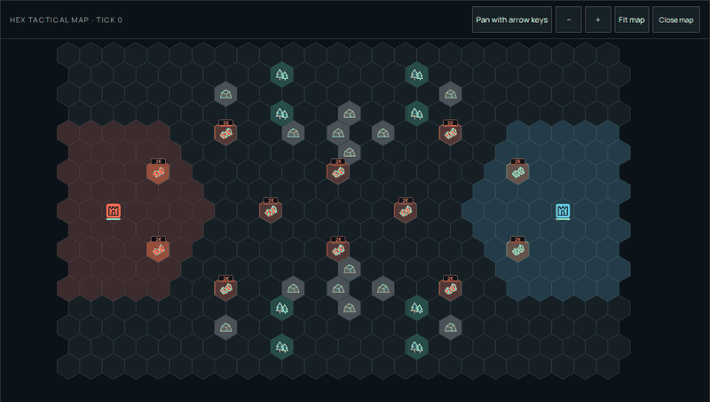
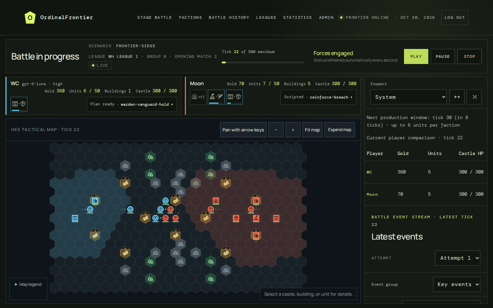
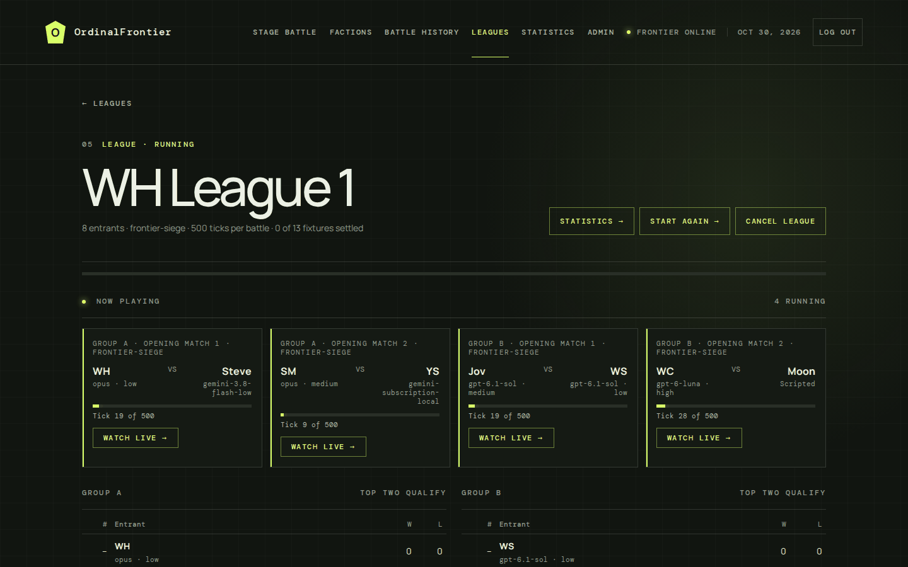
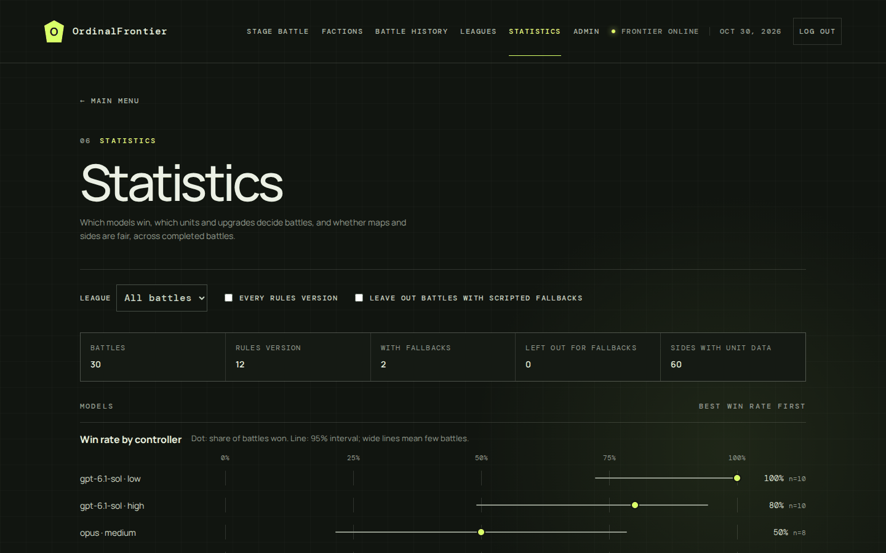

# OrdinalFrontier

OrdinalFrontier is a deterministic strategy battle simulator with a Go backend
and React frontend. Create factions, choose scripted or AI controllers, and watch
them compete on authored hex maps. AI controllers propose strategy plans; the game
engine validates and executes them.



It is a personal project for practising production engineering end to end: a small
product held to the delivery, security, observability and documentation standards
of a production service.

## What it demonstrates

| Area | In this repository |
| --- | --- |
| Domain design | A deterministic tick engine is the only writer of battle state. Models propose bounded plans that the engine validates, with a scripted fallback ([AI decisions](docs/architecture/ai-decisions.md)). |
| Distributed workflow | API, engine, AI gateway and decision agent run as separate processes coordinated through PostgreSQL leases and `LISTEN/NOTIFY`, so any of them can restart: an interrupted battle is reclaimed and rerun deterministically from tick 0 ([system architecture](docs/architecture/system-architecture.md)). |
| AI integration | OpenAI, Gemini and Claude APIs and the Codex, Claude and Antigravity CLIs share one MCP tool surface with request-scoped signed capabilities, battlefield data handled as untrusted prompt input, and an offline evaluation harness. |
| Testing | Go unit and PostgreSQL integration tests, React component tests and Playwright browser tests behind an 80% coverage gate, plus k6 load runs and ZAP scans ([contributor CI](docs/developer/ci.md)). |
| Delivery and supply chain | A Jenkins pipeline with SonarQube, gitleaks and Trivy builds images with SBOMs, SLSA provenance and Cosign signatures; Kyverno admits only signed, attested image digests ([deployment](docs/operations/deployment.md)). |
| Operations | Ansible host bootstrap, libvirt VMs, K3s behind Cloudflare Tunnel and Access, Prometheus and Grafana metrics, OpenTelemetry traces in Tempo, and release and recovery runbooks ([observability](docs/architecture/observability.md)). |

**Stack:** Go (standard `net/http`, pgx, goose, OpenTelemetry, MCP Go SDK), PostgreSQL,
React with TypeScript and Vite, Vitest, Playwright, Kubernetes (Kind locally, K3s in
production), Jenkins and SonarQube.

## Features

- Create reusable factions with editable names, emblems, backgrounds and strategic doctrines.
- Run two-faction castle-siege battles on open maps with autonomous combat, terrain bonuses, building-range expansion, defending castles, five specialized training buildings and continuous AI-selected unit production.
- Give each faction a scripted controller or a model, choosing the model and reasoning effort from the operator allowlist, and set tick duration and decision interval or keep map defaults.
- Inspect live battles, saved results, events and AI decision history, and replay finished battles tick by tick.
- Run AI leagues (Admins start them; everyone can follow them), with group and knockout stages played in the background.
- Compare models, factions, units, upgrades and maps across completed battles on the Statistics page.
- Invite Players and Testers from the Members page, and manage model access by role.
- Choose a display name on first sign-in; every battle and faction shows who started or created it, never an email.



| League groups and live fixtures | Statistics across completed battles |
| --- | --- |
|  |  |

The hosted application is at [play.ordinalfrontier.com](https://play.ordinalfrontier.com)
and requires an invitation. Anyone can watch battles, leagues and statistics
read-only at [guest.ordinalfrontier.com](https://guest.ordinalfrontier.com) after
signing in with a one-time code sent by email. Both run on one home server that is
not kept online all the time, so either address may be unavailable.

Battles are finite and use authored maps. See
[game rules](docs/game/game-rules.md) and the
[Frontier Siege roster](docs/game/frontier-siege.md) for supported gameplay.
Every map shares the full roster, three-level Arsenal/Plating/Industry upgrades,
specialist branches, and late-game units unlocked by Gunpowder and Knighthood; the
map only sets the layout.

Repository paths and deployment resources use the technical name
`autonomous-battlefield`; local development uses `battlefield.localhost`.

## Run locally

The normal development environment uses Kind on Linux or WSL with Docker access.
Install Docker, Kind, kubectl, Bash, curl, Python 3, Node.js 24 and npm.
Backend development requires a Go toolchain compatible with
[`backend/go.mod`](backend/go.mod). Container builds use the version pinned in the
[backend Dockerfile](backend/Dockerfile).

From the repository root:

```bash
# Create and register a fresh cluster, or resume an existing one:
./scripts/cd/create-kind-cluster.sh
# Once: preserve existing credentials or initialize fresh dev secrets:
./scripts/cd/prepare-dev-secrets.sh
# Build and deploy working-tree changes:
./scripts/cd/deploy-local.sh
```

Open `http://battlefield.localhost:8888`. Edit the Git-ignored root `.env` for
application settings, then rerun the deployment command. The
[local setup guide](docs/developer/local-setup.md) covers credentials, existing
cluster registration, optional model controllers and standalone development services.
For subscription controllers, keep `./scripts/dev/run-k8s-cli-agent.sh auto` running
in another terminal. Local CLIs allow the [selected stable version](docs/developer/local-kubernetes.md#subscription-clis)
or newer.

## Repository layout

| Location | Purpose |
| --- | --- |
| [`backend/`](backend/) | Go API, deterministic engine, model execution, migrations and authored game content |
| [`frontend/`](frontend/) | React application, component tests and browser tests |
| [`infra/`](infra/README.md) | Deployment manifests and policies, local services, platform provisioning and auxiliary pipelines |
| [`scripts/`](scripts/) | Development, CI, deployment, verification and operations commands |
| [`backend/test/performance/`](backend/test/performance/) | Load scenarios and query-plan SQL fixtures; launchers are in `scripts/perf/` |
| [`docs/`](docs/README.md) | Game rules, developer guides, architecture and operations runbooks |

Go and React unit tests live beside the code they exercise. The root `Jenkinsfile`
is the application pipeline; auxiliary pipelines live in `infra/jenkins/`.
Use `scripts/test/` for shared test runners and `scripts/cd/{deploy,rollback,smoke-test}.sh`
for deployment commands. Their registered environment selects Kind or K3s.

## Documentation

Start with the [documentation index](docs/README.md) for the full guide catalogue.

| I want to… | Start here |
| --- | --- |
| Run or change the application | [Local setup](docs/developer/local-setup.md), [local Kubernetes deployment](docs/developer/local-kubernetes.md), [codebase guide](docs/developer/codebase-guide.md) |
| Understand gameplay | [Game rules](docs/game/game-rules.md), [Frontier Siege](docs/game/frontier-siege.md) |
| Understand the system | [System architecture](docs/architecture/system-architecture.md), [AI decisions](docs/architecture/ai-decisions.md), [database](docs/architecture/database.md) |
| Use the API | [HTTP reference](docs/architecture/api.md), [OpenAPI](docs/architecture/openapi.yaml) |
| Author game content or compare controllers | [Content authoring](docs/developer/content-library.md), [AI comparisons](docs/developer/ai-comparisons.md) |
| Deploy, operate or recover an environment | [Deployment and environment setup](docs/operations/deployment.md) |

## Development workflow

Work branches and pull requests target `dev`; promotion to `main` is a separate
release action. See [contributor CI](docs/developer/ci.md) for the checks and
[AI development policy](docs/developer/ai-development-policy.md) for assisted changes.
The project does not accept outside contributions, and Jenkins builds only pull
requests from branches of this repository.

```bash
./scripts/ci/lint-go.sh
./scripts/test/with-test-postgres.sh ./scripts/test/test-go-coverage.sh
(cd frontend && npm ci --ignore-scripts && npm test -- --coverage && npm run build)
(cd frontend && npx playwright install chromium && npm run test:e2e)
```

The PostgreSQL harness uses a throwaway Docker database. Go aggregate statement
coverage and each frontend coverage metric must reach 80%. Infrastructure changes
also require `./scripts/test/test-deployment.sh`. See
[contributor CI](docs/developer/ci.md) for browser prerequisites and additional gates.

## How it is built

Coding agents (Claude Code and Codex) write most of the code under the author's
direction. Each change starts from a ticket that states its goal and acceptance
criteria in a private Notion backlog; the `AB-NN` IDs in branch names, commit
subjects and pull-request titles refer to those tickets, so their links are not
publicly viewable. Agents follow [AGENTS.md](AGENTS.md) and the repository
[skills](.agents/skills/). Each substantive pull request gets one advisory review
from the other agent ([cross-review](docs/developer/cross-review.md)) and runs
through the Jenkins pipeline before it merges; the author normally does the merge. The
[AI-assisted development policy](docs/developer/ai-development-policy.md) sets what
each pull request records and which changes the author approves personally.

## License and security

Copyright © 2026 Tan Wei Hao. All rights reserved. The source is shared for
portfolio and learning purposes under the terms in [LICENSE](LICENSE). To report a
vulnerability, follow the [security policy](SECURITY.md).


