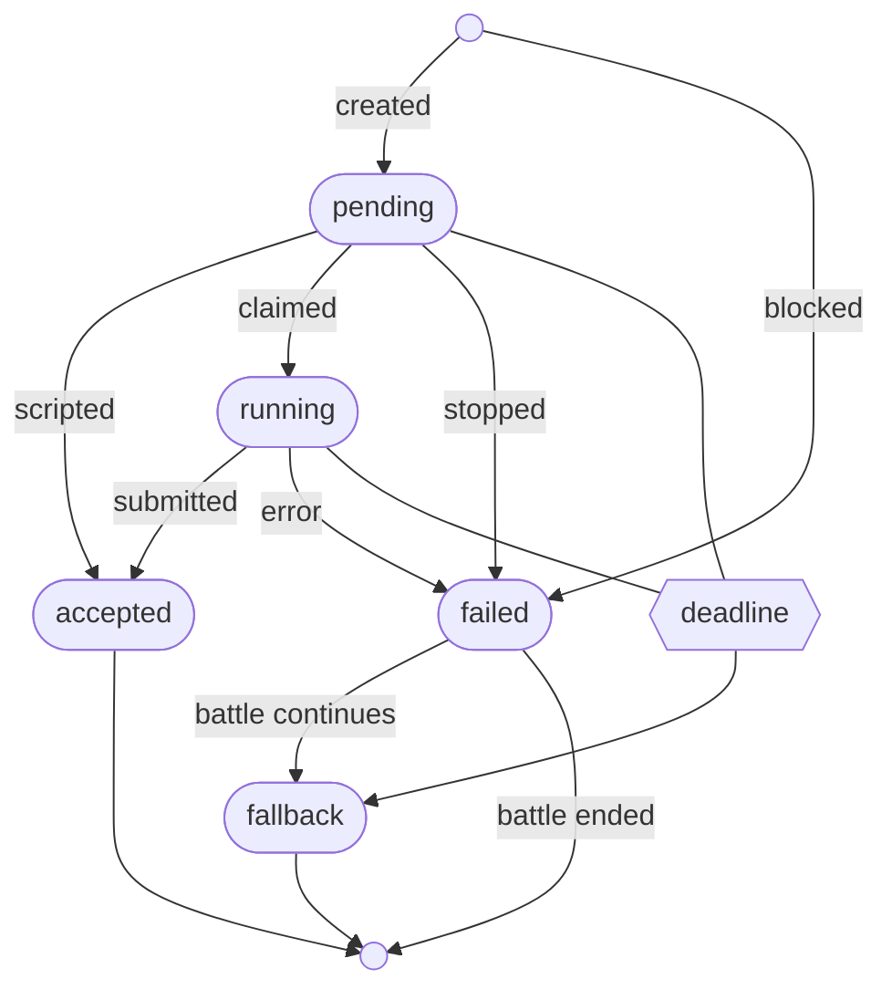

# AI decisions

This page is the contract between the deterministic engine and the model
controllers: how a decision is executed, what a model sees, what it may submit,
and how failures are attributed. The [system architecture](system-architecture.md)
owns the surrounding components, the
[decision window flow](system-architecture.md#52-strategy-decision-window) and
[timeout fallback](system-architecture.md#53-timeout-and-fallback), and the
[capability](system-architecture.md#model-facing-capability) and
[agent control-plane](system-architecture.md#agent-control-plane) trust
boundaries. The [game rules](../game/game-rules.md) define what a plan does once
applied.

## Decision lifecycle



| Transition | When |
| --- | --- |
| created → `pending` | The engine opens a decision window for a faction. |
| blocked → `failed` | The decision is created while AI is stopped or the battle's model budget is spent (`ai_disabled_or_budget`). |
| `pending` → `accepted` (scripted) | A scripted controller's plan is submitted directly by the engine. |
| `pending` → `running` (claimed) | A worker claims a model decision and receives its request capability. An expired lease is reclaimed and stays `running`. |
| `running` → `accepted` (submitted) | The model submits a valid plan with that capability. A model cannot submit from `pending`, because the capability is issued only by the claim. |
| `pending` → `failed` (stopped) | The budget runs out at claim time (`decision_budget`), or the battle is stopped or expires (`battle_stopped`). |
| `running` → `failed` (error) | The runner fails, or the battle is stopped or expires. |
| deadline → `fallback` | The window closes without an accepted plan; the engine records its fallback plan. |
| `failed` → `fallback` | While the battle continues, the engine resolves a failed decision with its fallback plan. A failed decision whose battle has ended stays `failed`. |

An accepted submission is idempotent when it repeats the stored idempotency key.
Optimistic version checks prevent late or duplicate workers from overwriting
another resolution.

## Model execution

`internal/ai/agent` (`agent.Executor`) owns decision claims, concurrency, timeouts
and outcome reporting. A worker runs `ai.agentConcurrency` jobs at once (1–4, 1
when omitted). CLI jobs also need one of the `runtime_policy.cli_concurrency`
leases (1–4, default 4), which PostgreSQL shares across every worker, battle
decision and generation job; API jobs take no CLI lease. A lease is held until the
worker reports completion or its execution deadline passes, even after the plan is
accepted. Claims carry the database lease deadline, so network delay never extends
a worker's time; keep the database, AI gateway and VM clocks synchronized.
[CLI worker operations](../operations/cli-worker.md) give the production worker's
current setting.

The executor runs either an `APIRunner` or a `CLIRunner` from `internal/ai/runner`;
both implement the same provider-neutral runner contract.

### API runtime

`APIRunner` (`internal/ai/runner/api.go`) runs one tool loop for every API
provider:

1. connect to MCP with the request-scoped capability;
2. offer only the battle tools `get_decision_context`, `get_unit_details` and
   `submit_strategy_plan`;
3. ask the provider for a tool-calling turn, rejecting unknown tools and turns
   without a tool call;
4. append the turn and each tool result to the conversation;
5. stop after an accepted submission or the profile's step limit.

Provider adapters send the decision policy as the provider's system instruction,
separate from the untrusted battlefield data, and normalize tool calls, refusals and
usage into common types.

### CLI runtime

The CLI runner starts Codex or Antigravity in a fresh temporary directory with:

- an empty workspace and a request-scoped MCP bearer token;
- only the session's battlefield tools enabled (three for battle decisions, two for
  background generation), and file, command and URL actions denied;
- shell, browser, app, image, plugin, skill and multi-agent features disabled where
  supported, and no approval prompts;
- the allowlisted profile model passed explicitly, and a CLI version matching
  the worker profile;
- a subprocess environment without worker control credentials, provider keys or
  personal CLI overrides, and output capture bounded at 4 MiB.

Local CLIs allow the selected stable version or newer; the launcher passes the
accepted version to the worker profile.

On Linux the worker disables dumpability, so a same-user CLI child cannot read the
parent's environment or memory, and cancellation kills the CLI's process group.
Development uses the host's existing CLI logins; production uses only the dedicated
login in the CLI VM, and subscription credentials never enter Kubernetes. A
headless account probe must succeed before a profile is advertised. Antigravity's
strict tool-permission mode is not used, because it blocked explicitly allowed MCP
calls; explicit allow and deny rules enforce the restrictions instead.

A CLI run succeeds only when its JSON result reports success with no denied actions
**and** the AI gateway holds an accepted plan for the request; otherwise the worker
fails the decision and the engine falls back. CLI prompts must copy the target tick
and version from the context and make a substantive decision; name-only plans are
rejected.

Antigravity writes large MCP responses to local files, which the session cannot
read, so the host fetches the context through MCP and embeds it in the prompt (up
to 64 KiB; larger contexts fall back). The model still submits through MCP.

The Claude profile (`claude-subscription-local`) runs in Claude Code's restricted
mode with no built-in tools, hooks or settings discovery, a strict MCP configuration
and `dontAsk` permissions; its capability lives in a private temporary file. Its
version pin, model alias and personal-memory caveat are in
[Claude operations](../operations/claude-cli.md).

## Prompt provenance and faction memory

Every runtime uses one embedded decision policy, assembled by
`internal/ai/prompts/prompts.go`; only context delivery differs (tool fetch or
host-prefetched inline JSON). The persisted `prompts.Version`
(`battlefield-agent-v9.<digest>`) includes a SHA-256 of the prompts as assembled for
a fixed sample session, so any wording, order or wiring change produces a new
version. Git keeps earlier prompt revisions.

The decision prompt runs from most to least stable: shared policy, the faction
identity block, then the request ID and any inline context, so a faction's repeated
prefix stays eligible for provider prompt caching.

Only the owning faction's name, doctrine and optional background enter its decision
context, observation hash and provenance; opponent doctrines never do. They arrive
JSON-escaped as untrusted data and never extend the system instructions. The model
acts as the faction's commanding voice: core rules, legal choices, tool restrictions
and observation privacy take precedence over doctrine, and doctrine over background.
Scripted controllers and the opening fallback ignore doctrine.

Before hashing an observation, the engine adds up to three earlier resolved
decisions for the same battle, attempt and faction (`BuildFactionMemory`, at most
8 KiB): their economy and unit counts, plans, ticks and accepted or fallback status.
Memory is part of the frozen, hashed observation; there is no mutable scratchpad,
and attempts never read memory from earlier attempts. A plan is reused only when the
observation hash, prompt and tool versions, and profile, provider, runtime and model
all match. [AI controller comparisons](../developer/ai-comparisons.md) measure these
contracts.

## Decision context

A decision context contains:

- battle, faction, request, target-tick and version identifiers;
- a fog-of-war faction view: terrain, the faction's own entities, visible enemies,
  enemy castles, and only the faction's own gold, upgrades and production totals;
- current and projected economy values;
- legal action kinds, unit and building definitions, construction sites and owned
  recruitment sources;
- the currently active plan;
- optional bounded faction memory and retrieved unit knowledge;
- a hash of the observation, excluding request-specific fields.

The opening decision at tick zero is prepared for both factions from castles and
starting gold before either plan is applied. All new decisions use
`battlefield.decision-context.v4`.

### Versioned unit knowledge

Unit knowledge cards are part of the ruleset content
([content libraries](../developer/content-library.md)) and of the scenario content
hash. At each decision window the engine selects cards using only what the faction
can see, then freezes them into the observation before hashing, so API and CLI
delivery read identical knowledge and retries reuse it. Selection never uses
hidden enemy state, needs no external service and does not affect combat or
validation. `engine.knowledgeRetrieval.maxUnitCards` and `maxBytes` bound it
(defaults 16 and 16384), and the persisted context records what was included and
whether it was truncated.

### Unit reference and lookup

The observation also freezes every legal or visible unit definition and its card in
`unitReference`. The model's context lists each legal unit's cost, class, role,
strengths and weaknesses; `get_unit_details` returns full base stats and guidance
for a few units at a time, scoped by the request capability to that frozen set.
Hidden and unknown unit IDs both return `available: false`. The tool's description
gives its batch and size limits. Reference content is untrusted data.

### Compact battlefield view

The agent view groups entities by faction and replaces repeated values (identical
stat profiles, visible-cell ranges, an unchanged historical plan) with references,
using each encoding only when it shrinks the output. The prompt explains the
encodings. The projection never changes persisted state, validation or hashes, and
older saved observations are projected the same way without rewriting storage.

## Submitted plans

A model or scripted controller can propose:

- a short name and operator-visible rationale;
- fixed-point attack and defend weights, and target-specific bonuses;
- reserve gold and spend ordering;
- ordered upgrade purchases, including level prerequisites when supplied by the ruleset;
- typed construction orders;
- explicit ordered unit purchases with quantities.

The service validates the decision version, target tick, general plan bounds, and
context-specific units and sites before persisting a plan. The `StrategyPlan`
schema in the [OpenAPI contract](openapi.yaml) gives the field shapes and limits.
API and CLI submissions must be substantive, and a request stops after three
rejected submissions.

`recruitmentOrders` lists `{unitType, count, sourceBuildingId?}` purchases for one
production window, at most six units in total (the six castle-adjacent spawn
positions). The engine buys in order, keeps reserve gold, and stops at the first
unaffordable unit or blocked castle spawn; an unavailable source or a blocked
Barracks skips that order and moves on. There is no substitution or queue, and a
reused plan buys again at the next window. An empty list buys nothing. Likewise, an empty
`constructionOrders` list builds nothing, while omitting it keeps the default
construction. Older plans may use `recruitmentPriorities` instead; a plan cannot
use both.

## Submission failures and fallback attribution

When a runner fails before the deadline, the engine keeps its error category in the
fallback record instead of replacing it with `timeout`. Malformed tool calls are
logged as `decision_tool_input_rejected` with only the request ID and missing field
names; see [Antigravity troubleshooting](../operations/antigravity-cli.md#missing-plans).

| Error category | Raised by | Meaning |
| --- | --- | --- |
| `timeout`, `refusal`, `rate_limit`, `provider` | API runner | Provider deadline, safety refusal, HTTP 429, or other provider failure |
| `mcp_connect`, `mcp_discovery`, `mcp_tool`, `mcp_context` | API/CLI runner | MCP session, tool-list, tool-call, or CLI context-prefetch failure |
| `unauthorized_tool`, `no_progress`, `step_limit` | API runner | Model requested a tool outside the session set, returned no tool call, or exceeded the profile's step limit |
| `cli`, `cli_permission`, `cli_isolation`, `cli_provider` | CLI runner | Non-success CLI result, denied tool action, sandbox setup failure, or unsupported CLI provider |
| `validation_limit` | Decision service | Third rejected API/CLI submission for the same request |
| `plan_not_submitted` | Agent worker | Runner reported success but MCP holds no accepted plan |
| `profile_unavailable`, `capability`, `provider_unavailable` | Agent worker | Claimed profile is not executable locally, the claim carried no capability, or no runner could be built for the profile |
| `runner` | Agent worker | Runner failed without a more specific category |
| `decision_budget` | PostgreSQL admission trigger | The battle's model execution budget is exhausted at claim time |
| `ai_disabled_or_budget` | PostgreSQL insert trigger | AI execution was stopped, or the battle's budget was already spent, when the decision was created; the engine falls back at once |
| `battle_stopped` | Battle stop route / expiry sweep | Battle stopped or expired while the decision was open |

Background-generation jobs share the worker and runner categories above except
`validation_limit`, `plan_not_submitted`, `runner`, `decision_budget` and
`battle_stopped`, and add their own:

| Error category | Meaning |
| --- | --- |
| `execution_error` | Runner failed or did not submit, without a more specific category |
| `invalid_output` | Third empty or over-length background submission |
| `timeout` | Execution deadline passed while the job was running |
| `queue_timeout` | Job expired before any worker claimed it (status `expired`) |

## Saved decision context

Historical decision context is scoped by battle, attempt and request. The service
returns only the saved observation's public fields; provider metadata, capability
tokens, private reasoning and tool-call traces are excluded. The displayed context
is a reconstruction, not the original provider payload, and the unit reference
shows what the model could look up, not what it fetched. Rows without a saved
observation return `context: null`. Plans describe intent and events show what
happened; a `running` decision does not prove MCP connectivity.

## Background generation

`internal/generation` admits background-draft jobs durably. PostgreSQL serializes
each actor's admissions and allows one active job per actor; the
[database guide](database.md#admission-triggers) owns the allowance accounting, and
the [HTTP API reference](api.md#faction-background-generation) the client-facing
limits.

Workers reuse the decision infrastructure: they advertise the
`faction_background` job type, battle claims take priority, and a generation job
starts only in a free execution slot. Generation capabilities are a separate kind
that authorizes only `get_background_context` and `submit_faction_background` on
`/generation-mcp`; neither tool sees battle data, and each MCP endpoint rejects the
other kind. The AI gateway's database role can read and update generation jobs but
not factions or battle state.

The writer is configured in `ai.backgroundGeneration` in `backend/config.yaml` or
the deployment ConfigMap; the deployed defaults are:

```yaml
ai:
  backgroundGeneration:
    enabled: true
    profileId: codex-subscription-local
    dailyAllowance: 10
    cooldown: 30s
    queueTimeout: 5m
    executionTimeout: 2m
```

The profile, independent of battle models, uses its existing model, credentials,
version check and availability, so the default writer needs its CLI profile enabled
and a connected worker. An unavailable profile rejects admission before quota is
reserved, and a job whose worker goes offline stays queued until it expires. API
execution allows at most three provider turns; CLI execution is told to use three
and capped at three invalid submissions, within the same deadline. Only a valid,
server-accepted tool submission succeeds, and there is no automatic model
fallback. With generation disabled, players can still write backgrounds by hand.
Provenance uses a `faction-background-v2` digest of the rendered instructions.

### Upgrade-level planning

The frozen legal upgrade catalog includes optional `track`, `level` and
`requiresUpgradeId`. All catalog levels are discoverable, including levels whose
prerequisites are not yet owned. A prerequisite must be owned or ordered earlier
in the same plan. An upgrades-only plan is a substantive decision. Both AI
submission validation and the engine enforce purchase ordering. Duplicate IDs
in one plan are invalid; IDs already owned may be requested again without cost.
Multiple levels can execute in one window, subject to reserve gold and ordered
affordability. Ruleset knowledge supplies prices and effects; the shared prompt
explains ordering without hardcoding a particular content version.

Specialist choices expose `targetUnit`/`targetClass` and `exclusiveGroup` alongside
incremental effects. Ownership locks out the paired alternative for the battle.
All maps expose the same legal content. Unit reference data includes Scout retreat,
cavalry preference, armor penetration and repair capabilities; remaining repair
charges stay on the individual unit observation. Repair events and shared support
markers remain subject to normal faction visibility.

## Model selection and latency

Battle creation accepts `modelIdentifier` and `reasoningEffort` per model-controlled
faction. A profile's `modelOptions` allowlists models and their supported
`reasoningEfforts`; omitted choices retain the profile model and model-default
effort (or the option's explicit `defaultReasoningEffort`). The backend validates
both fields, freezes them in the scenario and decision row, and includes effort in
retry-reuse matching. Workers validate against their own allowlist before execution;
a removed option fails as `model_selection_unavailable`, rather than substituting
another model. Existing API profiles and Antigravity expose no effort controls.
API profile model labels remain informational: API runners use their current
configured environment model, preserving behavior across secret rotation.
Codex receives `model_reasoning_effort`; Claude receives `--effort`. The CLI model
identifier is the requested identifier; aliases such as `sonnet` can resolve to a
new provider version and are not an immutable model-version guarantee.

The claim request carries `selectionVersion: 1`. An older worker receives HTTP 409
before leasing a job, preventing it from silently ignoring frozen choices. See
[worker rollout ordering](../operations/cli-worker.md#model-selection-rollout).

Context timestamp recording is best-effort: a failed timing write is logged and
the frozen context remains available; its missing timing stays unknown.

The decision inspector shows request-to-resolution elapsed time, queue wait,
claim-to-first-context and claim-to-resolution timings. Acceptance ends the main
wait measurement immediately; `runnerCompletedAt` records the gateway receipt of
the later worker report. Process-launch milliseconds measure only OS process
creation, not provider readiness. Claim-to-context includes CLI initialization,
provider activity and MCP work, and is not pure inference or reasoning time.
Missing historical measurements stay unknown. A lease reclaim resets claim/context
and completion timestamps; total wait still starts at the original request.

## CLI context-prefetch experiment

Codex and Claude battle profiles accept the worker-only `prefetchContext: true`
setting (default false). The worker calls `get_decision_context` with the same
request capability before launching the CLI, verifies the request identity,
version/tick and 64 KiB limit, and embeds the frozen JSON as untrusted data. The
model is instructed to use that snapshot without fetching it again; submission
and optional unit-detail tools retain the same capabilities and validation.
Prefetch failure stops execution as `mcp_context`; it never launches with missing
or mismatched context. Background-generation behavior is unchanged. Antigravity
continues to require prefetch regardless of this option.

Each CLI result stores `contextDelivery` (`tool` or `prefetch`) in provider metadata,
exposed through decision history and the timing panel; the generation span has
`battlefield.context_delivery`. Historical records omit this field. With prefetch,
`contextServedAt` precedes CLI launch: compare request/claim-to-resolution and
success/fallback rates across modes, not just claim-to-context time. Model,
effort, scenario, concurrency and prompt revision must be recorded for comparisons.
The option does not promise a latency reduction; provider variance and prompt
cache state affect results. See the [test procedure](../operations/cli-worker.md#context-prefetch-comparison).
