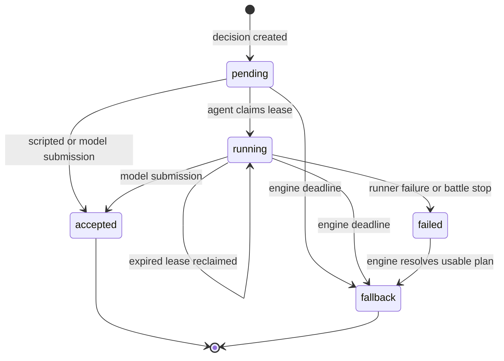

# AI decisions

This page is the contract between the deterministic engine and the model
controllers: how a decision is executed, what a model sees, what it may submit,
and how failures are attributed. The [system architecture](system-architecture.md)
owns the surrounding components, the
[decision window flow](system-architecture.md#52-strategy-decision-window) and
[timeout fallback](system-architecture.md#53-timeout-and-fallback), and the
[capability](system-architecture.md#model-facing-capability) and
[agent control-plane](system-architecture.md#agent-control-plane) trust
boundaries. The [game rules](../game/game-rules.md) define what a plan does once
applied.

## Decision lifecycle

An accepted submission is idempotent when it repeats the stored idempotency key.
Optimistic version checks prevent late or duplicate workers from overwriting
another resolution.

## Model execution

`internal/ai/agent` (`agent.Executor`) owns decision claims, concurrency, timeouts,
and outcome reporting. Agents use `ai.agentConcurrency` execution slots (1–4; 1
when omitted). The K3s API worker and the CLI VM template both set 4. API jobs are
bounded only by their slots and the per-battle decision budget. PostgreSQL
serializes admission on the policy row and caps active CLI leases at
`runtime_policy.cli_concurrency` (1–4, default 4), shared across all workers,
battle decisions and generation jobs. API jobs do not consume CLI leases. A
completed submission retains the CLI lease until the worker reports completion or
its execution deadline expires. Claim responses carry the database lease deadline,
so network delays cannot extend a worker's allotted execution time. Keep the
database, AI gateway and VM clocks synchronized. The executor selects an
`APIRunner` or `CLIRunner` from `internal/ai/runner`; both implement the same
provider-neutral decision-runner contract.

### API runtime

`APIRunner` in `internal/ai/runner/api.go` runs the shared API tool loop:

1. connects to MCP with a request-scoped capability;
2. accepts the battle tool set `get_decision_context`, `get_unit_details`, and `submit_strategy_plan`;
3. asks the configured provider for a tool-calling turn;
4. rejects unsupported tools or a turn with no tool call;
5. records the turn's text and tool calls as one assistant message with call IDs, and each result as a tool message answering its call;
6. stops after an accepted submission or the configured step limit.

Provider adapters send this history in each API's native form: OpenAI receives the
system prompt as `instructions` and the conversation as Responses input items
(`function_call` and `function_call_output` matched by `call_id`); Gemini receives
`systemInstruction`, model turns with `functionCall` parts (echoing each call's thought
signature) and results as `functionResponse` parts. The policy therefore arrives with
system authority, separate from untrusted battlefield data. Both adapters normalize
provider tool calls, refusals, and usage into common types.

### CLI runtime

The CLI runner starts Codex or Antigravity CLI in a new temporary directory with the
settings below; the [Claude profile](#claude-profile) uses its own provider restrictions.

- an empty workspace;
- a request-scoped MCP bearer token;
- only the session's battlefield tools enabled (three for battle decisions, two for background generation);
- shell, file, browser, app, image, plugin, skill, and multi-agent capabilities disabled where supported;
- no approval prompts;
- the allowlisted profile model passed explicitly with `--model`;
- a pre-validated CLI version family.

In development Codex uses the existing host login without copying it; production
uses only a dedicated VM login. Antigravity uses the host OS keyring or a private
temporary copy of its native `antigravity-oauth-token` login file, with a temporary
HOME and XDG directories. Both CLI subprocess environments exclude worker control
credentials, provider keys and personal CLI overrides. Linux workers disable
dumpability to block parent environment/memory reads from same-user children; CLI
process groups are killed on cancellation and output capture is bounded at 4 MiB.

Generated permissions allow the session's battlefield MCP tools and deny file,
command, and URL operations; slash-command expansion is disabled. A headless
account-usage probe must succeed before advertising the profile. JSON result
envelopes must report SUCCESS with no denied actions. Explicit permission rules are
used without strict mode, which overrides MCP allows in CLI 1.1.27. The MCP usage
endpoint verifies that a plan is accepted before acknowledging completion; missing
submissions trigger a worker failure and fallback. Usage counters are recorded for
accepted plans, and usage reporting retries transient failures up to three times.
Subscription credentials are not placed in Kubernetes.

CLI context responses include explicit target-tick and version metadata alongside
the full structured context. CLI prompts require copying those values and making a
substantive tactical or production decision. Name-only CLI plans are rejected.
AI gateway logs record context byte counts and validation field/code pairs without
dumping observations or credentials.

Antigravity CLI offloads larger MCP tool responses to local files. Because
battlefield CLI sessions deny file reads, the host fetches the request-scoped
context through the MCP SDK and embeds the validated JSON directly in the
Antigravity prompt (maximum 64 KiB). The model submits through MCP without
fetching the large response again. This keeps the file restrictions and avoids
blind tick guessing when the CLI hides an offloaded response. Larger contexts fall
back for that profile.

### Claude profile

The `claude-cli` provider exposes `claude-subscription-local` using Claude Code
2.1.267 and the `sonnet` alias. The host retains its native subscription login;
only allowlisted transport environment variables reach the subprocess. Restricted
mode, empty built-in tools, disabled hooks and settings discovery, strict MCP
configuration, and `dontAsk` permissions constrain it to explicitly approved
battlefield tools. A private temporary MCP file holds the request capability and
is removed on exit. Session persistence is disabled. Server-side capabilities and
submission validation remain authoritative for battle and faction-generation jobs.

The API advertises the profile only while `CLAUDE_CLI_PROFILE_AVAILABLE=true`;
production additionally requires the VM isolation verification flag, and the VM
profile defaults to disabled. Claude stdout is parsed as a complete JSON document
with stderr excluded. Native HOME is retained: user-level instruction memory is not
explicitly disabled, so reproducible comparisons need a dedicated account without
personal memory. Claude terminal results report aggregate CLI usage, including
cache reads/writes in total input tokens; errors and permission denials fail the
decision. The `sonnet` alias follows the subscription's default Sonnet model, so
operators need an explicit model ID for reproducible comparisons. See
[Claude operations](../operations/claude-cli.md).

## Prompt provenance and faction memory

API, Codex, Antigravity, and Claude CLI use one embedded decision policy assembled
by `internal/ai/prompts/prompts.go`. Only context delivery differs: tool fetch
versus Antigravity host-prefetched JSON. The persisted `prompts.Version` includes a
SHA-256 digest of the battle prompts as assembled for a fixed sample session
(system prompt, tool delivery and inline delivery), so wording, order and wiring
changes all produce a new version. Each prompt purpose has one current `.txt`
file; Git preserves previous revisions.

Recent versions changed how faction identity reaches the model:

- **v7** moved faction-authored name, background and doctrine into JSON-escaped
  untrusted decision context; they never extend the system instructions.
- **v8** orders the decision prompt from most to least stable (shared policy, the
  faction identity block, then the per-request ID and any inline context), so the
  prefix repeated across one faction's decisions stays eligible for provider
  prompt caching.
- **v9** restores the identity block's guidance: doctrine is the faction's
  strategic preferences and background its perspective, below core rules, legal
  choices, tool restrictions and observation privacy.

The build manifest reads the runtime prompt version, bundle digest, tool schema and
embedded game-content digest (`gameDataBundleSha256`: every file under
`backend/gamedata`, including the knowledge cards models receive) through
`go run ./cmd/aieval -mode metadata`, requiring Go during manifest generation.

Before hashing a decision observation, the engine reads at most three earlier
resolved records scoped in SQL to the same battle, attempt, and faction.
`BuildFactionMemory` produces historical economy/unit counts and resolved plans,
with observation ticks and accepted/fallback status, bounded to 8 KiB. These
snapshots describe state before the historical decisions, not attributed effects.
Memory is embedded in the frozen observation JSON and included in its hash; there
is no separate mutable scratchpad. Read failures are logged and the engine
proceeds without optional history. Reuse requires matching prompt/tool versions and
profile/provider/runtime/model identifiers as well as observation hashes. Attempts
never read memory from previous attempts.

[AI controller comparisons](../developer/ai-comparisons.md) measure these
contracts with matched, repeated decisions through the production tool server and
validator.

## Faction identity

A faction is a name, an explicit strategic doctrine, and an optional background,
independent of model profiles and scenario catalogs. Battle creation copies all
three into the immutable scenario snapshot; old snapshots without a background
decode it as empty. Backend validation, MCP descriptions and the writer prompt
share the faction limit constants.

Only the owning faction's identity enters each decision context, observation hash,
durable decision provenance, and untrusted API/CLI context; opponent doctrines are
absent. The shared `battlefield-agent` identity context JSON-escapes the profile
fields and asks the agent to act as the faction's commanding voice. Core rules take
precedence over doctrine, and background supplies perspective beneath doctrine.
Scripted controllers and the opening fallback ignore doctrine and do not map
history or keywords to tactical weights.

## Decision context

A decision context contains:

- battle, faction, request, target-tick, and version identifiers;
- a fog-of-war faction view: terrain, the faction's own entities, visible enemies, enemy castles, and only the faction's own gold, upgrades and production totals;
- current and projected economy values;
- legal action kinds, unit/building definitions, construction sites, and owned recruitment sources;
- the currently active plan;
- optional bounded faction memory and retrieved unit knowledge;
- a hash of the observation excluding request-specific fields.

The opening decision at tick zero is prepared for both factions from castles and
starting gold before either plan is applied.

### Versioned unit knowledge

Optional ruleset knowledge is frozen in the resolved scenario JSON alongside unit
statistics, and participates in the scenario content hash. Card authoring rules are
in [content libraries](../developer/content-library.md). At each decision window
the engine retrieves unit cards using only the faction-visible context, once,
before observation hashing and persistence. API MCP reads and host CLI inline
delivery consume that identical persisted knowledge. Retrieval has no external
service dependency and does not change engine combat or plan validation.

Selection orders candidates by visible enemy types, own deployed types, explicit
recruitment-order types, legacy recruitment priorities, then other legal units by
increasing cost, with unit ID breaking ties. It never uses hidden enemy state.
`engine.knowledgeRetrieval` sets positive `maxUnitCards` and `maxBytes` limits
(defaults 16 and 16384); the byte budget covers mechanics, cards and metadata. If
even the metadata cannot fit, knowledge is omitted; if mechanics cannot fit, they
are omitted and truncation is recorded. Otherwise retrieval keeps priority order
and stops before a whole card would exceed either limit. Persisted contexts record
source IDs, the ruleset-content digest, effective limits, serialized size and
truncation. Configuration changes affect decisions prepared after an engine
restart; retries reuse persisted decisions. Old scenarios without knowledge remain
valid.

### Unit reference and lookup

All new decisions use `battlefield.decision-context.v4`. Before hashing, the engine
freezes all legal or visible unit definitions and available cards in the persisted
observation's `unitReference` JSON field. This reference is independent of the
legacy automatic card budget. Full observations continue to drive validation.

The explicit `agentview.Context` projection emits unit ID, cost, class, role,
strengths, and weaknesses in `legal.units`, plus `referenceUnits` for visible types
that are not recruitable. It keeps knowledge mechanics and source identity but
omits cards, base statistics, and the stored reference snapshot. Battlefield
observations, including effective unit stats, remain intact. API delivery and CLI
prefetch use the same projection, and older saved observations are projected into
the current format without rewriting storage.

MCP tools v7 delivers `get_decision_context` as one JSON text block with the
`context` envelope, without a duplicate structured-content copy; API runners parse
the same text. Agents are instructed to reuse a successful frozen snapshot;
retries remain available after failed or unreadable responses, within the usual
step, timeout, and submission limits.

`get_unit_details(requestId, unitIds)` looks up frozen reference data. The request
capability and frozen legal/visible set scope every lookup. A batch contains 1–4
distinct nonempty IDs and returns base stats, guidance when present, and source
identity/digest. Hidden and unknown IDs both return `available: false`. Responses
above 1800 serialized JSON bytes return a recoverable tool error asking for fewer
IDs. For a single long card, `nextGuidanceOffset` marks continuation; pass it as
`guidanceOffset` with the same unit ID to read the remainder. Offsets count UTF-8
bytes of the frozen guidance, and every page contains complete base stats.
Text-only JSON delivery avoids duplicate CLI resource rendering, and overview text
is not repeated in lookup results. All reference content remains untrusted data.

### Compact battlefield view

The agent view groups units, buildings and statistics in `view.state.factions`:
each group has `factionId`, optional `stats`, `units` and `buildings`. Entities
inherit ownership from their group. Missing faction statistics are not invented
when only entities are observed. Full entity IDs, targets and recruitment source
references remain unchanged. Persisted state and the game's regular view types
keep flat entity arrays.

Each of the following encodings is used only when it reduces serialized size:

- `view.unitProfiles` stores identical effective-stat sets once, shared across
  faction groups; units reference a profile and keep their health, position, readiness, movement and combat
  observations. Profiles use observed modified stats, not catalog base stats.
- `view.buildingProfiles` shares identical effective building properties; health,
  location, readiness and combat observations stay individual.
- `view.visibleRowRanges` encodes visible cells as inclusive x ranges per y row,
  preserving visible empty cells and gaps. Inline units and `visiblePositions`
  remain valid.
- `planRef: "#/activePlan"` replaces a historical plan identical to the active one.
- Repeated battle ID/tick and own-faction gold/upgrades inherit their top-level
  values when equal; differing historical or enemy facts stay explicit.

The prompt documents these rules. API and Antigravity CLI delivery omit exact
copies of faction identity already present in the untrusted identity context,
keeping mismatches and all original wording. Direct MCP/Codex delivery and the
inspector remain self-contained. No projection changes persistence or validation
hashes, and evaluation and tool responses use the same projection.

## Submitted plans

A model or scripted controller can propose:

- a short name and operator-visible rationale;
- fixed-point attack and defend weights;
- target-specific bonuses;
- reserve gold and spend ordering;
- ordered upgrade purchases;
- typed construction orders (or legacy economy-site priorities);
- explicit ordered unit purchases with quantities (legacy plans may use recruitment priorities).

The service validates decision version, target tick, general plan bounds, and
context-specific units and sites before persistence. The `StrategyPlan` schema in
the [OpenAPI contract](openapi.yaml) gives the field shapes and limits. Both API
and CLI submissions require a substantive plan and stop after three validation
rejections.

### Explicit recruitment orders

The shared model prompt requests ordered `{unitType, count, sourceBuildingId?}`
purchases through `recruitmentOrders`. These are purchases for one production
window, not army ratios. MCP and engine validation enforce legal unit IDs, positive
counts and at most six units per window across all sources, matching the six
castle-adjacent spawn positions. The engine buys in order, keeps reserve gold and
stops at the first unaffordable unit or blocked castle spawn; unavailable explicit
sources and blocked Barracks orders are skipped. There is no substitution, extra
purchasing or queue, and a reused plan applies its quantities again at the next
window.

An explicit empty `recruitmentOrders: []` buys nothing. An absent or null field
keeps the legacy behavior of repeatedly buying the first affordable unit from
`recruitmentPriorities`; nonempty priorities and explicit orders together are
rejected. Omitting `recruitment` from a nonempty `spendOrder` also skips buying.
Orders are deep-copied and persisted with plans, faction memory and decision
hashes. The decision panel shows requested quantities; `unit_recruited` events
record actual purchases.

### Construction orders and sources

Typed `constructionOrders` and optional recruitment `sourceBuildingId` flow through
controller cloning and validation, frozen worker observations, MCP submissions,
and persisted decisions. Missing construction orders keep the legacy default
construction; an explicit empty array disables construction. All of this data
lives in the existing scenario and state JSON.

## Submission failures and fallback attribution

The shared decision instructions require a flat MCP argument object with all
required fields, including empty objects/arrays where appropriate. Antigravity
can otherwise stop after SDK schema errors without reaching the typed plan
handler. MCP receiving middleware records `decision_tool_input_rejected` with
only the authenticated request ID, allowlisted missing field names, and a
nested-plan flag; argument values and raw SDK errors are excluded.

When a runner fails before the deadline, the engine carries its error category
into the fallback record instead of replacing it with `timeout`.

| Error category | Raised by | Meaning |
| --- | --- | --- |
| `timeout`, `refusal`, `rate_limit`, `provider` | API runner | Provider deadline, safety refusal, HTTP 429, or other provider failure |
| `mcp_connect`, `mcp_discovery`, `mcp_tool`, `mcp_context` | API/CLI runner | MCP session, tool-list, tool-call, or Antigravity context-prefetch failure |
| `unauthorized_tool`, `no_progress`, `step_limit` | API runner | Model requested a tool outside the session set, returned no tool call, or exceeded the profile's step limit |
| `cli`, `cli_permission`, `cli_isolation`, `cli_provider` | CLI runner | Non-success CLI result, denied tool action, sandbox setup failure, or unsupported CLI provider |
| `validation_limit` | Decision service | Third rejected API/CLI submission for the same request |
| `plan_not_submitted` | Agent worker | Runner reported success but MCP holds no accepted plan |
| `profile_unavailable`, `capability`, `provider_unavailable` | Agent worker | Claimed profile is not executable locally, the claim carried no capability, or no runner could be built for the profile |
| `runner` | Agent worker | Runner failed without a more specific category |
| `decision_budget` | PostgreSQL admission trigger | The battle's model execution budget is exhausted at claim time |
| `ai_disabled_or_budget` | PostgreSQL insert trigger | AI execution was stopped, or the battle's budget was already spent, when the decision was created; the engine falls back at once |
| `battle_stopped` | Battle stop route / expiry sweep | Battle stopped or expired while the decision was open |

Background-generation jobs share the worker and runner categories above except
`validation_limit`, `plan_not_submitted`, `runner`, `decision_budget` and
`battle_stopped`, and add their own:

| Error category | Meaning |
| --- | --- |
| `execution_error` | Runner failed or did not submit, without a more specific category |
| `invalid_output` | Third empty or over-length background submission |
| `timeout` | Execution deadline passed while the job was running |
| `queue_timeout` | Job expired before any worker claimed it (status `expired`) |

Unresolved requests that reach the deadline retain the timeout category. CLI
terminal success remains subject to the worker's accepted-plan check.

## Saved decision context

Historical decision context is scoped by battle, attempt, and request. The service
projects only the saved observation's public fields; provider metadata, capability
tokens, private reasoning, and tool-call traces are excluded. The displayed initial
context is a reconstructed projection, not the original provider payload, and the
stored unit reference shows what the model could look up, not what it fetched.
Legacy rows without saved observations return `context: null`. Plans describe
intent; events provide execution evidence. A running decision does not prove MCP
connectivity.

## Background generation

The API's `internal/generation` package owns durable background draft admission.
PostgreSQL serializes each actor's admissions by locking
`faction_generation_accounts`; a partial unique index also prevents multiple
active jobs. `faction_background_generations` stores input, idempotency hash,
profile, quota admission day via `created_at`, expiry, result, prompt version,
usage, timing, and model metadata. Reads, admissions and claims expire stale rows.
Queued and running expiry both consume the original admission day's allowance. No
in-memory counter or browser state is authoritative for allowance. The
[HTTP API reference](api.md#faction-background-generation) gives the client-facing
limits.

Generation workers reuse the agent execution infrastructure with an advertised
`faction_background` job type and executable profile IDs. Legacy claims without
job types remain battle-only. Battle claims take priority; generation starts only
when a worker owns a free execution slot. Workers check ready background jobs
before entering an empty battle long poll; jobs admitted during that poll are
checked on the next claim. The AI gateway write timeout leaves room beyond the
maximum 20-second poll so a durable claim can be delivered. Claims use
`FOR UPDATE SKIP LOCKED` and never reclaim running generation jobs.

Generation capabilities are namespaced separately and authorize only the draft's
two tools on `/generation-mcp`, `get_background_context` and
`submit_faction_background`, neither of which receives battle data. Each endpoint
accepts only its own kind: `/mcp` rejects generation capabilities and
`/generation-mcp` rejects battle capabilities. Workers report the configured
model, prompt version, usage and failure category to
`/internal/agent/generation-finish`. The restricted AI gateway database role
receives SELECT/UPDATE on generation jobs, without faction-table or battle-state
access.

One operator-configured profile selects the writer independently of battle
models. API execution has at most three provider turns. Native CLI execution uses
the generation-only prompt/tool surface, a three-turn instruction, a three
invalid-submission cap, and the same execution deadline; the runner cannot enforce
native CLI internal provider calls as individual turns. There is no automatic model
fallback. Model-returned prose alone is insufficient: a valid server-accepted tool
submission is required for success. Generation provenance uses a
`faction-background-v2` digest covering the rendered system instructions
(including the character limit) and embedded request instructions.
