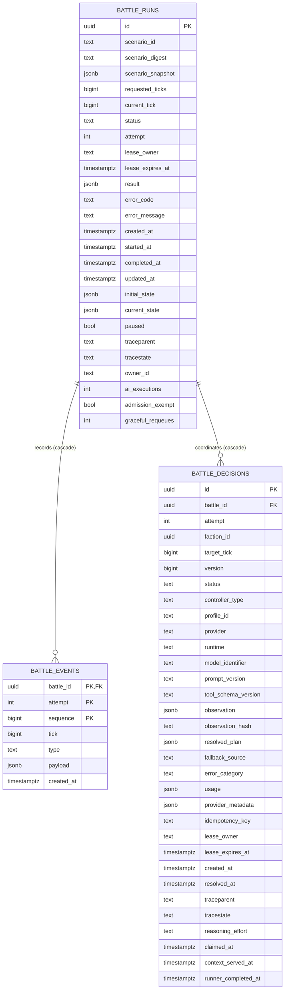
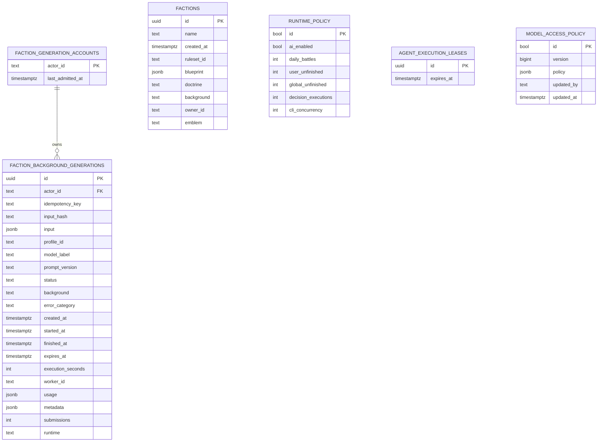
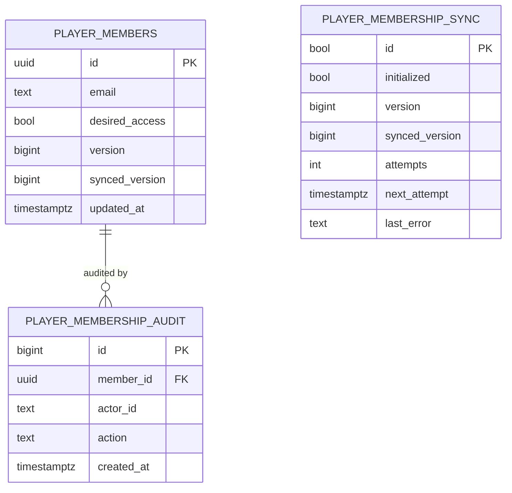

# Database

PostgreSQL is the system of record and the only coordination channel between the
API, the battle engine and the AI gateway. Processes never call each other to hand
over work: they claim rows, hold leases and record results in the database. This
page owns the schema, database access, coordination patterns and migration
conventions; the SQL in [`backend/migrations`](../../backend/migrations) is the
source of truth. [System architecture](system-architecture.md) describes the
runtime flows that use them; operations runbooks own backup, restore and migration
gates.

## Deployment and access

One PostgreSQL 17 instance runs as the `battlefield-postgres` StatefulSet. K3s
places its volume on the retained `battlefield-retained` storage class.

| Process | Login | Reads and writes |
| --- | --- | --- |
| API (`cmd/server`) | `DATABASE_URL` (application login) | Factions, battle creation, generation jobs, model access, Player membership; reads battles, events and decisions for inspection |
| Engine (`cmd/engine`) | `DATABASE_URL` (application login) | Battle claims, ticks and state, events, decision windows and fallbacks, expiry sweeps |
| Migration job (`cmd/server -migrate`) | `DATABASE_URL` (application login) | Schema changes; needs `CREATEROLE` the first time `00004` runs |
| AI gateway (`cmd/aigateway`) | `AI_GATEWAY_DATABASE_URL`, a login that inherits only `battlefield_ai_gateway` | Decision and generation claims, context reads, plan submission, usage and failures |
| Agent (`cmd/agent`) | None | Reaches data only through the AI gateway |

### The `battlefield_ai_gateway` role

Migration `00004` created this `NOLOGIN` group role as `battlefield_mcp`; `00017`
renamed it to `battlefield_ai_gateway`. A rename keeps the role's identity, so
logins already granted the old name keep their membership. Operators create a
separate login and grant it this role, which keeps credential lifecycle apart from
schema lifecycle. Grants (restated in full by `00017`):

| Object | Privilege | Migration |
| --- | --- | --- |
| `battle_decisions` | `SELECT`, `INSERT`, `UPDATE` | `00004` |
| `battle_controller_evaluation` | `SELECT` | `00004` |
| `faction_background_generations` | `SELECT`, `UPDATE` | `00009` |
| `runtime_policy` | `SELECT`, `UPDATE(id)` (row lock only) | `00011` |
| `battle_runs` | `SELECT(id, ai_executions)`, `UPDATE(ai_executions)` | `00011` |
| `agent_execution_leases` | `SELECT`, `INSERT`, `UPDATE`, `DELETE` | `00011` |

The role has no access to battle events, battle state, factions, membership or
policy tables beyond these columns. When `AI_GATEWAY_DATABASE_URL` is absent, the
deployment scripts use the pre-rename `MCP_DATABASE_URL` if present, and otherwise
reuse `DATABASE_URL`, which is acceptable only for local development. Production
must supply the restricted login
([deployment configuration](../operations/deployment.md)).

## Schema

Migration `00020_faction_emblem.sql` adds `factions.emblem`, a non-null text
identifier defaulting to `star`, with a check constraint for the 12 supported
symbols. Existing rows receive the star automatically. Profile creation writes
the selected identifier; updates with an omitted or empty emblem preserve the
stored value in the same SQL statement. Its Down migration removes the column.
The emblem is cosmetic profile metadata used by the registry and battle setup;
it is not part of the battle simulation snapshot.

| Table or view | Purpose | Key rules |
| --- | --- | --- |
| `factions` | Reusable faction identity: name, doctrine, background, emblem, owner | `ruleset_id` and `blueprint` are legacy-only. Battles snapshot faction data, so deleting a faction never changes a battle |
| `battle_runs` | One battle: scenario snapshot, initial and current state, status, lease, attempt and graceful-requeue count, pause flag, result, owner, model-execution count, trace context | Status `queued`, `running`, `completed`, `failed` or `stopped`. A lease owner and expiry are both set or both null, and only while `running` |
| `battle_events` | Ordered events per battle attempt | Primary key `(battle_id, attempt, sequence)` makes inserts idempotent and serves event paging |
| `battle_decisions` | One strategy decision window: frozen observation and hash, controller and profile, lease, resolved plan, fallback source, error category, usage, provider metadata, trace context | Unique per `(battle_id, attempt, faction_id, target_tick)`. Status `pending`, `running`, `accepted`, `fallback` or `failed`. `version` guards resolution; `idempotency_key` deduplicates submissions. `faction_id` is snapshot data, not a foreign key |
| `faction_generation_accounts` | Per-actor row used as a generation lock | Locked `FOR UPDATE` while creating a job |
| `faction_background_generations` | Durable background-draft jobs | Unique `(actor_id, idempotency_key)`; a partial unique index allows one queued or running job per actor. Status `queued`, `running`, `succeeded`, `failed` or `expired` |
| `runtime_policy` | Singleton: AI stop switch, battle allowances, per-battle model budget, CLI concurrency | Row lock serializes every admission decision |
| `agent_execution_leases` | Active CLI execution slots, keyed by decision or generation ID | Rows expire with their lease and are pruned on admission |
| `model_access_policy` | Singleton administrator model-access policy | `version` rejects conflicting saves |
| `player_members` / `player_membership_sync` / `player_membership_audit` | Managed Player grants, Cloudflare Access group synchronization state, and audit history | Unique email; versioned desired and synced state |
| `battle_controller_evaluation` (view) | Per-controller decision count, fallback and invalid-plan rates, latency, tokens, plan diversity and win rate | Readable by the AI gateway role |
| `friend_ai_usage` (view) | Model usage per identity across decisions and generation jobs | Private reporting view |
| `goose_db_version` | Goose's applied-migration ledger | Production recovery records compare it before approving an image rollback |

These diagrams show every column of every table, generated from the schema after
migration `00020` with keys marked `PK` and `FK`. Update them with any schema
change. Battles snapshot faction data instead of referencing `factions`, so
deleting a faction never changes a battle.

### Battles

### Factions, generation and AI policy

### Player membership

`runtime_policy`, `model_access_policy` and `player_membership_sync` are
single-row tables (`id boolean PRIMARY KEY CHECK (id)`). `agent_execution_leases.id`
holds a decision or generation ID without a foreign key, because one table serves
both job types.

### Indexes

Every table also has its primary-key index (`PK` above). The other indexes, from the
same migrated schema, are:

| Table | Index | Columns and condition | Serves |
| --- | --- | --- | --- |
| `battle_runs` | `battle_runs_unpaused_claim_idx` | `(status, lease_expires_at, created_at, id)` where `status` is `queued` or `running` and not `paused` | Engine battle claims |
| `battle_runs` | `battle_runs_claim_idx` | Same columns where `status` is `queued` or `running`, paused or not | The original claim index (`00002`); claims have used the unpaused index since `00006` |
| `battle_runs` | `battle_runs_history_idx` | `(created_at DESC, id DESC)` | Battle history pages, newest first |
| `battle_runs` | `battle_runs_owner_created` | `(owner_id, created_at)` | Per-owner admission counts |
| `battle_events` | primary key | `(battle_id, attempt, sequence)` | Idempotent inserts and event paging |
| `battle_decisions` | `battle_decisions_battle_id_attempt_faction_id_target_tick_key` | Unique `(battle_id, attempt, faction_id, target_tick)` | One decision per faction per window |
| `battle_decisions` | `battle_decisions_window_idx` | `(battle_id, attempt, target_tick, faction_id)` | Decision-window lookups |
| `battle_decisions` | `battle_decisions_agent_claim_idx` | `(status, lease_expires_at, created_at, id)` where `controller_type = 'model'` and `status` is `pending` or `running` | Worker decision claims |
| `faction_background_generations` | `faction_background_generations_actor_id_idempotency_key_key` | Unique `(actor_id, idempotency_key)` | Idempotent job creation |
| `faction_background_generations` | `faction_generation_one_active` | Unique `(actor_id)` where `status` is `queued` or `running` | One active job per actor |
| `faction_background_generations` | `faction_generation_queue` | `(created_at)` where `status = 'queued'` | Oldest-first generation claims |
| `faction_background_generations` | `faction_generation_quota` | `(actor_id, created_at)` | Daily allowance counts |
| `agent_execution_leases` | `agent_execution_expiry` | `(expires_at)` | Pruning and counting active CLI leases |
| `player_members` | `player_members_email_key` | Unique `(email)` | One membership per email |

## Coordination patterns

### Claims and leases

Workers claim queued rows with `FOR UPDATE SKIP LOCKED`, so concurrent workers never
block on or double-claim the same row.

- **Battles:** the engine claims unpaused `queued` battles, or `running` battles
  whose lease expired, while `attempt - graceful_requeues` is below
  `engine.maxAttempts`, through the partial index `battle_runs_unpaused_claim_idx`.
  Each claim increments `attempt` and restarts from `initial_state`, so every
  attempt keeps its own events and decisions. A graceful-shutdown requeue increments
  `graceful_requeues` (migration `00019`), refunding the attempt it interrupted;
  only crashed or lease-expired attempts spend the budget. Tick writes extend the
  lease only where status, attempt and lease owner still match, so a previous owner
  cannot write, requeue or fail the battle after a reclaim.
- **Decisions:** the AI gateway claims `model` decisions that are `pending`, or `running` with
  an expired lease, for the worker's profile IDs, and sets `status='running'` with a
  lease. The capability token issued with the claim expires at that lease deadline.
- **Generation jobs:** the AI gateway claims queued jobs by setting `status='running'`, the
  worker ID and an expiry.

### Admission triggers

PL/pgSQL triggers enforce limits inside the same transaction as the write, so every
API replica, engine and AI gateway instance sees one serialized policy:

| Trigger (function) | Fires | Effect |
| --- | --- | --- |
| `friend_battle_admission` (`admit_friend_battle`) | Before inserting a battle | Locks `runtime_policy` and rejects with SQLSTATE `P0429` when the owner reached the daily or unfinished allowance, or the global unfinished cap. Skips `legacy-admin` and `admission_exempt` (Admin) battles; retried IDs reach the unique constraint without spending an allowance |
| `gate_decision` / `gate_generation` (`gate_new_ai_job`) | Before inserting a decision or generation job | A new model decision becomes `failed` with `ai_disabled_or_budget` when AI is stopped or the battle's budget is spent, so the engine falls back at once. A new generation job raises `P0429` while AI is stopped |
| `agent_decision_admission` / `agent_generation_admission` (`admit_agent_execution`) | Before a claim sets `lease_owner` or `worker_id` | Locks `runtime_policy`. Cancels the claim (returns `NULL`) when AI is stopped or CLI slots are full, prunes expired leases, counts the battle's model execution (marking the decision `failed` with `decision_budget` past the limit), and inserts a CLI lease |
| `release_decision_execution` / `release_generation_execution` (`release_agent_execution`) | After a worker reports usage | Deletes the job's CLI lease |

Defaults (`runtime_policy`): 20 battles per person per UTC day, 2 unfinished per
person, 4 unfinished globally, 100 model executions per battle, 4 CLI slots. API
jobs do not take CLI slots. Paused battles remain `queued` or `running`, so they
still count as unfinished. Admin battles skip the allowances but count toward other
identities' global cap.

Rows created before ownership existed belong to `legacy-admin`, which bypasses the
battle allowances for migrations and trusted fixtures; application identities,
including the local Admin, cannot select that owner ID.

Background generation is admitted in application code under the actor's
`faction_generation_accounts` row lock: `ai.backgroundGeneration.dailyAllowance`
(default 10) jobs per UTC day, counting queued jobs that later expire, with one
active job per actor and same-key retries reusing the existing job.

### Wake-up notifications

Inserting a model decision runs `pg_notify('battlefield_decision_ready', profile_id)`.
The AI gateway listens on that channel to wake long-polling claims. The notification carries no
authoritative data and is safe to miss: every woken worker still claims through the
locked query, and workers claim again after each long poll ends. The engine is not notified when a plan arrives;
it reads the decision row when the window closes and falls back if no plan was
accepted.

### Idempotency and versions

- Battle events are keyed by `(battle_id, attempt, sequence)`.
- An accepted plan is written only to a `pending` or `running` decision whose
  `version` and `target_tick` match the submission, and the write increments
  `version`. Resubmitting with the same idempotency key after acceptance returns the
  same accepted result; any other later submission gets a version conflict.
- Generation jobs are unique per `(actor_id, idempotency_key)`.
- Battle creation retries with the same ID reach the primary-key constraint without
  counting against admission.

### Expiry

- **Battles:** the engine sweeps at startup and every minute. Battles older than one
  hour, including queued and paused time, become `failed` with `battle_timeout`,
  and their open decisions become `failed` with `battle_stopped`.
- **Generation jobs:** expired lazily whenever a job is created, read or claimed. A
  queued job past its expiry becomes `expired` (`queue_timeout`); a running one
  becomes `failed` (`timeout`).
- **CLI leases:** pruned on every admission and deleted when usage is reported.

## Migrations

Migrations are SQL files in [`backend/migrations`](../../backend/migrations),
embedded into the backend binary (`migrations.Files`) and applied with Goose by
`cmd/server -migrate`. Deployment runs this as the `battlefield-migrate` Job before
rolling out application workloads. `internal/postgres.NewMigrationProvider` holds a
database-wide advisory session lock, so concurrent runs and parallel tests cannot
interleave DDL.

Each migration file starts with a comment describing its change, so the
[`backend/migrations`](../../backend/migrations) directory is the change history.

Conventions:

- Add a new numbered migration for every schema change; never change the SQL of one
  that may have been applied to a shared database. Comment-only edits are safe: Goose
  does not checksum files and comments never execute.
- Start each file with a comment describing the change, and include one
  `-- +goose Up` and one `-- +goose Down` section; wrap every dollar-quoted DO block
  and function body in `StatementBegin`/`StatementEnd`. `migrations/embed_test.go`
  enforces these rules and contiguous version numbers.
- Guard data-dependent downgrades instead of silently discarding rows.
  `migrations/round_trip_integration_test.go` applies migrations one at a time,
  recording the schema after each (columns with type, nullability and default,
  indexes, views, constraints, functions and triggers), then runs each Down and
  requires exactly the previous version's schema. 00017's Down renames the
  cluster-wide role, so the earlier migrations are taken down only from 00016.
- Grant `battlefield_ai_gateway` only the columns the AI gateway needs, in the same
  migration that adds them.
- Update repository scanning, serialization and tests in the same change, and update
  this page when tables, roles, triggers or coordination rules change.

The [backend guide](../developer/backend-guide.md#database-migrations-and-adapters)
covers adapter structure and migration tests. Production migrations save and
validate a database backup first. [Jenkins production delivery](../operations/jenkins.md#production-delivery)
owns the migration gate, the [local walkthrough](../developer/local-kubernetes.md#migration-gate)
shows how to inspect it, and [K3s delivery](../operations/k3s-delivery.md) covers
backup, restore and recovery records.

## Shared content snapshot compatibility

New battles freeze one shared ruleset with their chosen map. Retired catalog IDs
remain readable in existing battle JSON; workers do not re-resolve them. Upgrade
ownership remains an array of purchased IDs. Specialist capabilities and remaining
Engineer repair charges are stored in scenario/state JSON, so no relational schema
migration is required. Historical replay tests retain the original transition hash.

## Decision selection and timing columns

Migration `00018_decision_selection_timing.sql` adds `reasoning_effort` (empty for
historical/model-default choices), nullable `claimed_at`, `context_served_at`, and
`runner_completed_at` to `battle_decisions`. Existing records are not backfilled
with invented measurements. `record_decision_claim_time` is a BEFORE UPDATE trigger
that records the latest claim and resets context/completion timing on a lease
reclaim. The gateway records the first successful context read once per claim.
`resolved_at` ends the battle's wait; completion-report receipt remains separate
and does not move acceptance time. Failed execution records a resolution timestamp.
Reuse requires matching model and effort. Existing table grants cover the new
columns; no new roles or broader table privileges are introduced. Down removes
the trigger/function and these columns.
