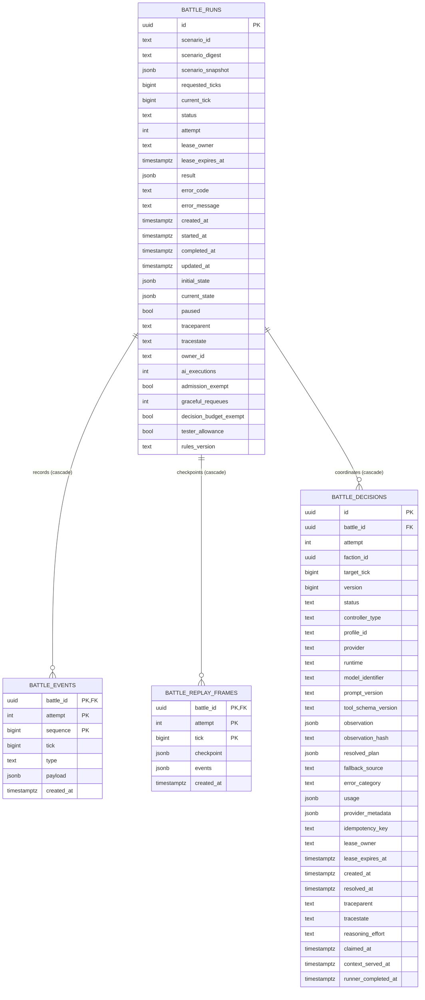
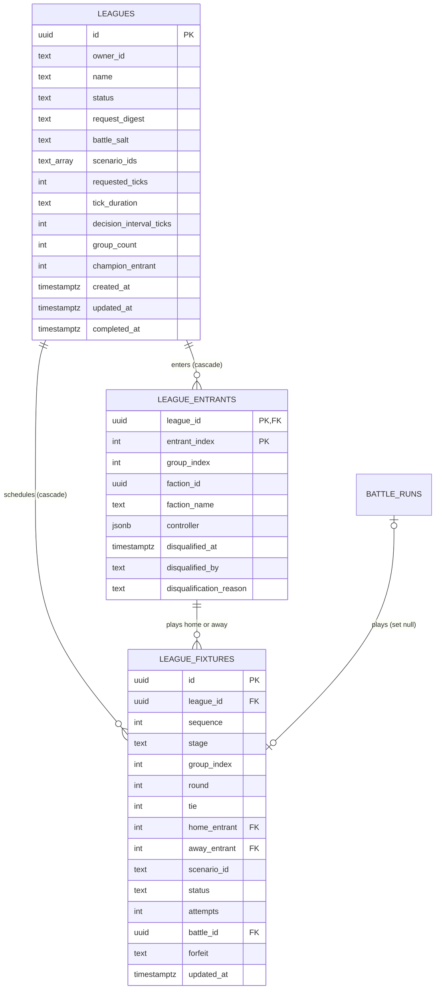
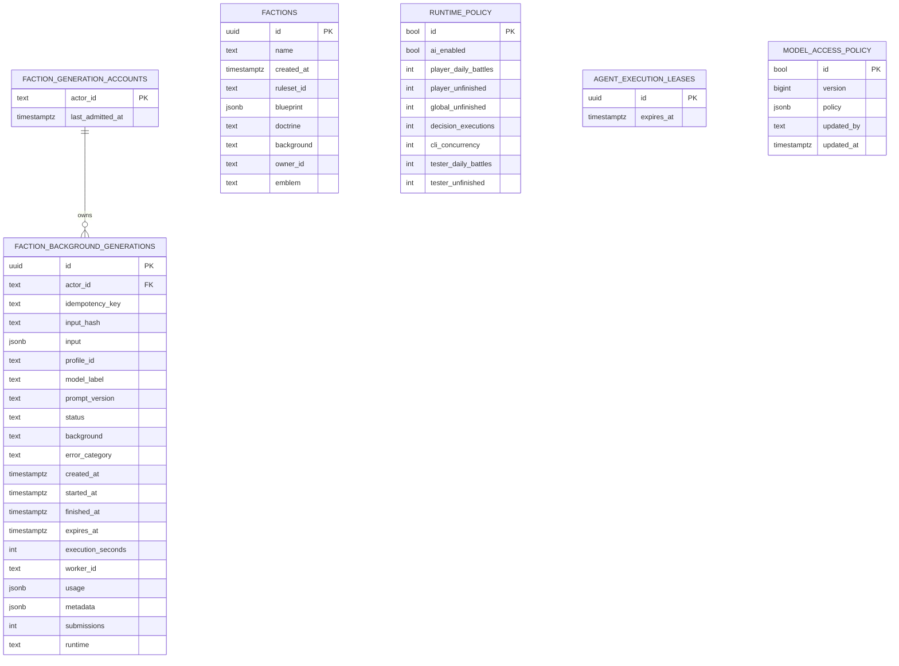
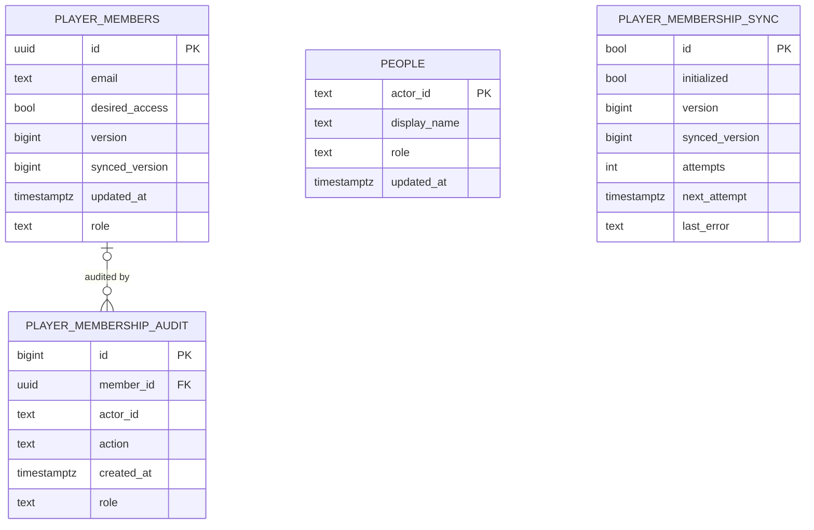

# Database

PostgreSQL is the system of record and the only coordination channel between the
API, the battle engine and the AI gateway. Processes never call each other to hand
over work: they claim rows, hold leases and record results in the database. This
page owns the schema, database access, coordination patterns and migration
conventions; the SQL in [`backend/migrations`](../../backend/migrations) is the
source of truth. [System architecture](system-architecture.md) describes the
runtime flows that use them; operations runbooks own backup, restore and migration
gates.

## Deployment and access

One PostgreSQL 17 instance runs as the `battlefield-postgres` StatefulSet. K3s
places its volume on the retained `battlefield-retained` storage class.

| Process | Login | Reads and writes |
| --- | --- | --- |
| API (`cmd/server`) | `DATABASE_URL` (application login) | Factions, battle creation, generation jobs, model access, Player membership, people's roles and display names; reads battles, events and decisions for inspection, and replay frames for replays |
| Engine (`cmd/engine`) | `DATABASE_URL` (application login) | Battle claims, ticks and state, events, replay frames, decision windows and fallbacks, expiry sweeps |
| Migration job (`cmd/server -migrate`) | `DATABASE_URL` (application login) | Schema changes; needs `CREATEROLE` the first time `00004` runs |
| AI gateway (`cmd/aigateway`) | `AI_GATEWAY_DATABASE_URL`, a login that inherits only `battlefield_ai_gateway` | Decision and generation claims, context reads, plan submission, usage and failures |
| Agent (`cmd/agent`) | None | Reaches data only through the AI gateway |

### The `battlefield_ai_gateway` role

Migration `00004` created this `NOLOGIN` group role as `battlefield_mcp`; `00017`
renamed it to `battlefield_ai_gateway`. A rename keeps the role's identity, so
logins already granted the old name keep their membership. Operators create a
separate login and grant it this role, which keeps credential lifecycle apart from
schema lifecycle. Grants (restated in full by `00017`):

| Object | Privilege | Migration |
| --- | --- | --- |
| `battle_decisions` | `SELECT`, `INSERT`, `UPDATE` | `00004` |
| `battle_controller_evaluation` | `SELECT` | `00004` |
| `faction_background_generations` | `SELECT`, `UPDATE` | `00009` |
| `runtime_policy` | `SELECT`, `UPDATE(id)` (row lock only) | `00011` |
| `battle_runs` | `SELECT(id, ai_executions)`, `UPDATE(ai_executions)` | `00011` |
| `battle_runs` | `SELECT(decision_budget_exempt)`, read by claim admission | `00022` |
| `agent_execution_leases` | `SELECT`, `INSERT`, `UPDATE`, `DELETE` | `00011` |

The role has no access to battle events, battle state, replay frames, factions, membership,
people or policy tables beyond these columns. When `AI_GATEWAY_DATABASE_URL` is absent, the
deployment scripts use the pre-rename `MCP_DATABASE_URL` if present, and otherwise
reuse `DATABASE_URL`, which is acceptable only for local development. Production
must supply the restricted login
([deployment configuration](../operations/deployment.md)).

## Schema

| Table or view | Purpose | Key rules |
| --- | --- | --- |
| `factions` | Reusable faction identity: name, doctrine, background, emblem, owner | `emblem` is one of 12 identifiers (check constraint, default `star`) and is not part of battle snapshots. `ruleset_id` and `blueprint` are legacy-only. Battles snapshot faction data, so deleting a faction never changes a battle |
| `battle_runs` | One battle: scenario snapshot and its rules version, initial and current state, status, lease, attempt and graceful-requeue count, pause flag, result, owner, model-execution count, admission exemption, Tester allowance, decision-budget exemption, trace context | Status `queued`, `running`, `completed`, `failed` or `stopped`. A lease owner and expiry are both set or both null, and only while `running` |
| `battle_events` | Ordered events per battle attempt | Primary key `(battle_id, attempt, sequence)` makes inserts idempotent and serves event paging |
| `battle_replay_frames` | One engine checkpoint per decision window of a battle attempt (tick 0, then every `decisionIntervalTicks`), with that tick's events | Written in the same lease-guarded statement as the tick. Primary key `(battle_id, attempt, tick)` makes inserts idempotent and finds the nearest earlier checkpoint. `checkpoint` is a JSON object about the size of one `current_state`; `events` is a JSON array. Frames of every attempt stay until the battle is deleted |
| `battle_decisions` | One strategy decision window: frozen observation and hash, controller, profile, model and `reasoning_effort` (empty for the model default), lease, lifecycle timestamps, resolved plan, fallback source, error category, usage, provider metadata, trace context | Unique per `(battle_id, attempt, faction_id, target_tick)`. Status `pending`, `running`, `accepted`, `fallback` or `failed`. `version` guards resolution; `idempotency_key` deduplicates submissions. `faction_id` is snapshot data, not a foreign key |
| `leagues` | One AI league: owner, name, status, request digest, secret battle-ID salt, maps, battle timing, group count, champion | Status `running`, `completed` or `cancelled`; `completed_at` is set exactly when it is not running, and a champion only when completed |
| `league_entrants` | One competitor per league: entry index, group, faction ID, faction name copied at creation, requested controller, and once disqualified the time, Admin and reason | Primary key `(league_id, entrant_index)`; one entrant per faction per league. No foreign key to `factions`, so deleting a faction never breaks a league. `disqualified_at` and `disqualified_by` are set together; a reason of up to 200 characters only with them |
| `league_fixtures` | One match, played as one battle: play sequence, stage, group, round, tie, home and away entrants, map, status, attempts, current battle | IDs are derived from the league and the match's stage, group, round and tie, so repeated writes are no-ops. Group fixtures are rounds 1–3 with ties 1–2; knockout fixtures are round 1. Status `pending`, `running`, `completed`, `void`, `cancelled` or `forfeited`; a running fixture has a battle, and exactly the forfeited ones name the disqualified side in `forfeit` (`home`, `away` or `both`). `battle_id` is unique and set to null if that battle is deleted. Results are read from the battle, not copied |
| `faction_generation_accounts` | Per-actor row used as a generation lock | Locked `FOR UPDATE` while creating a job |
| `faction_background_generations` | Durable background-draft jobs | Unique `(actor_id, idempotency_key)`; a partial unique index allows one queued or running job per actor. Status `queued`, `running`, `succeeded`, `failed` or `expired` |
| `runtime_policy` | Singleton: AI stop switch, battle allowances, per-battle model budget, CLI concurrency | Row lock serializes every admission decision |
| `agent_execution_leases` | Active CLI execution slots, keyed by decision or generation ID | Rows expire with their lease and are pruned on admission |
| `model_access_policy` | Singleton administrator model-access policy | `version` rejects conflicting saves |
| `player_members` / `player_membership_sync` / `player_membership_audit` | Managed Player and Tester grants with each member's role, Cloudflare Access group synchronization state, and audit history | Unique email; versioned desired and synced state. `role` is `player` or `tester`; a role change keeps the version. Audit actions are `grant`, `remove`, `retry`, `import` and `role`, with the role set by a grant, import or role change. Removed members [expire](#expiry); deleting one sets its audit rows' `member_id` to null and keeps them |
| `people` | One row per Admin, Tester or Player who has read their session or set a name: role as last recorded, optional display name | Written by the API; Guests and service identities are never stored. `role` is `admin`, `tester` or `player`. `display_name` is null or 3–24 letters, digits, spaces, hyphens or underscores with no leading or trailing space (check constraint), unique ignoring case. Owner IDs in other tables are not foreign keys to it: an owner without a row is labelled as unnamed |
| `battle_controller_evaluation` (view) | Per-controller decision count, fallback and invalid-plan rates, latency, tokens, plan diversity and win rate | Readable by the AI gateway role. `GET /v1/analytics` reports these figures by model and reasoning effort as well, from `battle_runs` and `battle_decisions` |
| `friend_ai_usage` (view) | Model usage per identity across decisions and generation jobs | Private reporting view |
| `goose_db_version` | Goose's applied-migration ledger | Production recovery records compare it before approving an image rollback |

These diagrams show every column of every table, generated from the schema after
migration `00031` with keys marked `PK` and `FK`. Update them with any schema
change. Battles snapshot faction data instead of referencing `factions`, so
deleting a faction never changes a battle. Gameplay content lives in the frozen
scenario and state JSON of `battle_runs`, not in relational columns: each battle
keeps the ruleset and map it started with, workers never re-resolve catalog IDs,
and retired IDs stay readable in saved battles. Gameplay changes therefore need no
schema migration. The one relational copy, `rules_version`, is a stored column
generated from the snapshot's `rulesVersion`, so battle history filters by version
and lists the versions in use through an index.

### Battles

### Leagues

### Factions, generation and AI policy

### People and Player membership

`runtime_policy`, `model_access_policy` and `player_membership_sync` are
single-row tables (`id boolean PRIMARY KEY CHECK (id)`). `agent_execution_leases.id`
holds a decision or generation ID without a foreign key, because one table serves
both job types.

### Indexes

Every table also has its primary-key index (`PK` above). The other indexes, from the
same migrated schema, are:

| Table | Index | Columns and condition | Serves |
| --- | --- | --- | --- |
| `battle_runs` | `battle_runs_unpaused_claim_idx` | `(status, lease_expires_at, created_at, id)` where `status` is `queued` or `running` and not `paused` | Engine battle claims |
| `battle_runs` | `battle_runs_claim_idx` | Same columns where `status` is `queued` or `running`, paused or not | No current query; claims use `battle_runs_unpaused_claim_idx` |
| `battle_runs` | `battle_runs_history_idx` | `(created_at DESC, id DESC)` | Battle history pages, newest first |
| `battle_runs` | `battle_runs_rules_version_history_idx` | `(rules_version, created_at DESC, id DESC)` | Battle history pages of one rules version, and the list of recorded versions |
| `battle_runs` | `battle_runs_owner_created` | `(owner_id, created_at)` | Per-owner admission counts |
| `battle_events` | primary key | `(battle_id, attempt, sequence)` | Idempotent inserts and event paging |
| `battle_replay_frames` | primary key | `(battle_id, attempt, tick)` | Idempotent inserts and the latest checkpoint at or before a replay tick |
| `battle_decisions` | `battle_decisions_battle_id_attempt_faction_id_target_tick_key` | Unique `(battle_id, attempt, faction_id, target_tick)` | One decision per faction per window |
| `battle_decisions` | `battle_decisions_window_idx` | `(battle_id, attempt, target_tick, faction_id)` | Decision-window lookups |
| `battle_decisions` | `battle_decisions_agent_claim_idx` | `(status, lease_expires_at, created_at, id)` where `controller_type = 'model'` and `status` is `pending` or `running` | Worker decision claims |
| `faction_background_generations` | `faction_background_generations_actor_id_idempotency_key_key` | Unique `(actor_id, idempotency_key)` | Idempotent job creation |
| `faction_background_generations` | `faction_generation_one_active` | Unique `(actor_id)` where `status` is `queued` or `running` | One active job per actor |
| `faction_background_generations` | `faction_generation_queue` | `(created_at)` where `status = 'queued'` | Oldest-first generation claims |
| `faction_background_generations` | `faction_generation_quota` | `(actor_id, created_at)` | Daily allowance counts |
| `agent_execution_leases` | `agent_execution_expiry` | `(expires_at)` | Pruning and counting active CLI leases |
| `player_members` | `player_members_email_key` | Unique `(email)` | One membership per email |
| `people` | `people_display_name_key` | Unique `(lower(display_name))`; nulls never conflict | Display names unique ignoring case |

## Coordination patterns

### Claims and leases

Workers claim queued rows with `FOR UPDATE SKIP LOCKED`, so concurrent workers never
block on or double-claim the same row.

- **Battles:** the engine claims unpaused `queued` battles, or `running` battles
  whose lease expired, while `attempt - graceful_requeues` is below
  `engine.maxAttempts`, through the partial index `battle_runs_unpaused_claim_idx`.
  Each claim increments `attempt` and restarts from `initial_state`, so every
  attempt keeps its own events, decisions and replay frames. A graceful-shutdown requeue increments
  `graceful_requeues` (migration `00019`), refunding the attempt it interrupted,
  and fails that attempt's open decisions with `battle_stopped`; only crashed or
  lease-expired attempts spend the budget. Tick writes extend the
  lease only where status, attempt and lease owner still match, so a previous owner
  cannot write, requeue or fail the battle after a reclaim.
- **Decisions:** the AI gateway claims `model` decisions that are `pending`, or `running` with
  an expired lease, for the worker's profile IDs, and sets `status='running'` with a
  lease. The capability token issued with the claim expires at that lease deadline.
  The `battle_decision_claim_time` trigger (`record_decision_claim_time`) sets
  `claimed_at` and clears
  `context_served_at` and `runner_completed_at` whenever a decision becomes
  `running` or its lease expiry changes, so timing describes the latest execution.
- **Generation jobs:** the AI gateway claims queued jobs by setting `status='running'`, the
  worker ID and an expiry.
- **League scheduling:** each pass takes transaction advisory lock `741928320` with
  `pg_try_advisory_xact_lock` and skips when another API replica holds it.
  Cancellation takes the blocking form, so it cannot race a battle start.

### Admission triggers

PL/pgSQL triggers enforce limits inside the same transaction as the write, so every
API replica, engine and AI gateway instance sees one serialized policy:

| Trigger (function) | Fires | Effect |
| --- | --- | --- |
| `friend_battle_admission` (`admit_friend_battle`) | Before inserting a battle | Locks `runtime_policy` and rejects with SQLSTATE `P0429` when the owner reached the daily or unfinished allowance, or the global unfinished cap. The `tester_*` allowances apply when the battle sets `tester_allowance`, which the API does only for a Tester; other battles use the `player_*` ones. Skips `legacy-admin` and `admission_exempt` (Admin) battles; retried IDs reach the unique constraint without spending an allowance |
| `gate_decision` / `gate_generation` (`gate_new_ai_job`) | Before inserting a decision or generation job | A new model decision becomes `failed` with `ai_disabled_or_budget` when AI is stopped or the battle's budget is spent (never for a `decision_budget_exempt` battle), so the engine falls back at once. A new generation job raises `P0429` while AI is stopped |
| `agent_decision_admission` / `agent_generation_admission` (`admit_agent_execution`) | Before a claim sets `lease_owner` or `worker_id` | Locks `runtime_policy`. Cancels the claim (returns `NULL`) when AI is stopped or CLI slots are full, prunes expired leases, counts the battle's model execution (marking the decision `failed` with `decision_budget` past the limit unless the battle is `decision_budget_exempt`), and inserts a CLI lease |
| `release_decision_execution` / `release_generation_execution` (`release_agent_execution`) | After a worker reports usage | Deletes the job's CLI lease |

Defaults (`runtime_policy`): the Player and Tester battle allowances and the global
cap listed in [admission limits](api.md#admission-limits), 100 model executions per
battle, 4 CLI slots (1–8). API jobs do not take CLI slots. Paused battles remain `queued` or `running`, so they
still count as unfinished. Admin battles skip the allowances but count toward other
identities' global cap. League battles are Admin battles that also skip the model
budget: only the league scheduler sets `decision_budget_exempt`, and only for an
Admin owner. Their executions are still counted in `ai_executions`.

Rows created before ownership existed belong to `legacy-admin`, which bypasses the
battle allowances for migrations and trusted fixtures; application identities,
including the local Admin, cannot select that owner ID.

Background generation is admitted in application code under the actor's
`faction_generation_accounts` row lock: `ai.backgroundGeneration.dailyAllowance`
(default 10) jobs per UTC day, counting queued jobs that later expire, with one
active job per actor and same-key retries reusing the existing job.

A Player's faction create is also admitted in application code. One transaction
takes advisory lock `pg_advisory_xact_lock(741928330, hashtext(owner_id))`, checks
that the owner owns no faction, and inserts, so concurrent creates by one owner
run one after another and the later one sees the earlier faction. An `id` already
in use skips the check and reaches the unique constraint, as a retry does. Tester
and Admin creates take no lock. The [faction rules](api.md#factions) state the
limit.

### Wake-up notifications

Inserting a model decision runs `pg_notify('battlefield_decision_ready', profile_id)`.
The AI gateway listens on that channel to wake long-polling claims. The notification carries no
authoritative data and is safe to miss: every woken worker still claims through the
locked query, and workers claim again after each long poll ends. The engine is not notified when a plan arrives;
it reads the decision row when the window closes and falls back if no plan was
accepted.

### Idempotency and versions

- Battle events are keyed by `(battle_id, attempt, sequence)`.
- Replay frames are keyed by `(battle_id, attempt, tick)`; a retried tick write keeps
  the first frame.
- An accepted plan is written only to a `pending` or `running` decision whose
  `version` and `target_tick` match the submission, and the write increments
  `version`. Resubmitting with the same idempotency key after acceptance returns the
  same accepted result; any other later submission gets a version conflict.
- Generation jobs are unique per `(actor_id, idempotency_key)`.
- Battle creation retries with the same ID reach the primary-key constraint without
  counting against admission.
- League fixture IDs derive from the league and the match's stage, group, round and
  tie, not its play order: groups advance independently, so a match opened again after
  a rolled-back pass may get another sequence but keeps its ID. League battle IDs derive
  from the fixture, the attempt and `leagues.battle_salt`, a secret the API never
  returns, so an interrupted scheduling pass finds the battle it created and nobody
  else can take that ID first. A pass adopts an existing battle only when its owner,
  budget exemption, map and factions match the fixture; otherwise the attempt is
  spent.

### Expiry

- **Battles:** the engine sweeps at startup and every minute. Battles older than one
  hour, including queued and paused time, become `failed` with `battle_timeout`,
  and their open decisions become `failed` with `battle_stopped`.
- **Generation jobs:** expired lazily whenever a job is created, read or claimed. A
  queued job past its expiry becomes `expired` (`queue_timeout`); a running one
  becomes `failed` (`timeout`).
- **CLI leases:** pruned on every admission and deleted when usage is reported.
- **Removed members:** each API replica's membership reconciler purges when it
  starts and then hourly. It deletes a member, and with it the email, once the member
  was removed more than seven days ago and Cloudflare has confirmed the removal; a
  removal still awaiting confirmation is kept. The purge takes the singleton
  desired-state lock that membership changes take, so a concurrent grant either
  restores the member first or creates a new member afterwards.

## Migrations

Migrations are SQL files in [`backend/migrations`](../../backend/migrations),
embedded into the backend binary (`migrations.Files`) and applied with Goose by
`cmd/server -migrate`. Deployment runs this as the `battlefield-migrate` Job before
rolling out application workloads. `internal/postgres.NewMigrationProvider` holds a
database-wide advisory session lock, so concurrent runs and parallel tests cannot
interleave DDL.

Each migration file starts with a comment describing its change, so the
[`backend/migrations`](../../backend/migrations) directory is the change history.

Conventions:

- Add a new numbered migration for every schema change; never change the SQL of one
  that may have been applied to a shared database. Comment-only edits are safe: Goose
  does not checksum files and comments never execute.
- Start each file with a comment describing the change, and include one
  `-- +goose Up` and one `-- +goose Down` section; wrap every dollar-quoted DO block
  and function body in `StatementBegin`/`StatementEnd`. `migrations/embed_test.go`
  enforces these rules and contiguous version numbers.
- Guard data-dependent downgrades instead of silently discarding rows.
  `migrations/round_trip_integration_test.go` applies migrations one at a time,
  recording the schema after each (columns with type, nullability and default,
  indexes, views, constraints, functions and triggers), then runs each Down and
  requires exactly the previous version's schema. 00017's Down renames the
  cluster-wide role, so the earlier migrations are taken down only from 00016.
- Grant `battlefield_ai_gateway` only the columns the AI gateway needs, in the same
  migration that adds them.
- Update repository scanning, serialization and tests in the same change, and update
  this page when tables, roles, triggers or coordination rules change.

The [backend guide](../developer/backend-guide.md#database-migrations-and-adapters)
covers adapter structure and migration tests. Production migrations save and
validate a database backup first. [Jenkins production delivery](../operations/jenkins.md#production-delivery)
owns the migration gate, the [local walkthrough](../developer/local-kubernetes.md#migration-gate)
shows how to inspect it, and [K3s delivery](../operations/k3s-delivery.md) covers
backup, restore and recovery records.
