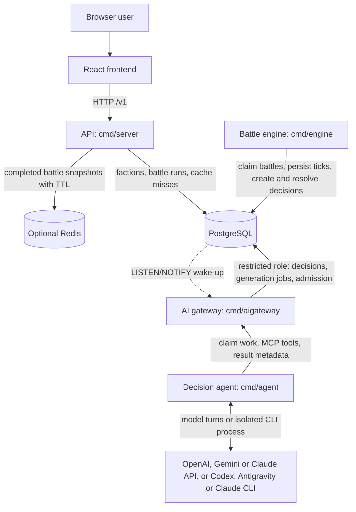
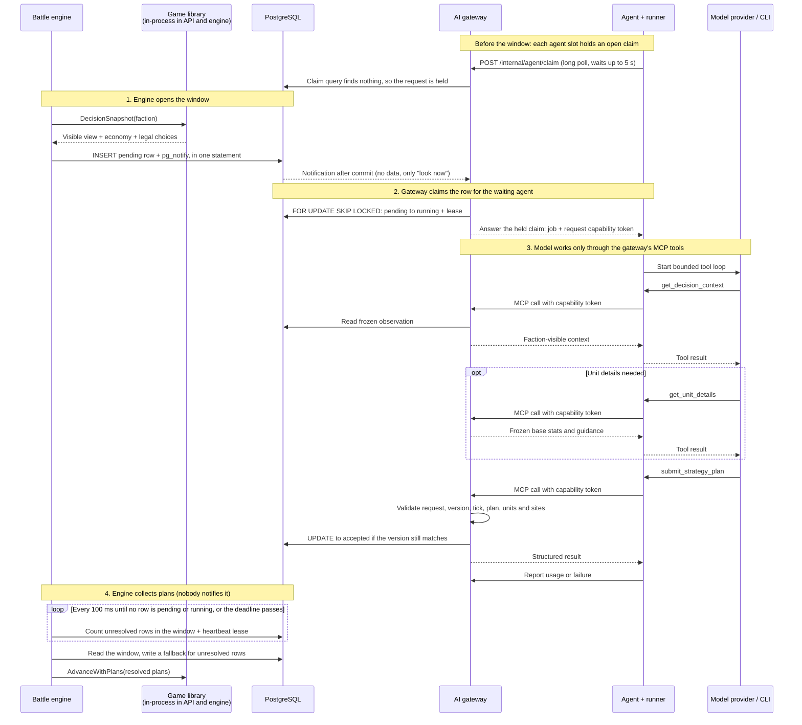
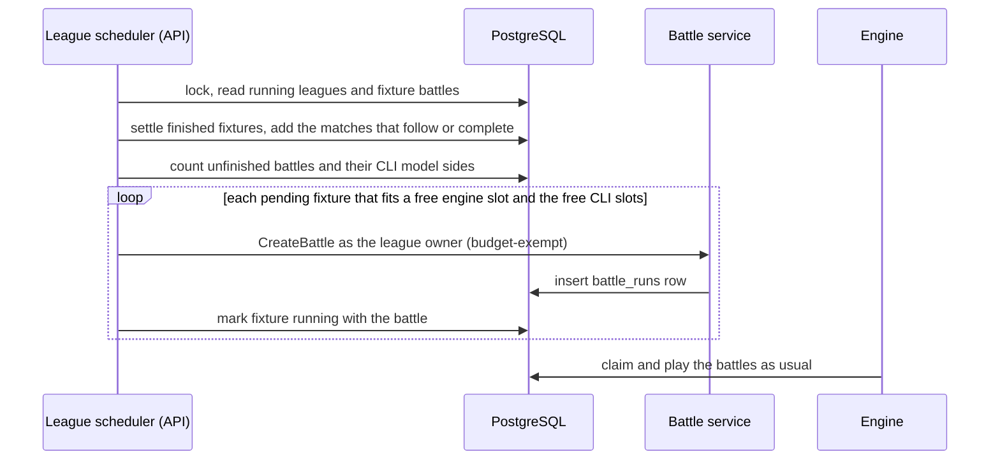
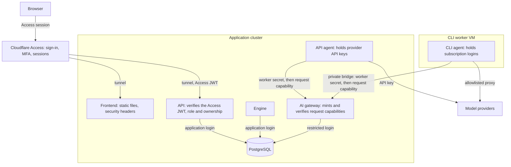

# OrdinalFrontier System Architecture

OrdinalFrontier is a deterministic castle-siege auto-battler. Users create reusable
faction doctrines, stage a finite battle between two factions, and watch a separate
engine execute it. Each faction is controlled by a deterministic script or by a
language model. The implementation uses `autonomous-battlefield` and `battlefield`
as technical identifiers.

The central architectural rule is:

> Models propose bounded strategy plans. The deterministic engine validates and
> applies those plans and remains the only component that controls battlefield-state
> mutation.

Jump to [components](#3-runtime-components),
[design decisions](#4-boundaries-and-design-decisions),
[flows](#5-core-runtime-flows), [AI decisions](#6-ai-decisions),
[persistence](#7-persistence-and-durability), [security](#8-security-and-trust-boundaries),
[deployment](#10-deployment-topology), or
[limitations](#12-current-limitations).

## 1. Overview

The design in brief:

- **Four backend processes share one database.** The API, the engine, the AI
  gateway and the decision agent each do one job. The API and the engine never call
  each other, and neither calls the model-facing processes: they coordinate through
  PostgreSQL rows.
- **The engine is deterministic.** A stored scenario and the plans applied at each
  decision window always produce the same battle, which is what makes crash
  recovery, replay and controller comparison possible.
- **Models are untrusted advisers.** A model reads one faction's decision context
  and submits one plan through three tools. The AI gateway validates the plan and
  the engine applies it; a deterministic fallback keeps the battle moving when a
  model fails or is late.
- **Work is durable.** Battles and model decisions are PostgreSQL state machines
  claimed with leases. Any process can restart, and an interrupted battle is rerun
  from tick 0 with the plans already decided.
- **Identity is checked twice.** Cloudflare Access authenticates people in
  production, and the API verifies every request's token and enforces roles and
  ownership itself.

Sections 2 to 4 introduce the parts and the reasons behind them, and section 5
walks through the runtime flows. Sections 6 to 11 are reference material for
decisions, durability, security, configuration, deployment and observability.
Section 12 lists the limitations.

This document describes runtime boundaries and interactions. Other documents own
the detail:

| Topic | Owning document |
| --- | --- |
| Engine–model contract: runners, prompts, tools and plan validation | [AI decisions](ai-decisions.md) |
| Schema, database roles and coordination rules | [Database](database.md) |
| Routes, permissions and errors | [HTTP API reference](api.md), [OpenAPI contract](openapi.yaml) |
| Environment files and Secret boundaries | [Configuration model](configuration.md) |
| Telemetry contracts and reliability objectives | [Observability architecture](observability.md) |
| Battle rules | [Game rules](../game/game-rules.md) |
| Source layout | [Codebase guide](../developer/codebase-guide.md) and its [launchers](../developer/codebase-guide.md#executable-entry-points), [backend packages](../developer/backend-guide.md#backend-organization), [frontend guide](../developer/frontend-guide.md) |
| Verification | [Contributor CI](../developer/ci.md) |
| Operating an environment | [Deployment](../operations/deployment.md), [observability operations](../operations/observability.md), [server rebuild contract](../operations/server-rebuild-contract.md) |

## 2. System context

PostgreSQL is the durable coordination point. The API and engine do not call each
other directly, and the engine and agent do not call each other directly. Each
workload can fail or restart without losing stored battles, events or decisions; a
battle whose engine stops is reclaimed and rerun from tick 0 (see
[battle retries](#battle-retries)).

## 3. Runtime components

| Component | Responsibility | Direct dependencies |
| --- | --- | --- |
| React frontend | Session-aware navigation (Cloudflare Access in production, development login locally), faction creation, battle staging and history, map display, controls, event stream, and AI decision history | API |
| API | Access identity verification, role/ownership authorization, managed Player membership, HTTP validation, scenario resolution, faction and battle persistence, selectable model-profile catalog, the league scheduler that queues league battles, and analytics over completed battles | PostgreSQL, embedded scenario/ruleset/content YAML, optional Redis, optional Cloudflare Access group API |
| Engine | Battle queue claims, deterministic ticks, strategy windows, state/event persistence | PostgreSQL |
| AI gateway | MCP tool server with request-scoped battle tools (`get_decision_context`, `get_unit_details`, `submit_strategy_plan`) and background-generation tools, plus the agent dispatch API (claims, capability minting, result reports) | PostgreSQL |
| Decision agent | Model-decision claims and API or CLI model execution | AI gateway, model provider |
| PostgreSQL | Factions, battle queue, event history, snapshots, replay checkpoints, leases, model decisions, leagues with their fixtures, membership and model-access policy | Persistent storage |
| Redis (optional) | Disposable read cache of completed battles; no engine or readiness dependency | None; only the API connects to it |
| Scenario catalog | Map-only layouts resolved with one shared timing/controller configuration and full ruleset from versioned [content libraries](../developer/content-library.md) | Embedded in the server binary (`backend/gamedata`), validated at API startup and frozen into battle rows |

The backend commands are `cmd/server`, `cmd/engine`, `cmd/aigateway`, `cmd/agent`,
and `cmd/aieval`. The first four are runtime processes; `aieval` runs deterministic
offline cases or explicitly enabled live comparisons and produces reports.

The rest of this document calls the processes the API, the engine, the AI gateway
and the agent. The agent has two placements: an *API agent* inside the cluster that
calls provider APIs, and a *CLI agent* outside it that runs subscription CLIs (in a
dedicated VM in production, on the developer's host locally). A *runner* is the code
inside the agent that drives one model: an API tool loop or a CLI process.

### Why four backend processes?

- The API remains responsive while battles and model calls take time.
- The engine can restart or scale without exposing gameplay HTTP routes.
- Provider credentials and model behavior remain outside the deterministic simulation process.
- The AI gateway can receive narrower database permissions than the API or engine.
- Local subscription CLIs can run on a developer host without copying login
  credentials into Kubernetes.

## 4. Boundaries and design decisions

Six decisions shape the rest of the system. Each subsection states the rule, why it
was chosen and what it costs.

### 4.1 Models propose, the engine decides

Models submit strategy and production priorities rather than state mutations. The
model never receives a repository, global game state, or mutation function. It can
only:

1. read one authorized decision context, projected for its faction;
2. look up frozen reference details for units in that context;
3. submit one validated strategy plan for that decision.

The simulation is a pure library, `internal/game`. It receives a resolved scenario
and optional plans and returns state transitions and events. It does not access
PostgreSQL, HTTP, environment variables, or model providers. Everything the rules
carry between ticks, including training progress, production settings and gold-mine
reserves, is part of the serialized state, so clones, checkpoints and replays carry
it too. The [game rules](../game/game-rules.md) describe the rules themselves.

The engine owns orchestration around this pure domain: leases, retries, pauses,
decision deadlines, persistence, and shutdown handling. Movement and attack
targeting use authoritative engine state. A model's decision context is a read-only
projection of that state ([battle visibility](#battle-visibility)) and never feeds
back into those paths.

This preserves replayability, legal-action enforcement, testing, and controller
comparison. The cost is expressiveness: a model acts only through the plan schema
and only at decision windows.

### 4.2 PostgreSQL is the coordination point

Battle work and model work are both durable PostgreSQL state machines. Leases and
`FOR UPDATE SKIP LOCKED` let competing processes share them without another queue
system, and the work survives restarts.

Every consumer polls: the UI polls the API, the engine polls battle rows, and agents
long-poll the AI gateway. PostgreSQL notifications reduce model-claim latency, but
notifications and long-polling are not correctness dependencies.

The cost is additional PostgreSQL state-machine logic and polling latency. Higher
scale may justify push delivery or a dedicated broker.

### 4.3 MCP as the capability boundary

The same small, auditable MCP tool surface supports API and subscription CLI models.
The AI gateway also hosts the agent dispatch API, so one process holds the
restricted database role and the capability signing secret. The trade-off is another
service and authentication boundary.

### 4.4 Each battle freezes its rules and scenario

Rules, factions, and initial state are captured per battle, so gameplay content
changes need no database migration, and later edits to factions or catalog YAML
cannot change a run that already exists. Replays remain stable within an engine
version, at the cost of larger JSONB rows and explicit version provenance.

Snapshot versions describe data compatibility; they do not retain previous engine
implementations. A retry, restart or replay re-simulates a saved battle with the
deployed engine, so a release that changes engine behavior follows the
[gameplay rules cutover](../operations/deployment.md#gameplay-rules-cutover).

The live catalog has one `battlefield` ruleset and shared `battlefield.yaml`
timing/controller configuration. Scenario YAML contains only map ID and geometry.
Every map receives all units, structures and upgrades from the active content
library. Adding content therefore needs no per-map selection updates.

### 4.5 Replay from decision-window checkpoints

Replays store one engine checkpoint per decision window and re-simulate the ticks
between them. Storing every tick's state would need no re-simulation, but it would
take one state per tick instead of one per decision interval: twenty times the
storage at the default interval. Re-simulating from tick 0 alone would make seeking
cost the whole battle. Checkpoints bound both, at the cost of serializing engine
runtime beyond `State`: a field added to the match runtime must join the checkpoint,
which the restore tests enforce. Ticks between checkpoints use the deployed engine,
so after a gameplay change they can differ for battles recorded earlier.

### 4.6 Identity at the edge, authorization in the API

Production requires Cloudflare Access on the whole application hostname through a
named Tunnel. The API independently verifies the Access JWT and maps issuer/subject
identity and verified email to a role on every request. Admin roles are configured;
optionally managed Player and Tester membership is read from PostgreSQL. Production
accepts no password or cookie login: the local-password and disabled-authentication
modes are development-only and must be selected explicitly. Exact-origin mutation
checks and a deny-by-default route permission registry wrap every application API.
The browser never connects to the engine, AI gateway or PostgreSQL.

The cost is that Cloudflare owns sessions, so revoking one happens there and
offline token verification cannot observe it. [Security](#8-security-and-trust-boundaries)
covers each boundary and [production access](../operations/access.md) the procedures.

## 5. Core runtime flows

The first three flows are the main path: a battle is created and run, each decision
window collects plans, and a fallback covers a missing answer. The others cover
controls, expiry, replay and leagues.

### 5.1 Create and run a battle

The game library is the deterministic `internal/game` package compiled into the
API and engine binaries, not a separate service. The API builds the match once to
validate the request and store its initial state; only the engine advances it.

Battle execution is asynchronous from the creation request. Each battle stores a
complete resolved scenario and initial state, so later edits to factions or catalog
YAML cannot change an existing run. Battle creation accepts optional tick-duration
(100ms–10s) and decision-interval (1–100 ticks) overrides. The service applies
validated overrides before computing the scenario digest and initial match;
the engine uses the stored timing without changing catalog defaults.

### 5.2 Strategy decision window

A decision window occurs immediately before ticks configured by
`decisionIntervalTicks`. The supplied map defaults use ticks 20, 40, 60, and
so on; a per-battle override changes that interval in the frozen scenario.

How the plan travels:

1. **Agents wait first.** Each agent concurrency slot keeps one claim request open
   at the gateway. The gateway holds it for up to the agent's wait (5 seconds by
   default, 20 at most) and then answers `204`; the agent reissues it at once.
2. **The engine writes the row.** The same statement that inserts a pending model
   decision calls `pg_notify('battlefield_decision_ready', ...)`, so PostgreSQL
   delivers the notification only after the row is committed.
3. **The gateway claims it.** Its `LISTEN` connection wakes every held claim
   request. Each runs the locked claim query; `SKIP LOCKED` gives each row to one
   request, and the rest keep waiting. The winner's response is the job itself, with
   a capability token valid only for that decision until its lease ends.
4. **The model submits through the gateway.** The runner (an API tool loop or a CLI
   configured with the gateway's MCP URL) calls the tools with the token. The
   gateway validates the plan and sets the row to `accepted`.
5. **The engine reads the row.** The engine is never called. It counts the
   window's unresolved rows every 100 ms (`battle_decisions_window_idx`, one query
   for all factions) until none remain or `ai.decisionTimeout` (3 minutes by
   default) passes, then reads the window once and falls back for anything
   unresolved.

The engine, gateway and agent never call each other about a decision; they share
only its row. The notification only saves latency: if it is lost, the next claim
request finds the row within one long poll. A plan arriving at the deadline races
the fallback, and the `version` check lets exactly one write win (see
[timeout and fallback](#53-timeout-and-fallback)).

The engine creates a decision row for every faction:

- A `scripted` controller submits its deterministic baseline immediately through the
  same validation service.
- A `model` controller remains pending until an agent claims and resolves it.

Using the same durable record shape supports consistent history and
scripted-versus-model evaluation.

The engine's first transition is an opening decision at tick zero, using the same
durable records, deadlines, and attempt/requeue semantics. The engine persists the
opening state and events through `SaveTick` before tick one, and the persisted
`openingComplete` flag prevents repeated spending.

### 5.3 Timeout and fallback

The battle must make progress even if a model does not answer.

At the decision deadline:

- the tick-zero opening uses a deterministic sorted-roster purchase fallback;
- the first in-battle production window uses the scenario's scripted baseline;
- later windows reuse the faction's previously active plan;
- the fallback is stored with status `fallback`, keeping the error category of a
  runner that already failed, or `timeout` when the request was still unresolved;
- a racing model submission and fallback are resolved by version and status
  predicates, so only one wins;
- the stored plan is applied exactly like an accepted model plan.

### 5.4 Pause, resume, and stop

- Pausing a queued battle prevents it from being claimed.
- Pausing a running battle retains and heartbeats its lease.
- Paused time extends the current decision and tick deadlines.
- Resuming continues the same in-memory attempt.
- Stopping releases the battle lease and fails outstanding decisions with `battle_stopped`.
- A stopped or reclaimed battle prevents the previous engine owner from making
  further guarded writes.

### 5.5 Battle expiry

Unfinished battles expire one hour after creation, including queued and paused
time. The engine sweeps at startup and every minute independently of active
battle processing. It atomically marks expired battles failed with
`battle_timeout`, clears their leases, and cancels pending/running decisions
using the `battle_stopped` cancellation category. History and tick
state remain available; active admission slots are released but daily usage is
not refunded. While the engine is offline, expiry waits for restart.

### 5.6 Replay a finished battle

At the opening and at every decision window the engine attaches a `game.Checkpoint`
to the transition: the full state plus the faction runtime that state does not
carry (active plan and source, scripted-plan index, unit ID sequence, scoped
upgrades and bonuses, damage and tactic counters, event sequence). `SaveTick` or
`CompleteBattle` stores it in `battle_replay_frames` with that tick's events, in the
same guarded statement as the tick.

`GET /v1/battles/{id}/replay?tick=N` reads the final attempt's latest checkpoint at
or before `N`, resumes the engine with `game.RestoreMatch` in the API process, and
re-simulates until the next decision window or the battle's last tick. Plans apply
only at windows, so a segment needs no decision rows. The API refuses an active
battle, and a segment whose checkpoint is missing, rather than re-simulating across
a window without its plans. The [API reference](api.md#battle-replay) describes the
segment contract.

### 5.7 Play a league

A league plays AI entrants against each other in background battles; the
[league rules](api.md#leagues) define groups, knockouts and tiebreaks. The league
scheduler runs inside the API and turns each fixture into an ordinary battle.

An Admin's `POST /v1/leagues` checks every entrant on every map with the battle
service's validation, then stores the league, its entrants and each group's opening
matches. Every API replica runs the league scheduler every 10 seconds; a pass holds
a transaction advisory lock, so one replica schedules at a time and the others skip.

A pass does four things in order:

1. **Stop.** It stops any battle still running in a cancelled league or a forfeited
   fixture, so a failed stop is retried.
2. **Settle.** It settles running fixtures from their battles, retrying or voiding
   failed ones as the league rules describe.
3. **Advance.** It adds each group's next round once that group's fixtures have
   settled, the knockout once every group is placed, and each later knockout stage
   once the previous one has settled, and it records the champion after the final. A
   match with a disqualified side opens already forfeited, so the pass keeps adding
   what follows until a match needs a battle or the league has its champion.
4. **Start.** It starts pending fixtures, oldest running league first and in fixture
   order, while capacity allows.

Two limits decide whether a fixture can start:

- **Engine slots.** A fixture starts only while battles of any owner leave an engine
  slot free. The scheduler reads the slot count from `engine.concurrency`, the same
  setting the engine uses, so a league battle never waits in the queue, where its
  one-hour timeout already counts. The count assumes one engine replica.
- **CLI slots.** A fixture whose CLI model sides, added to those already running,
  would exceed `runtime_policy.cli_concurrency` waits for a later pass, so model
  decisions do not queue toward the decision timeout. When no CLI side is running, a
  fixture starts even if it needs more CLI slots than exist. The agents' combined
  slots should cover `cli_concurrency`; see the
  [local launcher's slots](../developer/local-kubernetes.md#subscription-clis).

Interruptions and concurrent requests are handled as follows:

- A permanent start failure ends that league's pass, so an outage such as an
  unavailable profile spends one fixture attempt per pass.
- Battle IDs derive from the fixture, so a pass interrupted after creating a battle
  adopts it on the next pass
  ([idempotency rules](database.md#idempotency-and-versions)).
- Cancellation takes the same lock, cancels unfinished fixtures and then stops the
  league's running battles.
- Disqualification waits for the lock too. It records the entrant, forfeits its open
  fixtures and adds the matches that follow; after committing, it stops the
  forfeited battles, including one an interrupted pass created for a pending fixture.

Battle creation goes through the same service as `POST /v1/battles`, as the
league's Admin owner, so model access, faction existence and timing are rechecked
for every battle. That is why the scheduler runs in the API, which composes the
battle service, rather than in the engine.

## 6. AI decisions

Each faction's controller is either scripted or a model profile. For a model, the
decision agent claims the durable decision, runs an API tool loop or an isolated
subscription CLI against the AI gateway's MCP tools, and the gateway validates and
records one submitted plan. The engine applies whatever the decision resolved to,
accepted or fallback, exactly like a scripted plan. Background drafting for
faction profiles reuses the same agents, runners and capability model with a
separate tool set.

Battle creation freezes each model faction's model and reasoning effort, and
decision rows record lifecycle timestamps that the inspector and traces expose.

[AI decisions](ai-decisions.md) owns this contract: runners and CLI isolation,
model and effort selection, decision timing, context prefetch, prompt provenance
and faction memory, the decision context and unit knowledge, plan validation,
fallback error categories, and background generation.

## 7. Persistence and durability

PostgreSQL schema, access and coordination rules are in the [database guide](database.md).
This section covers the completed-result cache, battle retries, engine capacity,
replay storage and history reads.

### Completed battle result caching

The API can check an optional Redis cache before reading a battle from PostgreSQL.
Only a `completed` battle with a result is cached, as a snapshot of its final state
and scenario; faction views are projected from it after retrieval, authentication
runs first, and events and decision history are always PostgreSQL reads. A miss,
invalid entry or Redis error falls back to PostgreSQL, and Redis is excluded from
readiness, so an outage never fails a battle read. The engine and AI gateway never
use Redis.

Completed battles cannot be changed by any application command, so the cache needs
no invalidation. Any future result edit, battle deletion or reuse, or restart of a
completed battle must add invalidation or versioning first, and an incompatible
snapshot change must bump the key namespace. After restoring PostgreSQL, clear the
cache. Use a separate Redis database per environment; see
[Redis operations](../operations/redis.md) for keys, TTL and setup.

### Battle retries

Every mutating battle write includes battle ID, attempt, and lease owner. A
mismatched write fails with lease loss.

A reclaimed battle starts a new deterministic attempt at tick 0 from
`initial_state`; it does not resume the last persisted tick. Events from earlier
attempts remain available by attempt number.

The rerun does not ask a model again for a decision an earlier attempt resolved.
When the engine opens a decision window, it looks for a resolved decision of the
same battle, faction and target tick whose observation hash, prompt and tool
versions, profile, provider, runtime, model and reasoning effort all match. It
stores that decision's plan as already accepted, so no agent is notified and no
model is called. Because the engine is deterministic, the same plans lead to the
same states and therefore the same observation hashes at the following windows. The
rerun repeats the earlier attempt's decisions up to the point where that attempt
stopped, and resolves the remaining windows as usual.

Attempts are budgeted:

- Each claim increments `attempt`, so every attempt keeps its own event history.
- A graceful-shutdown requeue refunds the attempt it interrupted by incrementing
  `graceful_requeues`; only attempts that crashed or lost their lease count. A slot
  requeues between ticks or while it waits on a decision window, and the requeue
  fails that attempt's open decisions with `battle_stopped` so no agent spends a
  model call on them.
- Once a queued or lease-expired battle has used `engine.maxAttempts` (default 3)
  such attempts, the next claim pass marks it `failed` with `attempts_exhausted`
  instead of starting another attempt. A rolling restart that requeues within
  `engine.shutdownTimeout` therefore never spends the budget; one that misses it
  lets the lease expire, and that attempt counts.
- A stored scenario that cannot be decoded or cannot construct a match fails
  immediately with `invalid_scenario` and is not retried; the engine's other slots
  keep running.

Together with `battle_timeout` (see [battle expiry](#55-battle-expiry)), these are
the engine's terminal battle error codes.

### Engine capacity and recovery

An engine runs up to `engine.concurrency` battles at once (default 4), one claim
loop per slot; each loop processes its battle synchronously before claiming another.
The application manifest runs one engine replica, so **up to four battles run at a
time** and further admitted battles queue. A slot holds its battle through every
decision wait (up to the decision timeout) and through any pause: a paused running
battle keeps its lease and its slot until resumed or stopped. Paused battles that
are still queued are skipped at claim.

The default admission limit is four unfinished battles globally, matching the four
slots, so admitted battles normally start at once. Admin battles skip that limit and
can queue behind busy slots, and queued time counts toward the one-hour battle
expiry. Queue delay then depends on battle duration, decision waits and pauses;
admission does not guarantee that a battle finishes before expiry.

Claims use `FOR UPDATE SKIP LOCKED` and leases, so no two slots or replicas process
the same battle. Slots share the engine's worker ID because each lease names its
battle and attempt, and more replicas add slots without code changes. Each running
battle adds its own state writes, heartbeats and decision polls to PostgreSQL, and
model battles share the agent's concurrency slots, so those become the next limits.

Crash recovery has two gates: the previous lease must expire (30 seconds by
default), and an available engine slot must make its next claim. Claims select eligible
battles by creation time and ID. An engine whose slots are all busy does not
interrupt a battle to reclaim an orphan, so recovery can take longer than the
lease duration.

A database error returned by the claim operation in any slot stops every slot:
each other slot requeues its battle, and the engine process exits with the error so
Kubernetes restarts the container. A requeue that cannot reach the database leaves
the lease to expire, and the battle is reclaimed as after a crash.
A database interruption that reaches this path can therefore trigger lease
recovery and a fresh attempt. Restart timing and recovery are separate: a ready
replacement still has to satisfy the claim gates above.

The API and engines share PostgreSQL. Inspect database CPU and throttling, query
latency and connection-pool pressure alongside API pod usage when assessing
capacity. Adding API replicas does not remove shared database work; the limiting
resource and sustainable request rate depend on the workload and resource limits.
Use [reliability testing](../operations/reliability-testing.md) to measure them.

These contracts come from the
[worker loop](../../backend/internal/battle/worker/worker.go),
[claim and requeue operations](../../backend/internal/battle/repo/queue.go),
[expiry sweep](../../backend/internal/battle/repo/expiry.go) and
[engine entry point](../../backend/cmd/engine/main.go).

### Battle replay storage and cost

A checkpoint is about one state's size (26 KB of JSON on average for a measured
frontier battle), written once per decision interval (20 ticks by default) rather
than every tick. A replay request re-simulates at most one interval, about 7 ms per
tick in that battle, so a segment costs well under a second of API CPU; re-simulating
from tick 0 would take minutes for a long battle. Segments are neither cached nor
precomputed. A battle restored from the same checkpoint repeats the recorded ticks
exactly on the same engine; tests restore at every window after a JSON round trip
and require identical transitions. Battles that finished before migration `00020`
have no frames and no replay.

### Battle history reads

`GET /v1/battles` projects participant identities and controllers from the
immutable scenario snapshot in a single query, with lifecycle timestamps,
progress, status and a compact outcome. It does not load simulation states or use
the completed-result cache. Keyset pagination on `battle_runs_history_idx`
(`created_at DESC, id DESC`) fetches one extra row to detect the next page; status
filters read current values, so membership may change between requests. A
rules-version filter pages the same way through
`battle_runs_rules_version_history_idx`, which leads with the generated
`rules_version` column, and the version list skips through that index one version
at a time.

## 8. Security and trust boundaries

Each caller proves its identity with a different credential, and each credential
opens only one boundary.

| Caller | Proves its identity with | May do |
| --- | --- | --- |
| Person in a browser | Cloudflare Access JWT, verified by the API on every request | Use the routes their role permits, and change only rows they own (an Admin can manage any owner's rows) |
| Production smoke checks | Access service token, mapped to the `ci` actor | Read the session and scenario-catalog routes |
| Agent | Worker bearer secret | Claim jobs and report their results |
| Model session | Request capability minted by the AI gateway for one request ID until its expiry | Call the MCP tools for that one request |
| AI gateway | Database login restricted to the `battlefield_ai_gateway` role | Read and resolve decisions and generation jobs, and record admission |

The subsections below give the detail for each boundary. The
[production access runbook](../operations/access.md) owns credential provisioning,
network verification and enablement procedures.

### Access identity, roles and owners

**Startup configuration.** Production API manifests require
`BATTLEFIELD_ENV=production`; startup accepts only `BATTLEFIELD_AUTH_MODE=cloudflare`
with valid issuer (`BATTLEFIELD_ACCESS_ISSUER`), audience
(`BATTLEFIELD_ACCESS_AUDIENCE`), HTTPS origin (`BATTLEFIELD_PUBLIC_ORIGIN`) and
nonconflicting email/role assignments (`BATTLEFIELD_ACCESS_ROLES`, keyed by `admin`,
`tester` and `player`).

**Guest application.** An optional guest Access application has its own audience
(`BATTLEFIELD_ACCESS_GUEST_AUDIENCE`) and HTTPS origin (`BATTLEFIELD_GUEST_ORIGIN`),
set together and distinct from the game's. A token for that audience always maps to
the view-only Guest role, never to an email's configured or managed role, so signing
in there cannot bypass the game's Access policies; the guest origin may send
mutations, which the route policy denies.

**Token verification.** JWT verification uses RS256, a fixed issuer's JWKS with
one-hour key cache and a 30-second refresh throttle, and required
identity/time/audience checks. The audience claim accepts a single string or an
array of strings (RFC 7519 section 4.1.3), matched exactly and case-sensitively to
the configured audience. Invalid types and arrays with non-string entries are
rejected. Missing or unverifiable credentials deny access, with a generic response
and a bounded `auth_failure` reason in the server log
([diagnosis](../operations/access.md#diagnose-an-origin-401)).

**Sessions.** Access owns sessions and logout; the application issues no production
auth cookie, and logout sends the browser to `/cdn-cgi/access/logout`.

**Roles and ownership.** Guests, Players, Testers and Admins share gameplay/faction
reads. Mutation ownership is stored in PostgreSQL and taken from the authenticated
request, never client JSON. Legacy rows belong to `legacy-admin`. Only Admin can
manage another owner's rows. Player projections
([API roles](api.md#roles-and-ownership)), which Guests also receive, run after
shared cache retrieval and omit model diagnostics, raw prompts and internal errors.
The frontend hides inspection panels and stops their requests for Players and
Guests. Responses name owners by display name or `Admin` from the `people` table,
never by email ([display names](api.md#display-names)).

**Removing a person.** Cloudflare Access admission and MFA are independent
deployment requirements. For static roles, user removal requires Access rule
removal, session revocation, application role removal, and deployment to every
replica; offline JWT verification alone cannot see revocation. Managed member
removal instead denies each new API request from PostgreSQL immediately and
asynchronously removes the email from a dedicated Access group. It does not revoke
sessions in unrelated Cloudflare applications.

**Development login.** The local password login retains signed HttpOnly/SameSite
cookies for development. Missing auth mode and enable flags fail startup; explicit
legacy enable flags remain supported only in development. Local cookie logout does
not revoke copied tokens.

### Managed member invitations

Admins can invite Players and Testers from the application instead of editing
configuration. PostgreSQL holds the desired membership, and a reconciler in the API
copies it to a dedicated Cloudflare Access group.

**What is stored.** Optional Admin → Members routes persist grants, removals, role
changes and audit events for Players and Testers in PostgreSQL (`player_members`,
`player_membership_sync` and `player_membership_audit`). The singleton imports
configured Players once, and removed-member tombstones survive restarts until they
[expire](database.md#expiry). Every initialization also durably revokes and audits
prior invitations for identities configured as Admin or Tester, so removing that
configured role later cannot resurrect an invitation. Configured roles and CI
identities keep their own authentication paths. Membership grants only Player or
Tester, never Admin.

**How a member is authenticated.** After signature/issuer/audience/time validation,
member authentication reads current desired access, confirmed membership version and
stored role with a two-second deadline and no positive cache. A role change keeps
the confirmed version, because every active member belongs to the same Access group,
so it applies to the next request without a Cloudflare update. Lookup failure denies
access; `issuer|subject` ownership is unchanged.

**How Cloudflare is kept in step.** The API process starts a cancellable reconciler
when `BATTLEFIELD_MANAGED_PLAYERS` is enabled. A transaction advisory lock
serializes remote writes across replicas; repeatable-read transactions reject
concurrent edits before confirming a grant. Mutations lock only the singleton
desired-state row, not the remote worker lock, so removals commit while a Cloudflare
call is in flight. A successful PUT confirms current versions; failures persist
bounded retry backoff. Restart recovery and one-minute full-list reconciliation
repair ambiguous writes and dedicated-group drift.

**What the credential can reach.** The API alone receives `battlefield-members`; its
token can manage Access groups within the configured account, while code only calls
the configured group endpoint. The browser sees emails, access/sync status and a
game URL, never the token. Empty membership sends an explicitly deny-all group. No
policy edits or account-wide session revocation are automated. New grants stay
inactive until confirmed; removals block subsequent API requests immediately,
without cancelling already accepted work. See
[Player invitations](../operations/player-invitations.md) for activation, policy
separation, credential rotation, rollback limitations and live acceptance checks.

### Model access and role preview

**Model access.** The administrator-only `/admin` control center uses
`GET /v1/admin/model-access` and `PUT /v1/admin/model-access` to manage provider,
profile and per-model access, including allowed roles, stored in a singleton
PostgreSQL policy row. Version checks reject conflicting saves with HTTP 409. Each
API selection reads the durable policy with a bounded timeout, so replicas and
restarts share settings; read failures make models unavailable. The policy can
restrict access but cannot activate missing credentials or deployment-disabled
runtimes. Role overrides supersede configured `allowedRoles`; an explicit empty role
list denies everyone. Players can select API or CLI profiles only when explicitly
included in the profile's allowed roles; default roles are Admin and Tester.
Disables apply to new battle selection and background-generation admission; already
accepted jobs and frozen controller snapshots continue unchanged. This is not an
emergency stop.

**Role preview.** Role preview keeps the administrator's authenticated session and
identity while applying Player or Tester read permissions. The browser sends
`X-Battlefield-Preview-Role`; authentication validates the real administrator before
preview middleware substitutes the effective role ahead of route authorization. Both
transport and server reject mutations during preview, and the browser clears
privileged cached views when the role changes. Logout or session expiry also ends
preview. This previews the administrator's own ownership, not another person's
account. Role preview does not invite users, fabricate audit events, or provide
budget controls.

### Battle visibility

The battlefield hides no positions: every view shows the whole map and all
entities. What differs between viewers is economy and diagnostic detail.

- **Model controllers** receive a faction projection. It hides the opponent's
  aggregate economy totals and production settings; paid training progress and all
  physical entities stay visible.
- **Browser viewers** receive the full battle state, including both factions'
  totals, with no perspective selector. Server-side role and ownership checks are
  the access boundary, and Players and Guests receive the
  [projections](#access-identity-roles-and-owners) that omit model diagnostics.

Participant background and doctrine come from the persisted scenario, not the
editable faction directory. The presentation accepts multiple participants; battle
creation, scenario spawns, opponent selection, and castle-destruction victory rules
require two factions.

See the [HTTP API reference](api.md#battle-state-and-visibility) for state
projection and the [OpenAPI contract](openapi.yaml) for state, event and context
fields; [saved decision context](ai-decisions.md#saved-decision-context) for what
the inspector can show of a model's input; the
[frontend guide](../developer/frontend-guide.md#battle-data-lifecycle) for request
lifecycle, inspector state, map layout, and animation; and
[game rules](../game/game-rules.md) for movement and attack resolution.

### Browser delivery

The frontend is a static build served by Nginx. Nginx requires revalidation of the
SPA entry document after rollouts and returns 404 for missing hashed assets instead
of routing those requests to HTML. Every Nginx response carries a
Content-Security-Policy, `X-Frame-Options: DENY`, `nosniff`, a strict-origin
referrer policy and HSTS. The policy loads scripts, styles, fonts and images only
from the frontend's origin (fonts are bundled, small ones inlined as `data:` URIs),
forbids framing and plugins, keeps `<base>` and form posts on that origin, and lets
scripts fetch only from it plus, when a build sets `VITE_API_URL`, that API origin,
which Nginx receives as `CSP_API_ORIGIN`. Inline and off-origin scripts are
blocked, and requests and resource loads to other sites are refused. The policy
narrows what an injection could do but does not make data exfiltration
impossible: same-origin scripts still run, and it does not restrict top-level
navigation.

### Model-facing capability

The AI gateway mints each model session an HMAC-signed token containing one request
ID and expiry. Agents cannot mint capabilities and never receive the signing
secret. The gateway's MCP endpoints verify the signature, expiry, and equality
between the authorized and supplied request IDs.

Tool bodies are bounded, plan fields are validated, and model-provided state is never authoritative.

### Agent control plane

`/internal/agent/claim`, `/fail`, `/usage`, `/generation-finish` and `/enabled`
require a distinct worker bearer secret of at least 32 bytes, compared in constant
time. The AI gateway refuses to start, and denies agent authentication, when it is
missing, shorter or equal to the signing secret. Both agent placements, the API
agent in K3s and the CLI agent in its VM, share this one secret (see
[limitations](#12-current-limitations)). Claims return server-minted,
request-scoped capabilities; agents never receive the signing key.

The AI gateway is private to the agent network. Production CLI agents run in an
isolated VM and reach it through an authenticated private bridge. Their provider
egress is allowlisted; provider login state stays inside that VM. Development
bridges bind to loopback. Agents poll the durable operator AI switch and cancel work
on stop or loss of policy connectivity. The
[CLI worker guide](../operations/cli-worker-verification.md) owns addresses, proxy
settings, firewall rules and service installation.

### Production automation identity

Cloudflare signs service-authentication JWTs for the enrolled
`BATTLEFIELD_ACCESS_CI_CLIENT_ID`. After normal issuer, audience, expiry and
signature validation, an exact `common_name` match with `type: app` and empty
user subject/email produces a separate `ci` actor limited to GET session and
scenario-catalog routes. It cannot control
battles or use admin/inspection routes. Human roles and direct-origin denial
remain independent. The application receives the client ID, while the client
secret stays with the verification tooling. Credential setup and rotation live
in the [service authentication runbook](../operations/access.md#ci-service-identity).

### Runtime security requirements

- Every binary validates `BATTLEFIELD_ENV` (unset, `dev` or `production`) at
  startup, so a misspelt value cannot disable production-only checks.
- The AI gateway requires a capability secret and a worker secret of at least 32
  bytes each, different from each other; the agent requires the same worker secret.
  Secrets copied unchanged from `.env.example` (`replace-with-…`) and the publicly
  known development capability secret are rejected, as they are for the admin
  password and session secret. Deployment validation of `.env` rejects those worker
  and capability values too, so a deployment fails before it changes the cluster.
- In production, the API and the agent refuse to start with an offered CLI
  profile unless `BATTLEFIELD_CLI_ISOLATION_VERIFIED=true`. They decide whether a
  profile is offered with the same availability check the profile catalog uses.
- Production sessions use Access identity; direct-origin access is denied and
  network policy restricts private services.
- Provider credentials belong to the agent, separate from the API and engine.
- Model rationale remains untrusted display text; bounded length does not make it authoritative.
- Production CLI profiles enforce their configured version prefixes.

## 9. Configuration and profile availability

The shared YAML configuration defines HTTP, database, API, authentication, engine
and AI settings, and each process loads only the sections it needs; the API fails
startup when enabled secrets are missing or too short. The
[configuration model](configuration.md) owns where each setting lives and how
deployment renders `.env` into Kubernetes Secrets.

A model profile specifies:

- stable ID and display name;
- provider and API/CLI runtime;
- cluster or local scope;
- API credential/model environment variables or a pinned CLI model identifier;
- optional `modelOptions`, the models and reasoning efforts a battle may choose;
- optional external-agent availability environment variable;
- token and step limits;
- enabled state and supported CLI version prefix.

Local CLIs allow the [selected stable version](../developer/local-kubernetes.md#subscription-clis)
or newer. Production CLI agents use their configured version prefixes.

Key runtime settings and their defaults:

| Setting | Default | Effect |
| --- | --- | --- |
| `api.maxTicks` | 10000 (maximum) | Upper bound for a battle's requested tick limit |
| `engine.pollInterval` | 1s | Delay between empty battle-queue claims |
| `engine.leaseDuration` | 30s | Battle lease length; an expired lease lets another engine reclaim the battle |
| `engine.heartbeatInterval` | 10s | Lease renewal cadence; must be shorter than `leaseDuration` |
| `engine.concurrency` | 4 | Battles one engine runs at once (1–8), one claim loop per slot |
| `engine.maxAttempts` | 3 | Crashed or lease-expired attempts per battle before `attempts_exhausted`; graceful requeues are refunded |
| `engine.shutdownTimeout` | 10s | Bound for final writes and requeue during shutdown |
| `ai.decisionTimeout` | 3m | Engine decision deadline and agent execution timeout; a battle whose windows all run to it must still end within the one-hour battle limit |
| `ai.agentConcurrency` | 1 when omitted; the checked-in configurations set 4 | Execution slots per agent process (1–8) |
| `resultCache.ttl` / `resultCache.timeout` | 1h / 100ms | Completed-battle cache entry lifetime and per-operation deadline |

`backend/config.yaml` is the reference for all keys; unknown keys fail startup.

The API catalog advertises profiles users may select. In cluster mode, an operator
flag can advertise a host-connected CLI even though the API pod cannot execute it.
An agent advertises only profiles it can execute, and its claims include those IDs
so heterogeneous agents do not lease incompatible work. An agent's worker ID and profile
list are self-reported: this is a scheduling filter, not an authorization
boundary, because the AI gateway does not bind the worker secret to a placement or
profile set.

## 10. Deployment topology

Kubernetes hosts the runtime processes; battle rules and database coordination do
not depend on Kubernetes APIs. Local development uses Kind. Production runs K3s
in a dedicated VM, with a separate VM for subscription CLI agents. Development
and production have distinct clusters, databases, volumes and credentials.

Four properties of the topology matter to the design:

- **Entry.** Public production traffic passes through Cloudflare Access and the
  tunnel to the cluster's ingress gateway, which serves the frontend and the API
  and is not reachable directly. Network policies keep AI gateway and database
  access private while allowing the required workload and monitoring connections.
- **Placement.** The frontend, API, engine, AI gateway, API agent and PostgreSQL run
  in the cluster, and database migrations run as a separate Job. CLI agents run in
  their own VM and reach the AI gateway through a private bridge and providers
  through a restricted proxy, so subscription credentials stay outside the
  application cluster. The
  [trust-boundary diagram](#8-security-and-trust-boundaries) shows these placements.
- **State.** PostgreSQL is the durable game-state store. Persistent volumes retain
  database and supported observability data across pod replacement; Redis remains a
  disposable cache. Retained storage does not provide whole-host disaster recovery,
  and the application and CLI worker VMs share a physical host, so their
  process/network isolation does not eliminate the common host failure domain.
- **Images.** Production admits only images with verified provenance
  ([admission verification](../operations/supply-chain-runbook.md#admission-verification)).

The operations guides own how an environment is built and delivered:

| Topic | Guide |
| --- | --- |
| How delivery works: overlays, components, image identity, migrations and runtime requirements | [Deployment](../operations/deployment.md) |
| Delivering to K3s, rollback and moving production | [K3s delivery](../operations/k3s-delivery.md) |
| Host and VM layout, networks, state locations and recovery | [Server rebuild contract](../operations/server-rebuild-contract.md) |
| Workload Secrets and the ConfigMap | [Configuration model](configuration.md) |
| Image signing, evidence and admission | [Supply-chain runbook](../operations/supply-chain-runbook.md) |
| CLI worker VM, bridge and provider proxy | [CLI worker verification](../operations/cli-worker-verification.md) |

## 11. Observability

Development Kind and production K3s run the same observability stack, and the
[observability architecture](observability.md) owns its detail:

- **Logs:** structured JSON with stable `event` identifiers, request IDs and
  actor attribution, shipped by Fluent Bit to Elasticsearch and Kibana. Full
  combat detail stays in `battle_events`, not process logs.
- **Metrics:** the API and engine expose Prometheus metrics; Prometheus also
  scrapes kube-state-metrics and kubelet cAdvisor, and Grafana shows dashboards
  and checked-in alert rules.
- **Traces:** OpenTelemetry spans from all four processes go through the collector
  to Tempo, linked across battle creation, engine attempts and decisions. AI
  observations can also go to an optional self-hosted Langfuse.
- **Health:** every process exposes health endpoints; the agent also reports drain
  state.

Every `/v1` error's `requestId` equals the `X-Request-ID` header and the
`request_id` log field, so a client-reported failure maps to one log line (see
[API errors](api.md#errors)).

## 12. Current limitations

- Production identity is delegated entirely to Cloudflare Access, so Access rule
  removal and session revocation are deployment responsibilities that offline JWT
  verification cannot observe. The development password login is
  single-administrator and is not player identity.
- Public battle updates use polling rather than push delivery.
- Replays cover only a battle's final attempt, and only when that attempt stored
  checkpoints; frames of earlier attempts are kept but not served.
- Load and failover behavior needs testing before increasing engine, AI gateway, or agent replicas.
- Antigravity decisions prefetch the context into the prompt and refuse contexts
  over 64 KiB, because the CLI offloads large tool results to files it cannot read.
  Large late-game contexts therefore fall back for that profile.
- Both agent placements share one worker secret, and claims self-report their
  profile IDs. A compromised agent could claim another placement's profiles. The
  secret cannot be rotated without changing every holder at once; the CLI VM's copy
  is replaced through the managed
  [`battlefield-platform/cli`](../operations/cli-worker.md) job.
- Rigorous controller experiments may need experiment identity, model parameters,
  and cost normalization beyond the current evaluation view.
