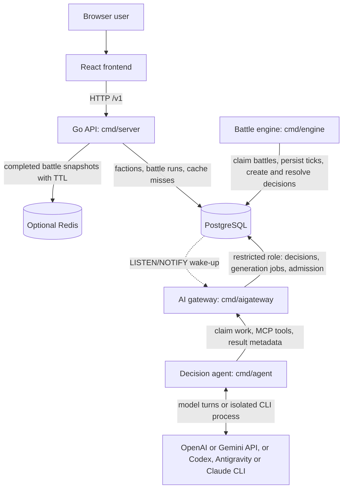
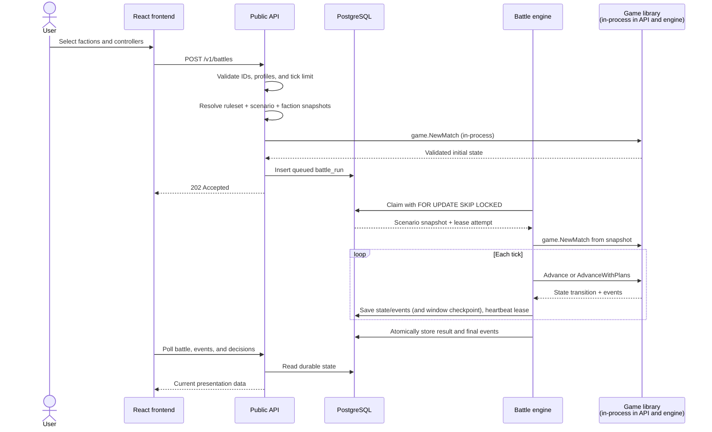
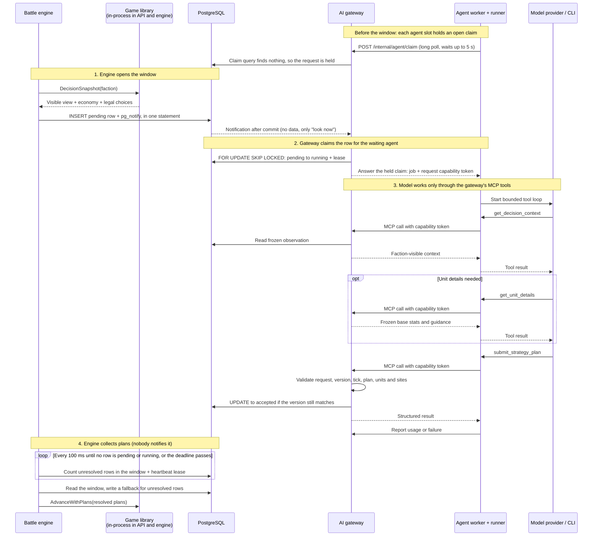
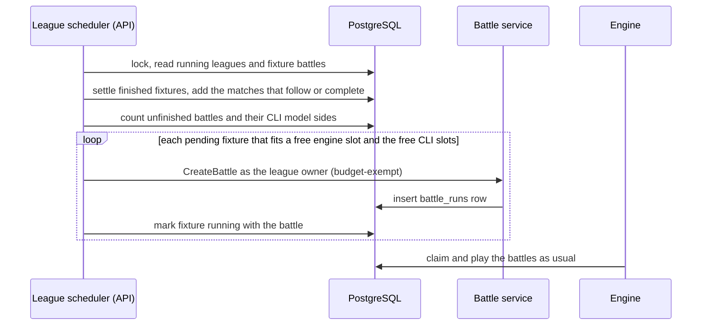

# OrdinalFrontier System Architecture

OrdinalFrontier is a deterministic strategy battle simulator. The implementation
uses `autonomous-battlefield` and `battlefield` as technical identifiers.

Jump to [components](#3-runtime-components), [boundaries](#4-architectural-boundaries),
[flows](#5-core-runtime-flows), [AI decisions](#6-ai-decisions),
[persistence](#7-persistence-and-durability), [security](#8-security-and-trust-boundaries),
[deployment](#10-deployment-topology), or
[limitations](#13-current-limitations-and-follow-up-questions).

## 1. Purpose

OrdinalFrontier is a deterministic castle-siege auto-battler. Users create reusable
faction doctrines, stage a finite battle between two factions, and watch a separate
engine execute it. Each faction can use either deterministic scripted plans or a
model-backed strategic controller.

The central architectural rule is:

> Models propose bounded strategy plans. The deterministic engine validates and
> applies those plans and remains the only component that controls battlefield-state
> mutation.

This document describes the system's runtime boundaries and interactions. The
[AI decisions](ai-decisions.md) page owns the engine–model contract;
[database](database.md) owns schema and coordination rules;
[configuration model](configuration.md) owns environment files and Secret
boundaries; and [observability architecture](observability.md) owns telemetry
contracts and reliability objectives. The
[codebase guide](../developer/codebase-guide.md) explains the implementation package
by package, [contributor CI](../developer/ci.md) covers verification, and the
[server rebuild contract](../operations/server-rebuild-contract.md) lists the
infrastructure state and recovery boundaries. Operational instructions remain in
[deployment](../operations/deployment.md) and
[observability operations](../operations/observability.md).

## 2. System context

PostgreSQL is the durable coordination point. The API and engine do not call each
other directly, and the engine and agent do not call each other directly. Each
workload can fail or restart while preserving battle and decision state.

## 3. Runtime components

| Component | Responsibility | Direct dependencies |
| --- | --- | --- |
| React frontend | Session-aware navigation (Cloudflare Access in production, development login locally), faction creation, battle staging and history, map display, controls, event stream, and AI decision history | Public API |
| Public API | Access identity verification, role/ownership authorization, managed Player membership, HTTP validation, scenario resolution, faction and battle persistence, selectable model-profile catalog, the league scheduler that queues league battles, and analytics over completed battles | PostgreSQL, embedded scenario/ruleset/content YAML, optional Redis, optional Cloudflare Access group API |
| Battle engine | Battle queue claims, deterministic ticks, strategy windows, state/event persistence | PostgreSQL |
| AI gateway | MCP tool server with request-scoped battle tools (`get_decision_context`, `get_unit_details`, `submit_strategy_plan`) and background-generation tools, plus the agent dispatch API (claims, capability minting, result reports) | PostgreSQL |
| Decision agent | Model-decision claims and API or CLI model execution | AI gateway, model provider |
| Redis (optional) | Disposable completed battle read cache; no engine or readiness dependency | Memory, API-only connection |
| PostgreSQL | Factions, battle queue, event history, snapshots, leases, model decisions, and leagues with their fixtures | Persistent storage |
| Scenario catalog | Map-only layouts resolved with one shared timing/controller configuration and full ruleset from versioned [content libraries](../developer/content-library.md) | Embedded in the server binary (`backend/gamedata`), validated at API startup and frozen into battle rows |

The backend commands are `cmd/server`, `cmd/engine`, `cmd/aigateway`, `cmd/agent`,
and `cmd/aieval`. The first four are runtime processes; `aieval` runs deterministic
offline cases or explicitly enabled live comparisons and produces reports.

### Why four backend processes?

- The API remains responsive while battles and model calls take time.
- The engine can restart or scale without exposing gameplay HTTP routes.
- Provider credentials and model behavior remain outside the deterministic simulation process.
- The AI gateway can receive narrower database permissions than the API or engine.
- Local subscription CLIs can run on a developer host without copying login
  credentials into Kubernetes.

## 4. Architectural boundaries

### Source ownership

See the [backend guide](../developer/backend-guide.md#backend-organization) for package
boundaries, the [frontend guide](../developer/frontend-guide.md) for browser ownership,
and the [codebase guide](../developer/codebase-guide.md#executable-entry-points) for launchers.

### Browser delivery

The frontend is a static build served by Nginx. Nginx requires revalidation of the
SPA entry document after rollouts and returns 404 for missing hashed assets instead
of routing those requests to HTML. Every Nginx response carries
`frame-ancestors 'none'` CSP, `X-Frame-Options: DENY`, `nosniff`, a strict-origin
referrer policy and HSTS, so the admin and gameplay UI cannot be framed for
clickjacking. The CSP deliberately leaves script and connect sources open because
`VITE_API_URL` may name a separate API origin.

### Battle inspection

The browser presents the complete battlefield without a perspective selector.
Server-side role and ownership checks remain the access boundary. Faction views
expose all entities while keeping opponents' aggregate economy totals private
from AI controllers. Authorized browser viewers receive the full battle state,
including both factions' totals. Participant
background and doctrine come from the persisted scenario, not the editable faction
directory. The presentation accepts multiple participants; battle creation,
scenario spawns, opponent selection, and castle-destruction victory rules still
require two factions.

See the [frontend guide](../developer/frontend-guide.md#battle-data-lifecycle) for
request lifecycle, inspector state, map layout, and animation;
the [OpenAPI contract](openapi.yaml) for state, event and context fields, and the
[HTTP API reference](api.md#battle-state-and-visibility) for state projection;
[saved decision context](ai-decisions.md#saved-decision-context) for what the
inspector can show of a model's input; and [game rules](../game/game-rules.md) for
movement and attack resolution.

### Deterministic simulation boundary

The simulation receives a resolved scenario and optional plans, then produces
deterministic state transitions and events. Construction uses living building ranges
and spacing; per-building training advances between economy and tactics. Core v7 then purchases one next unit for each enabled empty source in building ID order, respecting reserve gold. Production settings persist across decision windows; an off setting finishes paid work and stops new starts. Insufficient gold pauses starts until affordable, and a core v8 type whose unlock upgrade is not yet owned pauses them without charge until it is bought; blocked exits retain the paid unit without further purchases. The viewer displays both sides' source selection, state and progress; controls remain AI-only. Faction-scoped projections omit opponent production settings, including future choices and gold waits, while retaining paid training progress.
Training progress is serialized in building state; clone operations isolate queue
and training-roster slices plus production settings, including `buildings.castleTrains`. Core v6 and v7 start each
faction with only its castle, which shares the Barracks roster and fires in the
tower phase using authored `castleAttack`/`castleRange`. Five constructible kinds
provide specialized production. The `continuousProduction` ruleset flag selects v7 repeat purchases; frozen v6 and earlier retain batch queues. Frozen core v5 retains its starting Barracks and
passive castle; older rulesets without rosters preserve their recruitment rules. Forest cover affects
troop damage. Under gold-mine rulesets, economy income is drawn from finite mine
reserves kept in `state.goldMines`, so state clones, checkpoints and replays carry
each mine's remaining gold. The map hides destroyed buildings;
the engine retains their records for results/history and releases their occupied hexes.
It does not access PostgreSQL, HTTP,
environment variables, or model providers.

The engine owns orchestration around this pure domain: leases, retries, pauses,
decision deadlines, persistence, and shutdown handling. Movement and attack
targeting use authoritative engine state; faction sight filters AI observations
rather than controlling these engine paths.

### Public application boundary

Production requires Cloudflare Access on the whole application hostname through a
named Tunnel. The API independently verifies the Access JWT and maps issuer/subject
identity and verified email to a role on every request. Privileged roles remain
configured; optionally managed Player membership is read from PostgreSQL. No legacy
password/cookie fallback is accepted. Explicit local-password and
disabled-development modes remain development-only. Exact-origin mutation checks and
a deny-by-default route permission registry wrap every application API. The browser
never connects to the engine, AI gateway or PostgreSQL. See
[production access](../operations/access.md).

### Model boundary

The model never receives a repository, global game state, or mutation function. It can only:

1. read one authorized faction-visible decision context;
2. look up frozen reference details for units in that context;
3. submit one validated strategy plan for that decision.

### Durable coordination boundary

Battle work and model work are both durable PostgreSQL state machines. Notifications
and long-polling improve latency but are not correctness dependencies.

## 5. Core runtime flows

### 5.1 Create and run a battle

The game library is the deterministic `internal/game` package compiled into the
API and engine binaries, not a separate service. The API builds the match once to
validate the request and store its initial state; only the engine advances it.

Battle execution is asynchronous from the creation request. Each battle stores a
complete resolved scenario and initial state, so later edits to factions or catalog
YAML cannot change an existing run. Battle creation accepts optional tick-duration
(100ms–10s) and decision-interval (1–100 ticks) overrides. The service applies
validated overrides before computing the scenario digest and initial match;
workers use the stored timing without changing catalog defaults.

### 5.2 Strategy decision window

A decision window occurs immediately before ticks configured by
`decisionIntervalTicks`. The supplied map defaults use ticks 10, 20, 30, and
so on; a per-battle override changes that interval in the frozen scenario.

How the plan travels:

1. **Agents wait first.** Each agent concurrency slot keeps one claim request open
   at the gateway. The gateway holds it for up to the agent's wait (5 seconds by
   default, 20 at most) and then answers `204`; the agent reissues it at once.
2. **The engine writes the row.** The same statement that inserts a pending model
   decision calls `pg_notify('battlefield_decision_ready', ...)`, so PostgreSQL
   delivers the notification only after the row is committed.
3. **The gateway claims it.** Its `LISTEN` connection wakes every held claim
   request. Each runs the locked claim query; `SKIP LOCKED` gives each row to one
   request, and the rest keep waiting. The winner's response is the job itself, with
   a capability token valid only for that decision until its lease ends.
4. **The model submits through the gateway.** The runner (an API tool loop or a CLI
   configured with the gateway's MCP URL) calls the tools with the token. The
   gateway validates the plan and sets the row to `accepted`.
5. **The engine reads the row.** The engine is never called. It counts the
   window's unresolved rows every 100 ms (`battle_decisions_window_idx`, one query
   for all factions) until none remain or `ai.decisionTimeout` (3 minutes by
   default) passes, then reads the window once and falls back for anything
   unresolved.

The engine, gateway and agent never call each other about a decision; they share
only its row. The notification only saves latency: if it is lost, the next claim
request finds the row within one long poll. A plan arriving at the deadline races
the fallback, and the `version` check lets exactly one write win (see
[timeout and fallback](#53-timeout-and-fallback)).

The engine creates a decision row for every faction:

- A `scripted` controller submits its deterministic baseline immediately through the
  same validation service.
- A `model` controller remains pending until an agent claims and resolves it.

Using the same durable record shape supports consistent history and
scripted-versus-model evaluation.

The first worker transition is an opening decision at tick zero, using the same
durable records, deadlines, and attempt/requeue semantics. The worker persists the
opening state and events through `SaveTick` before tick one, and the persisted
`openingComplete` flag prevents repeated spending.

### 5.3 Timeout and fallback

The battle must make progress even if a model does not answer.

At the decision deadline:

- the tick-zero opening uses a deterministic sorted-roster purchase fallback;
- the first in-battle production window uses the scenario's scripted baseline;
- later windows reuse the faction's previously active plan;
- the fallback is stored with status `fallback`, keeping the error category of a
  runner that already failed, or `timeout` when the request was still unresolved;
- a racing model submission and fallback are resolved by version and status
  predicates, so only one wins;
- the stored plan is applied exactly like an accepted model plan.

### 5.4 Pause, resume, and stop

- Pausing a queued battle prevents it from being claimed.
- Pausing a running battle retains and heartbeats its lease.
- Paused time extends the current decision and tick deadlines.
- Resuming continues the same in-memory attempt.
- Stopping releases the battle lease and fails outstanding decisions with `battle_stopped`.
- A stopped or reclaimed battle prevents the previous engine owner from making
  further guarded writes.

### 5.5 Battle expiry

Unfinished battles expire one hour after creation, including queued and paused
time. The engine sweeps at startup and every minute independently of active
battle processing. It atomically marks expired battles failed with
`battle_timeout`, clears their leases, and cancels pending/running decisions
using the existing `battle_stopped` cancellation category. History and tick
state remain available; active admission slots are released but daily usage is
not refunded. While the engine is offline, expiry waits for restart.

### 5.6 Replay a finished battle

At the opening and at every decision window the engine attaches a `game.Checkpoint`
to the transition: the full state plus the faction runtime that state does not
carry (active plan and source, scripted-plan index, unit ID sequence, scoped
upgrades and bonuses, damage and tactic counters, event sequence). `SaveTick` or
`CompleteBattle` stores it in `battle_replay_frames` with that tick's events, in the
same guarded statement as the tick.

`GET /v1/battles/{id}/replay?tick=N` reads the final attempt's latest checkpoint at
or before `N`, resumes the engine with `game.RestoreMatch` in the API process, and
re-simulates until the next decision window or the battle's last tick. Plans apply
only at windows, so a segment needs no decision rows. The API refuses an active
battle, and a segment whose checkpoint is missing, rather than re-simulating across
a window without its plans. The [API reference](api.md#battle-replay) describes the
segment contract.

### 5.7 Play a league

An Admin's `POST /v1/leagues` checks every entrant on every map with the battle
service's validation, then stores the league, its entrants and each group's opening
matches. Every API replica runs the league scheduler every 10 seconds; a pass holds
a transaction advisory lock, so one replica schedules at a time and the others skip.

A pass first stops any battle still running in a cancelled league, so a failed stop
is retried. It then settles running fixtures from their battles, retrying or voiding
failed ones as the [league rules](api.md#leagues) describe. It adds each group's
next round once that group's fixtures have settled, the knockout once every group is
placed, each later knockout stage once the previous one has settled, and records the
champion after the final. Finally it starts pending fixtures, oldest running league first and in fixture
order, while battles of any owner leave an engine slot free: the scheduler reads the
slot count from `engine.concurrency`, the same setting the engine uses, so a league
battle never waits in the queue, where its one-hour timeout already counts. A fixture
whose CLI model sides, added to those already running, would exceed
`runtime_policy.cli_concurrency` waits for a later pass, so model decisions do not
queue toward the decision timeout; when no CLI side is running, a fixture starts even
if it needs more CLI slots than exist. The count assumes one engine replica, and the
agents' combined slots should cover `cli_concurrency`; see the
[local launcher's slots](../developer/local-kubernetes.md#subscription-clis). A
permanent start failure ends that league's pass, so an outage such as an unavailable
profile spends one fixture attempt per pass. Battle IDs derive from the fixture, so a
pass interrupted after creating a battle adopts it on the next pass
([idempotency rules](database.md#idempotency-and-versions)). Cancellation takes the
same lock, cancels unfinished fixtures and then stops the league's running battles.

Battle creation goes through the same service as `POST /v1/battles`, as the
league's Admin owner, so model access, faction existence and timing are rechecked
for every battle. That is why the scheduler runs in the API, which composes the
battle service, rather than in the engine.

## 6. AI decisions

Each faction's controller is either scripted or a model profile. For a model, the
decision agent claims the durable decision, runs an API tool loop or an isolated
subscription CLI against the AI gateway's MCP tools, and the gateway validates and
records one submitted plan. The engine applies whatever the decision resolved to,
accepted or fallback, exactly like a scripted plan. Background drafting for
faction profiles reuses the same workers, runners and capability model with a
separate tool set.

Battle creation freezes each model faction's model and reasoning effort, and
decision rows record lifecycle timestamps that the inspector and traces expose.

[AI decisions](ai-decisions.md) owns this contract: runners and CLI isolation,
model and effort selection, decision timing, context prefetch, prompt provenance
and faction memory, the decision context and unit knowledge, plan validation,
fallback error categories, and background generation.

## 7. Persistence and durability

PostgreSQL schema, access and coordination rules are in the [database guide](database.md).
This section covers the completed-result cache, battle retries and history reads.

### Completed battle result caching

The API can check an optional Redis cache before reading a battle from PostgreSQL.
Only a `completed` battle with a result is cached, as a snapshot of its final state
and scenario; faction views are projected from it after retrieval, authentication
runs first, and events and decision history are always PostgreSQL reads. A miss,
invalid entry or Redis error falls back to PostgreSQL, and Redis is excluded from
readiness, so an outage never fails a battle read. The engine and AI gateway never
use Redis.

Completed battles cannot be changed by any application command, so the cache needs
no invalidation. Any future result edit, battle deletion or reuse, or restart of a
completed battle must add invalidation or versioning first, and an incompatible
snapshot change must bump the key namespace. After restoring PostgreSQL, clear the
cache. Use a separate Redis database per environment; see
[Redis operations](../operations/redis.md) for keys, TTL and setup.

### Battle retries

Every mutating battle write includes battle ID, attempt, and lease owner. A
mismatched write fails with lease loss.

A reclaimed battle starts a new deterministic attempt at tick 0 from
`initial_state`; it does not resume the last persisted tick. Events from earlier
attempts remain available by attempt number. When an observation hash matches a
previously resolved decision for the same faction and target tick, the decision
repository can reuse that plan.

Each claim increments `attempt`, so every attempt keeps its own event history. A
graceful-shutdown requeue refunds the attempt it interrupted by incrementing
`graceful_requeues`; only attempts that crashed or lost their lease count. A slot
requeues between ticks or while it waits on a decision window, and the requeue
fails that attempt's open decisions with `battle_stopped` so no agent spends a model
call on them. Once a
queued or lease-expired battle has used `engine.maxAttempts` (default 3) such
attempts, the next claim pass marks it `failed` with `attempts_exhausted` instead of
starting another attempt. A rolling restart that requeues within
`engine.shutdownTimeout` therefore never spends the budget; one that misses it lets
the lease expire, and that attempt counts. A stored scenario that cannot construct a
match fails immediately with `invalid_scenario` and is not retried. Together with
`battle_timeout` (see [battle expiry](#55-battle-expiry)), these are the engine's
terminal battle error codes.

### Engine capacity and recovery

An engine runs up to `engine.concurrency` battles at once (default 4), one claim
loop per slot; each loop processes its battle synchronously before claiming another.
The application manifest runs one engine replica, so **up to four battles run at a
time** and further admitted battles queue. A slot holds its battle through every
decision wait (up to the decision timeout) and through any pause: a paused running
battle keeps its lease and its slot until resumed or stopped. Paused battles that
are still queued are skipped at claim.

The default admission limit is four unfinished battles globally, matching the four
slots, so admitted battles normally start at once. Admin battles skip that limit and
can queue behind busy slots, and queued time counts toward the one-hour battle
expiry. Queue delay then depends on battle duration, decision waits and pauses;
admission does not guarantee that a battle finishes before expiry.

Claims use `FOR UPDATE SKIP LOCKED` and leases, so no two slots or replicas process
the same battle. Slots share the engine's worker ID because each lease names its
battle and attempt, and more replicas add slots without code changes. Each running
battle adds its own state writes, heartbeats and decision polls to PostgreSQL, and
model battles share the agent's concurrency slots, so those become the next limits.

Crash recovery has two gates: the previous lease must expire (30 seconds by
default), and an available worker must make its next claim. Claims select eligible
battles by creation time and ID. An engine whose slots are all busy does not
interrupt a battle to reclaim an orphan, so recovery can take longer than the
lease duration.

A database error returned by the claim operation in any slot stops every slot:
each other slot requeues its battle, and the engine process exits with the error so
Kubernetes restarts the container. A requeue that cannot reach the database leaves
the lease to expire, and the battle is reclaimed as after a crash.
A database interruption that reaches this path can therefore trigger lease
recovery and a fresh attempt. Restart timing and recovery are separate: a ready
replacement still has to satisfy the claim gates above.

The API and engines share PostgreSQL. Inspect database CPU and throttling, query
latency and connection-pool pressure alongside API pod usage when assessing
capacity. Adding API replicas does not remove shared database work; the limiting
resource and sustainable request rate depend on the workload and resource limits.
Use [reliability testing](../operations/reliability-testing.md) to measure them.

These contracts come from the
[worker loop](../../backend/internal/battle/worker/worker.go),
[claim and requeue operations](../../backend/internal/battle/repo/queue.go),
[expiry sweep](../../backend/internal/battle/repo/expiry.go) and
[engine entry point](../../backend/cmd/engine/main.go).

### Battle replay storage and cost

A checkpoint is about one state's size (26 KB of JSON on average for a measured
frontier battle), written once per decision interval (10 ticks by default) rather
than every tick. A replay request re-simulates at most one interval, about 7 ms per
tick in that battle, so a segment costs well under a second of API CPU; re-simulating
from tick 0 would take minutes for a long battle. Segments are neither cached nor
precomputed. A battle restored from the same checkpoint repeats the recorded ticks
exactly on the same engine; tests restore at every window after a JSON round trip
and require identical transitions. Battles that finished before migration `00020`
have no frames and no replay.

### Battle history reads

`GET /v1/battles` projects participant identities and controllers from the
immutable scenario snapshot in a single query, with lifecycle timestamps,
progress, status and a compact outcome. It does not load simulation states or use
the completed-result cache. Keyset pagination on `battle_runs_history_idx`
(`created_at DESC, id DESC`) fetches one extra row to detect the next page; status
filters read current values, so membership may change between requests.

## 8. Security and trust boundaries

### Access identity, roles and owners

Production API manifests require `BATTLEFIELD_ENV=production`; startup accepts only
`BATTLEFIELD_AUTH_MODE=cloudflare` with valid issuer (`BATTLEFIELD_ACCESS_ISSUER`),
audience (`BATTLEFIELD_ACCESS_AUDIENCE`), HTTPS origin (`BATTLEFIELD_PUBLIC_ORIGIN`)
and nonconflicting email/role assignments (`BATTLEFIELD_ACCESS_ROLES`). JWT
verification uses RS256, a fixed issuer's JWKS with one-hour key cache and a
30-second refresh throttle, and required identity/
time/audience checks. The audience claim accepts a single string or an array of
strings (RFC 7519 section 4.1.3), matched exactly and case-sensitively to the
configured audience. Invalid types and arrays with non-string entries are rejected.
Missing or unverifiable credentials deny access, with a generic response and a
bounded `auth_failure` reason in the server log
([diagnosis](../operations/access.md#diagnose-an-origin-401)). Access owns
sessions and logout; the application issues no production auth cookie, and logout
sends the browser to `/cdn-cgi/access/logout`.

Players, Developers and Admins share gameplay/faction reads. Mutation ownership is
stored in PostgreSQL and taken from the authenticated request, never client JSON.
Legacy rows belong to `legacy-admin`. Only Admin can manage another owner's rows.
Decision history/context require Developer/Admin. Player gameplay projections run
after shared cache retrieval and omit model diagnostics, raw prompts and internal
errors. The frontend hides inspection panels and stops their requests for Players.
Cloudflare Access admission and MFA are independent deployment requirements. For
static roles, user removal requires Access rule removal, session revocation,
application role removal,
and deployment to every replica; offline JWT verification alone cannot see revocation.
Managed Player removal instead denies each new API request from PostgreSQL immediately
and asynchronously removes the email from a dedicated Access group. It does not
revoke sessions in unrelated Cloudflare applications.

The local password login retains signed HttpOnly/SameSite cookies for development.
Missing auth mode and enable flags fail startup; explicit legacy enable flags remain
supported only in development. Local cookie logout does not revoke copied tokens.

### Managed Player invitations

Optional Admin → Members routes persist Player grants, removals and audit events in
PostgreSQL (`player_members`, `player_membership_sync` and
`player_membership_audit`). The singleton imports configured Players once, retaining
removed-member tombstones across restarts. Every initialization also durably
revokes and audits prior Player invitations for configured privileged identities,
so subsequent privileged-role removal cannot resurrect Player access.
Admin/Developer roles and CI identities continue through their existing
authentication paths; membership cannot elevate roles.
After signature/issuer/audience/time validation, Player authentication reads current
desired access and confirmed membership version with a two-second deadline and no
positive cache. Lookup failure denies access; `issuer|subject` ownership is unchanged.

The API process starts a cancellable reconciler when `BATTLEFIELD_MANAGED_PLAYERS`
is enabled. A transaction advisory lock serializes remote writes across replicas;
repeatable-read transactions reject concurrent edits before confirming a grant.
Mutations lock only the singleton desired-state row, not the remote worker lock,
so removals commit while a Cloudflare call is in flight. A successful PUT confirms
current versions; failures persist bounded retry backoff. Restart recovery and
one-minute full-list reconciliation repair ambiguous writes and dedicated-group drift.

The API alone receives `battlefield-members`; its token can manage Access groups
within the configured account, while code only calls the configured group endpoint.
The browser sees emails, access/sync status and a game URL, never the token. Empty
membership sends an explicitly deny-all group. No policy edits or account-wide
session revocation are automated. New grants stay inactive until confirmed; removals
block subsequent API requests immediately, without cancelling already accepted work.
See [Player invitations](../operations/player-invitations.md) for activation, policy
separation, credential rotation, rollback limitations and live acceptance checks.

### Model access and role preview

The administrator-only `/admin` control center uses `GET /v1/admin/model-access` and
`PUT /v1/admin/model-access` to manage provider and individual profile access,
including allowed roles, stored in a singleton PostgreSQL policy row. Version checks
reject conflicting saves with HTTP 409. Each API
selection reads the durable policy with a bounded timeout, so replicas and restarts
share settings; read failures make models unavailable. The policy can restrict
access but cannot activate missing credentials or deployment-disabled runtimes.
Role overrides supersede configured `allowedRoles`; an explicit empty role list
denies everyone. Players can select API or CLI profiles only when explicitly included
in the profile's allowed roles; default roles remain Admin and Developer. Disables
apply to new battle selection and background-generation admission; already accepted jobs
and frozen controller snapshots continue unchanged. This is not an emergency stop.

Role preview keeps the administrator's authenticated session and identity while
applying Player or Developer read permissions. The browser sends
`X-Battlefield-Preview-Role`; authentication validates the real administrator before
preview middleware substitutes the effective role ahead of route authorization.
Both transport and server reject mutations during preview, and the browser clears
privileged cached views when the role changes. Logout or session expiry also ends
preview. This previews the administrator's own ownership, not another
person's account. Role preview does not invite users, fabricate audit events, or
provide budget controls.

### Model-facing capability

The AI gateway mints each model session an HMAC-signed token containing one request
ID and expiry. Workers cannot mint capabilities and never receive the signing
secret. The gateway's MCP endpoints verify the signature, expiry, and equality
between the authorized and supplied request IDs.

Tool bodies are bounded, plan fields are validated, and model-provided state is never authoritative.

### Agent control plane

`/internal/agent/claim`, `/fail`, `/usage`, `/generation-finish` and `/enabled`
require a distinct worker bearer secret of at least 32 bytes, compared in constant
time. The AI gateway refuses to start, and denies worker authentication, when it is missing,
shorter or equal to the signing secret. Every worker placement (the K3s API
worker and the CLI worker VM) currently shares this one secret. Claims return
server-minted, request-scoped capabilities; workers never receive the signing key.

The AI gateway is private to the worker network. Production subscription CLI workers run in
an isolated VM and reach it through an authenticated private bridge. Their
provider egress is allowlisted; provider login state stays inside the worker
boundary. Development bridges bind to loopback. Workers poll the durable operator
AI switch and cancel work on stop or loss of policy connectivity. The
[worker operations guide](../operations/cli-worker-verification.md) owns addresses,
proxy settings, firewall rules and service installation.

### Production automation identity

Cloudflare signs service-authentication JWTs for the enrolled
`BATTLEFIELD_ACCESS_CI_CLIENT_ID`. After normal issuer, audience, expiry and
signature validation, an exact `common_name` match with `type: app` and empty
user subject/email produces a separate `ci` actor limited to GET session and
scenario-catalog routes. It cannot control
battles or use admin/inspection routes. Human roles and direct-origin denial
remain independent. The application receives the client ID, while the client
secret stays with the verification tooling. Credential setup and rotation live
in the [service authentication runbook](../operations/access.md#ci-service-identity).

### Runtime security requirements

- Every binary validates `BATTLEFIELD_ENV` (unset, `dev` or `production`) at
  startup, so a misspelt value cannot disable production-only checks.
- The AI gateway requires a capability secret and a worker secret of at least 32
  bytes each, different from each other; the agent requires the same worker secret.
  Secrets copied unchanged from `.env.example` (`replace-with-…`) and the retired
  public development capability secret are rejected, as they are for the admin
  password and session secret. Deployment validation of `.env` rejects those worker
  and capability values too, so a deployment fails before it changes the cluster.
- In production, the API server and the agent refuse to start with an offered CLI
  profile unless `BATTLEFIELD_CLI_ISOLATION_VERIFIED=true`. They decide whether a
  profile is offered with the same availability check the profile catalog uses.
- Production sessions use Access identity; direct-origin access is denied and
  network policy restricts private services.
- Provider credentials belong to the decision agent, separate from the API and engine.
- Model rationale remains untrusted display text; bounded length does not make it authoritative.
- Production CLI profiles enforce their configured version prefixes.

The [production access runbook](../operations/access.md) owns credential
provisioning, network verification and enablement procedures.

## 9. Configuration and profile availability

The shared YAML configuration defines HTTP, database, API, authentication, engine
and AI settings, and each process loads only the sections it needs; the API fails
startup when enabled secrets are missing or too short. The
[configuration model](configuration.md) owns where each setting lives and how
deployment renders `.env` into Kubernetes Secrets.

A model profile specifies:

- stable ID and display name;
- provider and API/CLI runtime;
- cluster or local scope;
- API credential/model environment variables or a pinned CLI model identifier;
- optional external-agent availability environment variable;
- token and step limits;
- enabled state and supported CLI version prefix.

Local CLIs allow the [selected stable version](../developer/local-kubernetes.md#subscription-clis)
or newer. Production workers use their configured version prefixes.

Key runtime settings and their defaults:

| Setting | Default | Effect |
| --- | --- | --- |
| `api.maxTicks` | 10000 (maximum) | Upper bound for a battle's requested tick limit |
| `engine.pollInterval` | 1s | Delay between empty battle-queue claims |
| `engine.leaseDuration` | 30s | Battle lease length; an expired lease lets another engine reclaim the battle |
| `engine.heartbeatInterval` | 10s | Lease renewal cadence; must be shorter than `leaseDuration` |
| `engine.concurrency` | 4 | Battles one engine runs at once (1–8), one claim loop per slot |
| `engine.maxAttempts` | 3 | Crashed or lease-expired attempts per battle before `attempts_exhausted`; graceful requeues are refunded |
| `engine.shutdownTimeout` | 10s | Bound for final writes and requeue during shutdown |
| `ai.decisionTimeout` | 3m | Engine decision deadline and agent execution timeout; a battle whose windows all run to it must still end within the one-hour battle limit |
| `ai.agentConcurrency` | 1 | Execution slots per agent process (1–8) |
| `resultCache.ttl` / `resultCache.timeout` | 1h / 100ms | Completed-battle cache entry lifetime and per-operation deadline |

`backend/config.yaml` is the reference for all keys; unknown keys fail startup.

The API catalog advertises profiles users may select. In cluster mode, an operator
flag can advertise a host-connected CLI even though the API pod cannot execute it.
An agent advertises only profiles it can execute, and its claims include those IDs
so heterogeneous agents do not lease incompatible work. The worker ID and profile
list are self-reported: this is a scheduling filter, not an authorization
boundary, because the AI gateway does not bind the worker secret to a placement or
profile set.

## 10. Deployment topology

Kubernetes hosts the runtime processes; battle rules and database coordination do
not depend on Kubernetes APIs. Local development uses Kind. Production runs K3s
in a dedicated VM, with a separate VM for subscription CLI workers. Development
and production have distinct clusters, databases, volumes and credentials.

| Workload | Communication and state |
| --- | --- |
| Frontend | Serves the browser application, which calls the API through the shared gateway; no durable game state. |
| API | Reads and writes PostgreSQL, optionally caches completed results in Redis, and exposes authenticated HTTP routes. |
| Engine | Claims work and persists ticks through PostgreSQL; exposes health and metrics rather than gameplay routes. |
| AI gateway | Exposes private MCP decision tools and agent dispatch routes, with narrower database privileges than the API or engine. |
| API-provider agent | Calls the AI gateway and external model APIs; provider keys stay in this workload. |
| Migration Job | Applies database migrations separately from long-running application workloads. |

Public production traffic passes through Cloudflare Access and the tunnel to the
private gateway. Network policies keep AI gateway and database access private while
allowing the required workload and monitoring connections. CLI workers use a
private AI gateway bridge and restricted provider proxy; subscription credentials stay
outside the application cluster.

PostgreSQL is the durable game-state store. Persistent volumes retain database
and supported observability data across pod replacement; Redis remains a
disposable cache. Retained storage does not provide whole-host disaster recovery.
The application and worker VMs share a physical host, so their process/network
isolation does not eliminate the common host failure domain.

Application configuration is separated into workload-specific Secrets and a
non-secret ConfigMap. Deployment identity stays outside application Secrets;
see the [configuration model](configuration.md). Production image admission
requires verified image provenance. Registry publication, AI build manifests,
controller provisioning, migrations and rollback procedures belong to
[deployment operations](../operations/deployment.md),
[K3s delivery](../operations/k3s-delivery.md), and the
[supply-chain runbook](../operations/supply-chain-runbook.md).
The image-verification admission webhook fails closed on missing or invalid
evidence; see [admission verification](../operations/supply-chain-runbook.md#admission-verification)
for the configured retrieval timeout.

## 11. Observability

Development Kind and production K3s run the same observability stack, and the
[observability architecture](observability.md) owns its detail:

- **Logs:** structured JSON with stable `event` identifiers, request IDs and
  actor attribution, shipped by Fluent Bit to Elasticsearch and Kibana. Full
  combat detail stays in `battle_events`, not process logs.
- **Metrics:** the API and engine expose Prometheus metrics; Prometheus also
  scrapes kube-state-metrics and kubelet cAdvisor, and Grafana shows dashboards
  and checked-in alert rules.
- **Traces:** OpenTelemetry spans from all four processes go through the collector
  to Tempo, linked across battle creation, engine attempts and decisions. AI
  observations can also go to an optional self-hosted Langfuse.
- **Health:** every process exposes health endpoints; the agent also reports drain
  state.

Every `/v1` error's `requestId` equals the `X-Request-ID` header and the
`request_id` log field, so a client-reported failure maps to one log line (see
[API errors](api.md#errors)).

## 12. Decisions and trade-offs

### Determinism over direct model control

Models submit strategy and production priorities rather than state mutations. This
preserves replayability, legal-action enforcement, testing, and controller
comparison.

### Durable database coordination over in-memory queues

Battle and decision work survives restarts. Leases and `SKIP LOCKED` support
competing workers without another queue system, at the cost of additional PostgreSQL
state-machine logic.

### Shared rules and map-only scenarios

The live catalog has one `battlefield` ruleset and shared `battlefield.yaml`
timing/controller configuration. Scenario YAML contains only map ID and geometry.
Every map receives all units, structures and upgrades from the active content
library. Adding content therefore needs no per-map selection updates.

### Frozen snapshots over live catalog references

Rules, factions, and initial state are captured per battle, so gameplay content
changes need no database migration. Replays remain stable within an engine version,
at the cost of larger JSONB rows and explicit version provenance. Snapshot versions
describe data compatibility; they do not retain previous engine implementations. A
retry, restart or replay re-simulates a saved battle with the deployed engine, so a
release that changes engine behavior follows the
[gameplay rules cutover](../operations/deployment.md#gameplay-rules-cutover).

### Decision-window checkpoints over per-tick history

Replays store one engine checkpoint per decision window and re-simulate the ticks
between them. Storing every tick's state would need no re-simulation but about ten
times the storage, and re-simulating from tick 0 alone would make seeking cost the
whole battle. Checkpoints bound both, at the cost of serializing engine runtime
beyond `State`: a field added to the match runtime must join the checkpoint, which
the restore tests enforce. Ticks between checkpoints use the deployed engine, so
after a gameplay change they can differ for battles recorded earlier.

### MCP as a capability boundary

The same small, auditable MCP tool surface supports API and subscription CLI models.
The AI gateway also hosts the agent dispatch API, so one process holds the
restricted database role and the capability signing secret. The trade-off is another
service and authentication boundary.

### Polling with advisory wake-ups

The UI polls the API, the engine polls battle rows, and agents long-poll the AI
gateway. PostgreSQL notifications reduce model-claim latency without becoming a
correctness dependency. Higher scale may justify push delivery or a dedicated
broker.

## 13. Current limitations and follow-up questions

- Production identity is delegated entirely to Cloudflare Access, so Access rule
  removal and session revocation are deployment responsibilities that offline JWT
  verification cannot observe. The development password login remains
  single-administrator and is not player identity.
- Public battle updates use polling rather than push delivery.
- Replays cover only a battle's final attempt, and only when that attempt stored
  checkpoints; frames of earlier attempts are kept but not served.
- Load and failover behavior needs testing before increasing engine, AI gateway, or agent replicas.
- Antigravity decisions prefetch the context into the prompt and refuse contexts
  over 64 KiB, because the CLI offloads large tool results to files it cannot read.
  Large late-game contexts therefore fall back for that profile.
- All worker placements share one control-plane secret, and claims self-report their
  profile IDs. A compromised worker could claim another placement's profiles. The
  secret cannot be rotated without changing every holder at once; the CLI VM's copy
  is replaced through the managed
  [`battlefield-platform/cli`](../operations/cli-worker.md) job.
- Rigorous controller experiments may need experiment identity, model parameters,
  and cost normalization beyond the current evaluation view.
