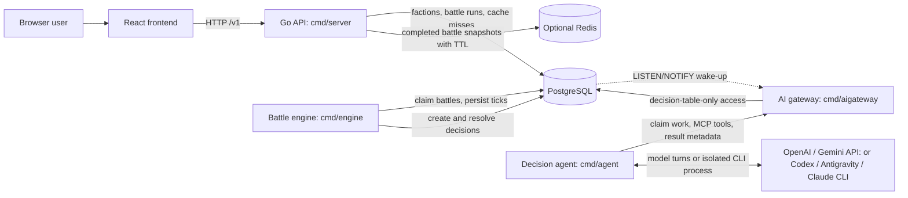
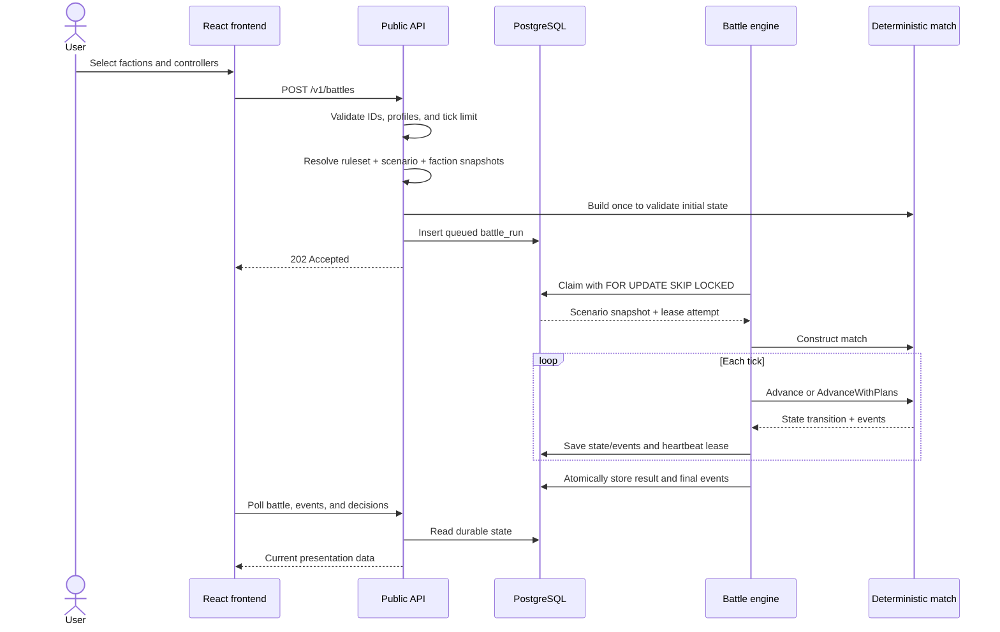
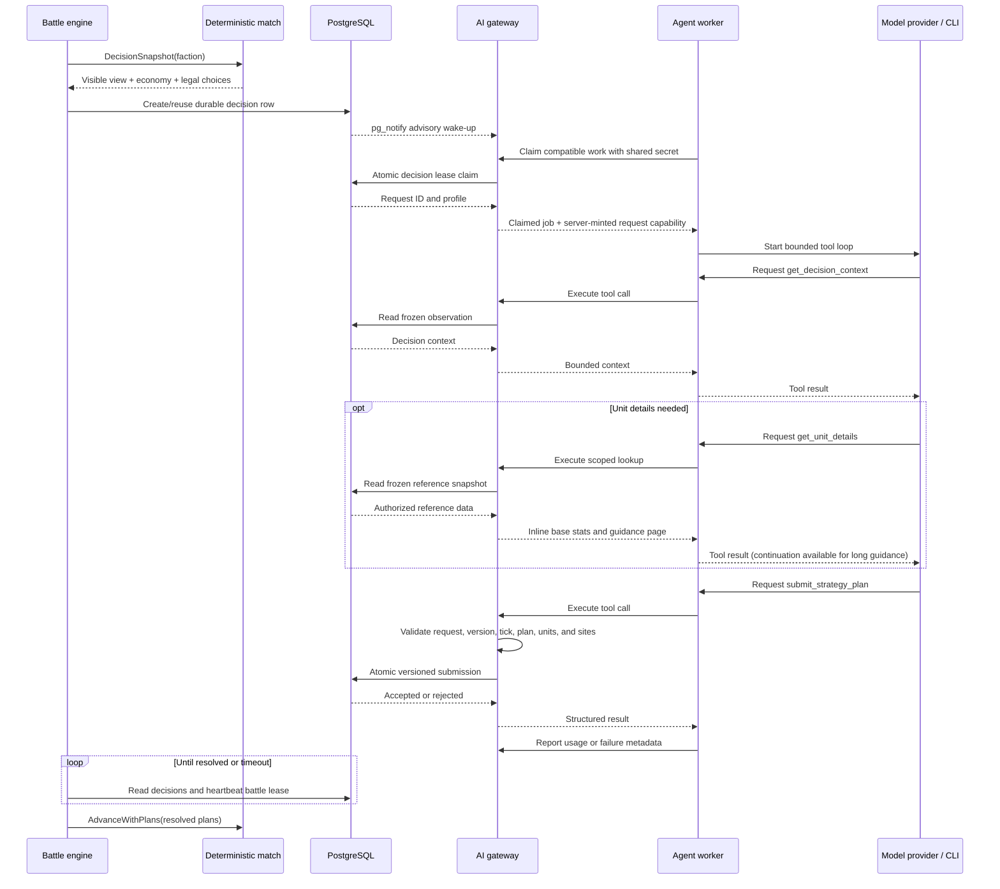
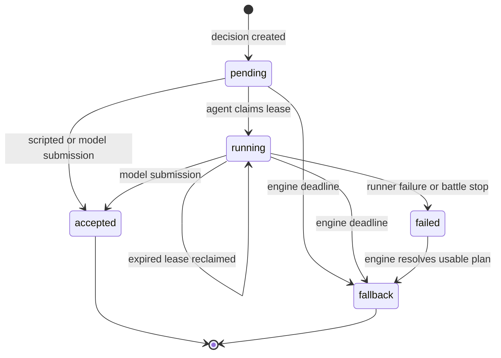

# OrdinalFrontier System Architecture

OrdinalFrontier is a deterministic strategy battle simulator. The implementation
uses `autonomous-battlefield` and `battlefield` as technical identifiers.

| Field | Value |
| --- | --- |
| Status | Current |
| Audience | Contributors reviewing or extending system behavior |
| Scope | Runtime components, data flows, durability, security, and deployment topology |

For a package-by-package explanation of the implementation, see the [codebase guide](../developer/codebase-guide.md).

Jump to [components](#3-runtime-components), [boundaries](#4-architectural-boundaries),
[flows](#5-core-runtime-flows), [decision contracts](#7-decision-contracts-and-lifecycle),
[persistence](#8-persistence-and-durability), [security](#9-security-and-trust-boundaries),
[deployment](#11-deployment-topology), or [limitations](#19-current-limitations-and-follow-up-questions).

## 1. Purpose

OrdinalFrontier is a deterministic castle-siege auto-battler. Users create reusable faction doctrines, stage a finite battle between two factions, and watch a separate engine execute it. Each faction can use either deterministic scripted plans or a model-backed strategic controller.

The central architectural rule is:

> Models propose bounded strategy plans. The deterministic engine validates and applies those plans and remains the only component that controls battlefield-state mutation.

This document describes the system's runtime boundaries and interactions. The
[configuration model](configuration.md) owns environment files and Secret
boundaries; [observability architecture](observability.md) owns telemetry contracts
and reliability objectives. Operational instructions remain in
[deployment](../operations/deployment.md) and
[observability operations](../operations/observability.md).

## 2. System context

PostgreSQL is the durable coordination point. The API and engine do not call each other directly, and the engine and agent do not call each other directly. Each workload can fail or restart while preserving battle and decision state.

## 3. Runtime components

| Component | Responsibility | Direct dependencies |
| --- | --- | --- |
| React frontend | Session-aware navigation (Cloudflare Access in production, development login locally), faction creation, battle staging and history, map display, controls, event stream, and AI decision history | Public API |
| Public API | Access identity verification, role/ownership authorization, managed Player membership, HTTP validation, scenario resolution, faction and battle persistence, and selectable model-profile catalog | PostgreSQL, embedded scenario/ruleset/content YAML, optional Redis, optional Cloudflare Access group API |
| Battle engine | Battle queue claims, deterministic ticks, strategy windows, state/event persistence | PostgreSQL |
| AI gateway | MCP tool server with request-scoped battle tools (`get_decision_context`, `get_unit_details`, `submit_strategy_plan`) and background-generation tools, plus the agent dispatch API (claims, capability minting, result reports) | PostgreSQL |
| Decision agent | Model-decision claims and API or CLI model execution | AI gateway, model provider |
| Redis (optional) | Disposable completed battle read cache; no engine or readiness dependency | Memory, API-only connection |
| PostgreSQL | Factions, battle queue, event history, snapshots, leases, and model decisions | Persistent storage |
| Scenario catalog | Authored map, timing, fallback plans, unit/building rules, and combat rules | Embedded in the server binary (`backend/gamedata`), loaded by the API at startup and frozen into battle rows |

The backend commands are `cmd/server`, `cmd/engine`, `cmd/aigateway`, `cmd/agent`, and `cmd/aieval`. The first four are runtime processes; `aieval` runs deterministic offline cases or explicitly enabled live comparisons and produces reports.

### Why four backend processes?

- The API remains responsive while battles and model calls take time.
- The engine can restart or scale without exposing gameplay HTTP routes.
- Provider credentials and model behavior remain outside the deterministic simulation process.
- The AI gateway can receive narrower database permissions than the API or engine.
- Local subscription CLIs can run on a developer host without copying login credentials into Kubernetes.

## 4. Architectural boundaries

### Process health ownership

The API and engine entry points compose `httpapi.LifecycleHandler` around application traffic. That handler alone serves `/startupz`, `/livez`, `/healthz`, `/readyz`, and `/metrics`; the inner application router does not register duplicate probes. Engine readiness combines `Worker.Ready()` with a database ping. Database failure affects readiness while liveness remains available.

### Source ownership

See the [backend guide](../developer/backend-guide.md#backend-organization) for package
boundaries, the [frontend guide](../developer/frontend-guide.md) for browser ownership,
and the [codebase guide](../developer/codebase-guide.md#executable-entry-points) for launchers.

### Browser delivery

The shell treats logout HTTP 401 as an already unauthenticated session. Other
request failures keep the current screen and expose retry; they do not confirm logout.

The Vite development proxy defaults to `http://localhost:8080` and accepts a
server-only `DEV_API_PROXY_TARGET` override from the frontend env files or shell.
Production/browser API routing continues to use `VITE_API_URL` and Nginx.
Nginx requires revalidation of the SPA entry document after rollouts and returns
404 for missing hashed assets instead of routing those requests to HTML.
Every Nginx response carries `frame-ancestors 'none'` CSP, `X-Frame-Options: DENY`,
`nosniff`, a strict-origin referrer policy and HSTS, so the admin and gameplay UI
cannot be framed for clickjacking. The CSP deliberately leaves script and connect
sources open because `VITE_API_URL` may name a separate API origin.

### Battle inspection

Battle detail state is scoped to the battle, attempt, and selected perspective.
Cancelled faction-view requests cannot replace the current selection, and loading
or failed faction views never fall back to spectator data. The perspective selector
controls presentation; server-side role and ownership checks remain the access boundary.

The browser loads events through one cancellable cursor loop per selected attempt,
retaining at most 500 events, deduplicated by sequence. Retrying an initial failure
loads the latest page; retries after a successful load resume from the cursor.
Historical attempts load on
selection or manual refresh. Errors retain loaded events and expose retry; the live
current attempt also retries automatically with backoff capped at 30 seconds.

Participant background and doctrine come from the persisted scenario, not the
editable faction directory. Player summaries use the spectator snapshot independently
of map perspective. The presentation accepts multiple participants; battle creation,
scenario spawns, opponent selection, and castle-destruction victory rules still
require two factions.

Historical decision context is scoped by battle, attempt, and request. The service
projects only the saved observation's public fields; provider metadata, capability
tokens, private reasoning, and tool-call traces are excluded. The displayed initial
context is a reconstructed projection, not the original provider payload. Legacy
rows without saved observations return `context: null`. Plans describe intent;
events provide execution evidence. A running decision does not prove MCP connectivity.

See the [frontend guide](../developer/frontend-guide.md#battle-data-lifecycle) for
request lifecycle, inspector state, map layout, and animation;
the [API contract](api.md#expanded-battlefield-data) for snapshot and context fields;
and [game rules](../game/game-rules.md) for movement and attack resolution.

### Deterministic simulation boundary

The simulation receives a resolved scenario and optional plans, then produces deterministic state transitions and events. It does not access PostgreSQL, HTTP, environment variables, or model providers.

The engine owns orchestration around this pure domain: leases, retries, pauses, decision deadlines, persistence, and shutdown handling.

### Blocked castle approaches

Unit movement prefers a complete path to a position within attack range of the
opposing castle. If occupied approach tiles prevent that route, the engine searches
for reachable attack positions around living enemy units and buildings. This
prevents occupied castle perimeters from freezing both armies. Paths still exclude
occupied and impassable tiles, and execution remains bounded by unit movement.
Movement and attack targeting use authoritative engine state; faction sight filters
AI observations rather than controlling these engine paths.

### Public application boundary

Production requires Cloudflare Access on the whole application hostname through a named Tunnel. The API independently verifies the Access JWT and maps issuer/subject identity and verified email to a role on every request. Privileged roles remain configured; optionally managed Player membership is read from PostgreSQL. No legacy password/cookie fallback is accepted. Explicit local-password and disabled-development modes remain development-only. Exact-origin mutation checks and a deny-by-default route permission registry wrap every application API. The browser never connects to the engine, AI gateway or PostgreSQL. See [limited-access launch](../operations/limited-launch.md).

### Model boundary

The model never receives a repository, global game state, or mutation function. It can only:

1. read one authorized faction-visible decision context;
2. look up frozen reference details for units in that context;
3. submit one validated strategy plan for that decision.

### Durable coordination boundary

Battle work and model work are both durable PostgreSQL state machines. Notifications and long-polling improve latency but are not correctness dependencies.

## 5. Core runtime flows

### 5.1 Create and run a battle

Battle execution is asynchronous from the creation request. Each battle stores a complete resolved scenario and initial state, so later edits to factions or catalog YAML cannot change an existing run.

### 5.2 Strategy decision window

A decision window occurs immediately before ticks configured by `decisionIntervalTicks`. The supplied scenario currently uses ticks 10, 20, 30, and so on.

The engine creates a decision row for every faction:

- A `scripted` controller submits its deterministic baseline immediately through the same validation service.
- A `model` controller remains pending until an agent claims and resolves it.

Using the same durable record shape supports consistent history and scripted-versus-model evaluation.

### 5.3 Timeout and fallback

The battle must make progress even if a model does not answer.

At the decision deadline:

- the tick-zero opening uses a deterministic sorted-roster purchase fallback;
- the first in-battle production window uses the scenario's scripted baseline;
- later windows reuse the faction's previously active plan;
- the fallback is stored with status `fallback` and error category `timeout`;
- a racing model submission and fallback are resolved by version and status predicates, so only one wins;
- the stored plan is applied exactly like an accepted model plan.

### 5.4 Pause, resume, and stop

- Pausing a queued battle prevents it from being claimed.
- Pausing a running battle retains and heartbeats its lease.
- Paused time extends the current decision and tick deadlines.
- Resuming continues the same in-memory attempt.
- Stopping releases the battle lease and fails outstanding decisions with `battle_stopped`.
- A stopped or reclaimed battle prevents the previous engine owner from making further guarded writes.

## 6. Model execution

`internal/ai/agent` (`agent.Executor`) owns decision claims, concurrency, timeouts, and outcome reporting. Agents use `ai.agentConcurrency` execution slots (1–4; 1 when omitted). The K3s API worker and the CLI VM template both set 4. API jobs are bounded only by their slots and the per-battle decision budget. PostgreSQL serializes admission on the policy row and caps active CLI leases at `runtime_policy.cli_concurrency` (1–4, default 4), shared across all workers, battle decisions and generation jobs. API jobs do not consume CLI leases. A completed submission retains the CLI lease until the worker reports completion or its execution deadline expires. Claim responses carry the database lease deadline, so network delays cannot extend a worker’s allotted execution time. Keep the database, AI gateway and VM clocks synchronized. It selects an `APIRunner` or `CLIRunner` from `internal/ai/runner`; both implement the same provider-neutral decision-runner contract.

### API runtime

`APIRunner` in `internal/ai/runner/api.go` runs the shared API tool loop:

1. connects to MCP with a request-scoped capability;
2. accepts the battle tool set `get_decision_context`, `get_unit_details`, and `submit_strategy_plan`;
3. asks the configured provider for a tool-calling turn;
4. rejects unsupported tools or a turn with no tool call;
5. records the turn's text and tool calls as one assistant message with call IDs, and each result as a tool message answering its call;
6. stops after an accepted submission or the configured step limit.

Provider adapters send this history in each API's native form: OpenAI receives the
system prompt as `instructions` and the conversation as Responses input items
(`function_call` and `function_call_output` matched by `call_id`); Gemini receives
`systemInstruction`, model turns with `functionCall` parts (echoing each call's thought
signature) and results as `functionResponse` parts. The policy therefore arrives with
system authority, separate from untrusted battlefield data.

OpenAI Responses and Gemini GenerateContent adapters normalize provider tool calls, refusals, and usage into common types.

### CLI runtime

The CLI runner starts Codex or Antigravity CLI in a new temporary directory with the
settings below; the [Claude profile](#claude-profile) uses its own provider restrictions.

- an empty workspace;
- a request-scoped MCP bearer token;
- only the session's battlefield tools enabled (three for battle decisions, two for background generation);
- shell, file, browser, app, image, plugin, skill, and multi-agent capabilities disabled where supported;
- no approval prompts;
- the allowlisted profile model passed explicitly with `--model`;
- a pre-validated CLI version family.

In development Codex uses the existing host login without copying it; production uses only a dedicated VM login. Antigravity uses the host OS keyring or a private temporary copy of its native `antigravity-oauth-token` login file, with a temporary HOME and XDG directories. Both CLI subprocess environments exclude worker control credentials, provider keys and personal CLI overrides. Linux workers disable dumpability to block parent environment/memory reads from same-user children; CLI process groups are killed on cancellation and output capture is bounded at 4 MiB. Generated permissions allow the session's battlefield MCP tools and deny file, command, and URL operations; slash-command expansion is disabled. A headless account-usage probe must succeed before advertising the profile. JSON result envelopes must report SUCCESS with no denied actions. Explicit permission rules are used without strict mode, which overrides MCP allows in CLI 1.1.27. The MCP usage endpoint verifies that a plan is accepted before acknowledging completion; missing submissions trigger a worker failure and fallback. Usage counters are recorded for accepted plans. Subscription credentials are not placed in Kubernetes.

CLI context responses include explicit target-tick and version metadata alongside the full structured context. CLI prompts require copying those values and making a substantive tactical or production decision. Name-only CLI plans are rejected; after three invalid submissions the decision is failed so the battle can fall back. AI gateway logs record context byte counts and validation field/code pairs without dumping observations or credentials. Usage reporting retries transient failures up to three times.

Antigravity CLI offloads larger MCP tool responses to local files. Because battlefield CLI sessions deny file reads, the host now fetches the request-scoped context through the MCP SDK and embeds the validated JSON directly in the Antigravity prompt (maximum 64 KiB). The model submits through MCP without fetching the large response again. This keeps existing file restrictions and avoids blind tick guessing when the CLI hides an offloaded response.

### Claude profile

The `claude-cli` provider exposes `claude-subscription-local` using Claude Code
2.1.267 and the `sonnet` alias. The host retains its native subscription login;
only allowlisted transport environment variables reach the subprocess. Restricted
mode, empty built-in tools, disabled hooks and settings discovery, strict MCP
configuration, and `dontAsk` permissions constrain it to explicitly approved
battlefield tools. A private temporary MCP file holds the request capability and
is removed on exit. Session persistence is disabled. Server-side capabilities and
submission validation remain authoritative for battle and faction-generation jobs.
The API advertises the profile only while `CLAUDE_CLI_PROFILE_AVAILABLE=true`;
production additionally requires the existing VM isolation verification flag.
Claude stdout is parsed as a complete JSON document with stderr excluded. The
VM profile defaults to disabled.
Native HOME is retained: user-level instruction memory is not explicitly disabled,
so reproducible comparisons need a dedicated account without personal memory.
Claude terminal results report aggregate CLI usage, including cache reads/writes
in total input tokens; errors and permission denials fail the decision. The
`sonnet` alias follows the subscription's default Sonnet model, so operators need
an explicit model ID for reproducible comparisons. See [Claude operations](../operations/claude-cli.md).

## 7. Decision contracts and lifecycle

### Shared prompt provenance and faction memory

API, Codex, Antigravity, and Claude CLI use one embedded decision policy assembled by
`internal/ai/prompts/prompts.go`. Only context delivery differs: tool fetch versus
Antigravity host-prefetched JSON. The persisted `prompts.Version` includes a SHA-256
digest of the battle prompts as assembled for a fixed sample session (system prompt, tool delivery and inline delivery), so wording, order and wiring changes all produce a new version. Version v7 moved faction-authored name/background/doctrine into JSON-escaped untrusted decision context; they never extend the system instructions. Version v8 orders the decision prompt from most to least stable (shared policy, then the faction identity block, then the per-request ID and any inline context), so the prefix repeated across one faction's decisions includes its identity and stays eligible for provider prompt caching. Version v9 restores the identity block's guidance, lost in v7: doctrine is the faction's strategic preferences and background its perspective, below core rules, legal choices, tool restrictions and observation privacy.
Each prompt purpose has one current `.txt` file; Git preserves previous revisions.
The build manifest reads the runtime prompt version, bundle digest, tool schema and
embedded game-content digest (`gameDataBundleSha256`: every file under
`backend/gamedata`, including the knowledge cards models receive) through
`go run ./cmd/aieval -mode metadata`, requiring Go during manifest generation. Both API and CLI
model submissions require a substantive plan and stop after three validation
rejections.

Before hashing a decision observation, the engine reads at most three earlier
resolved records scoped in SQL to the same battle, attempt, and faction.
`BuildFactionMemory` produces historical economy/unit counts and resolved plans,
with observation ticks and accepted/fallback status, bounded to 8 KiB. These
snapshots describe state before the historical decisions, not attributed effects.
Memory is embedded in the frozen observation JSON and included in its hash;
no separate mutable scratchpad or database migration is required. Read failures
are logged and the engine proceeds without optional history. Reuse requires
matching prompt/tool versions and profile/provider/runtime/model identifiers as
well as observation hashes. Attempts never read memory from previous attempts.

`aieval -mode compare` runs matched, repeated synthetic decisions through the
production AI gateway tool server and validator with isolated loopback repositories and API/CLI runners.
It verifies persisted acceptance rather than trusting CLI success, and records
context hashes, prompt provenance, validation failures, latency, usage and
canonical plan diversity. This measures individual decisions; win rate remains
null. CLI internal token/turn budgets differ from API enforcement and are labeled
in reports. See [AI comparisons](../developer/ai-comparisons.md).

### Bounded context

A decision context contains:

- battle, faction, request, target-tick, and version identifiers;
- a fog-of-war faction view: terrain, the faction's own entities, visible enemies, enemy castles, and only the faction's own gold, upgrades and production totals;
- current and projected economy values;
- legal action kinds, unit/building definitions, construction sites, and owned recruitment sources;
- the currently active plan;
- optional bounded faction memory and retrieved unit knowledge;
- a hash of the observation excluding request-specific fields.

### Submitted strategy

A model or scripted controller can propose:

- a short name and operator-visible rationale;
- fixed-point attack and defend weights;
- target-specific bonuses;
- reserve gold and spend ordering;
- typed construction orders (or legacy economy-site priorities);
- explicit ordered unit purchases with quantities (legacy plans may use recruitment priorities).

The service validates decision version, target tick, general plan bounds, and context-specific units and sites before persistence.

### Explicit recruitment orders

The shared model prompt requests ordered `{unitType, count, sourceBuildingId?}` purchases through
`recruitmentOrders`. MCP and engine validation enforce legal unit IDs, positive
counts, and a six-unit per-window maximum. The engine executes only the requested
sequence, preserving reserve gold and spawn occupancy. Unavailable explicit sources
and blocked Barracks orders are skipped; blocked castle spawns or an unaffordable
purchase stop remaining purchases. The six-unit limit spans all sources. Empty orders mean no buying; missing orders retain legacy
priority behavior. Orders are deep-copied and persisted with plans, faction memory,
and decision hashes. The UI shows requested quantities; recruitment events report
actual spending. See [explicit unit purchases](../developer/ai-comparisons.md#explicit-unit-purchases)
for partial-order and reuse semantics.

### Versioned unit knowledge

Optional ruleset knowledge is frozen in the resolved scenario JSON alongside unit
statistics, and participates in the scenario content hash. At each decision
window the engine retrieves unit cards using only the faction-visible context.
Selection runs before observation hashing and persistence. API MCP reads and host
CLI inline delivery consume that identical persisted knowledge. Retrieval has no
external service dependency and does not change engine combat or plan validation.

`engine.knowledgeRetrieval` controls positive card and byte limits (defaults 16
and 16384). Effective limits, selected source IDs, content digest, byte size, and
truncation accompany decision knowledge. Old scenarios without knowledge remain
valid. See [AI comparisons](../developer/ai-comparisons.md#unit-knowledge-retrieval)
for authoring, configuration, and evaluation details.

### Compact unit context and exact lookup

All new decisions use `battlefield.decision-context.v4`. Before hashing, the engine
freezes all legal or visible unit definitions and available cards in the persisted
observation's `unitReference` JSON field. This reference is independent of the
legacy automatic card budget. Full observations continue to drive validation.
No database migration is required: observations are stored as JSON.

The explicit `agentview.Context` projection emits unit ID, cost, class, role, strengths,
and weaknesses in `legal.units`, plus `referenceUnits` for visible types that are
not recruitable. It keeps knowledge mechanics and source identity but omits cards,
base statistics, and the stored reference snapshot. Battlefield observations,
including effective unit stats, remain intact. API delivery and CLI prefetch use
the same projection. Older saved observations are also projected into the current format without rewriting storage.
MCP tools v7 delivers `get_decision_context` as one JSON text block with the
existing `context` envelope, without a duplicate structured-content copy. API
runners parse the same text. Agents are instructed to reuse a successful frozen
snapshot; retries remain available after failed or unreadable responses and
existing step, timeout, and submission limits are unchanged.

MCP tools v6 adds `get_unit_details(requestId, unitIds)`. The request capability
and frozen legal/visible set scope every lookup. A batch contains 1–4 distinct
nonempty IDs and returns base stats, guidance when present, and source
identity/digest. Hidden and unknown IDs both return `available: false`. Responses
above 1800 serialized JSON bytes return a recoverable tool error asking for fewer
IDs. For a single long card, `nextGuidanceOffset` explicitly marks continuation;
pass it as `guidanceOffset` with the same unit ID to read the remainder. Every page
contains complete base stats. Text-only JSON delivery avoids duplicate CLI resource
rendering. Overview text is not repeated in lookup results. All reference content remains untrusted data.

The saved-context inspector exposes the exact initial projection separately from
reference details labelled available on demand. Availability does not establish
that the model fetched them. Evaluation reports count lookup calls and aggregate
input tokens across turns, alongside latency, acceptance, fallback, and diversity.
See [compact context rollout](../developer/ai-comparisons.md#compact-unit-context)
for deployment order and checks.

### Submission-shape failures and fallback attribution

The shared decision instructions require a flat MCP argument object with all
required fields, including empty objects/arrays where appropriate. Antigravity
can otherwise stop after SDK schema errors without reaching the typed plan
handler. MCP receiving middleware records `decision_tool_input_rejected` with
only the authenticated request ID, allowlisted missing field names, and a
nested-plan flag; argument values and raw SDK errors are excluded.

When a runner fails before the deadline, the engine carries its error category
into the fallback record instead of replacing it with `timeout`.

| Error category | Raised by | Meaning |
| --- | --- | --- |
| `timeout`, `refusal`, `rate_limit`, `provider` | API runner | Provider deadline, safety refusal, HTTP 429, or other provider failure |
| `mcp_connect`, `mcp_discovery`, `mcp_tool`, `mcp_context` | API/CLI runner | MCP session, tool-list, tool-call, or Antigravity context-prefetch failure |
| `unauthorized_tool`, `no_progress`, `step_limit` | API runner | Model requested a tool outside the session set, returned no tool call, or exceeded the profile's step limit |
| `cli`, `cli_permission`, `cli_isolation`, `cli_provider` | CLI runner | Non-success CLI result, denied tool action, sandbox setup failure, or unsupported CLI provider |
| `validation_limit` | Decision service | Third rejected API/CLI submission for the same request |
| `plan_not_submitted` | Agent worker | Runner reported success but MCP holds no accepted plan |
| `profile_unavailable`, `capability`, `provider_unavailable` | Agent worker | Claimed profile is not executable locally, the claim carried no capability, or no runner could be built for the profile |
| `runner` | Agent worker | Runner failed without a more specific category |
| `decision_budget` | PostgreSQL admission trigger | The battle's model execution budget is exhausted at claim time |
| `battle_stopped` | Battle stop route / expiry sweep | Battle stopped or expired while the decision was open |

Background-generation jobs share the worker and runner categories above except
`validation_limit`, `plan_not_submitted`, `runner`, `decision_budget` and
`battle_stopped`, and add their own:

| Error category | Meaning |
| --- | --- |
| `execution_error` | Runner failed or did not submit, without a more specific category |
| `invalid_output` | Third empty or over-length background submission |
| `timeout` | Execution deadline passed while the job was running |
| `queue_timeout` | Job expired before any worker claimed it (status `expired`) |

Unresolved requests that reach the deadline retain the timeout category. CLI terminal
success remains subject to the worker's accepted-plan check.

### State machine

An accepted submission is idempotent when it repeats the stored idempotency key. Optimistic version checks prevent late or duplicate workers from overwriting another resolution.

## 8. Persistence and durability

PostgreSQL schema, access and coordination rules are in the [database guide](database.md).
This section covers the completed-result cache and battle retries.

### Completed battle result caching

The API service optionally checks Redis before `GetBattle` reads PostgreSQL. A miss,
invalid entry, or Redis error falls back to PostgreSQL. Only a `completed` run with
non-null result is stored, as a JSON snapshot containing its final state and scenario.
Existing battle responses retain their schema. Faction views are projected from the
snapshot after retrieval; event payloads and decision history remain PostgreSQL reads.
Authentication runs before cache access. Engine and AI gateway persistence never use Redis.

Keys are `battlefield:completed-battle:v1:<lowercase-battle-uuid>`, with a default
one-hour TTL and 100 ms deadline per cache operation, with command retries disabled.
Completed runs cannot currently be restarted or modified by application commands, so
no writer invalidation is required. Any future result edit, battle deletion/reuse, or
restart of a completed battle must add invalidation/versioning before release. After
restoring PostgreSQL, clear the dedicated cache database or use a fresh Redis database.
The `v1` namespace must change for incompatible cached schema changes.

Redis is lazy-connected, optional, and excluded from readiness. An empty
`BATTLEFIELD_REDIS_URL` disables it. Malformed URLs fail API initialization without
logging their credentials; outages and cache write failures do not fail battle reads.
Concurrent misses may issue duplicate database reads; this first implementation does
not coalesce requests. Redis expiry and eviction bound the cached working set. Use a
separate Redis database or instance per deployment environment.

See [Redis operations](../operations/redis.md) for setup and verification.

### Battle retries

Every mutating battle write includes battle ID, attempt, and lease owner. A mismatched write fails with lease loss.

A reclaimed battle starts a new deterministic attempt from `initial_state`; events from earlier attempts remain available by attempt number. When an observation hash matches a previously resolved decision for the same faction and target tick, the decision repository can reuse that plan.

Each claim increments `attempt`. Once a queued or lease-expired battle has used
`engine.maxAttempts` (default 3), the next claim pass marks it `failed` with
`attempts_exhausted` instead of starting another attempt. A stored scenario that
cannot construct a match fails immediately with `invalid_scenario` and is not
retried. Together with `battle_timeout` (see
[current limitations](#19-current-limitations-and-follow-up-questions)), these are
the engine's terminal battle error codes.

See [engine capacity and recovery limits](observability.md#engine-capacity-and-recovery-limits)
for serial queue processing, claim timing, shutdown handoffs and database failures.

Decision wake-ups use the `battlefield_decision_ready` PostgreSQL channel, with the
profile ID as payload.

## 9. Security and trust boundaries

### Access identity, roles and owners

Access verification failures attach a bounded `auth_failure` reason code to the
existing `http_request_completed` server log, correlated by `request_id`. Codes
distinguish assertion, JWKS retrieval, signature, claim and identity failures;
raw tokens, claims, cookies, secrets and upstream error messages are excluded.
HTTP responses remain generic. Failed key refresh reasons persist through the
existing 30-second retry throttle; authentication and cache policy are unchanged.

Production API manifests require `BATTLEFIELD_ENV=production`; startup accepts only
`BATTLEFIELD_AUTH_MODE=cloudflare` with valid issuer (`BATTLEFIELD_ACCESS_ISSUER`),
audience (`BATTLEFIELD_ACCESS_AUDIENCE`), HTTPS origin (`BATTLEFIELD_PUBLIC_ORIGIN`)
and nonconflicting email/role assignments (`BATTLEFIELD_ACCESS_ROLES`). JWT verification uses RS256, a fixed issuer's
JWKS with one-hour key cache and a 30-second refresh throttle, and required identity/
time/audience checks. The audience claim accepts a single string or an array of
strings (RFC 7519 section 4.1.3), matched exactly and case-sensitively to the
configured audience. Invalid types and arrays with non-string entries are rejected.
Missing or unverifiable credentials deny access. Access owns
sessions and logout; the application issues no production auth cookie.
The frontend requests logout before changing its session display; a failed request
keeps the current screen visible with a retry message rather than implying the
session ended. A successful Access logout response directs the browser to
`/cdn-cgi/access/logout`.

Players, Developers and Admins share gameplay/faction reads. Mutation ownership is
stored in PostgreSQL and taken from the authenticated request, never client JSON.
Legacy rows belong to `legacy-admin`. Only Admin can manage another owner's rows.
Decision history/context require Developer/Admin. Player gameplay projections run
after shared cache retrieval and omit model diagnostics, raw prompts and internal
errors. The frontend hides inspection panels and stops their requests for Players.
Cloudflare Access admission and MFA are independent deployment requirements. For static roles, user
removal requires Access rule removal, session revocation, application role removal,
and deployment to every replica; offline JWT verification alone cannot see revocation.
Managed Player removal instead denies each new API request from PostgreSQL immediately
and asynchronously removes the email from a dedicated Access group. It does not
revoke sessions in unrelated Cloudflare applications.

The local password login retains signed HttpOnly/SameSite cookies for development.
Missing auth mode and enable flags fail startup; explicit legacy enable flags remain
supported only in development. Local cookie logout does not revoke copied tokens.

### Managed Player invitations

Optional Admin → Members routes persist Player grants/removals and audit events in
PostgreSQL. Migration 00013 adds `player_members`, `player_membership_sync`, and
`player_membership_audit`. The singleton imports configured Players once, retaining
removed-member tombstones across restarts. Every initialization also durably
revokes and audits prior Player invitations for configured privileged identities,
so subsequent privileged-role removal cannot resurrect Player access. Admin/Developer roles and CI identities
continue through their existing authentication paths; membership cannot elevate roles.
After signature/issuer/audience/time validation, Player authentication reads current
desired access and confirmed membership version with a two-second deadline and no
positive cache. Lookup failure denies access; `issuer|subject` ownership is unchanged.

The API process starts a cancellable reconciler when `BATTLEFIELD_MANAGED_PLAYERS`
is enabled. A transaction advisory lock serializes remote writes across replicas;
repeatable-read transactions reject concurrent edits before confirming a grant.
Mutations lock only the singleton desired-state row, not the remote worker lock,
so removals commit while a Cloudflare call is in flight. A successful PUT confirms
current versions; failures persist bounded retry backoff. Restart recovery and
one-minute full-list reconciliation repair ambiguous writes and dedicated-group drift.

The API alone receives `battlefield-members`; its token can manage Access groups
within the configured account, while code only calls the configured group endpoint.
The browser sees emails, access/sync status and a game URL, never the token. Empty
membership sends an explicitly deny-all group. No policy edits or account-wide
session revocation are automated. New grants stay inactive until confirmed; removals
block subsequent API requests immediately, without cancelling already accepted work.
See [Player invitations](../operations/player-invitations.md) for activation, policy
separation, credential rotation, rollback limitations and live acceptance checks.

### Model access and role preview

The administrator-only `/admin` control center uses `GET /v1/admin/model-access` and
`PUT /v1/admin/model-access` to manage provider and individual profile access, including
allowed roles. Migration `00012_model_access.sql` adds a singleton PostgreSQL
policy row. Version checks reject conflicting saves with HTTP 409. Each API
selection reads the durable policy with a bounded timeout, so replicas and restarts
share settings; read failures make models unavailable. The policy can restrict
access but cannot activate missing credentials or deployment-disabled runtimes.
Role overrides supersede configured `allowedRoles`; an explicit empty role list
denies everyone. Players can select API or CLI profiles only when explicitly included
in the profile’s allowed roles; default roles remain Admin and Developer. Disables apply to
new battle selection and background-generation admission; already accepted jobs
and frozen controller snapshots continue unchanged. This is not an emergency stop.

Role preview keeps the administrator's authenticated session and identity while
applying Player or Developer read permissions. The browser sends
`X-Battlefield-Preview-Role`; authentication validates the real administrator before
preview middleware substitutes the effective role ahead of route authorization.
Both transport and server reject mutations during preview. Navigation and inspection
use the effective role, and switching roles remounts route content to clear privileged
cached views. Exit preview restores the administrator view; logout/session expiry
also clears preview. This previews the administrator's own ownership, not another
person's account. Role preview does not invite users, fabricate audit events, or
provide budget controls.

### Model-facing capability

The AI gateway mints each model session an HMAC-signed token containing one request ID and expiry. Workers cannot mint capabilities and never receive the signing secret. The gateway's MCP endpoints verify the signature, expiry, and equality between the authorized and supplied request IDs.

Tool bodies are bounded, plan fields are validated, and model-provided state is never authoritative.

### Agent control plane

`/internal/agent/claim`, `/fail`, `/usage`, `/generation-finish` and `/enabled`
require a distinct worker bearer secret of at least 32 bytes, compared in constant
time. The AI gateway refuses to start, and denies worker authentication, when it is missing,
shorter or equal to the signing secret. Every worker placement (the K3s API
worker and the CLI worker VM) currently shares this one secret. Claims return server-minted, request-scoped
capabilities; workers never receive the signing key.

The AI gateway is private to the worker network. Production subscription CLI workers run in
an isolated VM and reach it through an authenticated private bridge. Their
provider egress is allowlisted; provider login state stays inside the worker
boundary. Development bridges bind to loopback. Workers poll the durable operator
AI switch and cancel work on stop or loss of policy connectivity. The
[worker operations guide](../operations/agent-vm.md) owns addresses, proxy settings,
firewall rules and service installation.

### Production automation identity

Cloudflare signs service-authentication JWTs for the enrolled
`BATTLEFIELD_ACCESS_CI_CLIENT_ID`. After normal issuer, audience, expiry and
signature validation, an exact `common_name` match with `type: app` and empty
user subject/email produces a separate `ci` actor limited to GET session and
scenario-catalog routes. It cannot control
battles or use admin/inspection routes. Human roles and direct-origin denial
remain independent. The application receives the client ID, while the client
secret stays with the verification tooling. Credential setup and rotation live
in the [service authentication runbook](../operations/limited-launch.md#ci-service-authentication).

### Runtime security requirements

- Every binary validates `BATTLEFIELD_ENV` (unset, `dev` or `production`) at startup, so a misspelt value cannot disable production-only checks.
- The AI gateway requires a capability secret and a worker secret of at least 32 bytes each, different from each other. Secrets copied unchanged from `.env.example` (`replace-with-…`) and the retired public development capability secret are rejected, as they are for the admin password and session secret.
- In production, the API server and the agent refuse to start with an offered CLI profile unless `BATTLEFIELD_CLI_ISOLATION_VERIFIED=true`. They decide whether a profile is offered with the same availability check the profile catalog uses.
- Production sessions use Access identity; direct-origin access is denied and network policy restricts private services.
- Provider credentials belong to the decision agent, separate from the API and engine.
- Model rationale remains untrusted display text; bounded length does not make it authoritative.
- CLI isolation depends on the configured, validated provider version family.

The [access and isolation runbook](../operations/limited-launch.md) owns credential
provisioning, network verification and enablement procedures.

## 10. Configuration and profile availability

The common YAML configuration defines HTTP, database, API, authentication, engine, and AI settings. Each process loads only the sections it needs. Authentication names the environment variables holding its enable flag, credentials, signing secret, and Secure-cookie flag; the API fails startup when enabled secrets are missing or too short. Development application settings live in the Git-ignored project-root `.env`; the deployer separates them into database, authentication, and AI Kubernetes Secrets. Production uses the same application schema in a private `.env` beside `deployment.env`.

A model profile specifies:

- stable ID and display name;
- provider and API/CLI runtime;
- cluster or local scope;
- API credential/model environment variables or a pinned CLI model identifier;
- optional external-agent availability environment variable;
- token and step limits;
- enabled state and supported CLI version prefix.

Key runtime settings and their defaults:

| Setting | Default | Effect |
| --- | --- | --- |
| `api.maxTicks` | 10000 (maximum) | Upper bound for a battle's requested tick limit |
| `engine.pollInterval` | 1s | Delay between empty battle-queue claims |
| `engine.leaseDuration` | 30s | Battle lease length; an expired lease lets another engine reclaim the battle |
| `engine.heartbeatInterval` | 10s | Lease renewal cadence; must be shorter than `leaseDuration` |
| `engine.maxAttempts` | 3 | Claims per battle before `attempts_exhausted` |
| `engine.shutdownTimeout` | 10s | Bound for final writes and requeue during shutdown |
| `ai.decisionTimeout` | 2m | Engine decision deadline and agent execution timeout |
| `ai.agentConcurrency` | 1 | Execution slots per agent process (1–4) |
| `resultCache.ttl` / `resultCache.timeout` | 1h / 100ms | Completed-battle cache entry lifetime and per-operation deadline |

`backend/config.yaml` is the reference for all keys; unknown keys fail startup.

The API catalog advertises profiles users may select. In cluster mode, an operator flag can advertise a host-connected CLI even though the API pod cannot execute it. An agent advertises only profiles it can execute; claims include those IDs so heterogeneous agents do not lease incompatible work. The worker ID and profile list are self-reported: this is a scheduling filter, not an authorization boundary, because the AI gateway does not bind the worker secret to a placement or profile set.

## 11. Deployment topology

Kubernetes hosts the runtime processes; battle rules and database coordination do
not depend on Kubernetes APIs. Local development uses Kind. Production runs K3s
in a dedicated VM, with a separate VM for subscription CLI workers. Development
and production have distinct clusters, databases, volumes and credentials.

| Workload | Communication and state |
| --- | --- |
| Frontend | Serves the browser application, which calls the API through the shared gateway; no durable game state. |
| API | Reads and writes PostgreSQL, optionally caches completed results in Redis, and exposes authenticated HTTP routes. |
| Engine | Claims work and persists ticks through PostgreSQL; exposes health and metrics rather than gameplay routes. |
| AI gateway | Exposes private MCP decision tools and agent dispatch routes, with narrower database privileges than the API or engine. |
| API-provider agent | Calls the AI gateway and external model APIs; provider keys stay in this workload. |
| Migration Job | Applies database migrations separately from long-running application workloads. |

Public production traffic passes through Cloudflare Access and the tunnel to the
private gateway. Network policies keep AI gateway and database access private while
allowing the required workload and monitoring connections. CLI workers use a
private AI gateway bridge and restricted provider proxy; subscription credentials stay
outside the application cluster.

PostgreSQL is the durable game-state store. Persistent volumes retain database
and supported observability data across pod replacement; Redis remains a
disposable cache. Retained storage does not provide whole-host disaster recovery.
The application and worker VMs share a physical host, so their process/network
isolation does not eliminate the common host failure domain.

Application configuration is separated into workload-specific Secrets and a
non-secret ConfigMap. Deployment identity stays outside application Secrets;
see the [configuration model](configuration.md). Production image admission
requires verified image provenance. AI build manifests include a checkout-independent
evaluation corpus digest over file contents and relative names. Registry publication, controller provisioning,
migrations and rollback procedures belong to [deployment operations](../operations/deployment.md),
[K3s delivery](../operations/k3s-delivery.md), and the
[supply-chain runbook](../operations/supply-chain-runbook.md).
The advisory retention inventory publishes only after cluster and registry reads
succeed; a failed collection preserves the previous report. Registry deletion is
not automated.

## 12. Observability

- Processes emit structured JSON logs with stable `event` identifiers and readable
  `msg` summaries containing selected operational fields. The shared logging
  handler attaches `trace_id` and `span_id` from active contexts without moving
  those fields into user attribute groups. `LOG_LEVEL` defaults to INFO.
- API logs carry or generate `X-Request-ID`. Tracing wraps access logging so
  completion logs, including authentication rejections, share the request span.
- Every `/v1` error uses one JSON envelope, `{"error":{"code","message","requestId"}}`,
  written by `internal/apierror`. `requestId` equals the `X-Request-ID` header and
  the `request_id` log field, so a client-reported failure maps to one log line.
  The identifier lives in the leaf `internal/observability/requestid` package because `httpapi`
  imports `authn`, which also writes errors. Codes are listed in the
  [API reference](api.md#errors).
- HTTP completion logs carry `actor_id` and `actor_role` from authentication
  middleware, providing request attribution rather than a tamper-proof audit
  store. Tokens, cookies and email headers are not logged. See
  [observability architecture](observability.md#structured-logs) for the full field list.
- Engine logs cover battle claims, lease loss, decision windows, fallbacks, requeues,
  and completion. Running battles and pending decision windows report progress
  immediately at their first reporting point and at most every 15 seconds
  thereafter. Waiting updates include pending faction counts; completion includes
  elapsed wall time. Per-tick persistence events require DEBUG logging.
- Agent and AI gateway logs cover decision claims, tool access, validation, provider outcome, usage, and latency.
- Full combat detail lives in `battle_events` rather than normal process logs.
- API and engine expose lifecycle checks; the agent exposes `/healthz`; the AI gateway exposes `/healthz` for liveness and `/readyz`, which pings PostgreSQL, for readiness.
- Prometheus, Grafana, Elasticsearch, Kibana, and Fluent Bit are provided for the local Kubernetes environment.
- Local Prometheus discovers nodes and scrapes each kubelet's cAdvisor endpoint
  using service-account authentication and the narrow `nodes/metrics`
  permission; it does not receive general kubelet proxy access.

## 13. Decisions and trade-offs

### Determinism over direct model control

Models submit strategy and production priorities rather than state mutations. This preserves replayability, legal-action enforcement, testing, and controller comparison.

### Durable database coordination over in-memory queues

Battle and decision work survives restarts. Leases and `SKIP LOCKED` support competing workers without another queue system, at the cost of additional PostgreSQL state-machine logic.

### Frozen snapshots over live catalog references

Rules, factions, and initial state are captured per battle. Replays remain stable, at the cost of larger JSONB rows and explicit version provenance.

### MCP as a capability boundary

The same small, auditable MCP tool surface supports API and subscription CLI models. The AI gateway also hosts the agent dispatch API, so one process holds the restricted database role and the capability signing secret. The trade-off is another service and authentication boundary.

### Polling with advisory wake-ups

The UI polls the API, the engine polls battle rows, and agents long-poll the AI gateway. PostgreSQL notifications reduce model-claim latency without becoming a correctness dependency. Higher scale may justify push delivery or a dedicated broker.

## 14. Shared content library and scenario restrictions

Catalog startup resolves ruleset library references from the sibling `content`
directory. Libraries version unit definitions, upgrades, existing castle/economy
building roles, and unit cards together. Rulesets select content and own global
balance rules; scenarios can narrow units, upgrades, and buildings. Invalid
references, incompatible authored plans, and invalid definitions fail startup.

Scenario summaries expose effective allowed IDs. Faction profiles are independent
of rulesets and scenarios. The backend validates purchases against the selected scenario. The resolved scenario contains
full definitions, filtered cards, and library provenance; its hash and persisted
JSON freeze these across later catalog edits. AI legal choices, retrieval, and
purchase validation consume the same resolved roster. Excluding economy buildings
disables economy production; legal construction sites remain when other structures are allowed. No schema migration
or runtime content service is required. See the
[content authoring guide](../developer/content-library.md).

## 15. Faction doctrine and opening purchases

New battle snapshots use version 2. Factions contain identity and doctrine, independent
of model profiles and scenario catalogs. The owning doctrine is frozen in each
decision context, included in observation hashes, and delivered to API and CLI
runners beneath core rules using the versioned doctrine prompt template. Opponent
doctrines are absent from agent observations.

The first worker transition is an opening decision at tick zero. Both contexts
are prepared from castles and starting gold before either plan is applied. Opening
permits zero to six recruited units and one-time upgrades, with no construction,
income, or combat. The worker persists opening state and events through `SaveTick`
before tick one. Opening units become ready at tick one. Accepted decisions and
fallbacks use the existing durable records, deadlines, and attempt/requeue semantics.
The persisted `openingComplete` state and engine phase prevent repeated spending.

Gold is the only resource: Castle Siege starts with 180; unspent gold carries forward.
`upgradeOrders` is an ordered array of legal IDs executed at the `upgrades` position
in `spendOrder`. Already-owned IDs are skipped free; the first unaffordable upgrade
stops that category, respecting reserves. Attack/defense bonuses update living units
and future recruits. Economy bonuses update existing and future economy buildings;
new bonuses affect the next income collection. In-battle income still precedes spending.

Scripted controllers and opening fallback ignore doctrine. They buy legal units
round-robin in sorted ID order, skipping unaffordable types, until six purchases or
no affordable type remains. Legacy snapshots without version 2 retain their starting
blueprints, initial upgrade bonuses, and original decision schedule.

### Faction identity and background drafts

Faction identity now consists of name, explicit strategic doctrine, and an
optional background (trimmed, at most 1,000 Unicode characters). Backend validation,
MCP descriptions, and the writer prompt share faction limit constants; the
frontend editor and preview share matching feature constants. Background-generation
provenance uses a `faction-background-v2` digest covering the rendered system
instructions (including the character limit) and embedded request instructions. Battle creation
copies all three into its immutable scenario snapshot. Missing background in old
snapshots decodes as empty. Only the owning profile enters each decision context,
observation hash, durable decision provenance, and API/CLI untrusted decision context.
The shared `battlefield-agent` identity context (introduced in v7) JSON-escapes profile fields and
asks the agent to act as the faction's commanding voice. Core rules take
precedence over doctrine; background supplies perspective beneath doctrine.
Scripted controllers do not interpret history or map keywords to tactical weights.

The API's `internal/generation` package owns durable background draft admission.
PostgreSQL serializes each actor's admissions by locking
`faction_generation_accounts`; a partial unique index also prevents multiple
active jobs. `faction_background_generations` stores input, idempotency hash,
profile, quota admission day via `created_at`, expiry, result, prompt version,
usage, timing, and model metadata. Reads/admissions/claims expire stale rows.
Queued and running expiry both consume the original admission day’s allowance.
No in-memory counter or browser state is authoritative for allowance.

Generation workers reuse the agent execution infrastructure with an advertised
`faction_background` job type and executable profile IDs. Legacy claims without
job types remain battle-only. Battle claims take priority; generation starts only
when a worker owns a free execution slot. Workers check ready background jobs
before entering an empty battle long poll; jobs admitted during that poll are
checked on the next claim. The AI gateway write timeout leaves room beyond the maximum
20-second poll so a durable claim can be delivered. Claims use `FOR UPDATE SKIP LOCKED` and
never reclaim running generation jobs. Generation capabilities are namespaced
separately and authorize only the draft's two tools on `/generation-mcp`. Each
endpoint accepts only its own kind: `/mcp` rejects generation capabilities and
`/generation-mcp` rejects battle capabilities.
The restricted AI gateway database role receives SELECT/UPDATE on generation jobs,
without faction-table or battle-state access.

One operator-configured profile selects the writer independently of battle
models. API execution has at most three provider turns. Native CLI execution uses
the generation-only prompt/tool surface, a three-turn instruction and three
invalid-submission cap, and the same execution deadline; native CLI internal
provider calls are not exposed as individually enforceable turns by the runner.
There is no automatic model fallback. Model-returned prose alone is insufficient:
a valid server-accepted tool submission is required for success.

The frontend keeps generated text in an editable preview until Use background;
Discard and errors leave current profile fields intact. Saving is a separate
explicit action. Manual background editing works while generation is disabled.

## 16. Battle history reads

The authenticated `GET /v1/battles` route passes through the battle API,
service, and PostgreSQL repository. A single query projects participant
identities/controllers from the immutable scenario snapshot and reads lifecycle
timestamps, progress, status, and a compact outcome. It does not load simulation
states or use the terminal-result cache. History is service-wide: every
authenticated Player, Developer, or Admin sees all battles, and ownership only
restricts mutations.

The `battle_runs_history_idx` index orders `created_at DESC, id DESC`.
Migration `00010_battle_history.sql` adds it without rewriting existing data;
rollback drops only the index. Keyset pagination uses the last displayed
creation time and UUID, with one extra fetched row to detect the next page.
Status filtering reads current values, so membership may change between requests.

The React `/battles` page fetches on entry, filter/page navigation, retry, and
manual refresh. It does not poll. URL parameters preserve the status, current
cursor, and prior cursors for Previous/browser navigation; refresh returns to
the newest page with the same filter. Detail links carry the originating URL
in router state, and direct detail visits link back to the unfiltered archive.
Obsolete requests are aborted and their results ignored.

### Frontier Siege capabilities

The optional `frontier-siege-v2` scenario resolves `core` version `2` through
`castle-siege-v2`, with seven units, three additional structure types, and a 25×17
map. Unit definitions and runtime units carry optional class, minimum range,
building priority, damage bonus, and healing fields; omitted capabilities preserve
ordinary v1 behavior. `Ruleset.structures` describes extra building types while
legacy castle/economy stats remain in `BuildingRules`. `maximumBuildingCount`
limits all living non-castle structures; the economy limit remains separate.

Tick ordering is income/production, faction tactics, position-attack aim capture,
tower attacks in building-ID
order, then unit turns by speed/ID. New tower attacks and Barracks sources activate
on the next tick. Healing takes a unit action and never enters minimum-damage
combat. Siege approaches structure firing positions; Herbalists approach allied
soldiers. Shared pathfinding enforces terrain and occupancy. Authored map bounds
are now odd widths 15–41 and heights 11–31 with two to eight mirrored construction
sites per side. Existing authored maps remain valid.

Typed `constructionOrders` and optional recruitment `sourceBuildingId` flow
through controller cloning/validation, frozen worker observations, MCP submissions,
and persisted decisions. Missing construction orders preserve legacy defaults;
explicit empty arrays disable construction. These fields were introduced as
optional in tool schema `battlefield.mcp-tools.v5` and remain optional through
the current `battlefield.mcp-tools.v7`. All capability data is serialized in
existing scenario and state JSON, requiring no database migration. Faction
projections strip hidden action targets; spectators retain the complete event
stream. The frontend renders healing and tower actions and displays recruitment
origins in decision history.
A frontend presentation layer derives readable entity names from existing IDs and
state metadata; it does not change API payloads, persistence, or engine identity.
Generated IDs retain their embedded sequence in labels even after an entity dies
or an older attempt is inspected. Current-state metadata is only used for events
from that attempt. The map uses its displayed perspective's entity metadata and
local SVG unit/building icons; roster, event fields, and decision recruitment
sources share naming helpers. Full IDs remain available through tooltips and raw
inspection views, and freeform model text is preserved.
See [Game rules](../game/game-rules.md) for the consolidated battle rules and [Frontier Siege](../game/frontier-siege.md) for the roster, map, and balance probes.

## 17. Compact battlefield view

The agent view groups units, buildings and statistics in `view.state.factions`:
each group has `factionId`, optional `stats`, `units` and `buildings`. Entities
inherit ownership from their group. Missing faction statistics are not invented
when only entities are observed. Full entity IDs, targets and recruitment source
references remain unchanged. `view.buildingProfiles` shares identical effective
building properties only when the profile map and references reduce total size;
health, location, readiness and combat observations remain individual. Unit
profiles remain shared across groups. Persisted state and the game's regular
view types retain flat entity arrays.

The current projection also replaces an identical historical plan with
`planRef: "#/activePlan"`, only when smaller. Repeated state battle ID/tick and
own-faction gold/upgrades inherit their top-level values only when equal;
differing historical/enemy facts stay explicit. The prompt documents these rules.
API and Antigravity CLI delivery omit exact copies of faction identity already present
in the untrusted identity context. They retain mismatches and all original identity wording.
Direct MCP/Codex delivery and the inspector remain self-contained. Persistence
and validation hashes are not changed by any projection.

Decision context v4 additionally compresses the agent-facing battlefield view.
`view.unitProfiles` stores identical effective-stat sets once; individual units
reference a profile and retain health, positions, readiness, movement and combat
observations. Profiles use observed modified stats, independently of catalog
base-stat lookup. `view.visibleRowRanges` encodes visible cells with inclusive
x ranges per y row, preserving visible empty cells and gaps. Each encoding is
used only if it reduces serialized size; inline units and `visiblePositions`
remain valid in v4. Persisted observations and validation remain unchanged.
The inspector uses “Reconstructed agent context” and “Unit details available on
demand” section labels without explanatory notices. Reconstruction can differ
from original input. Evaluation and tool responses use the same projection.

## 18. Optional Langfuse AI observability

The agent worker starts a separate, fully sampled trace for each decision request,
linked to the engine's `battlefield.engine.decision_window` span; battle creation
and engine processing are also always sampled (see
[distributed traces](observability.md#distributed-traces)).
Stable request-derived trace/root IDs let the capability-scoped AI gateway attach
server-side tool observations even when a CLI does not propagate trace headers.
API runners emit one generation per model attempt; CLI runners emit one aggregate
session generation. Decision roots carry no duplicate billable token usage.
The worker stores a trace marker with existing provider metadata, and additive
usage fields remain in the existing JSON usage payload. No database migration is
required. Legacy history retains its original interpretation and no invented link.

The collector keeps Tempo for infrastructure and optionally forwards only AI
observations to a self-hosted Langfuse Helm release. Langfuse owns dedicated
PostgreSQL, Valkey, ClickHouse/Keeper and SeaweedFS storage. Only the collector
receives its ingestion credentials. The API reads an optional public URL/project
ConfigMap for inspector links. Export is asynchronous and does not participate in
decision acceptance or timeout enforcement. See [Langfuse operations](../operations/langfuse.md)
for deployment order, sampling, privacy, persistence and token-accounting limits.

## 19. Current limitations and follow-up questions

- Production identity is delegated entirely to Cloudflare Access, so Access rule removal and session revocation are deployment responsibilities that offline JWT verification cannot observe. The development password login remains single-administrator and is not player identity.
- Public battle updates use polling rather than push delivery.
  A terminal battle-control response cancels status polling and invalidates
  in-flight responses so stale running status cannot overwrite an operator stop.
- Load and failover behavior needs testing before increasing engine, AI gateway, or agent replicas.
- Antigravity decisions prefetch the context into the prompt and refuse contexts over 64 KiB, because the CLI offloads large tool results to files it cannot read. Large late-game contexts therefore fall back for that profile.
- All worker placements share one control-plane secret, and claims self-report their profile IDs. A compromised worker could claim another placement's profiles. The secret cannot be rotated without changing every holder at once, and the CLI VM's `worker.env` cannot be changed through the managed workflow.
- Rigorous controller experiments may need experiment identity, model parameters, and cost normalization beyond the current evaluation view.

The image-verification admission webhook fails closed on missing or invalid
evidence. See [admission verification](../operations/limited-launch.md#validation-and-recovery)
for the configured retrieval timeout.

### Battle expiry

Unfinished battles expire one hour after creation, including queued and paused
time. The engine sweeps at startup and every minute independently of active
battle processing. It atomically marks expired battles failed with
`battle_timeout`, clears their leases, and cancels pending/running decisions
using the existing `battle_stopped` cancellation category. History and tick
state remain available; active admission slots are released but daily usage is
not refunded. While the engine is offline, expiry waits for restart.

## Related guides

- [Codebase guide](../developer/codebase-guide.md): packages, source ownership and implementation change paths.
- [Contributor CI](../developer/ci.md) and [cross-review](../developer/cross-review.md): development verification and review workflow.
- [Database](database.md): schema, process access, claim and admission rules, and migrations.
- [Observability architecture](observability.md): signal paths, telemetry contracts and reliability objectives.
- [Deployment](../operations/deployment.md) and [Jenkins operations](../operations/jenkins.md): rollout, verification and recovery.
- [Server rebuild contract](../operations/server-rebuild-contract.md): infrastructure state and recovery boundaries, with links to host, VM, K3s, Cloudflare and local HTTPS procedures.
