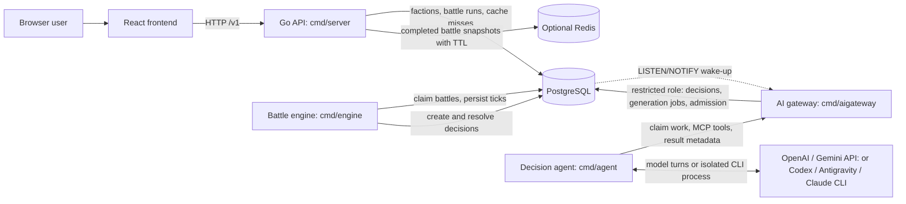
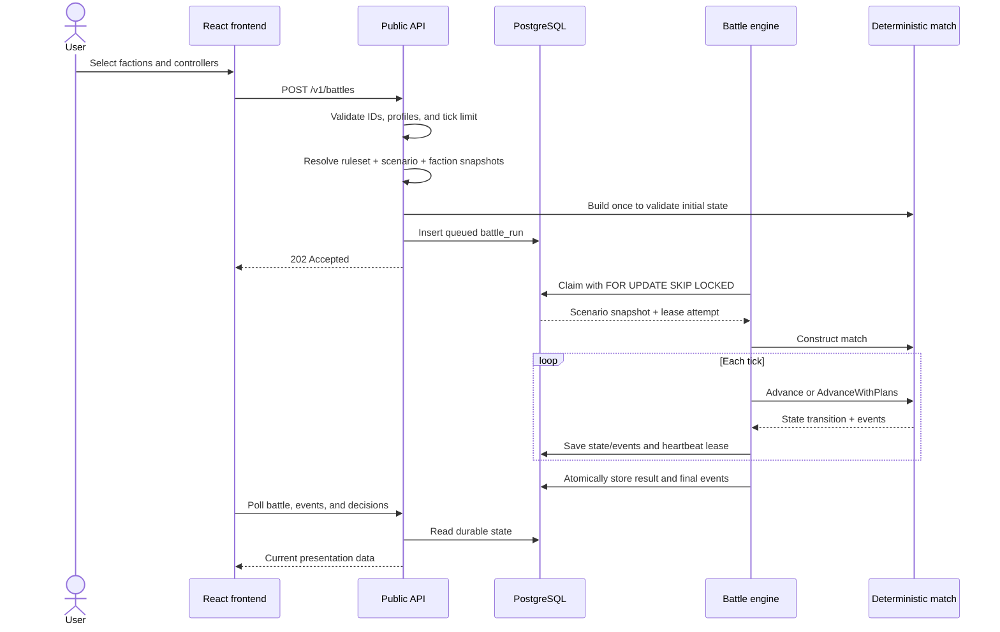
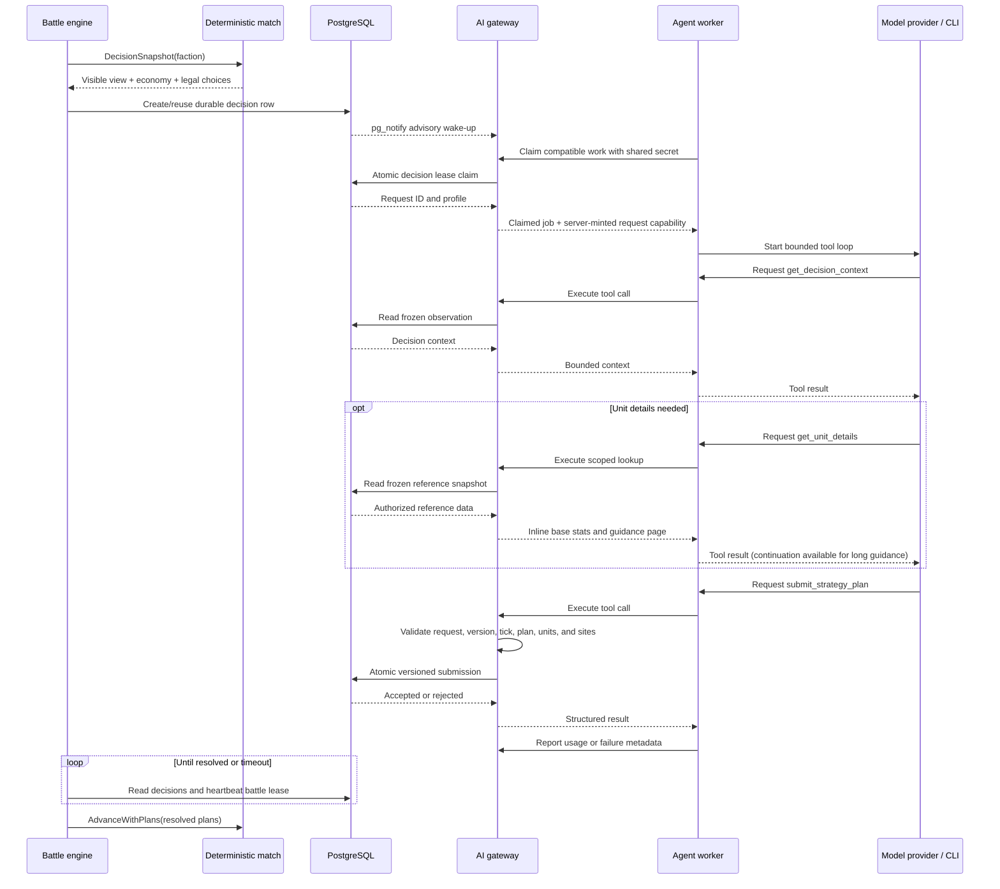

# OrdinalFrontier System Architecture

OrdinalFrontier is a deterministic strategy battle simulator. The implementation
uses `autonomous-battlefield` and `battlefield` as technical identifiers.

| Field | Value |
| --- | --- |
| Status | Current |
| Audience | Contributors reviewing or extending system behavior |
| Scope | Runtime components, data flows, durability, security, and deployment topology |

For a package-by-package explanation of the implementation, see the [codebase guide](../developer/codebase-guide.md).

Jump to [components](#3-runtime-components), [boundaries](#4-architectural-boundaries),
[flows](#5-core-runtime-flows), [AI decisions](#6-ai-decisions),
[persistence](#7-persistence-and-durability), [security](#8-security-and-trust-boundaries),
[deployment](#10-deployment-topology), or [limitations](#13-current-limitations-and-follow-up-questions).

## 1. Purpose

OrdinalFrontier is a deterministic castle-siege auto-battler. Users create reusable faction doctrines, stage a finite battle between two factions, and watch a separate engine execute it. Each faction can use either deterministic scripted plans or a model-backed strategic controller.

The central architectural rule is:

> Models propose bounded strategy plans. The deterministic engine validates and applies those plans and remains the only component that controls battlefield-state mutation.

This document describes the system's runtime boundaries and interactions. The
[AI decisions](ai-decisions.md) page owns the engine–model contract;
[database](database.md) owns schema and coordination rules;
[configuration model](configuration.md) owns environment files and Secret
boundaries; and [observability architecture](observability.md) owns telemetry
contracts and reliability objectives. Operational instructions remain in
[deployment](../operations/deployment.md) and
[observability operations](../operations/observability.md).

## 2. System context

PostgreSQL is the durable coordination point. The API and engine do not call each other directly, and the engine and agent do not call each other directly. Each workload can fail or restart while preserving battle and decision state.

## 3. Runtime components

| Component | Responsibility | Direct dependencies |
| --- | --- | --- |
| React frontend | Session-aware navigation (Cloudflare Access in production, development login locally), faction creation, battle staging and history, map display, controls, event stream, and AI decision history | Public API |
| Public API | Access identity verification, role/ownership authorization, managed Player membership, HTTP validation, scenario resolution, faction and battle persistence, and selectable model-profile catalog | PostgreSQL, embedded scenario/ruleset/content YAML, optional Redis, optional Cloudflare Access group API |
| Battle engine | Battle queue claims, deterministic ticks, strategy windows, state/event persistence | PostgreSQL |
| AI gateway | MCP tool server with request-scoped battle tools (`get_decision_context`, `get_unit_details`, `submit_strategy_plan`) and background-generation tools, plus the agent dispatch API (claims, capability minting, result reports) | PostgreSQL |
| Decision agent | Model-decision claims and API or CLI model execution | AI gateway, model provider |
| Redis (optional) | Disposable completed battle read cache; no engine or readiness dependency | Memory, API-only connection |
| PostgreSQL | Factions, battle queue, event history, snapshots, leases, and model decisions | Persistent storage |
| Scenario catalog | Authored map, timing, fallback plans, unit/building rules, and combat rules, resolved from versioned [content libraries](../developer/content-library.md) | Embedded in the server binary (`backend/gamedata`), validated at API startup and frozen into battle rows |

The backend commands are `cmd/server`, `cmd/engine`, `cmd/aigateway`, `cmd/agent`, and `cmd/aieval`. The first four are runtime processes; `aieval` runs deterministic offline cases or explicitly enabled live comparisons and produces reports.

### Why four backend processes?

- The API remains responsive while battles and model calls take time.
- The engine can restart or scale without exposing gameplay HTTP routes.
- Provider credentials and model behavior remain outside the deterministic simulation process.
- The AI gateway can receive narrower database permissions than the API or engine.
- Local subscription CLIs can run on a developer host without copying login credentials into Kubernetes.

## 4. Architectural boundaries

### Process health ownership

The API and engine entry points compose `httpapi.LifecycleHandler` around application traffic. That handler alone serves `/startupz`, `/livez`, `/healthz`, `/readyz`, and `/metrics`; the inner application router does not register duplicate probes. Engine readiness combines `Worker.Ready()` with a database ping. Database failure affects readiness while liveness remains available.

### Source ownership

See the [backend guide](../developer/backend-guide.md#backend-organization) for package
boundaries, the [frontend guide](../developer/frontend-guide.md) for browser ownership,
and the [codebase guide](../developer/codebase-guide.md#executable-entry-points) for launchers.

### Browser delivery

The frontend is a static build served by Nginx. Nginx requires revalidation of the
SPA entry document after rollouts and returns 404 for missing hashed assets instead
of routing those requests to HTML. Every Nginx response carries
`frame-ancestors 'none'` CSP, `X-Frame-Options: DENY`, `nosniff`, a strict-origin
referrer policy and HSTS, so the admin and gameplay UI cannot be framed for
clickjacking. The CSP deliberately leaves script and connect sources open because
`VITE_API_URL` may name a separate API origin.

### Battle inspection

The browser presents a battle from one selected perspective, but the perspective
selector controls presentation only: server-side role and ownership checks remain
the access boundary, and faction views are projected on the server. Participant
background and doctrine come from the persisted scenario, not the editable faction
directory. The presentation accepts multiple participants; battle creation,
scenario spawns, opponent selection, and castle-destruction victory rules still
require two factions.

See the [frontend guide](../developer/frontend-guide.md#battle-data-lifecycle) for
request lifecycle, inspector state, map layout, and animation;
the [OpenAPI contract](openapi.yaml) for state, event and context fields, and the
[HTTP API reference](api.md#battle-state-and-fog-of-war) for fog-of-war projection;
[saved decision context](ai-decisions.md#saved-decision-context) for what the
inspector can show of a model's input; and [game rules](../game/game-rules.md) for
movement and attack resolution.

### Deterministic simulation boundary

The simulation receives a resolved scenario and optional plans, then produces deterministic state transitions and events. It does not access PostgreSQL, HTTP, environment variables, or model providers.

The engine owns orchestration around this pure domain: leases, retries, pauses, decision deadlines, persistence, and shutdown handling. Movement and attack targeting use authoritative engine state; faction sight filters AI observations rather than controlling these engine paths.

### Public application boundary

Production requires Cloudflare Access on the whole application hostname through a named Tunnel. The API independently verifies the Access JWT and maps issuer/subject identity and verified email to a role on every request. Privileged roles remain configured; optionally managed Player membership is read from PostgreSQL. No legacy password/cookie fallback is accepted. Explicit local-password and disabled-development modes remain development-only. Exact-origin mutation checks and a deny-by-default route permission registry wrap every application API. The browser never connects to the engine, AI gateway or PostgreSQL. See [limited-access launch](../operations/limited-launch.md).

### Model boundary

The model never receives a repository, global game state, or mutation function. It can only:

1. read one authorized faction-visible decision context;
2. look up frozen reference details for units in that context;
3. submit one validated strategy plan for that decision.

### Durable coordination boundary

Battle work and model work are both durable PostgreSQL state machines. Notifications and long-polling improve latency but are not correctness dependencies.

## 5. Core runtime flows

### 5.1 Create and run a battle

Battle execution is asynchronous from the creation request. Each battle stores a complete resolved scenario and initial state, so later edits to factions or catalog YAML cannot change an existing run.

### 5.2 Strategy decision window

A decision window occurs immediately before ticks configured by `decisionIntervalTicks`. The supplied scenario currently uses ticks 10, 20, 30, and so on.

The engine creates a decision row for every faction:

- A `scripted` controller submits its deterministic baseline immediately through the same validation service.
- A `model` controller remains pending until an agent claims and resolves it.

Using the same durable record shape supports consistent history and scripted-versus-model evaluation.

The first worker transition is an opening decision at tick zero, using the same
durable records, deadlines, and attempt/requeue semantics. The worker persists the
opening state and events through `SaveTick` before tick one, and the persisted
`openingComplete` flag prevents repeated spending. Battles stored before doctrine
snapshots (`snapshotVersion` below 2) keep their starting blueprints, initial
upgrade bonuses and original decision schedule.

### 5.3 Timeout and fallback

The battle must make progress even if a model does not answer.

At the decision deadline:

- the tick-zero opening uses a deterministic sorted-roster purchase fallback;
- the first in-battle production window uses the scenario's scripted baseline;
- later windows reuse the faction's previously active plan;
- the fallback is stored with status `fallback` and error category `timeout`;
- a racing model submission and fallback are resolved by version and status predicates, so only one wins;
- the stored plan is applied exactly like an accepted model plan.

### 5.4 Pause, resume, and stop

- Pausing a queued battle prevents it from being claimed.
- Pausing a running battle retains and heartbeats its lease.
- Paused time extends the current decision and tick deadlines.
- Resuming continues the same in-memory attempt.
- Stopping releases the battle lease and fails outstanding decisions with `battle_stopped`.
- A stopped or reclaimed battle prevents the previous engine owner from making further guarded writes.

### 5.5 Battle expiry

Unfinished battles expire one hour after creation, including queued and paused
time. The engine sweeps at startup and every minute independently of active
battle processing. It atomically marks expired battles failed with
`battle_timeout`, clears their leases, and cancels pending/running decisions
using the existing `battle_stopped` cancellation category. History and tick
state remain available; active admission slots are released but daily usage is
not refunded. While the engine is offline, expiry waits for restart.

## 6. AI decisions

Each faction's controller is either scripted or a model profile. For a model, the
decision agent claims the durable decision, runs an API tool loop or an isolated
subscription CLI against the AI gateway's MCP tools, and the gateway validates and
records one submitted plan. The engine applies whatever the decision resolved to,
accepted or fallback, exactly like a scripted plan. Background drafting for
faction profiles reuses the same workers, runners and capability model with a
separate tool set.

[AI decisions](ai-decisions.md) owns this contract: runners and CLI isolation,
prompt provenance and faction memory, the decision context and unit knowledge, plan
validation, fallback error categories, and background generation.

## 7. Persistence and durability

PostgreSQL schema, access and coordination rules are in the [database guide](database.md).
This section covers the completed-result cache, battle retries and history reads.

### Completed battle result caching

The API service optionally checks Redis before `GetBattle` reads PostgreSQL. A miss,
invalid entry, or Redis error falls back to PostgreSQL. Only a `completed` run with
non-null result is stored, as a JSON snapshot containing its final state and scenario.
Existing battle responses retain their schema. Faction views are projected from the
snapshot after retrieval; event payloads and decision history remain PostgreSQL reads.
Authentication runs before cache access. Engine and AI gateway persistence never use Redis.

Keys are `battlefield:completed-battle:v1:<lowercase-battle-uuid>`, with a default
one-hour TTL and 100 ms deadline per cache operation, with command retries disabled.
Completed runs cannot currently be restarted or modified by application commands, so
no writer invalidation is required. Any future result edit, battle deletion/reuse, or
restart of a completed battle must add invalidation/versioning before release. After
restoring PostgreSQL, clear the dedicated cache database or use a fresh Redis database.
The `v1` namespace must change for incompatible cached schema changes.

Redis is lazy-connected, optional, and excluded from readiness. An empty
`BATTLEFIELD_REDIS_URL` disables it. Malformed URLs fail API initialization without
logging their credentials; outages and cache write failures do not fail battle reads.
Concurrent misses may issue duplicate database reads; this first implementation does
not coalesce requests. Redis expiry and eviction bound the cached working set. Use a
separate Redis database or instance per deployment environment.

See [Redis operations](../operations/redis.md) for setup and verification.

### Battle retries

Every mutating battle write includes battle ID, attempt, and lease owner. A mismatched write fails with lease loss.

A reclaimed battle starts a new deterministic attempt from `initial_state`; events from earlier attempts remain available by attempt number. When an observation hash matches a previously resolved decision for the same faction and target tick, the decision repository can reuse that plan.

Each claim increments `attempt`. Once a queued or lease-expired battle has used
`engine.maxAttempts` (default 3), the next claim pass marks it `failed` with
`attempts_exhausted` instead of starting another attempt. A stored scenario that
cannot construct a match fails immediately with `invalid_scenario` and is not
retried. Together with `battle_timeout` (see
[battle expiry](#55-battle-expiry)), these are
the engine's terminal battle error codes.

See [engine capacity and recovery limits](observability.md#engine-capacity-and-recovery-limits)
for serial queue processing, claim timing, shutdown handoffs and database failures.

Decision wake-ups use the `battlefield_decision_ready` PostgreSQL channel, with the
profile ID as payload.

### Battle history reads

`GET /v1/battles` projects participant identities and controllers from the
immutable scenario snapshot in a single query, with lifecycle timestamps,
progress, status and a compact outcome. It does not load simulation states or use
the completed-result cache. Keyset pagination on `battle_runs_history_idx`
(`created_at DESC, id DESC`) fetches one extra row to detect the next page; status
filters read current values, so membership may change between requests.

## 8. Security and trust boundaries

### Access identity, roles and owners

Access verification failures attach a bounded `auth_failure` reason code to the
existing `http_request_completed` server log, correlated by `request_id`. Codes
distinguish assertion, JWKS retrieval, signature, claim and identity failures;
raw tokens, claims, cookies, secrets and upstream error messages are excluded.
HTTP responses remain generic. Failed key refresh reasons persist through the
existing 30-second retry throttle; authentication and cache policy are unchanged.

Production API manifests require `BATTLEFIELD_ENV=production`; startup accepts only
`BATTLEFIELD_AUTH_MODE=cloudflare` with valid issuer (`BATTLEFIELD_ACCESS_ISSUER`),
audience (`BATTLEFIELD_ACCESS_AUDIENCE`), HTTPS origin (`BATTLEFIELD_PUBLIC_ORIGIN`)
and nonconflicting email/role assignments (`BATTLEFIELD_ACCESS_ROLES`). JWT verification uses RS256, a fixed issuer's
JWKS with one-hour key cache and a 30-second refresh throttle, and required identity/
time/audience checks. The audience claim accepts a single string or an array of
strings (RFC 7519 section 4.1.3), matched exactly and case-sensitively to the
configured audience. Invalid types and arrays with non-string entries are rejected.
Missing or unverifiable credentials deny access. Access owns
sessions and logout; the application issues no production auth cookie.
The frontend requests logout before changing its session display; a failed request
keeps the current screen visible with a retry message rather than implying the
session ended. A successful Access logout response directs the browser to
`/cdn-cgi/access/logout`.

Players, Developers and Admins share gameplay/faction reads. Mutation ownership is
stored in PostgreSQL and taken from the authenticated request, never client JSON.
Legacy rows belong to `legacy-admin`. Only Admin can manage another owner's rows.
Decision history/context require Developer/Admin. Player gameplay projections run
after shared cache retrieval and omit model diagnostics, raw prompts and internal
errors. The frontend hides inspection panels and stops their requests for Players.
Cloudflare Access admission and MFA are independent deployment requirements. For static roles, user
removal requires Access rule removal, session revocation, application role removal,
and deployment to every replica; offline JWT verification alone cannot see revocation.
Managed Player removal instead denies each new API request from PostgreSQL immediately
and asynchronously removes the email from a dedicated Access group. It does not
revoke sessions in unrelated Cloudflare applications.

The local password login retains signed HttpOnly/SameSite cookies for development.
Missing auth mode and enable flags fail startup; explicit legacy enable flags remain
supported only in development. Local cookie logout does not revoke copied tokens.

### Managed Player invitations

Optional Admin → Members routes persist Player grants/removals and audit events in
PostgreSQL. Migration 00013 adds `player_members`, `player_membership_sync`, and
`player_membership_audit`. The singleton imports configured Players once, retaining
removed-member tombstones across restarts. Every initialization also durably
revokes and audits prior Player invitations for configured privileged identities,
so subsequent privileged-role removal cannot resurrect Player access. Admin/Developer roles and CI identities
continue through their existing authentication paths; membership cannot elevate roles.
After signature/issuer/audience/time validation, Player authentication reads current
desired access and confirmed membership version with a two-second deadline and no
positive cache. Lookup failure denies access; `issuer|subject` ownership is unchanged.

The API process starts a cancellable reconciler when `BATTLEFIELD_MANAGED_PLAYERS`
is enabled. A transaction advisory lock serializes remote writes across replicas;
repeatable-read transactions reject concurrent edits before confirming a grant.
Mutations lock only the singleton desired-state row, not the remote worker lock,
so removals commit while a Cloudflare call is in flight. A successful PUT confirms
current versions; failures persist bounded retry backoff. Restart recovery and
one-minute full-list reconciliation repair ambiguous writes and dedicated-group drift.

The API alone receives `battlefield-members`; its token can manage Access groups
within the configured account, while code only calls the configured group endpoint.
The browser sees emails, access/sync status and a game URL, never the token. Empty
membership sends an explicitly deny-all group. No policy edits or account-wide
session revocation are automated. New grants stay inactive until confirmed; removals
block subsequent API requests immediately, without cancelling already accepted work.
See [Player invitations](../operations/player-invitations.md) for activation, policy
separation, credential rotation, rollback limitations and live acceptance checks.

### Model access and role preview

The administrator-only `/admin` control center uses `GET /v1/admin/model-access` and
`PUT /v1/admin/model-access` to manage provider and individual profile access, including
allowed roles. Migration `00012_model_access.sql` adds a singleton PostgreSQL
policy row. Version checks reject conflicting saves with HTTP 409. Each API
selection reads the durable policy with a bounded timeout, so replicas and restarts
share settings; read failures make models unavailable. The policy can restrict
access but cannot activate missing credentials or deployment-disabled runtimes.
Role overrides supersede configured `allowedRoles`; an explicit empty role list
denies everyone. Players can select API or CLI profiles only when explicitly included
in the profile’s allowed roles; default roles remain Admin and Developer. Disables apply to
new battle selection and background-generation admission; already accepted jobs
and frozen controller snapshots continue unchanged. This is not an emergency stop.

Role preview keeps the administrator's authenticated session and identity while
applying Player or Developer read permissions. The browser sends
`X-Battlefield-Preview-Role`; authentication validates the real administrator before
preview middleware substitutes the effective role ahead of route authorization.
Both transport and server reject mutations during preview. Navigation and inspection
use the effective role, and switching roles remounts route content to clear privileged
cached views. Exit preview restores the administrator view; logout/session expiry
also clears preview. This previews the administrator's own ownership, not another
person's account. Role preview does not invite users, fabricate audit events, or
provide budget controls.

### Model-facing capability

The AI gateway mints each model session an HMAC-signed token containing one request ID and expiry. Workers cannot mint capabilities and never receive the signing secret. The gateway's MCP endpoints verify the signature, expiry, and equality between the authorized and supplied request IDs.

Tool bodies are bounded, plan fields are validated, and model-provided state is never authoritative.

### Agent control plane

`/internal/agent/claim`, `/fail`, `/usage`, `/generation-finish` and `/enabled`
require a distinct worker bearer secret of at least 32 bytes, compared in constant
time. The AI gateway refuses to start, and denies worker authentication, when it is missing,
shorter or equal to the signing secret. Every worker placement (the K3s API
worker and the CLI worker VM) currently shares this one secret. Claims return server-minted, request-scoped
capabilities; workers never receive the signing key.

The AI gateway is private to the worker network. Production subscription CLI workers run in
an isolated VM and reach it through an authenticated private bridge. Their
provider egress is allowlisted; provider login state stays inside the worker
boundary. Development bridges bind to loopback. Workers poll the durable operator
AI switch and cancel work on stop or loss of policy connectivity. The
[worker operations guide](../operations/agent-vm.md) owns addresses, proxy settings,
firewall rules and service installation.

### Production automation identity

Cloudflare signs service-authentication JWTs for the enrolled
`BATTLEFIELD_ACCESS_CI_CLIENT_ID`. After normal issuer, audience, expiry and
signature validation, an exact `common_name` match with `type: app` and empty
user subject/email produces a separate `ci` actor limited to GET session and
scenario-catalog routes. It cannot control
battles or use admin/inspection routes. Human roles and direct-origin denial
remain independent. The application receives the client ID, while the client
secret stays with the verification tooling. Credential setup and rotation live
in the [service authentication runbook](../operations/limited-launch.md#ci-service-authentication).

### Runtime security requirements

- Every binary validates `BATTLEFIELD_ENV` (unset, `dev` or `production`) at startup, so a misspelt value cannot disable production-only checks.
- The AI gateway requires a capability secret and a worker secret of at least 32 bytes each, different from each other; the agent requires the same worker secret. Secrets copied unchanged from `.env.example` (`replace-with-…`) and the retired public development capability secret are rejected, as they are for the admin password and session secret. Deployment validation of `.env` rejects those worker and capability values too, so a deployment fails before it changes the cluster.
- In production, the API server and the agent refuse to start with an offered CLI profile unless `BATTLEFIELD_CLI_ISOLATION_VERIFIED=true`. They decide whether a profile is offered with the same availability check the profile catalog uses.
- Production sessions use Access identity; direct-origin access is denied and network policy restricts private services.
- Provider credentials belong to the decision agent, separate from the API and engine.
- Model rationale remains untrusted display text; bounded length does not make it authoritative.
- CLI isolation depends on the configured, validated provider version family.

The [access and isolation runbook](../operations/limited-launch.md) owns credential
provisioning, network verification and enablement procedures.

## 9. Configuration and profile availability

The common YAML configuration defines HTTP, database, API, authentication, engine, and AI settings. Each process loads only the sections it needs. Authentication names the environment variables holding its enable flag, credentials, signing secret, and Secure-cookie flag; the API fails startup when enabled secrets are missing or too short. Development application settings live in the Git-ignored project-root `.env`; the deployer separates them into database, authentication, and AI Kubernetes Secrets. Production uses the same application schema in a private `.env` beside `deployment.env`.

A model profile specifies:

- stable ID and display name;
- provider and API/CLI runtime;
- cluster or local scope;
- API credential/model environment variables or a pinned CLI model identifier;
- optional external-agent availability environment variable;
- token and step limits;
- enabled state and supported CLI version prefix.

Key runtime settings and their defaults:

| Setting | Default | Effect |
| --- | --- | --- |
| `api.maxTicks` | 10000 (maximum) | Upper bound for a battle's requested tick limit |
| `engine.pollInterval` | 1s | Delay between empty battle-queue claims |
| `engine.leaseDuration` | 30s | Battle lease length; an expired lease lets another engine reclaim the battle |
| `engine.heartbeatInterval` | 10s | Lease renewal cadence; must be shorter than `leaseDuration` |
| `engine.maxAttempts` | 3 | Claims per battle before `attempts_exhausted` |
| `engine.shutdownTimeout` | 10s | Bound for final writes and requeue during shutdown |
| `ai.decisionTimeout` | 2m | Engine decision deadline and agent execution timeout |
| `ai.agentConcurrency` | 1 | Execution slots per agent process (1–4) |
| `resultCache.ttl` / `resultCache.timeout` | 1h / 100ms | Completed-battle cache entry lifetime and per-operation deadline |

`backend/config.yaml` is the reference for all keys; unknown keys fail startup.

The API catalog advertises profiles users may select. In cluster mode, an operator flag can advertise a host-connected CLI even though the API pod cannot execute it. An agent advertises only profiles it can execute; claims include those IDs so heterogeneous agents do not lease incompatible work. The worker ID and profile list are self-reported: this is a scheduling filter, not an authorization boundary, because the AI gateway does not bind the worker secret to a placement or profile set.

## 10. Deployment topology

Kubernetes hosts the runtime processes; battle rules and database coordination do
not depend on Kubernetes APIs. Local development uses Kind. Production runs K3s
in a dedicated VM, with a separate VM for subscription CLI workers. Development
and production have distinct clusters, databases, volumes and credentials.

| Workload | Communication and state |
| --- | --- |
| Frontend | Serves the browser application, which calls the API through the shared gateway; no durable game state. |
| API | Reads and writes PostgreSQL, optionally caches completed results in Redis, and exposes authenticated HTTP routes. |
| Engine | Claims work and persists ticks through PostgreSQL; exposes health and metrics rather than gameplay routes. |
| AI gateway | Exposes private MCP decision tools and agent dispatch routes, with narrower database privileges than the API or engine. |
| API-provider agent | Calls the AI gateway and external model APIs; provider keys stay in this workload. |
| Migration Job | Applies database migrations separately from long-running application workloads. |

Public production traffic passes through Cloudflare Access and the tunnel to the
private gateway. Network policies keep AI gateway and database access private while
allowing the required workload and monitoring connections. CLI workers use a
private AI gateway bridge and restricted provider proxy; subscription credentials stay
outside the application cluster.

PostgreSQL is the durable game-state store. Persistent volumes retain database
and supported observability data across pod replacement; Redis remains a
disposable cache. Retained storage does not provide whole-host disaster recovery.
The application and worker VMs share a physical host, so their process/network
isolation does not eliminate the common host failure domain.

Application configuration is separated into workload-specific Secrets and a
non-secret ConfigMap. Deployment identity stays outside application Secrets;
see the [configuration model](configuration.md). Production image admission
requires verified image provenance. AI build manifests include a checkout-independent
evaluation corpus digest over the tracked files' contents and relative names. Registry publication, controller provisioning,
migrations and rollback procedures belong to [deployment operations](../operations/deployment.md),
[K3s delivery](../operations/k3s-delivery.md), and the
[supply-chain runbook](../operations/supply-chain-runbook.md).
The image-verification admission webhook fails closed on missing or invalid
evidence; see [admission verification](../operations/limited-launch.md#validation-and-recovery)
for the configured retrieval timeout.
The advisory retention inventory publishes only after cluster and registry reads
succeed; a failed collection preserves the previous report. Registry deletion is
not automated.

## 11. Observability

- Processes emit structured JSON logs with stable `event` identifiers and readable
  `msg` summaries containing selected operational fields. The shared logging
  handler attaches `trace_id` and `span_id` from active contexts without moving
  those fields into user attribute groups. `LOG_LEVEL` defaults to INFO.
- API logs carry or generate `X-Request-ID`. Tracing wraps access logging so
  completion logs, including authentication rejections, share the request span.
- Every `/v1` error uses one JSON envelope written by `internal/apierror`; its
  `requestId` equals the `X-Request-ID` header and the `request_id` log field, so a
  client-reported failure maps to one log line. The identifier lives in the leaf
  `internal/observability/requestid` package because `httpapi` imports `authn`,
  which also writes errors. See the [API reference](api.md#errors).
- HTTP completion logs carry `actor_id` and `actor_role` from authentication
  middleware, providing request attribution rather than a tamper-proof audit
  store. Tokens, cookies and email headers are not logged. See
  [observability architecture](observability.md#structured-logs) for the full field list.
- Engine logs cover battle claims, lease loss, decision windows, fallbacks, requeues,
  and completion. Running battles and pending decision windows report progress
  immediately at their first reporting point and at most every 15 seconds
  thereafter. Waiting updates include pending faction counts; completion includes
  elapsed wall time. Per-tick persistence events require DEBUG logging.
- Agent and AI gateway logs cover decision claims, tool access, validation, provider outcome, usage, and latency.
- Full combat detail lives in `battle_events` rather than normal process logs.
- API and engine expose lifecycle checks; the agent exposes `/healthz` and `/status` (drain state: `draining`, `active`, `concurrency`; `SIGUSR1` stops new claims and `SIGUSR2` resumes them); the AI gateway exposes `/healthz` for liveness and `/readyz`, which pings PostgreSQL, for readiness.
- Prometheus, Grafana, Elasticsearch, Kibana, and Fluent Bit are provided for the local Kubernetes environment.
- Local Prometheus discovers nodes and scrapes each kubelet's cAdvisor endpoint
  using service-account authentication and the narrow `nodes/metrics`
  permission; it does not receive general kubelet proxy access.
- AI decisions are traced in full and can be forwarded to an optional self-hosted
  Langfuse; see [AI observations](observability.md#ai-observations-in-langfuse).

## 12. Decisions and trade-offs

### Determinism over direct model control

Models submit strategy and production priorities rather than state mutations. This preserves replayability, legal-action enforcement, testing, and controller comparison.

### Durable database coordination over in-memory queues

Battle and decision work survives restarts. Leases and `SKIP LOCKED` support competing workers without another queue system, at the cost of additional PostgreSQL state-machine logic.

### Frozen snapshots over live catalog references

Rules, factions, and initial state are captured per battle. Replays remain stable, at the cost of larger JSONB rows and explicit version provenance.

### MCP as a capability boundary

The same small, auditable MCP tool surface supports API and subscription CLI models. The AI gateway also hosts the agent dispatch API, so one process holds the restricted database role and the capability signing secret. The trade-off is another service and authentication boundary.

### Polling with advisory wake-ups

The UI polls the API, the engine polls battle rows, and agents long-poll the AI gateway. PostgreSQL notifications reduce model-claim latency without becoming a correctness dependency. Higher scale may justify push delivery or a dedicated broker.

## 13. Current limitations and follow-up questions

- Production identity is delegated entirely to Cloudflare Access, so Access rule removal and session revocation are deployment responsibilities that offline JWT verification cannot observe. The development password login remains single-administrator and is not player identity.
- Public battle updates use polling rather than push delivery.
- Load and failover behavior needs testing before increasing engine, AI gateway, or agent replicas.
- Antigravity decisions prefetch the context into the prompt and refuse contexts over 64 KiB, because the CLI offloads large tool results to files it cannot read. Large late-game contexts therefore fall back for that profile.
- All worker placements share one control-plane secret, and claims self-report their profile IDs. A compromised worker could claim another placement's profiles. The secret cannot be rotated without changing every holder at once; the CLI VM's copy is replaced through the managed [`battlefield-platform/cli`](../operations/cli-worker.md) job.
- Rigorous controller experiments may need experiment identity, model parameters, and cost normalization beyond the current evaluation view.

## Related guides

- [Codebase guide](../developer/codebase-guide.md): packages, source ownership and implementation change paths.
- [Contributor CI](../developer/ci.md) and [cross-review](../developer/cross-review.md): development verification and review workflow.
- [AI decisions](ai-decisions.md): runners, decision context, plan validation and fallback attribution.
- [Database](database.md): schema, process access, claim and admission rules, and migrations.
- [Observability architecture](observability.md): signal paths, telemetry contracts and reliability objectives.
- [Deployment](../operations/deployment.md) and [Jenkins operations](../operations/jenkins.md): rollout, verification and recovery.
- [Server rebuild contract](../operations/server-rebuild-contract.md): infrastructure state and recovery boundaries, with links to host, VM, K3s, Cloudflare and local HTTPS procedures.
