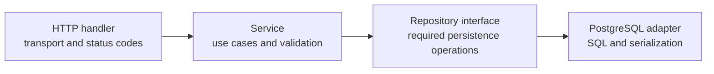

# Autonomous Battlefield Codebase Guide

| Field | Value |
| --- | --- |
| Status | Draft — describes the current working tree, including uncommitted changes |
| Last reviewed | 2026-09-02 |
| Audience | Contributors navigating or modifying the implementation |
| Scope | Repository layout, entry points, packages, dependencies, tests, and reading paths |

For runtime boundaries, data flows, durability, and security decisions, see the [system architecture](system-architecture.md).

## 1. Repository map

```text
autonomous_battlefield/
├── backend/
│   ├── cmd/
│   │   ├── server/       # Public API and migration command
│   │   ├── engine/       # Durable battle worker
│   │   ├── mcp/          # MCP tools and agent control plane
│   │   └── agent/        # Provider-neutral decision worker
│   ├── internal/
│   │   ├── ai/           # Decision contracts, validation, profiles, and runners
│   │   ├── app/          # API composition root
│   │   ├── battle/       # Battle delivery, use cases, persistence, and worker
│   │   ├── faction/      # Faction domain, delivery, use cases, and persistence
│   │   ├── game/         # Deterministic simulation domain
│   │   ├── config/       # Strict YAML and environment configuration
│   │   ├── httpapi/      # HTTP lifecycle, JSON, routing, and request logging
│   │   ├── postgres/     # Pool, migrations, and notifications
│   │   ├── logging/      # Structured logging setup
│   │   └── telemetry/    # Prometheus metrics
│   ├── migrations/       # Embedded Goose SQL migrations
│   ├── rulesets/         # Versioned game rules
│   └── scenarios/        # Authored battle templates
├── frontend/
│   └── src/
│       ├── api/           # Typed fetch clients
│       ├── components/    # Reusable visual components
│       └── pages/         # Route-level React components
├── deploy/
│   ├── base/              # Portable Kustomize resources
│   └── overlays/local/    # kind infrastructure and observability
├── scripts/
│   ├── ci/                # Lint, test, coverage, and image checks
│   └── cd/                # kind deployment, smoke test, and rollback
└── docs/design/           # Version-controlled design documentation
```

## 2. Executable entry points

The backend builds four binaries from one Go module.

| Process | Entry point | What the entry point owns |
| --- | --- | --- |
| API | [`backend/cmd/server/main.go`](../../backend/cmd/server/main.go) | Flags, configuration, migrations, PostgreSQL startup, catalog loading, application wiring, HTTP lifecycle |
| Engine | [`backend/cmd/engine/main.go`](../../backend/cmd/engine/main.go) | Configuration, PostgreSQL startup, worker construction, health server, signals, graceful requeue/shutdown |
| MCP | [`backend/cmd/mcp/main.go`](../../backend/cmd/mcp/main.go) | Restricted repository construction, PostgreSQL notification listener, MCP and agent-control routes, HTTP lifecycle |
| Agent | [`backend/cmd/agent/main.go`](../../backend/cmd/agent/main.go) | Profile registry, decision worker, health endpoint, signals, shutdown |

`cmd` packages should remain thin. Domain and use-case behavior belongs under `internal`; entry points should focus on composition and process lifecycle.

## 3. Backend organization

### Request-oriented features

Faction and battle HTTP features follow a handler → service → repository dependency direction:



- `api` packages translate HTTP requests, responses, and error categories.
- `service` packages enforce use-case rules and depend on narrow interfaces.
- `repo` packages implement those interfaces using PostgreSQL.
- [`backend/internal/app/app.go`](../../backend/internal/app/app.go) wires the API's concrete repositories, services, and handlers.

Repository interfaces live close to the service or worker that consumes them. This keeps the use case independent from a particular database implementation.

### Simulation-oriented code

[`backend/internal/game`](../../backend/internal/game) does not use the HTTP feature layering. It is an infrastructure-free domain package that takes resolved input and returns deterministic state transitions.

[`backend/internal/battle/engine/worker`](../../backend/internal/battle/engine/worker) is an application worker around that domain. It owns persistence orchestration but delegates game rules and state mutation to `game.Match`.

### AI-oriented code

[`backend/internal/ai`](../../backend/internal/ai) defines neutral contracts first, then separates execution into:

- an agent worker that leases jobs;
- a shared API-provider tool loop;
- isolated CLI runners;
- provider HTTP adapters;
- an MCP server and client.

The package root contains types and interfaces shared across these subpackages, avoiding provider-specific types in the engine or battle service.

## 4. Package guide

### `internal/game`: authoritative simulation domain

| File | Responsibility |
| --- | --- |
| [`types.go`](../../backend/internal/game/types.go) | Maps, rulesets, factions, units, buildings, state, events, results, controller config, and faction views |
| [`match.go`](../../backend/internal/game/match.go) | In-memory battle runtime, decision snapshots, production, tactics, movement, combat, and results |
| [`map.go`](../../backend/internal/game/map.go) | Hex-map validation, coordinates, traversal, and visibility helpers |
| [`rules.go`](../../backend/internal/game/rules.go) | Ruleset and point-buy blueprint validation |

`game.Match` is the in-memory authority for one battle attempt. Important methods include:

- `DecisionWindowDue` and `DecisionTargetTick` for production boundaries;
- `DecisionSnapshot` for a bounded faction-visible model input;
- `ScriptedPlans` for deterministic baselines;
- `AdvanceWithPlans` for plan application followed by a tick;
- `State` for a defensive copy of current state.

`Match` contains no database, HTTP, or model-provider dependency. Preserve this property when adding game behavior.

### `internal/battle/server/catalog`: authored inputs

[`catalog.go`](../../backend/internal/battle/server/catalog/catalog.go) strictly decodes scenario and ruleset YAML with unknown-field rejection. It validates templates, combines a scenario with two stored faction identities, and returns a complete resolved `game.Scenario` plus digest.

The API stores this resolved value in `battle_runs.scenario_snapshot`. The engine therefore does not reload live YAML when it claims a battle.

### `internal/battle/server/service`: battle use cases

[`service.go`](../../backend/internal/battle/server/service/service.go) contains public battle rules:

- validate battle IDs, participants, controller selections, and tick counts;
- ensure requested model profiles are available;
- load faction identities;
- resolve and hash the scenario snapshot;
- create an initial `game.Match` to validate the battle;
- enqueue, read, pause, resume, and stop battles;
- read events, decision history, and faction perspectives.

[`repository.go`](../../backend/internal/battle/server/service/repository.go) defines the persistence operations required by these use cases. [`catalog.go`](../../backend/internal/battle/server/service/catalog.go) defines catalog-facing types and interfaces.

### `internal/battle/server/api`: battle HTTP delivery

[`handler.go`](../../backend/internal/battle/server/api/handler.go) registers and implements:

| Route | Handler responsibility |
| --- | --- |
| `GET /v1/scenarios` | Return selectable scenario summaries |
| `GET /v1/model-profiles` | Return selectable profiles and availability |
| `POST /v1/battles` | Decode and enqueue a battle |
| `GET /v1/battles/{id}` | Return current state and result |
| `GET /v1/battles/{id}/events` | Parse cursors and return durable events |
| `GET /v1/battles/{id}/decisions` | Return decision history for an attempt |
| `GET /v1/battles/{id}/factions/{factionId}/view` | Return a fog-of-war perspective |
| `POST /v1/battles/{id}/pause` | Pause an active battle |
| `POST /v1/battles/{id}/resume` | Resume an active battle |
| `POST /v1/battles/{id}/stop` | Stop an active battle |

Keep domain validation in the service. The handler should concentrate on transport validation and stable HTTP status mapping.

### `internal/battle/engine/worker`: durable execution

| File | Responsibility |
| --- | --- |
| [`repository.go`](../../backend/internal/battle/engine/worker/repository.go) | Battle-job, lease, and worker repository contracts |
| [`worker.go`](../../backend/internal/battle/engine/worker/worker.go) | Claim loop, deterministic attempts, tick persistence, decisions, pause, retries, and shutdown |
| [`health.go`](../../backend/internal/battle/engine/worker/health.go) | Worker readiness behavior |

The worker's main call path is:

```text
Run
└── ClaimBattle
    └── process
        └── game.NewMatch
            └── runBattle
                └── runTick
                    ├── waitWhilePaused
                    ├── resolveDecisionWindow (when due)
                    ├── Match.Advance / AdvanceWithPlans
                    ├── SaveTick
                    └── CompleteBattle
```

`resolveDecisionWindow` freezes contexts for both factions, persists durable decision rows, immediately resolves scripted controllers, waits for model controllers, applies timeout fallbacks, and returns one plan per faction.

All persistence calls carry the current battle lease. Do not add an unguarded write path that allows a stale attempt to update the battle.

### `internal/battle/repo`: PostgreSQL battle adapter

[`postgres.go`](../../backend/internal/battle/repo/postgres.go) implements both public battle persistence and engine queue operations. It contains the battle lease predicates and atomic state/event writes.

[`decisions.go`](../../backend/internal/battle/repo/decisions.go) implements the AI decision repository:

- create or reuse decisions;
- notify waiting agents;
- atomically claim compatible model work;
- accept a versioned/idempotent plan;
- resolve fallbacks;
- record provider failures, validation failures, usage, and metadata;
- list per-window and per-battle decision history.

SQL concurrency behavior is part of the application's correctness. Changes to status predicates, `FOR UPDATE SKIP LOCKED`, versions, owners, attempts, or leases require focused concurrency and race tests.

### `internal/ai`: shared contracts

| File | Responsibility |
| --- | --- |
| [`types.go`](../../backend/internal/ai/types.go) | Decision sessions, contexts, submissions, records, model turns, tools, usage, and profiles |
| [`repository.go`](../../backend/internal/ai/repository.go) | Durable decision repository contract and errors |
| [`service.go`](../../backend/internal/ai/service.go) | Context reads, plan validation, observation hashes, and HMAC capabilities |
| [`profiles.go`](../../backend/internal/ai/profiles.go) | API/CLI profile validation and availability evaluation |

`DecisionRunner` is the execution boundary used by the agent. `TurnProvider` is the narrower boundary implemented by model APIs that participate in the shared tool loop.

`DecisionService` deliberately receives only a `DecisionSubmissionRepository`, which cannot modify battles or simulation state.

### `internal/ai/agent`: provider-neutral worker

[`worker.go`](../../backend/internal/ai/agent/worker.go) starts one claim loop per concurrency slot. Each loop:

1. long-polls the MCP agent-control endpoint with executable profile IDs;
2. immediately runs the claimed job in its owned slot;
3. requires the claimed profile from the local registry;
4. mints a request-scoped capability;
5. creates an API or CLI runner;
6. applies a decision timeout;
7. reports usage or failure metadata through MCP.

The default runner factory is the only place that chooses concrete provider implementations from a model profile.

### `internal/ai/runner`: model execution mechanisms

| File | Responsibility |
| --- | --- |
| [`agent_loop.go`](../../backend/internal/ai/runner/agent_loop.go) | Shared bounded tool loop for API providers |
| [`mcp.go`](../../backend/internal/ai/runner/mcp.go) | Authenticated streamable HTTP MCP client and normalized tool calls |
| [`cli.go`](../../backend/internal/ai/runner/cli.go) | Isolated Codex/Gemini CLI execution and environment setup |

The API loop discovers exactly two MCP tools and accepts only those names. It appends tool calls and results to the neutral message transcript and accumulates usage over turns.

The CLI runner creates a temporary directory, passes the profile's allowlisted model explicitly with `--model`, and constructs provider-specific command-line restrictions. Tests use the `CommandExecutor` interface to inspect the selected model and execution restrictions without starting a real CLI.

### `internal/ai/providers`: external API adapters

[`openai.go`](../../backend/internal/ai/providers/openai.go) translates neutral tools into OpenAI Responses function tools. [`gemini.go`](../../backend/internal/ai/providers/gemini.go) translates them into Gemini function declarations.

Both adapters:

- accept a configurable HTTP client and endpoint for tests;
- normalize token usage and tool calls;
- map safety/refusal results to a common error;
- contain no battle or database logic.

### `internal/ai/mcpserver`: model and agent boundary

[`server.go`](../../backend/internal/ai/mcpserver/server.go) exposes two distinct HTTP surfaces:

- `/mcp` is the request-capability-protected model tool surface;
- `/internal/agent/*` is the shared-secret agent control plane for claims and result metadata.

The MCP tools are:

- `get_decision_context`;
- `submit_strategy_plan`.

The server validates request scope before calling `DecisionService`. PostgreSQL notifications close an in-memory wake-up channel so long-polling claim requests promptly query durable state.

### `internal/battle/simulation/controller`: deterministic policy abstractions

[`types.go`](../../backend/internal/battle/simulation/controller/types.go) defines `PlanProposal`, action candidates, strategy plans, and a controller interface. `PlanProposal` is actively used by the game, AI subsystem, scenarios, repository, API, and frontend.

[`utility_controller.go`](../../backend/internal/battle/simulation/controller/utility_controller.go) is an independently tested in-memory utility controller with its own decision scheduling and pending-plan lifecycle. It is not constructed by the API, engine, or `game.Match` production path. The current match consumes `PlanProposal` directly and performs deterministic action scoring internally.

Treat the utility controller's scheduling types as a standalone or transitional abstraction unless it is deliberately integrated later.

### `internal/faction`: reusable blueprints

| Area | Responsibility |
| --- | --- |
| [`faction.go`](../../backend/internal/faction/faction.go) | Stored and decorated faction model |
| [`service`](../../backend/internal/faction/service) | UUID/name validation, ruleset lookup, blueprint validation, design-cost decoration |
| [`api`](../../backend/internal/faction/api) | Faction and faction-ruleset HTTP routes |
| [`repo`](../../backend/internal/faction/repo) | PostgreSQL serialization and errors |

Deleting a faction removes it from the active registry but does not affect the copied participant data inside existing battle snapshots.

### Shared infrastructure packages

- [`internal/config/config.go`](../../backend/internal/config/config.go) strictly decodes one YAML document, rejects unknown fields, resolves environment variables, and provides process-specific loaders.
- [`internal/postgres`](../../backend/internal/postgres) manages the `pgx` pool, embedded Goose migrations, startup retries, and `LISTEN/NOTIFY`.
- [`internal/httpapi`](../../backend/internal/httpapi) provides bounded strict JSON, lifecycle/readiness routes, request IDs, routing, and access logging.
- [`internal/logging`](../../backend/internal/logging) configures structured process logging.
- [`internal/telemetry`](../../backend/internal/telemetry) defines Prometheus metrics used by API and engine.

## 5. Important shared data types

| Type | Defined in | Used for |
| --- | --- | --- |
| `game.Scenario` | `internal/game/types.go` | Complete immutable input to a battle attempt |
| `game.State` | `internal/game/types.go` | Current authoritative simulation snapshot |
| `game.Transition` | `internal/game/types.go` | One tick's state, events, and optional result |
| `game.View` | `internal/game/types.go` | Faction-projected fog-of-war state |
| `controller.PlanProposal` | `battle/simulation/controller/types.go` | Scripted/model strategy and production input |
| `ai.DecisionContext` | `internal/ai/types.go` | Frozen bounded model observation |
| `ai.DecisionRecord` | `internal/ai/types.go` | Durable decision state and provenance |
| `service.BattleRun` | `battle/server/service/service.go` | Public/use-case representation of a stored run |
| `worker.BattleLease` | `battle/engine/worker/repository.go` | Attempt and ownership guard for engine writes |

When introducing a new field, identify its authority:

- simulation truth belongs in `game` types;
- public use-case state belongs in the relevant service;
- model-only context belongs in `ai` types;
- transport-specific request/response shapes should stay inside handlers or frontend clients.

## 6. Database migrations and adapters

Migrations under [`backend/migrations`](../../backend/migrations) are embedded into the server binary.

| Migration | Main change |
| --- | --- |
| `00001_create_factions.sql` | Initial faction table |
| `00002_create_battle_queue.sql` | Battle runs and per-attempt event stream |
| `00003_castle_siege_state.sql` | Ruleset/blueprint and battle state snapshots |
| `00004_battle_decisions.sql` | Model decisions, indexes, evaluation view, restricted MCP role |
| `00005_stop_battles.sql` | `stopped` battle status |
| `00006_pause_battles.sql` | Pause flag and unpaused claim index |

Schema changes should be made with a new migration, then reflected in repository scan/serialization logic and tests. Do not edit an already-applied migration to evolve a shared database.

## 7. Frontend organization

The frontend is a React/Vite single-page application.

| Area | Responsibility |
| --- | --- |
| [`App.tsx`](../../frontend/src/App.tsx) | Shared layout and route table |
| [`api/factions.ts`](../../frontend/src/api/factions.ts) | Typed faction and ruleset requests |
| [`api/battles.ts`](../../frontend/src/api/battles.ts) | Typed scenario, profile, battle, event, view, control, and decision requests |
| [`pages/CreateFactionPage.tsx`](../../frontend/src/pages/CreateFactionPage.tsx) | Point-buy faction builder |
| [`pages/FactionsPage.tsx`](../../frontend/src/pages/FactionsPage.tsx) | Faction registry and deletion |
| [`pages/CreateBattlePage.tsx`](../../frontend/src/pages/CreateBattlePage.tsx) | Scenario, participants, controllers, and tick-limit selection |
| [`pages/BattlePage.tsx`](../../frontend/src/pages/BattlePage.tsx) | Polling, map, perspective, controls, events, AI decisions, and statistics |
| [`components/HexBattleMap.tsx`](../../frontend/src/components/HexBattleMap.tsx) | Hex-map visualization |
| [`components/Emblem.tsx`](../../frontend/src/components/Emblem.tsx) | Deterministic faction emblem |

The browser's API boundary lives in `src/api`. Page components should consume typed client functions rather than duplicating `fetch` calls.

`BattlePage` contains several local hooks for status, events, decision history, and faction perspective. It polls while the battle is active and stops or slows behavior based on terminal/error state; there is no WebSocket or server-sent-event client.

## 8. Configuration and authored content

| Path | Purpose |
| --- | --- |
| [`backend/config.yaml`](../../backend/config.yaml) | Local process configuration and model-profile definitions |
| [`backend/.env.example`](../../backend/.env.example) | Local environment variable template |
| [`backend/rulesets`](../../backend/rulesets) | Versioned unit, building, economy, and combat values |
| [`backend/scenarios`](../../backend/scenarios) | Map layout, timing, scripted plans, and fallbacks |
| [`deploy/base/infrastructure/configmap.yaml`](../../deploy/base/infrastructure/configmap.yaml) | Cluster configuration equivalent |
| [`deploy/overlays/local/infrastructure/ai-secret.env.example`](../../deploy/overlays/local/infrastructure/ai-secret.env.example) | Local Kubernetes AI secret template |

Configuration is decoded with `yaml.KnownFields(true)`. Update the file-facing struct, parsed runtime struct, validation, examples, deployment ConfigMap, and tests together.

## 9. Deployment code

[`deploy/base`](../../deploy/base) contains portable Kustomize resources. [`deploy/overlays/local`](../../deploy/overlays/local) adds kind-specific PostgreSQL, Gateway API, observability, and logging resources.

The key application manifests are:

- `api-deployment.yaml` and `api-service.yaml`;
- `engine-deployment.yaml`;
- `agent-deployment.yaml`;
- `mcp-deployment.yaml`, `mcp-service.yaml`, and `mcp-network-policy.yaml`;
- frontend deployment and service;
- migration overlay job.

[`run-dev.sh`](../../run-dev.sh) is the local multi-process launcher. [`run-k8s-cli-agent.sh`](../../run-k8s-cli-agent.sh) bridges authenticated host subscription CLIs to a Kubernetes MCP service. CI/CD helpers under `scripts` classify affected components, build images, apply migrations, deploy, smoke-test, and roll back.

## 10. Testing layout and expectations

Tests are colocated with their Go or React implementation. The codebase includes:

- pure domain tests for map rules, combat, economy, and determinism;
- service tests for validation and use cases;
- PostgreSQL adapter tests with mocked query behavior and integration coverage;
- worker tests for leases, cancellation, decisions, fallback, pause/resume, and stop;
- provider, MCP, runner, profile, and capability tests;
- HTTP contract/status tests;
- React component and typed API-client tests.

Merge-blocking gates require at least 80% Go statement coverage and at least 80% frontend statements, branches, functions, and lines:

```bash
./scripts/ci/test-go-coverage.sh
(cd frontend && npm test -- --coverage)
```

For a focused change, start with the affected package tests. Before completing implementation work, run the applicable repository coverage gate.

## 11. Common change paths

### Add a battle API field

1. Decide whether the source of truth is `game.State`, `BattleRun`, or derived presentation data.
2. Update the service type/use case.
3. Update repository serialization or query scanning if persisted.
4. Update the handler response.
5. Update `frontend/src/api/battles.ts`.
6. Update the consuming page/component and both backend/frontend tests.

### Add a plan field

1. Add it to `controller.PlanProposal`.
2. Add bounds and semantic validation.
3. Add it to the MCP submission schema/input mapping.
4. Apply it deterministically in `game.Match`.
5. Update scenario YAML if scripted/fallback values need it.
6. Update decision persistence, API/frontend types, display, and tests.

### Add a model provider

1. Add a provider adapter implementing `ai.TurnProvider`, or a CLI branch implementing `DecisionRunner` behavior.
2. Extend profile validation and availability rules.
3. Extend the agent's default runner factory.
4. Add environment/configuration and deployment secret fields.
5. Add provider contract, refusal, usage, and tool-call tests.
6. Keep the MCP tool surface unchanged unless the domain contract itself changes.

### Add durable battle behavior

1. Add a forward-only migration.
2. Update repository interfaces only with operations required by a use case.
3. Implement guarded SQL using battle attempt and lease ownership where applicable.
4. Update service/worker behavior.
5. Add stale-owner, retry, and shutdown tests.

## 12. Suggested reading order

### Learn the whole request-to-battle path

1. [`backend/internal/game/types.go`](../../backend/internal/game/types.go)
2. [`backend/internal/game/match.go`](../../backend/internal/game/match.go)
3. [`backend/internal/battle/server/service/service.go`](../../backend/internal/battle/server/service/service.go)
4. [`backend/internal/battle/engine/worker/worker.go`](../../backend/internal/battle/engine/worker/worker.go)
5. [`backend/internal/battle/repo/postgres.go`](../../backend/internal/battle/repo/postgres.go)
6. [`frontend/src/pages/BattlePage.tsx`](../../frontend/src/pages/BattlePage.tsx)

### Learn the AI decision path

1. [`backend/internal/ai/types.go`](../../backend/internal/ai/types.go)
2. [`backend/internal/battle/engine/worker/worker.go`](../../backend/internal/battle/engine/worker/worker.go), starting at `resolveDecisionWindow`
3. [`backend/internal/battle/repo/decisions.go`](../../backend/internal/battle/repo/decisions.go)
4. [`backend/internal/ai/mcpserver/server.go`](../../backend/internal/ai/mcpserver/server.go)
5. [`backend/internal/ai/agent/worker.go`](../../backend/internal/ai/agent/worker.go)
6. [`backend/internal/ai/runner/agent_loop.go`](../../backend/internal/ai/runner/agent_loop.go)
7. [`backend/internal/ai/providers/openai.go`](../../backend/internal/ai/providers/openai.go) or [`gemini.go`](../../backend/internal/ai/providers/gemini.go)

### Learn application composition

1. [`backend/cmd/server/main.go`](../../backend/cmd/server/main.go)
2. [`backend/internal/app/app.go`](../../backend/internal/app/app.go)
3. A feature's `api`, `service`, and `repo` packages in that order
4. The matching frontend API client and page
