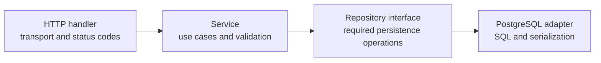

# OrdinalFrontier Codebase Guide

The public product name is OrdinalFrontier. Its wordmark and O emblem appear in
the application shell and login page; `frontend/index.html` owns browser metadata
and `frontend/public/ordinalfrontier.svg` is the matching favicon. Historical
repository/package paths and deployment identifiers remain compatible.

| Field | Value |
| --- | --- |
| Status | Draft — describes the current working tree, including uncommitted changes |
| Last reviewed | 2026-09-10 |
| Audience | Contributors navigating or modifying the implementation |
| Scope | Repository layout, entry points, packages, dependencies, tests, and reading paths |

For runtime boundaries, data flows, durability, and security decisions, see the [system architecture](system-architecture.md).

AI-created work branches start from the latest fetched `origin/dev` and target
`dev` in pull requests, unless the user explicitly requests otherwise. Promotion
to `main` is separate. See [agent branch guidance](../../AGENTS.md#branches-and-pull-requests)
and the [Jenkins workflow](../operations/jenkins.md#configure-github-integration-branch-protection).
Run applicable local checks before opening a PR. Jenkins verifies both `dev` and
`main` PR targets on the existing shared `battlefield-production` agent.

## Environment tooling

`scripts/lib/deployment-environment.sh` owns profile loading, conflicting-override
checks, cluster UID verification, and dev Docker identity verification.
`scripts/cd/setup-environment.sh` registers an existing cluster without changing
its original kubeconfig. `prepare-dev-secrets.sh` provisions private dev files;
`create-kind-cluster.sh` starts/bootstrap dev without recreation. Deployment,
rollback, smoke, dev CLI agents, retention reports, and runtime assurance share
the resolver. `scripts/test/test-deployment-environment.sh` exercises rejection
and bootstrap paths. See the [environment guide](../operations/environments.md)
for machine configuration, Jenkins credentials, and commands.

## 1. Repository map

```text
autonomous_battlefield/
├── backend/
│   ├── cmd/{server,engine,mcp,agent,aieval}/ # Startup and command wiring
│   ├── internal/
│   │   ├── battle/{api,service,catalog,worker,repo,resultcache}/
│   │   ├── faction/{api,service,repo}/
│   │   ├── game/               # Deterministic state transitions
│   │   │   └── controller/     # Infrastructure-free controller contracts
│   │   ├── ai/                 # Decision execution, providers, MCP, evaluations
│   │   ├── generation/         # Faction background generation jobs and quotas
│   │   ├── testutil/           # Shared assertions with lazy failure diagnostics
│   │   └── ...                 # app, authn, config, httpapi, postgres, logging, telemetry
│   ├── migrations/             # Embedded SQL migrations
│   ├── content/                # Shared versioned unit and building libraries
│   ├── rulesets/               # Versioned game rules
│   ├── scenarios/              # Authored battle templates
│   └── evals/                  # Evaluation cases and pricing configuration
├── frontend/src/
│   ├── app/                    # Application shell, routes, integration tests
│   ├── features/{battles,factions,auth}/ # Feature pages, API clients, unit tests
│   ├── shared/{api,components}/ # HTTP transport and cross-feature visuals
│   ├── pages/                  # General pages, including Home
│   └── test/                   # Shared test setup
├── deploy/                     # Kubernetes bases, overlays, supply-chain assets
├── infra/aws/                  # AWS provisioning with Terraform
├── scripts/
│   ├── dev/                    # Local application and host-agent launchers
│   ├── test/                   # Test runners, deployment and runtime assurance script tests
│   ├── ci/                     # Lint, builds, coverage summaries, image assurance
│   ├── cd/                     # Deployment, smoke checks, rollback
│   ├── perf/                   # Performance-test launcher
│   ├── security/               # Security-test launcher
│   ├── ops/                    # Operational reports and failure drills
│   └── lib/                    # Shared script functions
├── tests/performance/          # k6 scenarios
├── quality/sonarqube/          # Local analysis service
├── policy/                     # Deployment policy
└── docs/{design,operations,reference,security}/
```

## 2. Executable entry points

The backend has five commands in one Go module: four runtime processes and the offline AI evaluation command. The application image contains the four runtime binaries.

| Process | Entry point | What the entry point owns |
| --- | --- | --- |
| API | [`backend/cmd/server/main.go`](../../backend/cmd/server/main.go) | Flags, configuration, migrations, PostgreSQL startup, catalog loading, application wiring, HTTP lifecycle |
| Engine | [`backend/cmd/engine/main.go`](../../backend/cmd/engine/main.go) | Configuration, PostgreSQL startup, worker construction, health server, signals, graceful requeue/shutdown |
| MCP | [`backend/cmd/mcp/main.go`](../../backend/cmd/mcp/main.go) | Restricted repository construction, PostgreSQL notification listener, MCP and agent-control routes, HTTP lifecycle |
| Agent | [`backend/cmd/agent/main.go`](../../backend/cmd/agent/main.go) | Profile registry, decision worker, health endpoint, signals, shutdown |
| AI evaluation | [`backend/cmd/aieval/main.go`](../../backend/cmd/aieval/main.go) | Evaluation case execution, pricing inputs, reports, and runtime provenance via `-mode metadata` |

`cmd` packages should remain thin. Domain and use-case behavior belongs under `internal`; entry points should focus on composition and process lifecycle.

## 3. Backend organization

### Request-oriented features

Faction and battle HTTP features follow a handler → service → repository dependency direction:



- `api` packages translate HTTP requests, responses, and error categories.
- `service` packages enforce use-case rules and depend on narrow interfaces.
- `repo` packages implement those interfaces using PostgreSQL.
- [`backend/internal/app/app.go`](../../backend/internal/app/app.go) wires the API's concrete repositories, services, and handlers.

Repository interfaces live close to the service or worker that consumes them. This keeps the use case independent from a particular database implementation.

### Simulation-oriented code

[`backend/internal/game`](../../backend/internal/game) does not use the HTTP feature layering. It is an infrastructure-free domain package that takes resolved input and returns deterministic state transitions.

[`backend/internal/battle/worker`](../../backend/internal/battle/worker) is an application worker around that domain. It owns persistence orchestration but delegates game rules and state mutation to `game.Match`.

### Process health ownership

`httpapi.LifecycleHandler` is the sole owner of startup, liveness, readiness, and metrics endpoints. The API and engine entry points wire its dependencies and readiness callback into that handler. The application router owns business routes only, and the application database contract requires SQL operations without a health-ping dependency. `Worker.Ready()` exposes execution state; the worker package contains no HTTP health wrapper. Engine lifecycle integration tests cover worker startup/shutdown and database failure through the shared handler.

Agent and MCP commands expose a separate `/healthz` endpoint; they do not use
`LifecycleHandler`.

### AI-oriented code

[`backend/internal/ai`](../../backend/internal/ai) defines neutral contracts first, then separates execution into:

- an agent worker that leases jobs;
- a shared API-provider tool loop;
- isolated CLI runners;
- provider HTTP adapters;
- an MCP server and client.

The package root contains types and interfaces shared across these subpackages, avoiding provider-specific types in the engine or battle service.

## 4. Package guide

### `internal/game`: authoritative simulation domain

| File | Responsibility |
| --- | --- |
| [`types.go`](../../backend/internal/game/types.go) | Maps, rulesets, factions, units, buildings, state, events, results, controller config, and faction views |
| [`match.go`](../../backend/internal/game/match.go) | Runtime state, tick orchestration, events, and results |
| [`initialization.go`](../../backend/internal/game/initialization.go) | Scenario validation and initial factions, castles, and units |
| [`opening.go`](../../backend/internal/game/opening.go) | Tick-zero opening phase and deterministic fallback |
| [`upgrades.go`](../../backend/internal/game/upgrades.go) | One-time gold purchases and bonus propagation |
| [`decisions.go`](../../backend/internal/game/decisions.go) | Decision snapshots, plan validation, scripted plans, and tactics |
| [`economy.go`](../../backend/internal/game/economy.go) | Income, construction, and recruitment |
| [`structures.go`](../../backend/internal/game/structures.go) | Typed construction, building caps, tower turns, and forward recruitment |
| [`siege.go`](../../backend/internal/game/siege.go) | Structure approach priorities and minimum-range retreat |
| [`support.go`](../../backend/internal/game/support.go) | Herbalist treatment and allied movement |
| [`combat.go`](../../backend/internal/game/combat.go) | Unit turns, targeting, damage, and loot |
| [`movement.go`](../../backend/internal/game/movement.go) | Castle approach paths and reachable enemy alternatives |
| [`knowledge.go`](../../backend/internal/game/knowledge.go) | Ruleset knowledge validation and defensive copying |
| [`visibility.go`](../../backend/internal/game/visibility.go) | Faction perspectives and fog of war |
| [`clone.go`](../../backend/internal/game/clone.go) | Defensive copying of state, scenarios, results, and plans |
| [`map.go`](../../backend/internal/game/map.go) | Hex-map validation, coordinates, traversal, and visibility helpers |
| [`rules.go`](../../backend/internal/game/rules.go) | Ruleset and legacy blueprint validation |

`game.Match` is the in-memory authority for one battle attempt. Important methods include:

- `DecisionWindowDue` and `DecisionTargetTick` for production boundaries;
- `DecisionSnapshot` for a bounded faction-visible model input;
- `ScriptedPlans` for deterministic baselines;
- `AdvanceWithPlans` for plan application followed by a tick;
- `State` for a defensive copy of current state.

`Match` contains no database, HTTP, or model-provider dependency. Preserve this property when adding game behavior.

### `internal/battle/catalog`: authored inputs

[`catalog.go`](../../backend/internal/battle/catalog/catalog.go) strictly decodes scenario and ruleset YAML with unknown-field rejection. It validates templates, combines a scenario with two stored faction identities, and returns a complete resolved `game.Scenario` plus digest.

The API stores this resolved value in `battle_runs.scenario_snapshot`. The engine therefore does not reload live YAML when it claims a battle.

### `internal/battle/service`: battle use cases

[`service.go`](../../backend/internal/battle/service/service.go) contains public battle rules:

- validate battle IDs, participants, controller selections, and tick counts;
- ensure requested model profiles are available;
- load faction identities;
- resolve and hash the scenario snapshot;
- create an initial `game.Match` to validate the battle;
- enqueue, list history, read, pause, resume, and stop battles;
- read events, decision history, and faction perspectives.

[`repository.go`](../../backend/internal/battle/service/repository.go) defines the persistence operations required by these use cases. [`catalog.go`](../../backend/internal/battle/service/catalog.go) defines catalog-facing types and interfaces.

### `internal/battle/resultcache`: optional read cache

[`redis.go`](../../backend/internal/battle/resultcache/redis.go) implements the
service's `ResultCache` port. `cmd/server` constructs and closes it;
`app.NewAPIWithResultCache` wires it beneath authentication. Service/config tests
and `resultcache/redis_test.go` cover caching and failure behavior with an
in-process Redis protocol server; no external Redis process is required.
See [cache behavior](system-architecture.md#completed-battle-result-caching) and
[Redis operations](../operations/redis.md).

### `internal/battle/api`: battle HTTP delivery

[`handler.go`](../../backend/internal/battle/api/handler.go) registers and implements:

Battle, scenario, and profile routes are documented in the
[HTTP API reference](../reference/api.md). This handler owns JSON decoding,
cursor/attempt parsing, HTTP status mapping, and response encoding for those routes.

Keep domain validation in the service. The handler should concentrate on transport validation and stable HTTP status mapping.

### `internal/battle/worker`: durable execution

| File | Responsibility |
| --- | --- |
| [`repository.go`](../../backend/internal/battle/worker/repository.go) | Battle-job, lease, and worker repository contracts |
| [`worker.go`](../../backend/internal/battle/worker/worker.go) | Construction, claims, battle/tick execution, persistence, and completion |
| [`decisions.go`](../../backend/internal/battle/worker/decisions.go) | Decision-window preparation, waiting, validation, fallback, and logging |
| [`lifecycle.go`](../../backend/internal/battle/worker/lifecycle.go) | Worker readiness, pause/heartbeat waits, cancellation, and requeue |

The worker's main call path is:

```text
Run
└── ClaimBattle
    └── process
        └── game.NewMatch
            └── runBattle
                └── runTick
                    ├── waitWhilePaused
                    ├── resolveDecisionWindow (when due)
                    ├── Match.Advance / AdvanceWithPlans
                    ├── SaveTick
                    └── CompleteBattle
```

`resolveDecisionWindow` freezes contexts for both factions, persists durable decision rows, immediately resolves scripted controllers, waits for model controllers, applies timeout fallbacks, and returns one plan per faction.

All persistence calls carry the current battle lease. Do not add an unguarded write path that allows a stale attempt to update the battle.

### `internal/battle/repo`: PostgreSQL battle adapter

The adapter stays in one package: [`postgres.go`](../../backend/internal/battle/repo/postgres.go) constructs it, [`battles.go`](../../backend/internal/battle/repo/battles.go) owns public battle operations, [`queue.go`](../../backend/internal/battle/repo/queue.go) owns queue leases, and [`ticks.go`](../../backend/internal/battle/repo/ticks.go) owns atomic tick and completion writes. Splitting files does not change transaction boundaries.

[`decisions.go`](../../backend/internal/battle/repo/decisions.go) implements the AI decision repository:

- create or reuse decisions;
- notify waiting agents;
- atomically claim compatible model work;
- accept a versioned/idempotent plan;
- resolve fallbacks;
- record provider failures, validation failures, usage, and metadata;
- list per-window and per-battle decision history.

SQL concurrency behavior is part of the application's correctness. Changes to status predicates, `FOR UPDATE SKIP LOCKED`, versions, owners, attempts, or leases require focused concurrency and race tests.

### `internal/ai`: shared contracts

| File | Responsibility |
| --- | --- |
| [`types.go`](../../backend/internal/ai/types.go) | Decision sessions, contexts, submissions, records, model turns, tools, usage, and profiles |
| [`repository.go`](../../backend/internal/ai/repository.go) | Durable decision repository contract and errors |
| [`service.go`](../../backend/internal/ai/service.go) | Context reads, plan validation, observation hashes, and HMAC capabilities |
| [`prompts.go`](../../backend/internal/ai/prompts.go) | Embedded shared instructions, context delivery, and separate battle and background-generation prompt digests |
| [`knowledge.go`](../../backend/internal/ai/knowledge.go) | Bounded knowledge selection from frozen rules and faction-visible context |
| [`memory.go`](../../backend/internal/ai/memory.go) | Scoped, chronological historical decision summaries with count/byte bounds |
| [`profiles.go`](../../backend/internal/ai/profiles.go) | API/CLI profile validation and availability evaluation |

Prompt files are embedded through [`prompts.go`](../../backend/internal/ai/prompts.go).
`PromptVersion` hashes the six battle prompt templates below and the inline
`identityContextTemplate`; background writer prompts have a separate
`GenerationPromptVersion`.

| File | Role |
| --- | --- |
| `prompts/battlefield-agent.txt` | Battle session system prompt establishing tool-only authority and untrusted observations |
| `prompts/decision.txt` | Main tactical and production decision instructions |
| `prompts/tool-context.txt` | Short per-decision prompt when context is fetched through MCP |
| `prompts/inline-context.txt` | Variant used when the host has already supplied the full context JSON |
| `prompts/doctrine.txt` | Doctrine template embedded and included in `PromptVersion`, but currently not rendered |
| `prompts/identity.txt` | Identity template embedded and included in `PromptVersion`, but currently not rendered |
| `prompts/background-generation.txt` | Background writer system instructions |
| `prompts/background-decision.txt` | Background writer per-job instructions |

For battle sessions, `SessionSystemPrompt` returns the battlefield system prompt.
`SessionDecisionPrompt` appends the faction name, background, and doctrine as JSON
inside the untrusted-data delimiters defined by `identityContextTemplate`.

`GenerationPromptVersion` covers both background writer instruction
components and the rendered character limit. Faction limits are declared in
`internal/faction/faction.go` and mirrored in frontend `features/factions/limits.ts`;
update both when changing this API contract. Existing Unicode boundary tests cover
editor, service, and generation validation.

`DecisionRunner` is the execution boundary used by the agent. `TurnProvider` is the narrower boundary implemented by model APIs that participate in the shared tool loop.

`DecisionService` deliberately receives only a `DecisionSubmissionRepository`, which cannot modify battles or simulation state.

### `internal/ai/worker`: provider-neutral worker

[`worker.go`](../../backend/internal/ai/worker/worker.go) starts one claim loop per concurrency slot. Each loop:

1. long-polls the MCP agent-control endpoint with executable profile IDs;
2. immediately runs the claimed job in its owned slot;
3. requires the claimed profile from the local registry;
4. requires the server-minted request-scoped capability;
5. creates an API or CLI runner;
6. applies a decision timeout;
7. reports usage or failure metadata through MCP.

The default runner factory is the only place that chooses concrete provider implementations from a model profile.

### `internal/ai/runner`: model execution mechanisms

| File | Responsibility |
| --- | --- |
| [`api.go`](../../backend/internal/ai/runner/api.go) | Shared bounded tool loop for API providers |
| [`mcp.go`](../../backend/internal/ai/runner/mcp.go) | Authenticated streamable HTTP MCP client and normalized tool calls |
| [`cli.go`](../../backend/internal/ai/runner/cli.go) | Isolated Codex/Antigravity CLI execution and result parsing |

The API loop discovers exactly two MCP tools and accepts only those names. It appends tool calls and results to the neutral message transcript and accumulates usage over turns.

The CLI runner creates a temporary directory, passes the profile's allowlisted model explicitly with `--model`, and constructs provider-specific command-line restrictions. Tests use the `CommandExecutor` interface to inspect the selected model and execution restrictions without starting a real CLI.

[`clienv/antigravity.go`](../../backend/internal/ai/clienv/antigravity.go) shares
permission configuration, environment isolation, and saved-login probing between
profile discovery and execution. `cmd/agent -check-antigravity-auth` supports the
host launcher's preflight. See [CLI runtime](system-architecture.md#cli-runtime)
for context delivery and accepted-plan enforcement.

### `internal/ai/providers`: external API adapters

[`openai.go`](../../backend/internal/ai/providers/openai.go) translates neutral tools into OpenAI Responses function tools. [`gemini.go`](../../backend/internal/ai/providers/gemini.go) translates them into Gemini function declarations.

[`http.go`](../../backend/internal/ai/providers/http.go) owns transcript formatting,
the shared HTTP response lifecycle, status errors, and JSON decoding. Provider
adapters retain their authentication, request schemas, and named response types.

Both adapters:

- accept a configurable HTTP client and endpoint for tests;
- normalize token usage and tool calls;
- map safety/refusal results to a common error;
- contain no battle or database logic.

### `internal/ai/mcpserver`: model and agent boundary

[`server.go`](../../backend/internal/ai/mcpserver/server.go) exposes separate HTTP surfaces:

- `/mcp` is the request-capability-protected battle model tool surface;
- `/generation-mcp` exposes only background context and submission tools;
- `/internal/agent/*` is the shared-secret agent control plane for claims and result metadata.

The MCP tools are:

- `get_decision_context`;
- `get_unit_details` (1–4 exact unit IDs);
- `submit_strategy_plan`.

[`agent_context.go`](../../backend/internal/ai/agent_context.go) owns the explicit
agent projection, frozen unit reference snapshot, and exact lookup. The full
`DecisionContext` remains persisted for validation. New snapshots are captured by
the battle worker before hashing for every decision.
[`unit_details.go`](../../backend/internal/ai/mcpserver/unit_details.go) serves the
capability-scoped lookup. The saved-context service and frontend inspector show
reconstructed context separately from optional reference details. All evaluation
variants use the current projection, with lookup and total input-token metrics.

The server validates request scope before calling `DecisionService`. PostgreSQL notifications close an in-memory wake-up channel so long-polling claim requests promptly query durable state.

### `internal/game/controller`: deterministic policy abstractions

[`types.go`](../../backend/internal/game/controller/types.go) defines `PlanProposal`, action candidates, strategy plans, and a controller interface. `PlanProposal` is actively used by the game, AI subsystem, scenarios, repository, API, and frontend.

[`utility_controller.go`](../../backend/internal/game/controller/utility_controller.go) is an independently tested in-memory utility controller with its own decision scheduling and pending-plan lifecycle. It is not constructed by the API, engine, or `game.Match` production path. The current match consumes `PlanProposal` directly and performs deterministic action scoring internally.

The standalone controller is retained as an intentional, independently tested capability. Shared production plan validation lives in [`validation.go`](../../backend/internal/game/controller/validation.go); [`clone.go`](../../backend/internal/game/controller/clone.go) owns `ClonePlanProposal` and `ClonePlanProposals`, used by the match, catalog, and utility controller. Add new mutable proposal fields to that copy implementation and its isolation test.

### `internal/faction`: reusable doctrines

| Area | Responsibility |
| --- | --- |
| [`faction.go`](../../backend/internal/faction/faction.go) | Stored and decorated faction model |
| [`service`](../../backend/internal/faction/service) | UUID/name/doctrine/background validation and profile creation/update |
| [`api`](../../backend/internal/faction/api) | Faction and faction-ruleset HTTP routes |
| [`repo`](../../backend/internal/faction/repo) | PostgreSQL serialization and errors |

Faction creation and editing share `normalizeFaction` in `service/service.go`,
so whitespace normalization and Unicode length limits stay consistent. The
`RulesetCatalog` port requires only the ruleset listing operation it consumes.

Deleting a faction removes it from the active registry but does not affect the copied participant data inside existing battle snapshots.

### `internal/generation`: faction background generation

| File | Responsibility |
| --- | --- |
| [`types.go`](../../backend/internal/generation/types.go) | Configuration, normalized draft input, job state, quota options, and the repository contracts |
| [`handler.go`](../../backend/internal/generation/handler.go) | Authenticated options, admission, and status routes under `/v1/faction-background-generations` |
| [`postgres.go`](../../backend/internal/generation/postgres.go) | Transactional admission, account quotas, idempotency, durable claims, expiry, and result recording |

This package runs background writing as durable asynchronous jobs rather than
inline requests. `Admit` opens a transaction per actor, expires stale jobs,
evaluates the account quota, and reuses an existing job when the idempotency key
and input hash match. `Claim` hands a job to an agent worker by executable
profile. `Submit` and `Finish` record the draft, category, usage, and metadata.

The generation path never touches battle or simulation state. Its worker side
lives in [`ai/worker/generation.go`](../../backend/internal/ai/worker/generation.go)
and its tool surface in [`ai/mcpserver/generation.go`](../../backend/internal/ai/mcpserver/generation.go),
which exposes draft-only tools and namespaced capabilities. Migration
`00009_faction_background.sql` owns the jobs, account locks, and quota indexes.

### Shared infrastructure packages

- [`internal/authn`](../../backend/internal/authn) provides Cloudflare JWT verification, explicit development login modes, role/ownership helpers, exact-origin mutations, a deny-by-default route permission registry, and mode-aware session/logout routes. `cloudflare_test.go` exercises signatures, key rotation, forged headers, legacy cookies and role removal. `service_test.go` covers enrolled CI service JWTs, invalid claims, disabled enrollment and the read-only route boundary. CI uses a separate `ci` actor, never a human role.
- [`internal/config/config.go`](../../backend/internal/config/config.go) strictly decodes one YAML document, rejects unknown fields, resolves environment variables, and provides process-specific loaders.
- [`internal/postgres`](../../backend/internal/postgres) manages the `pgx` pool, embedded Goose migrations, startup retries, and `LISTEN/NOTIFY`.
- [`internal/httpapi`](../../backend/internal/httpapi) provides bounded strict JSON, lifecycle/readiness routes, request IDs, routing, and access logging.
- [`internal/logging`](../../backend/internal/logging) configures `LOG_LEVEL`,
  formats readable operational messages while retaining stable event names, and
  enriches logs with active trace/span IDs. `handler.go` preserves slog attribute
  grouping; `messages.go` selects the operational fields shown in compact messages.
- [`worker/progress.go`](../../backend/internal/battle/worker/progress.go) bounds
  battle and decision-wait updates to one per 15 seconds and supplies elapsed time.
- [`internal/telemetry`](../../backend/internal/telemetry) defines API/engine Prometheus metrics and shared OpenTelemetry tracing, HTTP
  instrumentation, and durable trace-context propagation.

## 5. Important shared data types

| Type | Defined in | Used for |
| --- | --- | --- |
| `game.Scenario` | `internal/game/types.go` | Complete immutable input to a battle attempt |
| `game.State` | `internal/game/types.go` | Current authoritative simulation snapshot |
| `game.Transition` | `internal/game/types.go` | One tick's state, events, and optional result |
| `game.View` | `internal/game/types.go` | Faction-projected fog-of-war state |
| `controller.PlanProposal` | `game/controller/types.go` | Scripted/model strategy and production input |
| `ai.DecisionContext` | `internal/ai/types.go` | Frozen bounded model observation |
| `ai.DecisionRecord` | `internal/ai/types.go` | Durable decision state and provenance |
| `service.BattleRun` | `battle/service/service.go` | Public/use-case representation of a stored run |
| `worker.BattleLease` | `battle/worker/repository.go` | Attempt and ownership guard for engine writes |

When introducing a new field, identify its authority:

- simulation truth belongs in `game` types;
- public use-case state belongs in the relevant service;
- model-only context belongs in `ai` types;
- transport-specific request/response shapes should stay inside handlers or frontend clients.

Administrator model access is implemented in [`internal/admin`](../../backend/internal/admin):
its handler validates settings and stores a versioned policy in PostgreSQL.
[`internal/ai/access.go`](../../backend/internal/ai/access.go) overlays that policy
on the API profile registry for catalog reads and new selections. The API composition
root wires the same effective registry into battle and background-generation handlers.
[`internal/authn/preview.go`](../../backend/internal/authn/preview.go) enforces
administrator-only, read-only role preview before route permission checks.
Frontend [`admin/api/settings.ts`](../../frontend/src/features/admin/api/settings.ts)
handles settings reads/saves; [`RolePreviewContext.ts`](../../frontend/src/features/auth/RolePreviewContext.ts)
and the shared request transport coordinate effective roles and mutation blocking.
Tests cover durable cross-instance saves, conflicts, selection restrictions, preview
permissions, frontend save/reload, and preview navigation.

## 6. Database migrations and adapters

Migrations under [`backend/migrations`](../../backend/migrations) are embedded into the server binary.

| Migration | Main change |
| --- | --- |
| `00001_create_factions.sql` | Initial faction table |
| `00002_create_battle_queue.sql` | Battle runs and per-attempt event stream |
| `00003_castle_siege_state.sql` | Ruleset/blueprint and battle state snapshots |
| `00004_battle_decisions.sql` | Model decisions, indexes, evaluation view, restricted MCP role |
| `00005_stop_battles.sql` | `stopped` battle status |
| `00006_pause_battles.sql` | Pause flag and unpaused claim index |
| `00007_trace_context.sql` | Persisted trace propagation context |
| `00008_faction_doctrine.sql` | Faction doctrine and versioned battle snapshots |
| `00009_faction_background.sql` | Faction background and asynchronous generation jobs |
| `00010_battle_history.sql` | Descending creation-time/ID index for battle history |
| `00011_friends_access.sql` | Row ownership, atomic admission triggers, AI execution counts, single CLI lease, runtime stop policy, and private usage view |
| `00012_model_access.sql` | Versioned administrator model access policy and last editor metadata |
| `00013_player_members.sql` | Durable player membership and access synchronization |
| `00014_cli_concurrency.sql` | Four shared CLI lease slots with serialized admission |

Schema changes should be made with a new migration, then reflected in repository scan/serialization logic and tests. Do not edit an already-applied migration to evolve a shared database.

`internal/postgres.NewMigrationProvider` configures embedded Goose migrations with
the same database-wide advisory session lock for application startup and tests
that run `Up`, `UpTo`, or `Down`. Separate test schemas still share the MCP role
and public-schema permissions; constructing an unlocked provider can cause
`tuple concurrently updated` failures across parallel packages. The PostgreSQL
integration regression holds the lock from another schema, verifies migration
cancellation without application DDL, then verifies successful migration after release.

## 7. Frontend organization

The frontend is a React/Vite single-page application.

| Area | Responsibility |
| --- | --- |
| [`app/App.tsx`](../../frontend/src/app/App.tsx) | Shared layout and route table |
| [`features/auth/api/auth.ts`](../../frontend/src/features/auth/api/auth.ts) | Session discovery, login, and logout client |
| [`shared/api/request.ts`](../../frontend/src/shared/api/request.ts) | API base URL, cancellation-preserving network error mapping, and opt-in unauthorized-session notifications |
| [`features/factions/api/factions.ts`](../../frontend/src/features/factions/api/factions.ts) | Typed faction and ruleset requests |
| [`features/battles/api/battles.ts`](../../frontend/src/features/battles/api/battles.ts) | Typed scenario, profile, battle, history, event, view, control, and decision requests |
| [`features/factions/pages/CreateFactionPage.tsx`](../../frontend/src/features/factions/pages/CreateFactionPage.tsx) | Faction profile editor and background generator |
| [`features/factions/pages/FactionsPage.tsx`](../../frontend/src/features/factions/pages/FactionsPage.tsx) | Faction registry and authorized edit links; deletion lives in the editor's Danger zone |
| [`features/battles/pages/CreateBattlePage.tsx`](../../frontend/src/features/battles/pages/CreateBattlePage.tsx) | Scenario, participants, controllers, and tick-limit selection |
| [`features/battles/pages/BattleHistoryPage.tsx`](../../frontend/src/features/battles/pages/BattleHistoryPage.tsx) | Status-filtered history table/cards, cursor navigation, refresh, and detail links |
| [`features/battles/pages/BattlePage.tsx`](../../frontend/src/features/battles/pages/BattlePage.tsx) | Route-level composition, selected perspective/panel, and control actions |
| [`features/auth/pages/LoginPage.tsx`](../../frontend/src/features/auth/pages/LoginPage.tsx) | Single-administrator credential form and error state |
| [`features/admin/pages/AdminSettingsPage.tsx`](../../frontend/src/features/admin/pages/AdminSettingsPage.tsx) | Persistent provider/profile switches, allowed roles, save/conflict states, and entry to read-only role preview |
| [`features/battles/components/HexBattleMap.tsx`](../../frontend/src/features/battles/components/HexBattleMap.tsx) | Hex-map visualization, movement routes, tracking arrows, attack outcomes, and accessible unit animation |
| [`features/battles/components/PlayerStatusPanel.tsx`](../../frontend/src/features/battles/components/PlayerStatusPanel.tsx) | Null-safe spectator summaries, economy/building overview, and grouped living units |
| [`shared/components/Emblem.tsx`](../../frontend/src/shared/components/Emblem.tsx) | Deterministic faction emblem |

Feature-specific API clients live in `src/features/<feature>/api`; common HTTP transport lives in `src/shared/api`. Page components should consume typed client functions rather than duplicating `fetch` calls.

`features/factions/presentation/availability.ts` derives background-writer status
from existing availability, quota, cooldown, and active-job fields. Retrying status
never configures a provider. Identifiers are generated internally and retained in
API requests and routes, but ordinary pages show no identifier or copy controls.
The former shared `Identifier` component has been removed.

Home and primary navigation share three destinations in order: Stage battle,
Factions, Battle history. Administrator navigation also includes Admin. The compact home has no promotional hero. Factions
combines directory access with its Create faction action; the existing creation
and editing routes remain available and keep the Factions navigation item active.

`frontend/e2e/fixtures.ts` intercepts the complete API boundary for application
Playwright tests. `e2e/usability.spec.ts` runs against a local Vite server in
desktop and mobile Chromium, including destructive cases only against fixtures.
Map keyboard tests focus the native “Pan with arrow keys” button; pointer panning
continues through the map viewport. Admin settings split per-model access controls
into `ModelAccessCard` and use native outputs for loading and save status.
See [frontend commands](../../frontend/README.md#commands) for browser setup,
coverage, and reports. Jenkins archives failure screenshots, traces, and HTML
reports alongside coverage without changing the 80% coverage thresholds.

The battle feature's `hooks/` directory owns status, event, decision-history, and faction-perspective requests. Each hook preserves its own polling cadence, retries, cancellation, and terminal-state handling. `components/AIDecisionPanel.tsx`, `components/EventConsole.tsx`, and `components/BattlePresentation.tsx` own the panels and visual presentation; shared UI state types live in `types.ts`. There is no WebSocket or server-sent-event client.

`useBattleStatus` cancels polling when a control returns a terminal status.
`useBattleStatus.test.ts` verifies that a late in-flight response cannot overwrite
an operator stop or schedule further polls.

`BattlePage` owns map perspective and controls. `components/BattleInspector.tsx`
owns the System/player dropdown, the shared inner tab, and the scoped context cache;
`InspectorTabs.tsx` implements inner-tab keyboard navigation. `AIDecisionPanel` keeps
individual decision expansion stable, while `DecisionContextPanel.tsx` lazily
loads and presents the historical observation. `EventConsole` preserves loaded
event filtering and payload expansion. `presentation/events.ts` owns readable
summaries and Key events/Combat/Economy/All events categorization. Mobile initially
shows ten matching events, with Show more revealing additional loaded rows.
Player/decision sections remain mounted
when hidden; the inspector is reset for a different battle or attempt.

The battle toolbar places compact tick progress on the left, faction summaries in
the flexible middle, and the outcome above Play/Pause/Stop on the right. Faction
cards share available width with a 160px minimum before wrapping into equal-height
rows. Progress, faction summaries, and controls stretch to matching outer heights;
the toolbar and map layout stack at 1000px. Controls and inspector share a 340px
desktop column and a 14px gutter, aligning their left and right borders.
The inline map uses the board's aspect ratio and can expand into a native modal
dialog. Camera fitting happens on opening and viewport resizing, not live ticks.
`usability.css` overrides the legacy fixed map height at the battle-layout
specificity; browser tests assert the rendered aspect ratio to prevent regression.
The inspector's desktop content scrolls internally; mobile uses page scrolling.
Above 1000px the inspector stretches to the map's grid-row height. Size
containment prevents event content from enlarging that row; the map determines
the shared height. Stacked and events-only layouts keep independent heights.
Terminal battles hide Play/Pause/Stop and label tick usage as a maximum rather
than completion. `components/FactionSummaries.tsx` shows each
participant's decision activity, gold, and living unit count using existing
spectator state and current-attempt decision polling, independent of map
perspective. Paused and terminal states override decision activity, polling errors
show unavailable status, and missing metrics display a dash. The display accepts
any participant count; battle creation and engine faction limits are unchanged.

`components/EntityIcon.tsx` supplies local SVG artwork for all seven core unit
and five building types, reused by the map, player roster, building overview,
and a collapsible legend of types present in the displayed map. Map markers keep
faction-colored backgrounds and HP bars, with a separate selection/focus ring.
`presentation/entities.ts` owns type labels, entity indexing, and readable
references such as `Iron Legion · Ranger #12` (or `Ranger #12` inside that player's
panel). It uses the sequence embedded in generated IDs, so deaths, polling,
reordering, and historical event pages do not renumber entities. Opaque IDs use
available entity metadata plus an eight-character ID; unknown references use
`Entity · <short ID>`. Event metadata is scoped to the current attempt; older
attempts resolve generated IDs directly. Full IDs remain in tooltips and raw
inspection payloads. Structured recruitment sources and unit/building types use
the same helpers, while freeform AI prose and raw JSON remain unchanged.
Presentation tests cover naming stability, unknown types/IDs, historical attempts,
raw payload preservation, icon distinctions, and keyboard selection.

Backend `internal/battle/api/decision_context.go` routes the scoped context read;
`internal/battle/service/decision_context.go` validates ownership and projects the
saved observation through the existing repository `GetDecision` method. The
battle response includes the scenario snapshot's background and doctrine.

Component and route tests cover three-player navigation, keyboard focus,
retained sections, null opening collections, recruitment updates, unit grouping,
legacy profiles, lazy context loading/cache/retry, obsolete response cancellation,
and stable decision expansion. Backend tests cover scope and public projection.

`shared/api/request.ts` accepts API paths and applies the configured base URL. `createApiClient` preserves abort errors and wraps network failures in the feature's error type. Authentication disables global unauthorized notifications so login/session failures are handled locally. Feature clients, including faction ruleset discovery, use this common error handling and retain HTTP status messages; battle stop/pause/resume share one response mapper.

The frontend build enables TypeScript `noUnusedLocals` and `noUnusedParameters`
to reject unused local declarations and parameters alongside strict type checks.

## 8. Configuration and authored content

| Path | Purpose |
| --- | --- |
| [`backend/config.yaml`](../../backend/config.yaml) | Local process configuration and model-profile definitions |
| [`.env.example`](../../.env.example) | Shared dev/production application settings schema |
| [`backend/rulesets`](../../backend/rulesets) | Versioned unit, building, economy, and combat values |
| [`backend/scenarios`](../../backend/scenarios) | Map layout, timing, scripted plans, and fallbacks |
| [`deploy/base/infrastructure/configmap.yaml`](../../deploy/base/infrastructure/configmap.yaml) | Cluster configuration equivalent |
| [`deploy/environments/deployment.env.example`](../../deploy/environments/deployment.env.example) | Deployment environment profile template consumed by the shared resolver |

Configuration is decoded with `yaml.KnownFields(true)`. Update the file-facing struct, parsed runtime struct, validation, examples, deployment ConfigMap, and tests together.

## 9. Deployment code

[`deploy/base`](../../deploy/base) contains portable Kustomize resources. [`deploy/overlays/local`](../../deploy/overlays/local) adds kind-specific PostgreSQL, Gateway API, observability, and logging resources.

The key application manifests are:

- `api-deployment.yaml` and `api-service.yaml`;
- `engine-deployment.yaml`;
- `agent-deployment.yaml`;
- `mcp-deployment.yaml`, `mcp-service.yaml`, and `mcp-network-policy.yaml`;
- frontend deployment and service;
- `ingress.yaml` for external routing;
- `api-hpa.yaml` for API horizontal autoscaling;
- `api-pdb.yaml` and `frontend-pdb.yaml` for disruption budgets;
- migration overlay job.

[`deploy-local.sh`](../../scripts/cd/deploy-local.sh) is the development entry point. It reads the Git-ignored project-root `.env`; `scripts/lib/application-env.cjs` parses both environments' literal settings, validates credentials, and separates Kubernetes Secret fields. [`run-k8s-cli-agent.sh`](../../scripts/dev/run-k8s-cli-agent.sh) bridges authenticated host subscription CLIs to a Kubernetes MCP service. CI/CD helpers under `scripts` classify affected components, build images, apply migrations, deploy, smoke-test, and roll back.

[`scripts/ci/with-ghcr-auth.sh`](../../scripts/ci/with-ghcr-auth.sh) owns temporary
GHCR login and command cleanup for both Jenkins pipelines and production rollback.
[`scripts/test/test-registry-auth.sh`](../../scripts/test/test-registry-auth.sh)
checks credential isolation, argument/input forwarding, failures, and cancellation
without registry access. Component-classifier tests include application test files,
CI compatibility wrappers, mixed changes, and production-to-test renames.

[`scripts/lib/image-metadata.sh`](../../scripts/lib/image-metadata.sh) owns published
repository defaults, policy reference validation, and source-URL normalization.
[`scripts/test/test-image-metadata.sh`](../../scripts/test/test-image-metadata.sh)
checks publishing and admission rendering with stub external commands.
[`scripts/test/test-registry-verification.sh`](../../scripts/test/test-registry-verification.sh)
exercises publication and deployment signature checks, including Cosign 3 bundle
summaries without annotations, retained legacy revisions, and rejected evidence. The Vite
configuration and `frontend/vite.config.test.ts` cover development proxy overrides.

Root launch scripts remain compatibility entry points that `exec` their implementations under `scripts/dev` and `scripts/cd`. `deploy/` owns Kubernetes configuration; `infra/aws/` provisions cloud resources. Operational instructions live under `docs/operations`.

## 10. Testing layout and expectations

Tests are colocated with their Go or React implementation. The codebase includes:

- pure domain tests for map rules, combat, economy, and determinism;
- service tests for validation and use cases;
- PostgreSQL adapter tests with mocked query behavior and integration coverage;
- worker tests for leases, cancellation, decisions, fallback, pause/resume, and stop;
- provider, MCP, runner, profile, and capability tests;
- HTTP contract/status tests;
- React component and typed API-client tests.

`backend/internal/testutil.Require` shares fatal assertion checks while evaluating
diagnostics only on failure. Larger balance, opening, and generation tests use
named scenario helpers to keep setup, execution, and assertions readable.
Ruleset and plan validation, recruitment, healing routes, and agent claims have
separate helpers for their individual validation or execution phases; their
owning packages and runtime contracts remain the same.

Battle inspector regions use labelled sections, and asynchronous loading messages
use native `output` elements. Component tests verify the resulting accessibility
roles rather than requiring redundant explicit role attributes.

Package-specific PostgreSQL integration tests remain beside their adapters and require `TEST_DATABASE_URL`; the isolated PostgreSQL harness supplies it. `scripts/test` contains reusable test runners and deployment script tests. Old `scripts/ci` test commands forward to those runners. `scripts/test/test-command-wrappers.sh` verifies argument, environment, working-directory, exit-status, and signal forwarding without launching the application. `scripts/test/test-kind-deployment.sh` checks selected-overlay staging, preservation of registered auth paths across child preflight checks, auth-only Secret inputs, collector configuration with Langfuse enabled and disabled, real Kustomize renders, and rollout failure handling. It loads the deployment environment helpers with explicit Langfuse overrides so overlay tests do not query a live cluster. `scripts/test/test-security-launchers.sh` checks scanner artifact paths, failure propagation, and the shared Trivy pin using scanner stubs. `scripts/lib/access_service.py` validates private CI credentials, destination binding and expiry; `scripts/ops/verify-access-service.py` verifies private denial and public service authentication without redirects. `scripts/test/test-access-service.py` tests those boundaries, and `test-runtime-assurance.sh` exercises service credential mounting and k6 requests. Performance scenarios live in `tests/performance`; AI cases remain in `backend/evals`. Add an end-to-end folder only when whole-application tests exist.

Merge-blocking gates require at least 80% Go statement coverage in aggregate across the module — one repository-wide total from `go tool cover`, not a per-package floor, so thin wiring in `cmd/*` and `internal/postgres` may sit below 80% while the module passes — and at least 80% frontend statements, branches, functions, and lines. Measure through the PostgreSQL harness; a coverage run without `TEST_DATABASE_URL` skips tests that require the database and omits the code exercised only by those tests:

```bash
./scripts/test/with-test-postgres.sh ./scripts/test/test-backend.sh
(cd frontend && npm test -- --coverage)
```

For a focused change, start with the affected package tests. Before completing implementation work, run the applicable repository coverage gate.

Frontend Vitest runs use at most two workers, configured in
`frontend/vite.config.ts`, to limit CPU contention with Jenkins's parallel Go,
fuzz, and security checks. Each test has a 15-second timeout to accommodate
multi-step DOM interactions under shared-agent load. The 80% coverage gates
remain in effect; the timeout is a hang guard, not a performance benchmark.
Testing Library async queries and `waitFor` use a five-second deadline configured
in `frontend/src/test/setup.ts`, within Vitest's separate per-test budget.

Battle-history pagination, browser-back navigation, and refresh-to-newest behavior
have separate component tests so each interaction sequence has its own timeout
budget on the shared CI agent.

### AI comparison and regression coverage

[`cmd/aieval/comparison.go`](../../backend/cmd/aieval/comparison.go) owns compare
flags and configuration; [`ai/eval/comparison.go`](../../backend/internal/ai/eval/comparison.go)
runs isolated MCP sessions through production validation. `ai/eval/knowledge.go`
exports retrieval metadata. `backend/evals/comparison-cases/` contains synthetic
contexts, including the large-roster fixture. See [comparison operations](../operations/ai-comparisons.md).

`DecisionRepository.ListFactionMemory` bounds history in SQL; the battle worker
freezes memory and selected knowledge before hashing. Tests cover faction/attempt
isolation, bounds, optional-read failure, invalid submissions, and false CLI success.
`ai/mcpserver/tool_logging_test.go` verifies safe schema-rejection diagnostics;
worker tests verify fallback error attribution.

`game/movement_test.go` covers blocked approaches and enemy filtering.
Recruitment tests in `game`, `game/controller`, and `ai` cover explicit quantities,
reserves, spawn blocking, empty orders, and validation. `AIDecisionPanel.test.tsx`
checks their presentation. `frontend/src/app/App.test.tsx` uses controlled timers
to verify event-page draining without load-sensitive wall-clock deadlines.

## 11. Common change paths

### Add a battle API field

1. Decide whether the source of truth is `game.State`, `BattleRun`, or derived presentation data.
2. Update the service type/use case.
3. Update repository serialization or query scanning if persisted.
4. Update the handler response.
5. Update `frontend/src/features/battles/api/battles.ts`.
6. Update the consuming page/component and both backend/frontend tests.

### Add a plan field

1. Add it to `controller.PlanProposal`.
2. Add bounds and semantic validation.
3. Add it to the MCP submission schema/input mapping.
4. Apply it deterministically in `game.Match`.
5. Update scenario YAML if scripted/fallback values need it.
6. Update decision persistence, API/frontend types, display, and tests.

### Add a model provider

1. Add a provider adapter implementing `ai.TurnProvider`, or a CLI branch implementing `DecisionRunner` behavior.
2. Extend profile validation and availability rules.
3. Extend the agent's default runner factory.
4. Add environment/configuration and deployment secret fields.
5. Add provider contract, refusal, usage, and tool-call tests.
6. Keep the MCP tool surface unchanged unless the domain contract itself changes.

### Add durable battle behavior

1. Add a forward-only migration.
2. Update repository interfaces only with operations required by a use case.
3. Implement guarded SQL using battle attempt and lease ownership where applicable.
4. Update service/worker behavior.
5. Add stale-owner, retry, and shutdown tests.

## 12. Langfuse integration

`ai/faction_groups.go` groups observed units/buildings with faction statistics
after metadata deduplication, and conditionally shares effective building stats.
Its reconstruction tests verify ownership, missing faction statistics, distinct
effective profiles, stable full IDs and individual observations. The inspector
renders grouped JSON through its existing reconstructed-context section.

`ai/context_duplicates.go` removes equal plan/metadata copies from the current
projection. `ai/session_context.go` removes identity text only when the exact
value is supplied in the system prompt. API tool delivery and Gemini prefetch
apply this helper; MCP's canonical response stays self-contained. Tests cover
historical differences, faction scope, source immutability and both runner paths.

`backend/internal/ai/battlefield_context.go` implements the v4 agent view:
effective-stat profiles and inclusive visibility row ranges, with independent
size checks to retain inline fields when smaller. Its tests reconstruct observed
units and visibility, check version compatibility and measure opening/small/large
views. To measure a local JSON context without adding private data to fixtures,
run `BATTLEFIELD_CONTEXT_FIXTURE=/path/to/context.json go test ./internal/ai -run TestBattlefieldContextExternalFixture -v`
from `backend`.

- `backend/internal/telemetry/ai.go` provides decision correlation, explicit AI
  sampling and safe trace URLs alongside the existing infrastructure tracing.
- `backend/internal/ai/runner/observability.go` emits generation observations;
  `codex_usage.go` parses terminal JSONL usage without retaining model reasoning.
  `runner/claude.go` constructs the restricted Claude invocation and parses its
  terminal result and cache-aware usage. `clienv/claude.go` filters environment
  variables and checks the native subscription login without model inference.
  Their tests cover tool restrictions, credential handling, cleanup, multiline JSON
  with separated stderr diagnostics, and failures;
  `mcpserver/claude_live_test.go` is an opt-in synthetic MCP submission test.
  `scripts/test/test-cli-agent.py` checks launcher profile selection, generated
  configuration, availability flags, forwarding diagnostics and health-probe
  failure handling as part of the deployment regression gate.
  Provider adapters preserve cache/reasoning subsets and usage on refusals.
- `backend/internal/ai/mcpserver/tool_logging.go` records server tool spans;
  `context_telemetry.go` measures serialized initial-context sections in bytes.
  Tool metrics distinguish serialized transport, text, and structured-content
  bytes. `context_transport_test.go` checks single-copy JSON delivery, legacy
  context fields, repeat-read compatibility, and reduced transport size.
- Decision history exposes optional trace links and additive usage metadata;
  `AIDecisionPanel` distinguishes API totals, CLI aggregates and legacy counters.
- `deploy/langfuse/values.yaml` pins the self-hosted Helm configuration;
  `collector-config.yaml` adds the filtered export pipeline. Run
  `scripts/cd/deploy-langfuse.sh` using the registered environment and follow
  [Langfuse operations](../operations/langfuse.md) to enable future deploys.

`scripts/lib/ensure-helm.py` supplies the Langfuse installer with an existing
Helm binary or a temporary checksum-pinned Linux amd64 download.

`deploy/langfuse/values.yaml` also supplies explicit pod/container security contexts
for Langfuse, SeaweedFS and PostgreSQL, preserving the namespace security policy.

`deploy/overlays/local/gateway/langfuse-route.yaml` exposes the UI through the
shared gateway. `battlefield_env_langfuse_enabled` in the environment helper detects
the installed project for collector configuration and host CLI forwarding.

## 13. Limited-access deployment and agent containment

`internal/authn/cloudflare.go` owns Access verification/key refresh;
`internal/authn/audience.go` decodes string and string-array JWT audiences, with
signed human/service session regression tests in `audience_test.go`;
`internal/authn/diagnostics.go` classifies failures and exposes a context observer
consumed by `internal/httpapi/request_logging.go` for safe request-correlated diagnostics;
`authorization.go` owns role capabilities, ownership checks, mutation origin checks
and explicit route assignments. Add new public routes to that registry deliberately.
`config/access_test.go` covers production misconfiguration and the CLI verification
gate. `battle/api/player_test.go` checks projections after shared cache reads.
Faction/battle service tests cover every role for own, other and legacy content.

Migration `00011_friends_access.sql` owns row ownership, atomic admission triggers,
AI execution counts, the original CLI lease, runtime stop policy and private usage view.
Migration `00014_cli_concurrency.sql` expands that lease admission to four shared slots.
`generation/friends_integration_test.go` tests cross-connection admission, paused
limits, UTC reset, shared CLI slots and execution budgets against PostgreSQL.
Workers receive capabilities from MCP instead of signing them. `worker/policy.go`
cancels execution on the private stop switch; `credentials_linux.go` blocks procfs/
ptrace reads of the worker's credentials; `runner/process_linux.go` kills CLI process
groups. Local credentials remain available only to the appropriate CLI login.

`features/auth/SessionContext.tsx` exposes UI permissions from the session. The App
handles Access reauthentication/logout; Player battle pages do not mount inspection
panels or request decision history. Faction editing and battle controls reflect
ownership, with backend enforcement independent of the UI.

`scripts/ops/render-limited-launch.py` produces private auth configuration and a
Tunnel deployment with origin-side Access validation and application ingress policies.
`deploy/agent-vm/` contains the libvirt network/filter, proxy and worker configuration;
its `host/` templates include the dedicated firewall, Caddy proxy, loopback MCP
forward and Squid service override. `scripts/ops/render-agent-vm-host.py` renders
a credential-free bundle into a new directory without changing live services.
`scripts/test/test-agent-vm-host.py` checks rendering, input rejection and private
listener/Host-rewrite invariants through the deployment gate.
[VM setup and recovery](../operations/agent-vm.md) explains host/guest commands,
Codex helper installation and end-to-end verification;
`create-agent-vm.sh` provisions a fresh VM after capacity/image checks;
`verify-agent-isolation.py` tests its guest boundary. `ai-policy.sh` is the private
operator stop/status/usage interface. `verify-access-service.py` checks the restricted CI service identity during production smoke;
the former human-JWT helper has been retired. `scripts/test/test-limited-launch.py` verifies
rendered routing and isolation artifacts without modifying infrastructure.
See [limited-access launch](../operations/limited-launch.md) for setup and live verification.

Authentication configuration parsing separates mode selection, Cloudflare identity
assignments and local session settings. Signing-key decoding is separate from
JWKS fetching and refresh caching. Regression tests cover malformed signing keys,
profile eligibility and the default-deny browser/route boundaries.

`scripts/ops/prepare-limited-production.sh` checks production cluster identity before invoking its Python helper to validate and prepare private launch files. Offline regression checks live in `scripts/test/test-production-preparation.py`.

Production k6 smoke-load credential binding is described in the
[launch runbook](../operations/limited-launch.md).

## 14. Suggested reading order

### Learn the whole request-to-battle path

1. [`backend/internal/game/types.go`](../../backend/internal/game/types.go)
2. [`backend/internal/game/match.go`](../../backend/internal/game/match.go)
3. [`backend/internal/battle/service/service.go`](../../backend/internal/battle/service/service.go)
4. [`backend/internal/battle/worker/worker.go`](../../backend/internal/battle/worker/worker.go)
5. [`backend/internal/battle/repo/battles.go`](../../backend/internal/battle/repo/battles.go) and [`queue.go`](../../backend/internal/battle/repo/queue.go)
6. [`features/battles/pages/BattlePage.tsx`](../../frontend/src/features/battles/pages/BattlePage.tsx)

### Learn the AI decision path

1. [`backend/internal/ai/types.go`](../../backend/internal/ai/types.go)
2. [`backend/internal/battle/worker/decisions.go`](../../backend/internal/battle/worker/decisions.go), starting at `resolveDecisionWindow`
3. [`backend/internal/battle/repo/decisions.go`](../../backend/internal/battle/repo/decisions.go)
4. [`backend/internal/ai/mcpserver/server.go`](../../backend/internal/ai/mcpserver/server.go)
5. [`backend/internal/ai/worker/worker.go`](../../backend/internal/ai/worker/worker.go)
6. [`backend/internal/ai/runner/api.go`](../../backend/internal/ai/runner/api.go)
7. [`backend/internal/ai/providers/openai.go`](../../backend/internal/ai/providers/openai.go) or [`gemini.go`](../../backend/internal/ai/providers/gemini.go)

### Learn application composition

1. [`backend/cmd/server/main.go`](../../backend/cmd/server/main.go)
2. [`backend/internal/app/app.go`](../../backend/internal/app/app.go)
3. A feature's `api`, `service`, and `repo` packages in that order
4. The matching frontend API client and page

### Shared content catalog

- `backend/content/core-v1.yaml` preserves the starter roster. `core-v2.yaml`
  adds siege/support units and defensive/production structures; rulesets reference
  a versioned library instead of duplicating stats.
- `backend/scenarios/frontier-siege-v2.yaml` supplies the expanded 25×17 authored
  map and mixed scripted plans, selected through `castle-siege-v2`.
- `backend/internal/ai/expansion.go` validates typed construction and recruitment
  sources against frozen legal choices. The worker exposes structure definitions
  and source IDs through the MCP context.
- `backend/internal/game/expansion_test.go` covers expansion mechanics;
  catalog `expansion_test.go` and `balance_test.go` cover actual content, replay,
  and mirrored equal-budget probes. Frontend `ExpansionMap.test.tsx` covers the
  larger map, new structures, treatment indicators, and decision history.
- `backend/internal/battle/catalog/library.go` resolves and validates library
  references; `restrictions.go` narrows scenario choices and validates authored plans.
- Faction creation/editing uses name, doctrine and optional background, with editable strategy templates.
  Scenario summaries carry allowed IDs for purchase validation; profiles are generic.

Library-backed and inline rulesets both resolve to the existing immutable game
snapshot. See [content libraries](../operations/content-library.md) for authoring.

The faction API exchanges `{ id, name, doctrine, background? }`; edit requests use PUT.
Battle setup selects generic profiles without blueprint compatibility filtering.

### Doctrine profile implementation

- `backend/internal/faction/service/update.go` and the faction handler/repository
  implement validated name/doctrine/background updates. Creation and listing expose only profile fields.
- `backend/internal/game/opening.go` handles the tick-zero phase and deterministic
  fallback; `upgrades.go` executes one-time gold purchases and propagates bonuses.
- `backend/internal/ai/prompts/*.txt` and doctrine-aware API/CLI runners define
  the new context/tool contract. Decision records retain doctrine in observation provenance.
- `backend/migrations/00008_faction_doctrine.sql` backfills balanced doctrine,
  preserves legacy columns, and permits decision records at tick zero.
- Faction routes `/factions/new` and `/factions/:id/edit` share the doctrine editor.
  The decision panel displays opening plans and requested upgrades.

### Faction backgrounds and generation

- `backend/internal/generation/{types,handler,postgres}.go` defines normalized
  draft input, configuration, authenticated endpoints, PostgreSQL admission,
  account quotas, idempotency, durable claims, expiry and result validation.
- `backend/migrations/00009_faction_background.sql` adds an empty-default
  background, generation jobs/account locks, active/queue/quota indexes, and
  narrowly scoped MCP grants. Existing profiles, blueprints and battle snapshots
  are preserved. `internal/postgres/migrations.go` serializes migration runners
  with a PostgreSQL advisory session lock, including concurrent fresh schemas.
- Faction API/service/repository and battle catalog/worker copy background with
  name/doctrine; `ai.SessionSystemPrompt` uses `identity.txt`. Observation
  hashing includes owning identity. Prompt history lives in Git; filenames identify purpose without version suffixes.
- `backend/internal/ai/mcpserver/generation.go` provides draft-only tools and
  namespaced capabilities; `internal/ai/worker/generation.go` executes and reports
  background jobs without battle data, using the configured writer profile.
- `frontend/src/features/factions/components/BackgroundGenerator.tsx` handles
  allowance discovery, admission, polling, editable preview and use/discard.
  `api/backgrounds.ts` defines its HTTP contracts. Creation and editing share
  the background textarea, Unicode counter and generator; the directory shows
  saved backgrounds.
- Generation PostgreSQL tests exercise concurrent admission, quota days,
  cooldown, expiry accounting, account isolation and migration preservation. MCP
  tests run both API and CLI stubs through the real generation tool transport;
  frontend tests cover preview state and unsaved text. Identity tests cover prompt
  escaping, delivery, hashing and opposing-profile isolation. Deterministic battle
  evaluations carry profile identity in their context and session.


### Responsive navigation and forms

`AppLayout` owns the mobile menu, account actions, Escape/focus handling and skip
link. `useMobile` shares the 780px breakpoint with CSS. `ResponsivePreview` keeps
form previews after the controls and collapses them on mobile. The visual theme
is followed by `usability.css` for accessible typography and interaction rules.
Navigation and preview tests cover disclosure behavior and responsive changes.

### Battle history implementation and verification

The battle API, service, and repository each contain a `history.go` adapter:
HTTP query parsing and error mapping; summary types and cursor validation;
and a compact PostgreSQL projection. `Service.ListBattles` accepts
`BattleHistoryInput`, while `Repository.ListBattles` accepts a validated
`BattleHistoryQuery`. `BattleSummary` and `BattleHistoryPage` have matching
frontend types in the battle API client.

The history page owns abortable list requests and URL-based navigation. Its
tests cover outcomes, loading/errors, refresh, filter changes, stale requests,
and returns from detail pages. App tests cover exact navigation matching and
expired sessions. Repository integration tests cover paused semantics, tied
timestamps, new insertions between pages, snapshot identities, and migration
upgrade/rollback using isolated fixtures.

Run the Go coverage gate with disposable PostgreSQL integration coverage:

```bash
./scripts/test/with-test-postgres.sh ./scripts/test/test-go-coverage.sh
(cd frontend && npm test -- --coverage)
(cd frontend && npm run build)
```

Battle creation maps HTTP 429 to an allowance explanation: queued, running, and
paused battles count toward active limits. The message directs players to battle
history or to retry later for daily limits; the API does not distinguish the
exhausted limit in its response.

Unfinished battles expire one hour after creation, including queued and paused
time. The engine sweeps at startup and every minute independently of active
battle processing. It atomically marks expired battles failed with
`battle_timeout`, clears their leases, and cancels pending/running decisions
using the existing `battle_stopped` cancellation category. History and tick
state remain available; active admission slots are released but daily usage is
not refunded. Existing overdue battles expire on rollout. No migration or new
configuration is required; while the engine is offline, expiry waits for restart.

`scripts/lib/prometheus-smoke.sh` supplies the bounded Prometheus query wait and
timeout target diagnostics used by `scripts/cd/smoke-test-kind.sh`. Run
`bash scripts/test/test-prometheus-smoke.sh` to verify delayed recovery, persistent
failure, unavailable/malformed diagnostics and timeout validation without a cluster.

`scripts/ops/render-limited-launch.py` includes the same-namespace Prometheus
scrape peer in the API ingress policy. `scripts/test/test-limited-launch.py`
asserts exact API/frontend peer selectors and ports to prevent broadening access.

Production hardening entry points:

- `scripts/test/test-deployment.sh` is the shared PR/main infrastructure regression gate.
- `scripts/ci/run-sonarqube-gate.sh` runs the selected Community Build project
  and waits for the quality-gate result; `test-sonarqube-gate.sh` verifies
  preview-project selection and scanner arguments without contacting SonarQube.
- `scripts/cd/reconcile-network-policies.sh` applies only the separately rendered
  `network-policies.json`; `deploy-tunnel.sh` applies connector inputs with checksum
  annotations instead of an unconditional restart.
- `scripts/ops/configure-production-prometheus.py` stages verified kubelet TLS;
  `export-kind-kubelet-ca.sh` obtains public trust material via the registered Docker
  daemon. `scripts/ci/render-security-manifests.sh` includes synthetic production
  TLS and tunnel/policy resources in schema and security scanning.
- `scripts/lib/prometheus-targets.cjs` checks all live API replicas and fresh scrapes;
  `scripts/test/prometheus-targets.test.cjs` covers missing, stale and wrong-IP targets.
- `scripts/cd/production-recovery.sh` and `scripts/lib/production_recovery.py` maintain
  the private cluster/image recovery approval after successful runtime assurance.
- `scripts/security/capture-zap-traffic.py` verifies and sanitizes authenticated CI
  reads for an offline ZAP passive scan. `test-production-hardening.py` covers
  destination binding, redirect rejection, credential exclusion, TLS staging,
  recovery mismatches, policy-only reconciliation and scanner failure propagation.

## Cross-review tooling

`scripts/review/cross-review.py` resolves a committed diff and temporary source
snapshot, invokes the opposite CLI reviewer and saves private reports outside the
repository. `--pr` publishes a completed review after checking the live PR revisions;
`--publish-only` retries publication without another model call. Marked PR
review comments determine the prior reviewed head and enforce a two-round
automatic limit. Follow-ups diff that head against the new commit and receive
only the latest report/author summary in `discussion.json`. Full discussion
fingerprints still prevent knowingly stale publication. An explicitly approved
`--allow-extra-round` permits one more focused call. `scripts/test/test-cross-review.py` checks snapshot boundaries,
read-only CLI options, version/argument checks, rejected responses, publication
identity/body matching, delta-only follow-ups, compact context, round limits
and process timeouts. `CLAUDE.md` points
Claude to the shared `AGENTS.md` rules. See the
[cross-review workflow](../operations/cross-review.md).

## Managed Player membership

`backend/internal/members` contains the PostgreSQL membership/audit store, bounded
Cloudflare group client, background reconciler and Admin-only HTTP routes. Its
integration tests use isolated schemas through `TEST_DATABASE_URL` and exercise
replica contention, concurrent removal/reinvitation, one-time import, promotion/
offboarding and recovery.
Migration 00013 persists membership versions, removed records and synchronization
backoff. API startup initializes the store before readiness and cancels its worker
before closing the pool. The authentication package accepts a Player resolver only
after verifying the Access JWT; privileged and CI identities keep their existing path.

`frontend/src/features/admin/pages/MembersPage.tsx` provides email invitations,
removal, retry and a copyable game link with five-second status polling. App routing
exposes it only to Admins with the session members capability, outside preview; the backend permission registry independently
enforces every endpoint. Feature API and component tests cover the full flow.
The shared application environment parser extracts a separate members Secret consumed
only by API pods. See [Player invitations](../operations/player-invitations.md).

Worker capacity is configured by `ai.agentConcurrency` in
`backend/internal/config/config.go` and passed by `backend/cmd/agent/main.go`.
Migration `backend/migrations/00014_cli_concurrency.sql` sets the shared CLI lease
capacity; `backend/internal/generation/friends_integration_test.go` verifies
concurrent admission across battle and generation jobs.
