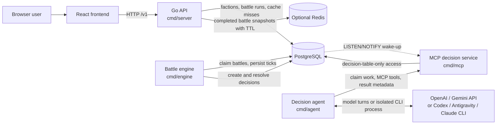
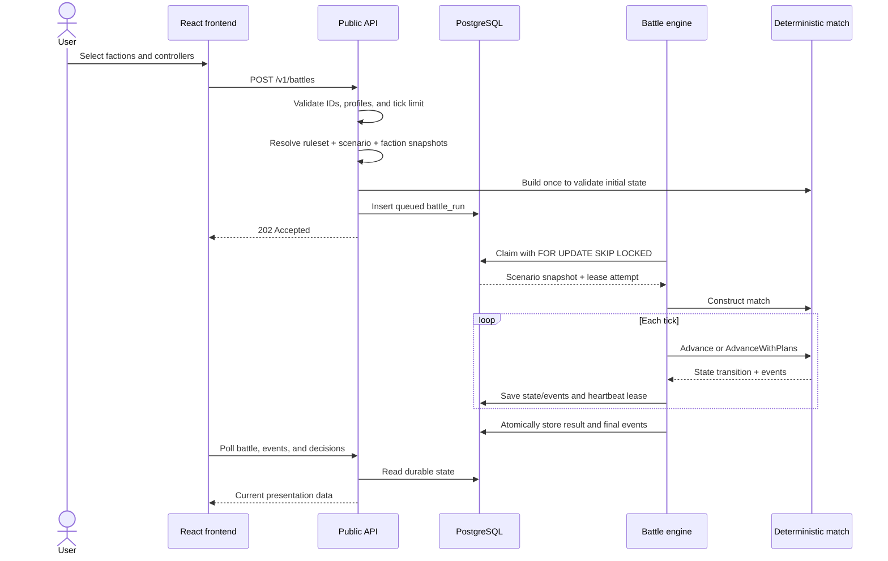
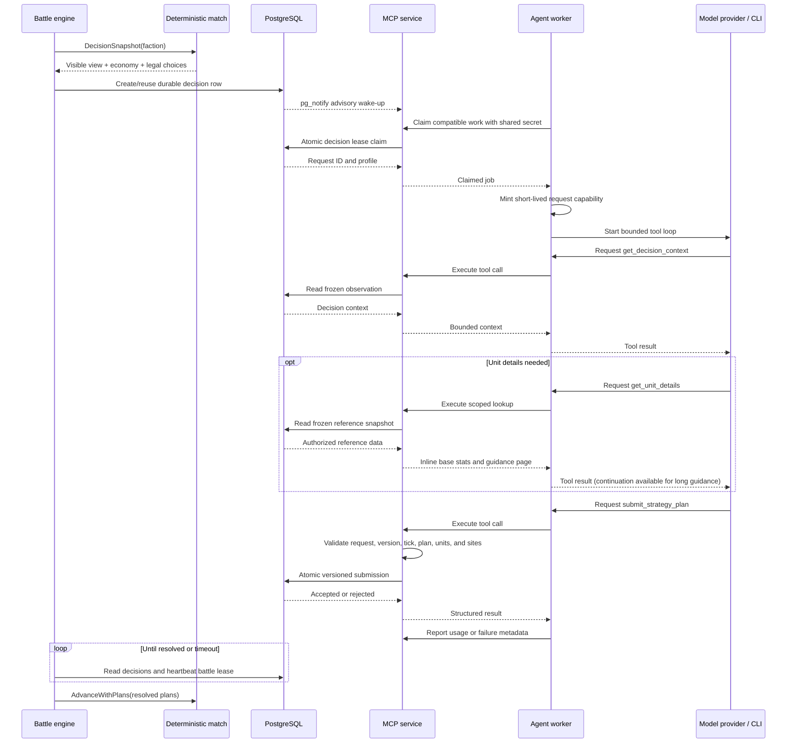
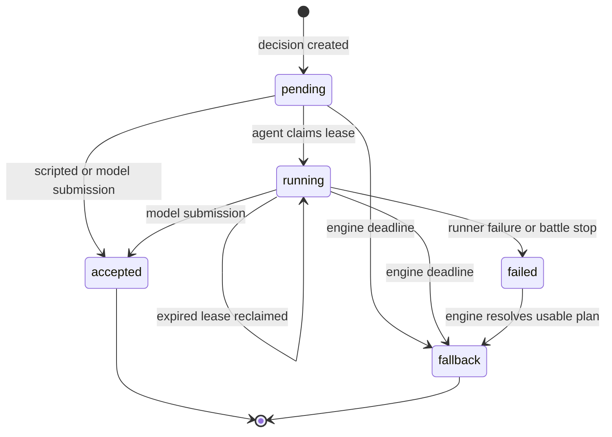
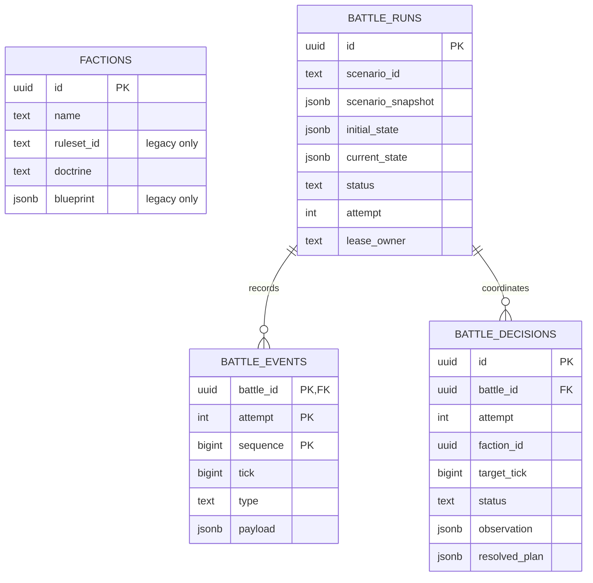

# OrdinalFrontier System Architecture

OrdinalFrontier is the public product brand. Existing `autonomous-battlefield`
resource identifiers, `battlefield` service names, local hostnames, and repository
paths remain operational identifiers; this branding change does not migrate
resources, authentication, stored data, or API routes.

| Field | Value |
| --- | --- |
| Status | Current |
| Last reviewed | 2026-09-23 |
| Audience | Contributors reviewing or extending system behavior |
| Scope | Runtime components, data flows, durability, security, and deployment |

For a package-by-package explanation of the implementation, see the [codebase guide](codebase-guide.md).

## Deployment environment boundary

WSL dev and server production use separate Kubernetes clusters, PostgreSQL
volumes, kubeconfigs, and secrets. The shared environment resolver pins the
cluster UID before operations. Dev loads working-tree images through a local
Docker socket; production accepts verified GHCR digests through Jenkins main
rollout. Context aliases distinguish environments without renaming resources.
Missing production application inputs fail validation. Production
rollback verifies both prior digests and the recorded applied migration state; local development never pulls production
deployment credentials. Observability is optional for dev. See the
[environment guide](../operations/environments.md) for registration and recovery.

Production profiles explicitly select `BF_DRIVER=kind|k3s`, with Kind as the
backward-compatible default. K3s preflight verifies the managed node/controllers
and retained storage contract in addition to the namespace UID. Shared deployment,
smoke and rollback entry points select K3s overlays without provisioning. K3s
PostgreSQL and Elasticsearch claims use `battlefield-retained`; CD leaves the
pinned controllers under platform ownership. Monitoring uses the exported serving
CA and a port forward into the selected gateway. The owner-authorized initial
[migration/cutover](../operations/k3s-delivery.md#adoption-and-cutover-boundary)
moves application data and the existing tunnel to the K3s VM, retaining Kind
and its historical logs for recovery. The production registration and Jenkins
kubeconfig must identify the same cluster before main delivery resumes.
The disposable delivery rehearsal can upgrade between two signed releases and
restore the previous exact image pair while checking the migration ledger and
retained claim identities. Its synthetic registration and private recovery record
stay separate from production; public authentication and cutover need their own
acceptance evidence.

## 1. Purpose

OrdinalFrontier is a deterministic castle-siege auto-battler. Users create reusable faction doctrines, stage a finite battle between two factions, and watch a separate engine execute it. Each faction can use either deterministic scripted plans or a model-backed strategic controller.

The central architectural rule is:

> Models propose bounded strategy plans. The deterministic engine validates and applies those plans and remains the only component that controls battlefield-state mutation.

This document describes the system's runtime boundaries and interactions. Operational instructions remain in [README.md](../../README.md), [docs/operations/deployment.md](../operations/deployment.md), and [docs/operations/observability.md](../operations/observability.md).

## 2. System context

PostgreSQL is the durable coordination point. The API and engine do not call each other directly, and the engine and agent do not call each other directly. Each workload can fail or restart while preserving battle and decision state.

## 3. Runtime components

| Component | Responsibility | Direct dependencies |
| --- | --- | --- |
| React frontend | Session-aware navigation (Cloudflare Access in production, development login locally), faction creation, battle staging and history, map display, controls, event stream, and AI decision history | Public API |
| Public API | Access identity verification, role/ownership authorization, managed Player membership, HTTP validation, scenario resolution, faction and battle persistence, and selectable model-profile catalog | PostgreSQL, scenario/ruleset YAML, optional Redis, optional Cloudflare Access group API |
| Battle engine | Battle queue claims, deterministic ticks, strategy windows, state/event persistence | PostgreSQL |
| MCP decision service | Request-scoped battle tools (`get_decision_context`, `get_unit_details`, `submit_strategy_plan`), background-generation tools, and an internal agent control plane | PostgreSQL |
| Decision agent | Model-decision claims and API or CLI model execution | MCP service, model provider |
| Redis (optional) | Disposable completed battle read cache; no engine or readiness dependency | Memory, API-only connection |
| PostgreSQL | Factions, battle queue, event history, snapshots, leases, and model decisions | Persistent storage |
| Scenario catalog | Authored map, timing, fallback plans, unit/building rules, and combat rules | Loaded by API and frozen into battle rows |

The backend commands are `cmd/server`, `cmd/engine`, `cmd/mcp`, `cmd/agent`, and `cmd/aieval`. The first four are runtime processes; `aieval` runs deterministic offline cases or explicitly enabled live comparisons and produces reports.

### Why four backend processes?

- The API remains responsive while battles and model calls take time.
- The engine can restart or scale without exposing gameplay HTTP routes.
- Provider credentials and model behavior remain outside the deterministic simulation process.
- The MCP service can receive narrower database permissions than the API or engine.
- Local subscription CLIs can run on a developer host without copying login credentials into Kubernetes.

## 4. Architectural boundaries

### Process health ownership

The API and engine entry points compose `httpapi.LifecycleHandler` around application traffic. That handler alone serves `/startupz`, `/livez`, `/healthz`, `/readyz`, and `/metrics`; the inner application router does not register duplicate probes. Engine readiness combines `Worker.Ready()` with a database ping. Database failure affects readiness while liveness remains available.

### Source ownership

See the [backend guide](backend-guide.md#backend-organization) for package
boundaries, frontend ownership, and launcher locations.

The Vite development proxy defaults to `http://localhost:8080` and accepts a
server-only `DEV_API_PROXY_TARGET` override from the frontend env files or shell.
Production/browser API routing continues to use `VITE_API_URL` and Nginx.
Nginx requires revalidation of the SPA entry document after rollouts and returns
404 for missing hashed assets instead of routing those requests to HTML.
Every Nginx response carries `frame-ancestors 'none'` CSP, `X-Frame-Options: DENY`,
`nosniff`, a strict-origin referrer policy and HSTS, so the admin and gameplay UI
cannot be framed for clickjacking. The CSP deliberately leaves script and connect
sources open because `VITE_API_URL` may name a separate API origin.

The administrator-only `/admin` control center uses `GET /v1/admin/model-access` and
`PUT /v1/admin/model-access` to manage provider and individual profile access, including
allowed roles. Migration `00012_model_access.sql` adds a singleton PostgreSQL
policy row. Version checks reject conflicting saves with HTTP 409. Each API
selection reads the durable policy with a bounded timeout, so replicas and restarts
share settings; read failures make models unavailable. The policy can restrict
access but cannot activate missing credentials or deployment-disabled runtimes.
Role overrides supersede configured `allowedRoles`; an explicit empty role list
denies everyone. Players can select API or CLI profiles only when explicitly included
in the profile’s allowed roles; default roles remain Admin and Developer. Disables apply to
new battle selection and background-generation admission; already accepted jobs
and frozen controller snapshots continue unchanged. This is not an emergency stop.

Role preview keeps the administrator's authenticated session and identity while
applying Player or Developer read permissions. The browser sends
`X-Battlefield-Preview-Role`; authentication validates the real administrator before
preview middleware substitutes the effective role ahead of route authorization.
Both transport and server reject mutations during preview. Navigation and inspection
use the effective role, and switching roles remounts route content to clear privileged
cached views. Exit preview restores the administrator view; logout/session expiry
also clears preview. This previews the administrator's own ownership, not another
person's account. There are no invitations, fabricated audit events, or budget controls.

Frontend feature clients, including faction ruleset discovery, use the shared
HTTP transport to report network failures consistently while preserving request
cancellation. Feature clients own HTTP status messages; protected requests also
notify the application when authentication is required.

### Battle inspection

The inline map fits its board aspect ratio. Expanding moves the same map state
into a native modal dialog with focus containment, Escape dismissal, scroll
locking, and focus restoration. Perspective and entity selection survive this
transition. Opening or resizing fits the board; live tick updates preserve the
camera. Pointer and keyboard panning remain local UI state. A native “Pan with
arrow keys” toolbar button provides keyboard panning without making the map container
an application landmark. On mobile the inline
overview permits page scrolling, with dragging enabled in the expanded map.

Terminal battles display a result without inactive transport controls. Tick
progress describes usage of the requested maximum, not completion percentage.
Event presets and exact-type filtering operate on loaded history without changing
cursor requests, attempt selection, or server records. Key events is the default;
All events includes unknown types. Summaries are derived from existing payloads,
with original fields and JSON inside Details. Mobile shows ten matching rows at
a time and uses page scrolling. A separate polite status announces loaded counts.

The frontend hides identifier displays and copy controls; UUID generation,
API requests, and routes retain their existing identifiers. Navigation is Stage
battle, Factions, then Battle history, with creation accessible from Factions.
Background generation availability distinguishes failed status reads,
unavailable service, exhausted allowance, cooldown, and active work using existing
fields. Quota/reset details appear only for an available service. Retry reads do
not activate providers or configure credentials, and manual editing stays enabled.
Controller menus show available profiles; unavailable integrations have a separate
status disclosure. Existing inspection permissions govern model/execution details.
Faction deletion is offered only in the authorized editor's Danger zone. It keeps
the named registry-removal confirmation, disables repeat submissions, leaves failed
deletions on the editor, and navigates to the directory after success.

The SVG map uses compact directional arrows beneath entity icons, matching the
acting faction's unit color. Movement remains dashed and subdued; attacks use solid
lines with a subtle traveling highlight, and tower fire uses a thicker stroke. Endpoints clear entity outlines; paths too short to fit an
arrowhead are omitted. Indicators follow the current battle snapshot, and reduced
motion preferences retain static lines without the traveling highlight. Health
bars update their green fill and numeric HP immediately; lost HP appears red for
300 ms before shrinking over 500 ms. Healing immediately covers the red layer.
Reduced motion disables the damage trail transition. Defeated units leave the live roster immediately. Per-tick `unitDeaths` records
provide a fading cross/ring in the fallen unit's faction color at its confirmed
death position for 900 ms, or a
static marker for reduced motion. Faction views expose allied deaths and visible
enemy deaths only; disappearance from vision never creates a death marker.

Unit snapshots include optional `movementPath` coordinates (start plus each hex
actually traversed during the tick). The engine records these for normal, siege,
retreat, and support movement and clears them with the other per-tick actions.
Snapshot and faction-view copies own their route arrays; enemy routes crossing
hidden hexes are omitted from faction views. No database migration is required.
The map draws these routes and animates existing units along them at 220 ms per
step, capped at 700 ms. Animation requires the recorded start to match the last
displayed position; initial loads, discontinuous snapshots, and reduced-motion
preferences show the current position immediately. New updates cancel any prior
animation. Older snapshots can animate adjacent endpoint-only moves, but the UI
does not infer missing multi-hex routes.

Tracking attacks retain immediate damage. Their arrows follow the target's rendered
walking position; missing/destroyed targets use a short impact marker at the stored
hit position. Attacking units nudge 0.75 pixels forward and back over 200 ms on a
separate transform layer, while towers remain stationary. Fixed-location shots
show a fading impact ring for hits or a muted cross for misses, without a damage
tracer on misses. Polling and map controls do not replay these effects, and reduced
motion disables them.

Optional `attackMode` capabilities default to `tracking`; newly resolved core-v2
catapults use `position`. Position attacks lock the existing priority-selected hex
after economy/tactics and before towers. On the unit's speed-ordered turn, retreat
cancels the shot; otherwise a living enemy occupying the locked hex takes normal
damage. Empty or friendly-only hexes miss, without splash or friendly fire. A unit
without an initial aim moves normally and cannot acquire a late shot. Speed remains
turn order, not attack frequency. Existing resolved snapshots without the capability
retain tracking behavior. Per-tick `attackOutcome` and attack event impact metadata
make hits and misses explicit; faction projections suppress hidden impact positions
and targets. Event history remains the existing administrator-wide view.

The battle page keeps progress/outcome and controls in a compact toolbar above
the map. `BattleInspector` owns the native System/player dropdown and the shared inner tab
(Overview, Decisions, Units, Faction), independently of map perspective. System
shows a current-player comparison and the attempt-selectable event stream.
Player headers show current gold, living units, castle health, and snapshot tick;
Overview groups buildings and economy totals, Units groups living entities with
individual HP/coordinates, and Faction shows the saved profile. Navigation stays
fixed above a single scrolling content region. The inspector and map have matching
desktop heights and scroll together with the page; the inspector moves below the
map at narrow widths. Hidden sections remain mounted to preserve filters and
expanded decisions across tab changes; historical context requests run only in
an active, expanded decision. New history rows do not collapse existing details.

The player summary derives from the full spectator state, including under a
faction map perspective. Null collection slices from Go JSON are handled safely;
missing faction state displays unavailable values, while empty armies show zero.
Battle participant responses include background and doctrine from the persisted
scenario, not the current editable faction directory.

`GET /v1/battles/{id}/decisions/{requestId}/context?attempt=N` reads the persisted
observation through the existing decision repository. The service checks battle,
attempt, request, and observation scope. An explicit response projection exposes
only historical identity, economy, faction-visible view, legal choices, prior
plan, memory, and knowledge; internal provider metadata and capabilities are
excluded. For saved observations, `initialContext` contains the current reconstructed projection
and `availableUnitDetails` holds the frozen reference snapshot, clearly labelled
as optional in the inspector. Legacy rows without observations return `context: null`. No migration
is needed. The browser loads on expansion, caches by battle/attempt/request, and
aborts and ignores obsolete responses. Decision history also rejects responses
from an obsolete battle/attempt. The inspector labels observation ticks and
separates historical context from its current-resource header. Plans describe
intent; events provide execution evidence. A running decision does not imply
verified MCP connectivity. Private reasoning and tool-call traces are not exposed.

Dropdown options and comparison rows iterate participant IDs without a two-slot assumption.
Three-way simulation remains separate work: battle creation and scenario/map
spawns require two factions, movement selects a single opponent, and destroying
a castle currently ends the match. Supporting three players requires revisiting
those contracts, elimination/winner rules, and map faction colors as well as the
creation form.

### Deterministic simulation boundary

The simulation receives a resolved scenario and optional plans, then produces deterministic state transitions and events. It does not access PostgreSQL, HTTP, environment variables, or model providers.

The engine owns orchestration around this pure domain: leases, retries, pauses, decision deadlines, persistence, and shutdown handling.

### Blocked castle approaches

Unit movement prefers a complete path to a position within attack range of the
opposing castle. If occupied approach tiles prevent that route, the engine searches
for reachable attack positions around living enemy units and buildings. This
prevents occupied castle perimeters from freezing both armies. Paths still exclude
occupied and impassable tiles, and execution remains bounded by unit movement.
Movement and attack targeting use authoritative engine state; faction sight filters
AI observations rather than controlling these engine paths.

### Public application boundary

Production requires Cloudflare Access on the whole application hostname through a named Tunnel. The API independently verifies the Access JWT and maps issuer/subject identity and verified email to a role on every request. Privileged roles remain configured; optionally managed Player membership is read from PostgreSQL. No legacy password/cookie fallback is accepted. Explicit local-password and disabled-development modes remain development-only. Exact-origin mutation checks and a deny-by-default route permission registry wrap every application API. The browser never connects to the engine, MCP or PostgreSQL. See [limited-access launch](../operations/limited-launch.md).

### Model boundary

The model never receives a repository, global game state, or mutation function. It can only:

1. read one authorized faction-visible decision context;
2. look up frozen reference details for units in that context;
3. submit one validated strategy plan for that decision.

### Durable coordination boundary

Battle work and model work are both durable PostgreSQL state machines. Notifications and long-polling improve latency but are not correctness dependencies.

## 5. Core runtime flows

### 5.1 Create and run a battle

Battle execution is asynchronous from the creation request. Each battle stores a complete resolved scenario and initial state, so later edits to factions or catalog YAML cannot change an existing run.

### 5.2 Strategy decision window

A decision window occurs immediately before ticks configured by `decisionIntervalTicks`. The supplied scenario currently uses ticks 10, 20, 30, and so on.

The engine creates a decision row for every faction:

- A `scripted` controller submits its deterministic baseline immediately through the same validation service.
- A `model` controller remains pending until an agent claims and resolves it.

Using the same durable record shape supports consistent history and scripted-versus-model evaluation.

### 5.3 Timeout and fallback

The battle must make progress even if a model does not answer.

At the decision deadline:

- the tick-zero opening uses a deterministic sorted-roster purchase fallback;
- the first in-battle production window uses the scenario's scripted baseline;
- later windows reuse the faction's previously active plan;
- the fallback is stored with status `fallback` and error category `timeout`;
- a racing model submission and fallback are resolved by version and status predicates, so only one wins;
- the stored plan is applied exactly like an accepted model plan.

### 5.4 Pause, resume, and stop

- Pausing a queued battle prevents it from being claimed.
- Pausing a running battle retains and heartbeats its lease.
- Paused time extends the current decision and tick deadlines.
- Resuming continues the same in-memory attempt.
- Stopping releases the battle lease and fails outstanding decisions with `battle_stopped`.
- A stopped or reclaimed battle prevents the previous engine owner from making further guarded writes.

## 6. Model execution

`internal/ai/worker` owns decision claims, concurrency, timeouts, and outcome reporting. Workers use `ai.agentConcurrency` execution slots (1–4, default 1); the VM template keeps 1 until an operator selects 4 after a resource check. PostgreSQL serializes admission on the policy row and caps active CLI leases at `runtime_policy.cli_concurrency` (1–4, default 4), shared across all workers, battle decisions and generation jobs. API jobs do not consume CLI leases. A completed submission retains the CLI lease until the worker reports completion or its execution deadline expires. Claim responses carry the database lease deadline, so network delays cannot extend a worker’s allotted execution time. Keep the database, MCP and VM clocks synchronized. It selects an `APIRunner` or `CLIRunner` from `internal/ai/runner`; both implement the same provider-neutral decision-runner contract.

### API runtime

`APIRunner` in `internal/ai/runner/api.go` runs the shared API tool loop:

1. connects to MCP with a request-scoped capability;
2. accepts the battle tool set `get_decision_context`, `get_unit_details`, and `submit_strategy_plan` (also accepting the legacy pair during rollout);
3. asks the configured provider for a tool-calling turn;
4. rejects unsupported tools or a turn with no tool call;
5. adds tool input and output to the transcript;
6. stops after an accepted submission or the configured step limit.

OpenAI Responses and Gemini GenerateContent adapters normalize provider tool calls, refusals, and usage into common types.

### CLI runtime

The CLI runner starts Codex or Antigravity CLI in a new temporary directory with the
settings below; the Claude Code CLI runner is described under [Deployment topology](#kubernetes).

- an empty workspace;
- a request-scoped MCP bearer token;
- only the session's battlefield tools enabled (three for battle decisions, two for background generation);
- shell, file, browser, app, image, plugin, skill, and multi-agent capabilities disabled where supported;
- no approval prompts;
- the allowlisted profile model passed explicitly with `--model`;
- a pre-validated CLI version family.

In development Codex uses the existing host login without copying it; production uses only a dedicated VM login. Antigravity uses the host OS keyring or a private temporary copy of its native `antigravity-oauth-token` login file, with a temporary HOME and XDG directories. Both CLI subprocess environments exclude worker control credentials, provider keys and personal CLI overrides. Linux workers disable dumpability to block parent environment/memory reads from same-user children; CLI process groups are killed on cancellation and output capture is bounded at 4 MiB. Generated permissions allow the session's battlefield MCP tools and deny file, command, and URL operations; slash-command expansion is disabled. A headless account-usage probe must succeed before advertising the profile. JSON result envelopes must report SUCCESS with no denied actions. Explicit permission rules are used without strict mode, which overrides MCP allows in CLI 1.1.27. The MCP usage endpoint verifies that a plan is accepted before acknowledging completion; missing submissions trigger a worker failure and fallback. Usage counters are recorded for accepted plans. Subscription credentials are not placed in Kubernetes.

CLI context responses include explicit target-tick and version metadata alongside the full structured context. CLI prompts require copying those values and making a substantive tactical or production decision. Name-only CLI plans are rejected; after three invalid submissions the decision is failed so the battle can fall back. MCP logs record context byte counts and validation field/code pairs without dumping observations or credentials. Usage reporting retries transient failures up to three times.

Antigravity CLI offloads larger MCP tool responses to local files. Because battlefield CLI sessions deny file reads, the host now fetches the request-scoped context through the MCP SDK and embeds the validated JSON directly in the Antigravity prompt (maximum 64 KiB). The model submits through MCP without fetching the large response again. This keeps existing file restrictions and avoids blind tick guessing when the CLI hides an offloaded response.

## 7. Decision contracts and lifecycle

### Shared prompt provenance and faction memory

API, Codex, Antigravity, and Claude CLI use one embedded decision policy assembled by
`internal/ai/prompts.go`. Only context delivery differs: tool fetch versus
Antigravity host-prefetched JSON. The persisted `PromptVersion` includes a SHA-256
digest covering the base, identity/context boundary, doctrine, policy, and both delivery templates. Version v7 moved faction-authored name/background/doctrine into JSON-escaped untrusted decision context; they never extend the system instructions. Version v8 orders the decision prompt from most to least stable (shared policy, then the faction identity block, then the per-request ID and any inline context), so the prefix repeated across one faction's decisions includes its identity and stays eligible for provider prompt caching. Bump the major version whenever assembly order changes, because the digest covers only template text.
Each prompt purpose has one current `.txt` file; Git preserves previous revisions.
The build manifest reads the runtime prompt version, bundle digest, and tool schema
through `go run ./cmd/aieval -mode metadata`, requiring Go during manifest generation. Both API and CLI
model submissions require a substantive plan and stop after three validation
rejections.

Before hashing a decision observation, the engine reads at most three earlier
resolved records scoped in SQL to the same battle, attempt, and faction.
`BuildFactionMemory` produces historical economy/unit counts and resolved plans,
with observation ticks and accepted/fallback status, bounded to 8 KiB. These
snapshots describe state before the historical decisions, not attributed effects.
Memory is embedded in the frozen observation JSON and included in its hash;
no separate mutable scratchpad or database migration is required. Read failures
are logged and the engine proceeds without optional history. Reuse requires
matching prompt/tool versions and profile/provider/runtime/model identifiers as
well as observation hashes. Attempts never read memory from previous attempts.

`aieval -mode compare` runs matched, repeated synthetic decisions through the
production MCP validator with isolated loopback repositories and API/CLI runners.
It verifies persisted acceptance rather than trusting CLI success, and records
context hashes, prompt provenance, validation failures, latency, usage and
canonical plan diversity. This measures individual decisions; win rate remains
null. CLI internal token/turn budgets differ from API enforcement and are labeled
in reports. See [AI comparisons](../operations/ai-comparisons.md).

### Bounded context

A decision context contains:

- battle, faction, request, target-tick, and version identifiers;
- a fog-of-war faction view;
- current and projected economy values;
- legal action kinds, unit/building definitions, construction sites, and owned recruitment sources;
- the currently active plan;
- optional bounded faction memory and retrieved unit knowledge;
- a hash of the observation excluding request-specific fields.

### Submitted strategy

A model or scripted controller can propose:

- a short name and operator-visible rationale;
- fixed-point attack and defend weights;
- target-specific bonuses;
- reserve gold and spend ordering;
- typed construction orders (or legacy economy-site priorities);
- explicit ordered unit purchases with quantities (legacy plans may use recruitment priorities).

The service validates decision version, target tick, general plan bounds, and context-specific units and sites before persistence.

### Explicit recruitment orders

The shared model prompt requests ordered `{unitType, count, sourceBuildingId?}` purchases through
`recruitmentOrders`. MCP and engine validation enforce legal unit IDs, positive
counts, and a six-unit per-window maximum. The engine executes only the requested
sequence, preserving reserve gold and spawn occupancy. Unavailable explicit sources
and blocked Barracks orders are skipped; blocked castle spawns or an unaffordable
purchase stop remaining purchases. The six-unit limit spans all sources. Empty orders mean no buying; missing orders retain legacy
priority behavior. Orders are deep-copied and persisted with plans, faction memory,
and decision hashes. The UI shows requested quantities; recruitment events report
actual spending. See [explicit unit purchases](../operations/ai-comparisons.md#explicit-unit-purchases)
for partial-order and reuse semantics.

### Versioned unit knowledge

Optional ruleset knowledge is frozen in the resolved scenario JSON alongside unit
statistics, and participates in the scenario content hash. At each decision
window the engine retrieves unit cards using only the faction-visible context.
Selection runs before observation hashing and persistence. API MCP reads and host
CLI inline delivery consume that identical persisted knowledge. Retrieval has no
external service dependency and does not change engine combat or plan validation.

`engine.knowledgeRetrieval` controls positive card and byte limits (defaults 16
and 16384). Effective limits, selected source IDs, content digest, byte size, and
truncation accompany decision knowledge. Old scenarios without knowledge remain
valid. See [AI comparisons](../operations/ai-comparisons.md#unit-knowledge-retrieval)
for authoring, configuration, and evaluation details.

### Compact unit context and exact lookup

All new decisions use `battlefield.decision-context.v4`. Before hashing, the engine
freezes all legal or visible unit definitions and available cards in the persisted
observation's `unitReference` JSON field. This reference is independent of the
legacy automatic card budget. Full observations continue to drive validation.
No database migration is required: observations are stored as JSON.

The explicit `AgentContext` projection emits unit ID, cost, class, role, strengths,
and weaknesses in `legal.units`, plus `referenceUnits` for visible types that are
not recruitable. It keeps knowledge mechanics and source identity but omits cards,
base statistics, and the stored reference snapshot. Battlefield observations,
including effective unit stats, remain intact. API delivery and CLI prefetch use
the same projection. Older saved observations are also projected into the current format without rewriting storage.
MCP tools v7 delivers `get_decision_context` as one JSON text block with the
existing `context` envelope, without a duplicate structured-content copy. API
runners parse the same text. Agents are instructed to reuse a successful frozen
snapshot; retries remain available after failed or unreadable responses and
existing step, timeout, and submission limits are unchanged.

MCP tools v6 adds `get_unit_details(requestId, unitIds)`. The request capability
and frozen legal/visible set scope every lookup. A batch contains 1–4 distinct
nonempty IDs and returns base stats, guidance when present, and source
identity/digest. Hidden and unknown IDs both return `available: false`. Responses
above 1800 serialized JSON bytes return a recoverable tool error asking for fewer
IDs. For a single long card, `nextGuidanceOffset` explicitly marks continuation;
pass it as `guidanceOffset` with the same unit ID to read the remainder. Every page
contains complete base stats. Text-only JSON delivery avoids duplicate CLI resource
rendering. Overview text is not repeated in lookup results. All reference content remains untrusted data.

The saved-context inspector exposes the exact initial projection separately from
reference details labelled available on demand. Availability does not establish
that the model fetched them. Evaluation reports count lookup calls and aggregate
input tokens across turns, alongside latency, acceptance, fallback, and diversity.
See [compact context rollout](../operations/ai-comparisons.md#compact-unit-context)
for deployment order and checks.

### Submission-shape failures and fallback attribution

The shared decision instructions require a flat MCP argument object with all
required fields, including empty objects/arrays where appropriate. Antigravity
can otherwise stop after SDK schema errors without reaching the typed plan
handler. MCP receiving middleware records `decision_tool_input_rejected` with
only the authenticated request ID, allowlisted missing field names, and a
nested-plan flag; argument values and raw SDK errors are excluded.

When a runner fails before the deadline, the engine carries its error category
into the fallback record instead of replacing it with `timeout`.

| Error category | Raised by | Meaning |
| --- | --- | --- |
| `timeout`, `refusal`, `rate_limit`, `provider` | API runner | Provider deadline, safety refusal, HTTP 429, or other provider failure |
| `mcp_connect`, `mcp_discovery`, `mcp_tool`, `mcp_context` | API/CLI runner | MCP session, tool-list, tool-call, or Antigravity context-prefetch failure |
| `unauthorized_tool`, `no_progress`, `step_limit` | API runner | Model requested a tool outside the session set, returned no tool call, or exceeded the profile's step limit |
| `cli`, `cli_permission`, `cli_isolation`, `cli_provider` | CLI runner | Non-success CLI result, denied tool action, sandbox setup failure, or unsupported CLI provider |
| `validation_limit` | Decision service | Third rejected API/CLI submission for the same request |
| `plan_not_submitted` | Agent worker | Runner reported success but MCP holds no accepted plan |
| `profile_unavailable`, `capability`, `provider_unavailable` | Agent worker | Claimed profile is not executable locally, the claim carried no capability, or no runner could be built for the profile |
| `runner` | Agent worker | Runner failed without a more specific category |
| `decision_budget` | PostgreSQL admission trigger | The battle's model execution budget is exhausted at claim time |
| `battle_stopped` | Battle stop route / expiry sweep | Battle stopped or expired while the decision was open |

Background-generation jobs share the worker and runner categories above except
`validation_limit`, `plan_not_submitted`, `runner`, `decision_budget` and
`battle_stopped`, and add their own:

| Error category | Meaning |
| --- | --- |
| `execution_error` | Runner failed or did not submit, without a more specific category |
| `invalid_output` | Third empty or over-length background submission |
| `timeout` | Execution deadline passed while the job was running |
| `queue_timeout` | Job expired before any worker claimed it (status `expired`) | Unresolved
requests that reach the deadline retain the timeout category. CLI terminal
success remains subject to the worker's accepted-plan check.

### State machine

An accepted submission is idempotent when it repeats the stored idempotency key. Optimistic version checks prevent late or duplicate workers from overwriting another resolution.

## 8. Persistence and durability

Migration `00011_friends_access.sql` persists faction/battle owners, the singleton
`runtime_policy`, shared `agent_execution_leases`, per-battle execution counters,
and the private `friend_ai_usage` view. PostgreSQL admission serializes across API
replicas: 20 battles/person/UTC day, 2 unfinished/person and 4 globally. Queued and
running rows remain unfinished while paused. Generation admission retains its
account lock and idempotency, with 10/day including queued jobs that later expire.
Same-identity request retries reuse admission. Admin battles are exempt from the
battle allowances (migration `00016`: the API sets `admission_exempt` only for an
Admin actor), but still count as unfinished for other identities because they use
the same engine. Players, Developers and CI keep every limit.

A battle receives at most 100 model execution claims, including retries, then the
existing fallback resolves new windows. Disabling AI prevents new generation
admissions/claims and makes new model windows fall back. Production migrations
first save and validate a PostgreSQL backup; recovery retains Access authentication.
The legacy-owner quota exemption supports migrations/trusted internal fixtures;
application identities (including local Admin) cannot select that owner ID.

| Table or view | Purpose | Important behavior |
| --- | --- | --- |
| `factions` | Reusable faction identity and doctrine; archived legacy blueprint | Existing battle snapshots survive faction deletion |
| `battle_runs` | Queue, scenario/initial snapshot, current state, lease, status, and result | Lease owner and attempt guard writes |
| `battle_events` | Replayable per-attempt event stream | Primary key and conflict handling make insertion idempotent |
| `battle_decisions` | Observations, provenance, leases, plans, fallbacks, errors, and usage | Unique per battle/attempt/faction/tick; versioned resolution |
| `battle_controller_evaluation` | Aggregated controller comparison | Latency, fallback/invalid rates, token use, plan diversity, and win rate |
| `runtime_policy` | Singleton admission limits, AI stop switch, and CLI concurrency | Row lock serializes battle, decision, and generation admission |
| `agent_execution_leases` | Active CLI execution slots | Capped by `runtime_policy.cli_concurrency`; expired rows are pruned on admission |
| `faction_generation_accounts` / `faction_background_generations` | Per-actor generation lock and durable background draft jobs | Account row lock plus partial unique index allow one active job |
| `model_access_policy` | Singleton administrator model-access policy | Optimistic version rejects conflicting saves |
| `player_members` / `player_membership_sync` / `player_membership_audit` | Managed Player grants, Access-group synchronization, and audit history | Removal takes effect on the next API request |

`battle_decisions.faction_id` is historical snapshot data rather than a foreign key to `factions`. PostgreSQL `NOTIFY` only reduces claim latency: it carries no authoritative work payload and is safe to miss because agents query durable state after every wake-up.

### Completed battle result caching

The API service optionally checks Redis before `GetBattle` reads PostgreSQL. A miss,
invalid entry, or Redis error falls back to PostgreSQL. Only a `completed` run with
non-null result is stored, as a JSON snapshot containing its final state and scenario.
Existing battle responses retain their schema. Faction views are projected from the
snapshot after retrieval; event payloads and decision history remain PostgreSQL reads.
Authentication runs before cache access. Engine and MCP persistence never use Redis.

Keys are `battlefield:completed-battle:v1:<lowercase-battle-uuid>`, with a default
one-hour TTL and 100 ms deadline per cache operation, with command retries disabled.
Completed runs cannot currently be restarted or modified by application commands, so
no writer invalidation is required. Any future result edit, battle deletion/reuse, or
restart of a completed battle must add invalidation/versioning before release. After
restoring PostgreSQL, clear the dedicated cache database or use a fresh Redis database.
The `v1` namespace must change for incompatible cached schema changes.

Redis is lazy-connected, optional, and excluded from readiness. An empty
`BATTLEFIELD_REDIS_URL` disables it. Malformed URLs fail API initialization without
logging their credentials; outages and cache write failures do not fail battle reads.
Concurrent misses may issue duplicate database reads; this first implementation does
not coalesce requests. Redis expiry and eviction bound the cached working set. Use a
separate Redis database or instance per deployment environment.

See [Redis operations](../operations/redis.md) for setup and verification.

### Battle retries

Every mutating battle write includes battle ID, attempt, and lease owner. A mismatched write fails with lease loss.

A reclaimed battle starts a new deterministic attempt from `initial_state`; events from earlier attempts remain available by attempt number. When an observation hash matches a previously resolved decision for the same faction and target tick, the decision repository can reuse that plan.

Each claim increments `attempt`. Once a queued or lease-expired battle has used
`engine.maxAttempts` (default 3), the next claim pass marks it `failed` with
`attempts_exhausted` instead of starting another attempt. A stored scenario that
cannot construct a match fails immediately with `invalid_scenario` and is not
retried. Together with `battle_timeout` (see
[current limitations](#19-current-limitations-and-follow-up-questions)), these are
the engine's terminal battle error codes.

Decision wake-ups use the `battlefield_decision_ready` PostgreSQL channel, with the
profile ID as payload.

## 9. Security and trust boundaries

### Access identity, roles and owners

Access verification failures attach a bounded `auth_failure` reason code to the
existing `http_request_completed` server log, correlated by `request_id`. Codes
distinguish assertion, JWKS retrieval, signature, claim and identity failures;
raw tokens, claims, cookies, secrets and upstream error messages are excluded.
HTTP responses remain generic. Failed key refresh reasons persist through the
existing 30-second retry throttle; authentication and cache policy are unchanged.

Production API manifests require `BATTLEFIELD_ENV=production`; startup accepts only
`BATTLEFIELD_AUTH_MODE=cloudflare` with valid issuer (`BATTLEFIELD_ACCESS_ISSUER`),
audience (`BATTLEFIELD_ACCESS_AUDIENCE`), HTTPS origin (`BATTLEFIELD_PUBLIC_ORIGIN`)
and nonconflicting email/role assignments (`BATTLEFIELD_ACCESS_ROLES`). JWT verification uses RS256, a fixed issuer's
JWKS with one-hour key cache and a 30-second refresh throttle, and required identity/
time/audience checks. The audience claim accepts a single string or an array of
strings (RFC 7519 section 4.1.3), matched exactly and case-sensitively to the
configured audience. Invalid types and arrays with non-string entries are rejected.
Missing or unverifiable credentials deny access. Access owns
sessions and logout; the application issues no production auth cookie.

Players, Developers and Admins share gameplay/faction reads. Mutation ownership is
stored in PostgreSQL and taken from the authenticated request, never client JSON.
Legacy rows belong to `legacy-admin`. Only Admin can manage another owner's rows.
Decision history/context require Developer/Admin. Player gameplay projections run
after shared cache retrieval and omit model diagnostics, raw prompts and internal
errors. The frontend hides inspection panels and stops their requests for Players.
Cloudflare Access admission and MFA are independent deployment requirements. For static roles, user
removal requires Access rule removal, session revocation, application role removal,
and deployment to every replica; offline JWT verification alone cannot see revocation.
Managed Player removal instead denies each new API request from PostgreSQL immediately
and asynchronously removes the email from a dedicated Access group. It does not
revoke sessions in unrelated Cloudflare applications.

The local password login retains signed HttpOnly/SameSite cookies for development.
Missing auth mode and enable flags fail startup; explicit legacy enable flags remain
supported only in development. Local cookie logout does not revoke copied tokens.

### Model-facing capability

The MCP server mints each model session an HMAC-signed token containing one request ID and expiry. Workers cannot mint capabilities and never receive the signing secret. MCP verifies the signature, expiry, and equality between the authorized and supplied request IDs.

Tool bodies are bounded, plan fields are validated, and model-provided state is never authoritative.

### Agent control plane

`/internal/agent/claim`, `/fail`, `/usage`, `/generation-finish` and `/enabled` use a distinct worker bearer secret. Missing or equal worker/signing secrets deny worker authentication. Claims return a server-minted scoped capability. Kubernetes keeps MCP private; production CLI workers run in a separate KVM VM alongside the K3s application VM. They reach MCP through Caddy on `192.168.234.1:18084`, which forwards to a host loopback-only kubectl bridge. The renderer defaults to `127.0.0.1:28084`, matching the existing server's drop-in and Caddy upstream and avoiding Jenkins smoke ports 18081–18085. Its `--bridge-port` option changes both rendered endpoints together; the bridge selects the registered production kubeconfig. Caddy sets upstream Host to `127.0.0.1:8084` to satisfy the MCP SDK localhost protection while preserving capability authentication. Squid on `192.168.234.1:3128` restricts provider egress. Dedicated systemd units and the host firewall are generated by `scripts/ops/render-agent-vm-host.py`; see the [VM setup guide](../operations/agent-vm.md). Codex and its version-matched code-mode host are separate guest processes, not nested VMs. The development launcher keeps its bridge on loopback. Workers poll the durable operator AI switch and cancel on stop or loss of policy connectivity.

### Database privileges

Migration `00004_battle_decisions.sql` creates a `battlefield_mcp` group role with decision-table and evaluation-view access, with no event, unit, building, or resource-state grants. Migration 00011 adds narrowly scoped battle-run ID/counter access and execution-lease/policy access for atomic admission. A deployment must give MCP a login that inherits only that intended role.

### Deployment responsibilities

- Replace the development capability secret with high-entropy secret-manager material. MCP refuses to start with a capability secret shorter than 32 bytes or equal to the built-in local-development placeholder.
- Use Access for production sessions; keep role assignments and the independent worker/signing secrets in private operator configuration. Block direct-origin IPv4/IPv6 access and verify the CNI enforces NetworkPolicy.
- Keep provider keys only in the agent workload.
- Treat model rationale as untrusted display text even though its length is bounded.
- Keep CLI versions pinned because isolation flags and behavior are version-sensitive.

## 10. Configuration and profile availability

The common YAML configuration defines HTTP, database, API, authentication, engine, and AI settings. Each process loads only the sections it needs. Authentication names the environment variables holding its enable flag, credentials, signing secret, and Secure-cookie flag; the API fails startup when enabled secrets are missing or too short. Development application settings live in the Git-ignored project-root `.env`; the deployer separates them into database, authentication, and AI Kubernetes Secrets. Production uses the same application schema in a private `.env` beside `deployment.env`.

A model profile specifies:

- stable ID and display name;
- provider and API/CLI runtime;
- cluster or local scope;
- API credential/model environment variables or a pinned CLI model identifier;
- optional external-agent availability environment variable;
- token and step limits;
- enabled state and supported CLI version prefix.

Key runtime settings and their defaults:

| Setting | Default | Effect |
| --- | --- | --- |
| `api.maxTicks` | 10000 (maximum) | Upper bound for a battle's requested tick limit |
| `engine.pollInterval` | 1s | Delay between empty battle-queue claims |
| `engine.leaseDuration` | 30s | Battle lease length; an expired lease lets another engine reclaim the battle |
| `engine.heartbeatInterval` | 10s | Lease renewal cadence; must be shorter than `leaseDuration` |
| `engine.maxAttempts` | 3 | Claims per battle before `attempts_exhausted` |
| `engine.shutdownTimeout` | 10s | Bound for final writes and requeue during shutdown |
| `ai.decisionTimeout` | 2m | Engine decision deadline and agent execution timeout |
| `ai.agentConcurrency` | 1 | Execution slots per agent process (1–4) |
| `resultCache.ttl` / `resultCache.timeout` | 1h / 100ms | Completed-battle cache entry lifetime and per-operation deadline |

`backend/config.yaml` is the reference for all keys; unknown keys fail startup.

The API catalog advertises profiles users may select. In cluster mode, an operator flag can advertise a host-connected CLI even though the API pod cannot execute it. An agent advertises only profiles it can execute; claims include those IDs so heterogeneous agents do not lease incompatible work.

## 11. Deployment topology

### Local development

`deploy-local.sh` builds images, deploys to the registered dev Kind cluster, and runs smoke checks. Dev reads the root `.env`; production reads `.env` beside its private `deployment.env`. Both files use the shared literal parser and explicit schemas. Application settings are filtered into database, auth, AI and optional-runtime Kubernetes Secrets; deployment identity never enters these Secrets. Application pods refresh on configuration-only deployments. Production tunnel settings remain in the deployment profile and its credential JSON stays separate; tunnel resources are rendered temporarily by the explicit tunnel deployment command. No legacy configuration fallback or persistent generated launch files remain.

| Port | Process |
| --- | --- |
| `5173` | Vite frontend |
| `8080` | Public API |
| `8081` | Engine health and metrics |
| `8083` | Agent health |
| `8084` | MCP and internal agent control plane |
| `5432` | PostgreSQL |

### Kubernetes

Kustomize deploys separate API, engine, agent, MCP, frontend, and migration workloads. The API requires `battlefield-auth`, the API and agent read profile availability from `battlefield-ai`, MCP receives a distinct `MCP_DATABASE_URL`, and the processes mount a common non-secret ConfigMap. Development smoke uses its local administrator Secret; production smoke requires a real invited Access JWT and uses private port forwards. Neither mode disables authentication for verification.

The migration Job runs the server in migration-only mode and reads the required
`battlefield-auth` Secret for configuration validation. Deployment supplies the
same dev/production environment as the API; CLI profiles are disabled in this Job.
Startup and migration tests construct providers through the same PostgreSQL
advisory-lock configuration. The lock spans schemas within the database because
role and public-schema permission changes are shared across test fixtures.

Registry-backed Jenkins deployments use immutable GHCR digest references.
Publication and admission rendering share validated repository settings. The
rollout supplies its resolved image references so preserved repositories remain
covered during partial updates. Image source labels are derived from Git origin
or an explicit `SOURCE_URL`, rather than a fixed project URL. Before
admission, Kyverno validates a Cosign signature plus CycloneDX, SLSA v0.2, and
AI-manifest attestations with the reviewed public key. Cosign v3 OCI 1.1
referrers remain the portable evidence copied during registry promotion. The
CI publisher also writes legacy digest-tag mirrors of the same signed evidence
because the pinned Kyverno 1.15 verifier discovers that layout. Publication and
GHCR deployment explicitly verify the legacy signature for the signed full-commit
`revision` annotation: Cosign 3.0.2 bundle signatures and their verification
summaries do not preserve that annotation. Attestation verification continues to
use the modern evidence. Registry access
uses short-lived Docker configuration in Jenkins and a namespace-local pull
Secret for the admission controller; neither changes the cryptographic trust
root.

PR verification generates backend and frontend coverage, then runs the shared
SonarQube Community Build service with quality-gate polling before image builds.
Each PR is the main branch of its own preview project and keeps one stable project
identity across retries. Jenkins seeds the preview with the target merge-base as
one version before scanning the head as the next version, so New Code is relative
to that PR's target and cannot be moved by another PR. The production project
remains dedicated to `main` analyses.
Main delivery repeats the analysis before deployment and classifies changes
after the CI quality gates. Application-test-only
changes and known CI test wrappers skip image publication and rollout; production
file removals and unknown paths still select deployment. The shared
`scripts/ci/with-ghcr-auth.sh` wrapper isolates registry credentials for each
authenticated command, including rollback, and cleans up on cancellation.

Deployment staging copies only selected overlays and their base dependencies.
Infrastructure secret inputs are staged explicitly; unrelated local credentials
are not copied. Auth-only extraction uses a separate staging path; the exported
registered `.env` path remains unchanged for child deployment preflight checks.
Observability verification waits for completion of each new
Deployment rollout concurrently and reports failures before setup verification.
The source-security stage owns CI manifest rendering and policy validation;
scanner versions are centralized in `scripts/ci/tool-versions.env`.
Its Trivy filesystem scan excludes generated `artifacts`, `frontend/coverage`,
`frontend/playwright-report`, and `frontend/test-results`
directories so parallel coverage cleanup cannot race with source analysis.
Frontend source and dependency lockfiles remain in scan scope.
Frontend tests use two Vitest workers and a 15-second per-test timeout to allow
multi-step DOM interactions to finish while the agent runs parallel CI checks.
Testing Library async waits have a separate five-second deadline inside that
per-test budget.

W3C trace context is persisted on `battle_runs` and `battle_decisions`. API inbound spans flow through PostgreSQL; engine and agent workers extract that durable context and create consumer spans before simulation, MCP, and provider work. Outbound HTTP clients and selected database operations are instrumented. The local OpenTelemetry Collector exports to Tempo, which Grafana provisions as a data source. Span attributes deliberately exclude prompts, credentials, capabilities, full observations, and raw provider responses.

The observability overlay includes metrics, tracing, and disposable log storage.
The observability smoke test generates application traffic on the same API
port-forward it scrapes, because request counters are local to each replica and
lifecycle probes bypass request instrumentation.
See [observability operations](../operations/observability.md) for storage,
security, and access details, and [Jenkins](../operations/jenkins.md) for runtime
assurance launchers.

The in-cluster agent is intended for API providers. `run-k8s-cli-agent.sh` bridges host subscription CLIs by validating the local binary and login, forwarding MCP to loopback, running a local agent, advertising availability to the API, and removing that availability on exit.

The `claude-cli` provider exposes `claude-subscription-local` using Claude Code
2.1.267 and the `sonnet` alias. The host retains its native subscription login;
only allowlisted transport environment variables reach the subprocess. Restricted
mode, empty built-in tools, disabled hooks and settings discovery, strict MCP
configuration, and `dontAsk` permissions constrain it to explicitly approved
battlefield tools. A private temporary MCP file holds the request capability and
is removed on exit. Session persistence is disabled. Server-side capabilities and
submission validation remain authoritative for battle and faction-generation jobs.
The host bridge waits for MCP rollout readiness and surfaces forwarding logs on
startup failure; bounded loopback health probes bypass proxies and require a live
forwarding process.
The API advertises the profile only while `CLAUDE_CLI_PROFILE_AVAILABLE=true`;
production additionally requires the existing VM isolation verification flag.
Claude stdout is parsed as a complete JSON document with stderr excluded. The
host wait accommodates both serial auth checks; the VM profile defaults to disabled.
Native HOME is retained: user-level instruction memory is not explicitly disabled,
so reproducible comparisons need a dedicated account without personal memory.
Claude terminal results report aggregate CLI usage, including cache reads/writes
in total input tokens; errors and permission denials fail the decision. The
`sonnet` alias follows the subscription's default Sonnet model, so operators need
an explicit model ID for reproducible comparisons. See [Claude operations](../operations/claude-cli.md).

## 12. Observability

- Processes emit structured JSON logs with stable `event` identifiers and readable
  `msg` summaries containing selected operational fields. The shared logging
  handler attaches `trace_id` and `span_id` from active contexts without moving
  those fields into user attribute groups. `LOG_LEVEL` defaults to INFO.
- API logs carry or generate `X-Request-ID`. Tracing wraps access logging so
  completion logs, including authentication rejections, share the request span.
- Every `/v1` error uses one JSON envelope, `{"error":{"code","message","requestId"}}`,
  written by `internal/apierror`. `requestId` equals the `X-Request-ID` header and
  the `request_id` log field, so a client-reported failure maps to one log line.
  The identifier lives in the leaf `internal/requestid` package because `httpapi`
  imports `authn`, which also writes errors. Codes are listed in the
  [API reference](../reference/api.md#errors).
- HTTP completion logs carry `actor_id` and `actor_role` from authentication
  middleware, providing request attribution rather than a tamper-proof audit
  store. Tokens, cookies and email headers are not logged. See
  [observability](../operations/observability.md) for the full field list.
- Engine logs cover battle claims, lease loss, decision windows, fallbacks, requeues,
  and completion. Running battles and pending decision windows report progress
  immediately at their first reporting point and at most every 15 seconds
  thereafter. Waiting updates include pending faction counts; completion includes
  elapsed wall time. Per-tick persistence events require DEBUG logging.
- Agent/MCP logs cover decision claims, tool access, validation, provider outcome, usage, and latency.
- Full combat detail lives in `battle_events` rather than normal process logs.
- API and engine expose lifecycle checks; agent and MCP expose `/healthz`.
- Prometheus, Grafana, Elasticsearch, Kibana, and Fluent Bit are provided for the local Kubernetes environment.
- Local Prometheus discovers nodes and scrapes each kubelet's cAdvisor endpoint
  using service-account authentication and the narrow `nodes/metrics`
  permission; it does not receive general kubelet proxy access.

## 13. Decisions and trade-offs

### Determinism over direct model control

Models submit strategy and production priorities rather than state mutations. This preserves replayability, legal-action enforcement, testing, and controller comparison.

### Durable database coordination over in-memory queues

Battle and decision work survives restarts. Leases and `SKIP LOCKED` support competing workers without another queue system, at the cost of additional PostgreSQL state-machine logic.

### Frozen snapshots over live catalog references

Rules, factions, and initial state are captured per battle. Replays remain stable, at the cost of larger JSONB rows and explicit version provenance.

### MCP as a capability boundary

The same small, auditable tool surface supports API and subscription CLI models. The trade-off is another service and authentication boundary.

### Polling with advisory wake-ups

The UI polls the API, the engine polls battle rows, and agents long-poll MCP. PostgreSQL notifications reduce model-claim latency without becoming a correctness dependency. Higher scale may justify push delivery or a dedicated broker.

## 14. Shared content library and scenario restrictions

Catalog startup resolves ruleset library references from the sibling `content`
directory. Libraries version unit definitions, upgrades, existing castle/economy
building roles, and unit cards together. Rulesets select content and own global
balance rules; scenarios can narrow units, upgrades, and buildings. Invalid
references, incompatible authored plans, and invalid definitions fail startup.

Scenario summaries expose effective allowed IDs. Faction profiles are independent
of rulesets and scenarios. The backend validates purchases against the selected scenario. The resolved scenario contains
full definitions, filtered cards, and library provenance; its hash and persisted
JSON freeze these across later catalog edits. AI legal choices, retrieval, and
purchase validation consume the same resolved roster. Excluding economy buildings
disables economy production; legal construction sites remain when other structures are allowed. No schema migration
or runtime content service is required. See the
[content authoring guide](../operations/content-library.md).

## 15. Faction doctrine and opening purchases

New battle snapshots use version 2. Factions contain identity and doctrine, independent
of model profiles and scenario catalogs. The owning doctrine is frozen in each
decision context, included in observation hashes, and delivered to API and CLI
runners beneath core rules using the versioned doctrine prompt template. Opponent
doctrines are absent from agent observations.

The first worker transition is an opening decision at tick zero. Both contexts
are prepared from castles and starting gold before either plan is applied. Opening
permits zero to six recruited units and one-time upgrades, with no construction,
income, or combat. The worker persists opening state and events through `SaveTick`
before tick one. Opening units become ready at tick one. Accepted decisions and
fallbacks use the existing durable records, deadlines, and attempt/requeue semantics.
The persisted `openingComplete` state and engine phase prevent repeated spending.

Gold is the only resource: Castle Siege starts with 180; unspent gold carries forward.
`upgradeOrders` is an ordered array of legal IDs executed at the `upgrades` position
in `spendOrder`. Already-owned IDs are skipped free; the first unaffordable upgrade
stops that category, respecting reserves. Attack/defense bonuses update living units
and future recruits. Economy bonuses update existing and future economy buildings;
new bonuses affect the next income collection. In-battle income still precedes spending.

Scripted controllers and opening fallback ignore doctrine. They buy legal units
round-robin in sorted ID order, skipping unaffordable types, until six purchases or
no affordable type remains. Legacy snapshots without version 2 retain their starting
blueprints, initial upgrade bonuses, and original decision schedule.

### Faction identity and background drafts

Faction identity now consists of name, explicit strategic doctrine, and an
optional background (trimmed, at most 1,000 Unicode characters). Backend validation,
MCP descriptions, and the writer prompt share faction limit constants; the
frontend editor and preview share matching feature constants. Background-generation
provenance uses a `faction-background-v2` digest covering the rendered system
instructions (including the character limit) and embedded request instructions. Battle creation
copies all three into its immutable scenario snapshot. Missing background in old
snapshots decodes as empty. Only the owning profile enters each decision context,
observation hash, durable decision provenance, and API/CLI untrusted decision context.
The shared `battlefield-agent` identity context (introduced in v7) JSON-escapes profile fields and
asks the agent to act as the faction's commanding voice. Core rules take
precedence over doctrine; background supplies perspective beneath doctrine.
Scripted controllers do not interpret history or map keywords to tactical weights.

The API's `internal/generation` package owns durable background draft admission.
PostgreSQL serializes each actor's admissions by locking
`faction_generation_accounts`; a partial unique index also prevents multiple
active jobs. `faction_background_generations` stores input, idempotency hash,
profile, quota admission day via `created_at`, expiry, result, prompt version,
usage, timing, and model metadata. Reads/admissions/claims expire stale rows.
Queued and running expiry both consume the original admission day’s allowance.
No in-memory counter or browser state is authoritative for allowance.

Generation workers reuse the agent execution infrastructure with an advertised
`faction_background` job type and executable profile IDs. Legacy claims without
job types remain battle-only. Battle claims take priority; generation starts only
when a worker owns a free execution slot. Workers check ready background jobs
before entering an empty battle long poll; jobs admitted during that poll are
checked on the next claim. The MCP write timeout leaves room beyond the maximum
20-second poll so a durable claim can be delivered. Claims use `FOR UPDATE SKIP LOCKED` and
never reclaim running generation jobs. Generation capabilities are namespaced
separately and authorize only the draft's two tools on `/generation-mcp`.
The restricted MCP database role receives SELECT/UPDATE on generation jobs,
without faction-table or battle-state access.

One operator-configured profile selects the writer independently of battle
models. API execution has at most three provider turns. Native CLI execution uses
the generation-only prompt/tool surface, a three-turn instruction and three
invalid-submission cap, and the same execution deadline; native CLI internal
provider calls are not exposed as individually enforceable turns by the runner.
There is no automatic model fallback. Model-returned prose alone is insufficient:
a valid server-accepted tool submission is required for success.

The frontend keeps generated text in an editable preview until Use background;
Discard and errors leave current profile fields intact. Saving is a separate
explicit action. Manual background editing works while generation is disabled.

## 16. Battle history reads

The authenticated `GET /v1/battles` route passes through the battle API,
service, and PostgreSQL repository. A single query projects participant
identities/controllers from the immutable scenario snapshot and reads lifecycle
timestamps, progress, status, and a compact outcome. It does not load simulation
states or use the terminal-result cache. History is service-wide: every
authenticated Player, Developer, or Admin sees all battles, and ownership only
restricts mutations.

The `battle_runs_history_idx` index orders `created_at DESC, id DESC`.
Migration `00010_battle_history.sql` adds it without rewriting existing data;
rollback drops only the index. Keyset pagination uses the last displayed
creation time and UUID, with one extra fetched row to detect the next page.
Status filtering reads current values, so membership may change between requests.

The React `/battles` page fetches on entry, filter/page navigation, retry, and
manual refresh. It does not poll. URL parameters preserve the status, current
cursor, and prior cursors for Previous/browser navigation; refresh returns to
the newest page with the same filter. Detail links carry the originating URL
in router state, and direct detail visits link back to the unfiltered archive.
Obsolete requests are aborted and their results ignored.

### Frontier Siege capabilities

The optional `frontier-siege-v2` scenario resolves `core` version `2` through
`castle-siege-v2`, with seven units, three additional structure types, and a 25×17
map. Unit definitions and runtime units carry optional class, minimum range,
building priority, damage bonus, and healing fields; omitted capabilities preserve
ordinary v1 behavior. `Ruleset.structures` describes extra building types while
legacy castle/economy stats remain in `BuildingRules`. `maximumBuildingCount`
limits all living non-castle structures; the economy limit remains separate.

Tick ordering is income/production, faction tactics, position-attack aim capture,
tower attacks in building-ID
order, then unit turns by speed/ID. New tower attacks and Barracks sources activate
on the next tick. Healing takes a unit action and never enters minimum-damage
combat. Siege approaches structure firing positions; Herbalists approach allied
soldiers. Shared pathfinding enforces terrain and occupancy. Authored map bounds
are now odd widths 15–41 and heights 11–31 with two to eight mirrored construction
sites per side. Existing authored maps remain valid.

Typed `constructionOrders` and optional recruitment `sourceBuildingId` flow
through controller cloning/validation, frozen worker observations, MCP submissions,
and persisted decisions. Missing construction orders preserve legacy defaults;
explicit empty arrays disable construction. These fields were introduced as
optional in tool schema `battlefield.mcp-tools.v5` and remain optional through
the current `battlefield.mcp-tools.v7`. All capability data is serialized in
existing scenario and state JSON, requiring no database migration. Faction
projections strip hidden action targets; spectators retain the complete event
stream. The frontend renders healing and tower actions and displays recruitment
origins in decision history.
A frontend presentation layer derives readable entity names from existing IDs and
state metadata; it does not change API payloads, persistence, or engine identity.
Generated IDs retain their embedded sequence in labels even after an entity dies
or an older attempt is inspected. Current-state metadata is only used for events
from that attempt. The map uses its displayed perspective's entity metadata and
local SVG unit/building icons; roster, event fields, and decision recruitment
sources share naming helpers. Full IDs remain available through tooltips and raw
inspection views, and freeform model text is preserved.
See [Game rules](game-rules.md) for the consolidated battle rules and [Frontier Siege](frontier-siege.md) for the roster, map, and balance probes.

These operational recovery procedures are owned by the operations guides:
the [Elasticsearch and Kibana rollout recovery](../operations/deployment.md#elasticsearch-and-kibana-rollout-recovery)
in the deployment guide, and [k6 HTTPS trust](../operations/jenkins.md#k6-https-trust)
in the Jenkins guide.

## 17. Compact battlefield view

The agent view groups units, buildings and statistics in `view.state.factions`:
each group has `factionId`, optional `stats`, `units` and `buildings`. Entities
inherit ownership from their group. Missing faction statistics are not invented
when only entities are observed. Full entity IDs, targets and recruitment source
references remain unchanged. `view.buildingProfiles` shares identical effective
building properties only when the profile map and references reduce total size;
health, location, readiness and combat observations remain individual. Unit
profiles remain shared across groups. Persisted state and the game's regular
view types retain flat entity arrays.

The current projection also replaces an identical historical plan with
`planRef: "#/activePlan"`, only when smaller. Repeated state battle ID/tick and
own-faction gold/upgrades inherit their top-level values only when equal;
differing historical/enemy facts stay explicit. The prompt documents these rules.
API and Antigravity CLI delivery omit exact copies of faction identity already present
in the untrusted identity context. They retain mismatches and all original identity wording.
Direct MCP/Codex delivery and the inspector remain self-contained. Persistence
and validation hashes are not changed by any projection.

Decision context v4 additionally compresses the agent-facing battlefield view.
`view.unitProfiles` stores identical effective-stat sets once; individual units
reference a profile and retain health, positions, readiness, movement and combat
observations. Profiles use observed modified stats, independently of catalog
base-stat lookup. `view.visibleRowRanges` encodes visible cells with inclusive
x ranges per y row, preserving visible empty cells and gaps. Each encoding is
used only if it reduces serialized size; inline units and `visiblePositions`
remain valid in v4. Persisted observations and validation remain unchanged.
The inspector uses “Reconstructed agent context” and “Unit details available on
demand” section labels without explanatory notices. Reconstruction can differ
from original input. Evaluation and tool responses use the same projection.

## 18. Optional Langfuse AI observability

The agent worker starts a separate, fully sampled trace for each decision request,
linked to the engine's `battlefield.engine.decision_window` span; battle creation
and engine processing are also always sampled (see
[distributed traces](../operations/observability.md#distributed-traces)).
Stable request-derived trace/root IDs let the capability-scoped MCP server attach
server-side tool observations even when a CLI does not propagate trace headers.
API runners emit one generation per model attempt; CLI runners emit one aggregate
session generation. Decision roots carry no duplicate billable token usage.
The worker stores a trace marker with existing provider metadata, and additive
usage fields remain in the existing JSON usage payload. No database migration is
required. Legacy history retains its original interpretation and no invented link.

The collector keeps Tempo for infrastructure and optionally forwards only AI
observations to a self-hosted Langfuse Helm release. Langfuse owns dedicated
PostgreSQL, Valkey, ClickHouse/Keeper and SeaweedFS storage. Only the collector
receives its ingestion credentials. The API reads an optional public URL/project
ConfigMap for inspector links. Export is asynchronous and does not participate in
decision acceptance or timeout enforcement. See [Langfuse operations](../operations/langfuse.md)
for deployment order, sampling, privacy, persistence and token-accounting limits.

The Langfuse deployment entry point bootstraps missing Helm in its private
temporary workspace on Linux amd64, verifies a pinned release checksum before
execution, and cleans it up on exit without changing system tools.

Langfuse and SeaweedFS explicitly run with restricted Pod Security settings and
non-root volume groups; PostgreSQL adds RuntimeDefault seccomp to its existing
restricted container configuration. These settings are supplied through chart
values rather than namespace-policy exceptions.

Langfuse shares the Envoy gateway with Grafana and Kibana at
`http://langfuse.localhost:8888`. The Helm login URL and API trace-link ConfigMap
use that public address. Deployment and host-agent scripts detect the installed
project ConfigMap to enable export automatically, with explicit 0/1 overrides.

Production launch preparation validates the registered cluster identity and rendered Access/tunnel settings, preserves existing secrets, and optionally creates a database backup. It is separate from image delivery and public tunnel activation; the helper does not change live workloads or establish proof of network/MFA enforcement.

Production Jenkins verification and k6 use the private
`battlefield-production-access-service-token` JSON Secret file. Preflight checks
its destination, client ID and expiry against the registered application config
before rollout. The client secret is sent only to the configured public HTTPS
origin; HTTP redirects are refused. Cloudflare authenticates the service and
forwards a signed JWT. The API enrolls exactly `BATTLEFIELD_ACCESS_CI_CLIENT_ID`
via the signed `common_name`, with a separate `ci` actor restricted to GET session
and scenario catalog. User role mappings, signing-key validation and direct-origin
denial remain enforced. CI cannot manage battles or use admin/inspection routes.
Private port forwards still check readiness and rejection of forged identities.
A fresh human JWT is only needed for optional operator user-session checks.

Credential files carry operator-maintained Cloudflare expiry metadata: builds warn
within 30 days and stop below one hour. Cloudflare expiry notifications and
scheduled operator rotation cover idle periods; Jenkins has no Cloudflare
management token. Activation and rotation are in the
[launch runbook](../operations/limited-launch.md#ci-service-authentication).

## 19. Current limitations and follow-up questions

- Production identity is delegated entirely to Cloudflare Access, so Access rule removal and session revocation are deployment responsibilities that offline JWT verification cannot observe. The development password login remains single-administrator and is not player identity.
- Public battle updates use polling rather than push delivery.
  A terminal battle-control response cancels status polling and invalidates
  in-flight responses so stale running status cannot overwrite an operator stop.
- Load and failover behavior needs testing before increasing engine, MCP, or agent replicas.
- API adapters build text transcripts instead of preserving provider-native structured tool history.
- The standalone `UtilityController` lifecycle overlaps with the durable decision-window design but is not wired into production. See the [backend guide](backend-guide.md#internalgamecontroller-deterministic-policy-abstractions).
- Rigorous controller experiments may need experiment identity, model parameters, and cost normalization beyond the current evaluation view.

The image-verification admission webhook allows 30 seconds per request for
registry signature and attestation retrieval (`webhookConfiguration.timeoutSeconds`).
Verification remains enforced with `failurePolicy: Fail`; this timeout does not
waive missing or invalid evidence.

Unfinished battles expire one hour after creation, including queued and paused
time. The engine sweeps at startup and every minute independently of active
battle processing. It atomically marks expired battles failed with
`battle_timeout`, clears their leases, and cancels pending/running decisions
using the existing `battle_stopped` cancellation category. History and tick
state remain available; active admission slots are released but daily usage is
not refunded. Existing overdue battles expire on rollout. No migration or new
configuration is required; while the engine is offline, expiry waits for restart.

Prometheus deployment smoke queries allow a bounded 120-second discovery/scrape
settling window per query, configurable from 1 to 600 seconds. Timeout reports
application/node target health and scrape errors before failing the deployment;
it does not waive target-health requirements. See the [deployment smoke guide](../operations/deployment.md).

Production API ingress permits the tunnel, frontend and same-namespace Prometheus
pods on TCP 8080. Prometheus peers must match the name, component and part-of
labels from its deployment. This enables private metrics scraping while API
authentication still protects application routes on the shared listener; the
frontend policy remains tunnel-only. See the [limited-launch policy](../operations/limited-launch.md).

PR verification for `dev` and `main`, main delivery and assurance share the existing
`battlefield-production` agent and Docker daemon. The owner accepts this setup for
the small, trusted project; build code can affect production through shared host
access. Main-only delivery stages and scoped credential bindings prevent routine
PR deployment but do not isolate malicious build code. Separate agents, daemons
and controller-enforced credential boundaries remain a future infrastructure option.
Production policy reconciliation precedes application rollout without
activating the tunnel. Tunnel config/credential checksum changes trigger rollouts;
policy-only changes do not. Prometheus requires approved kubelet serving trust in
production and retains narrow node-metrics RBAC. API scrape verification covers
all current ready replicas rather than an aggregate minimum of one.

Successful authentication and runtime assurance establish a private recovery
record bound to cluster UID and both deployed digests. Subsequent automatic image
rollback requires an exact match, unchanged applied Goose migration versions and existing signature/provenance verification. An unavailable migration ledger disables rollback approval without blocking forward delivery; recording a new verified target still fails. Recovery preserves identity/storage checks while allowing a platform-controller restart or upgrade.
The record does not roll back database changes or replace current authentication
configuration. An absent record leaves recovery under operator control.

Production ZAP receives sanitized, authenticated read-only response captures and
runs without network access or credentials. Its report explicitly covers session,
scenario catalog and liveness responses only; broader role-specific application
scanning requires staging. Human JWT copying is no longer part of operator tooling.
See the [hardening rollout](../operations/jenkins.md#production-hardening-rollout).

## Development cross-review boundary

The [Codex/Claude review runner](../operations/cross-review.md) operates
on the development machine, separately from production workers. It sends the
selected committed source/diff to the reviewer's provider using existing CLI
login, excludes untracked application secrets, and stores private reports outside
the repository. Claude reviews explicitly select the `opus` model alias and use file-read tools
only; Codex uses `gpt-6-astra` with medium reasoning effort and a named read-only
filesystem profile allowing the snapshot, minimal OS paths and installed CLI
helpers, with sandbox command networking disabled. The runner enforces the
minimum Codex version and strict configuration parsing. Personal auth files remain
outside model tool access; the parent CLI still uses its existing login.
No review result authorizes a merge or deployment. Agents invoke cross-review
by default at the PR handoff; `--pr` publishes a completed advisory report through
the host GitHub CLI after checking the live head/base. It never applies findings
automatically. Local metadata separates review completion from comment publication.
Publication retries require a report prepared with PR discussion context.

The first PR review inspects the merge-base diff. Follow-ups inspect only changes
since the last reviewed head and unresolved findings, with the latest report and
latest self-contained author response as context (32 KiB maximum). The full
marked discussion is fingerprinted for stale-publication checks but is not sent
to the model. Two published rounds exhaust the automatic allowance; further
calls require explicit user authorization via `--allow-extra-round`. Failed calls
stop rather than automatically retrying. Trivial low-risk edits are exempt by
author judgment, not file-extension heuristics. Both author directions follow
this policy. Agreement is advisory; unresolved issues return to the user at the
limit. No usage accounting or automatic merge is added.

## Managed Player invitations

Optional Admin → Members routes persist Player grants/removals and audit events in
PostgreSQL. Migration 00013 adds `player_members`, `player_membership_sync`, and
`player_membership_audit`. The singleton imports configured Players once, retaining
removed-member tombstones across restarts. Every initialization also durably
revokes and audits prior Player invitations for configured privileged identities,
so subsequent privileged-role removal cannot resurrect Player access. Admin/Developer roles and CI identities
continue through their existing authentication paths; membership cannot elevate roles.
After signature/issuer/audience/time validation, Player authentication reads current
desired access and confirmed membership version with a two-second deadline and no
positive cache. Lookup failure denies access; `issuer|subject` ownership is unchanged.

The API process starts a cancellable reconciler when `BATTLEFIELD_MANAGED_PLAYERS`
is enabled. A transaction advisory lock serializes remote writes across replicas;
repeatable-read transactions reject concurrent edits before confirming a grant.
Mutations lock only the singleton desired-state row, not the remote worker lock,
so removals commit while a Cloudflare call is in flight. A successful PUT confirms
current versions; failures persist bounded retry backoff. Restart recovery and
one-minute full-list reconciliation repair ambiguous writes and dedicated-group drift.

The API alone receives `battlefield-members`; its token can manage Access groups
within the configured account, while code only calls the configured group endpoint.
The browser sees emails, access/sync status and a game URL, never the token. Empty
membership sends an explicitly deny-all group. No policy edits or account-wide
session revocation are automated. New grants stay inactive until confirmed; removals
block subsequent API requests immediately, without cancelling already accepted work.
See [Player invitations](../operations/player-invitations.md) for activation, policy
separation, credential rotation, rollback limitations and live acceptance checks.

## Policy and build ownership

Administrator model-access routes depend on `internal/admin.Service`; its
repository contract is implemented by `admin.Postgres`. The service owns policy
normalization and validation and supplies the three-second bounded `ReadPolicy`
callback directly to the AI profile registry. HTTP delivery no longer owns the
registry's database access. Optimistic versions, actor attribution, deny behavior,
and response contracts are unchanged.

Process configuration stays within `internal/config`, with parsers separated by
concern. Frontend features share unit capabilities and model-profile contracts
through `shared/domain`; feature API clients retain their request logic. Styles
are owned by the shell, features, and shared components and assembled through
`src/styles.css`. See the [codebase index](codebase-guide.md) for the focused guides.

Docker image builds use the backend and frontend directories as separate
contexts. Each context excludes local environment files, including nested files,
while preserving `.env.example`. This keeps local settings and credentials out
of builder layers; the root ignore file is not the boundary for component builds.

## CLI service bootstrap boundary

The optional `server.sh cli-*` commands register and reconcile the existing CLI
VM host bundle and guest through `infra/ansible/cli.yml`. Host and guest preflight
finishes before either target changes. Machine/domain/network/cluster identities,
active and persistent NIC isolation, managed paths and immutable file hashes are
bound by root-owned markers. Existing bridge overrides and explicit provider
domains are captured for adoption. Secrets travel only through Vault; the guest
receives its dedicated worker environment, never host kubeconfig or signing keys.
New profiles stay disabled; provider login homes and existing shared-directory
permissions are preserved. Captured adoption inputs retain the installed isolation
helper. New vendor Caddy and unconfigured Squid units are masked before package
installation; only the reviewed dedicated services are activated after validation.
Both targets pass preflight, and a host setup failure blocks guest installation.
Unchanged applies
do not restart healthy services. Normal host and application jobs do not call
this opt-in operation, and worker release upgrades remain a separate reviewed
workflow. VM creation and Player isolation verification remain separate gates.
See [CLI bootstrap and adoption](../operations/cli-bootstrap.md).

## Ubuntu host bootstrap boundary

The [server bootstrap](../operations/server-bootstrap.md) adds an explicit
workstation/server administration entry point under `scripts/infra/`, backed by
`infra/ansible/`. It validates trusted SSH, Ubuntu release, x86-64 architecture
and a registered machine ID before configuration, imports existing file credentials into an external Ansible Vault
bundle, and reconciles the x86-64 Ubuntu host foundation using concrete QEMU packages
so unattended installation does not depend on virtual-package provider selection;
an existing QEMU/libvirt HWE stack is rejected before package changes, and apt
operations refuse dependency removals. Imported inputs are staged
root-only; application/Jenkins/Cloudflare credentials are not rotated or activated
by staging. Unknown configuration ownership and differing credentials fail closed.
Host inspection selects the installed traditional sudo executable for Ansible's
password handshake, using `/usr/bin/sudo.ws` when Ubuntu's default is sudo-rs.
Both SSH and local execution use that target-side selection; the system default,
sudo policy and password requirements remain unchanged. Missing compatibility
support stops Ansible before host tasks run.
Applies and individual production deploy/tunnel/rollback commands share an
operator-owned host lock. Ansible inherits the lock descriptor or a pipe keeping
its detached lock proxy alive, preserving exclusion when its controller is killed
while the child continues. This does not protect remote tasks after total loss of
the workstation/SSH connection. Jenkins additionally holds one shared resource for the
whole production rollout or reviewed host operation. External operator applies
must not run between separate application pipeline commands. Package/service setup uses the existing Ubuntu host;
the K3s application VM and isolated CLI worker VM are separate boundaries.
The retained Kind cluster is a migration recovery source, not another active writer.

Optional `data_uuid`/`data_mount` inventory adds an existing ext4 partition to
host management. The data role persists its UUID mount, prepares private operator
and libvirt image directories, and records immutable storage identity outside Git.
A separate libvirt hook refuses future `battlefield-k3s` starts/restores when the
selected data filesystem is missing, wrong or read-only; other guests retain their
existing lifecycle. The guard also provides a preflight for Terraform
volume operations. Host storage setup does not move existing Docker data.
The separate application migration exports PostgreSQL from Kind into K3s on the
retained guest disk; old Kind data remains on the Ubuntu root filesystem.
The Terraform VM module consumes this contract; the guest's
retained-volume mount is managed by the [K3s platform role](../operations/k3s-platform.md). See the
[storage contract](../operations/server-bootstrap.md#terraform-and-guest-storage-contract).

The dedicated [Jenkins host job](../operations/platform-jobs.md) reads trusted
`main`, binds folder-scoped inventory/Vault/sudo files outside its checkout, and
executes the local bootstrap as the registered operator. Apply requires an owner
approval of a fresh plan, rechecks revision/input fingerprints and host change
digest, consumes its private receipt before mutation, and then verifies. The digest
includes available loop-item diffs, but only outcomes for secret tasks or modules
without diffs; it cannot prove a complete host-state snapshot. Reports contain
only task outcomes and target identity (an application-specific fingerprint for
the machine ID), never module output or raw diffs. Ansible's final recap determines
failure after ignored errors or rescue tasks.
The one-time workstation installer uses a strict SSH tunnel and authenticated API
to create owned job/credential objects without starting builds or restarting the
controller. Its plugin pins cover this existing-controller slice; complete
Jenkins/SonarQube reconstruction remains separate work. Folder credential scope
retains the project's accepted shared-user/host CI trust boundary.

The [Terraform VM workflow](../operations/k3s-vm.md) provisions a dedicated
Ubuntu guest from a dated release-build pin shared with the host rehearsal,
NAT network and autostarting domain with separate replaceable OS
and retained data disks on the selected partition. It is available through
`battlefield-platform/vm` after reviewed seeding; it does not establish that the
production VM has already been deployed. Host/network/mount identity and full
virtual disk capacity are checked before planning. Saved-plan hashes, canonical
state and a fresh plan bind apply to the owner-reviewed revision; retained
resources cannot be deleted or recreated silently. The workflow generates Ansible
inventory from Terraform outputs and authenticates the guest SSH key through its
UUID-bound QEMU agent channel. Application credentials stay outside Terraform.

VM control files live in the operator's private state directory outside Jenkins
workspaces. Initial planning may prepare a key, seed and verified tool/image
caches; libvirt mutation occurs only during apply. The Terraform local backend
lock and shared operator lock serialize state writes. Versioned encrypted state
and key snapshots accompany applies; an explicit command can copy them to the
selected second disk. These snapshots do not back up database or VM data.
Whole-server-loss recovery and automatic backup retention remain outside scope.

The [K3s platform workflow](../operations/k3s-platform.md) consumes that verified
Terraform inventory. Its manually triggered `battlefield-platform/k3s` job runs
Ansible with the shared locks and a revision/input-bound owner approval. First
installation formats only the exact, all-zero retained guest disk; subsequent
operations require its filesystem UUID and ownership marker. The guest mounts it
at `/srv/battlefield`; SQLite/container state, kubelet state, local-path volumes
and the node registration password remain there. Systemd mount dependencies and
startup guards reject missing or mismatched storage and prevent silently replacing registered cluster state.

K3s runs a pinned compatible Kubernetes release with Flannel, enforcing network
policies, CoreDNS and metrics-server. Traefik and ServiceLB are disabled from the
first start. Pinned Envoy Gateway/Gateway API and Kyverno provide platform
controllers, with bounded readiness retries for API reconnects after boot; application manifests and admission policies remain CD-owned. A
dedicated guest nftables table restricts private API/kubelet/kube-proxy health/NodePort access,
including checks before NodePort translation. Verification compares live rules
with their recorded applied state; a reviewed reload repairs drift without
restarting K3s. The host and CLI VM networks are
preserved. A validation namespace tests private registry pulls, retained PVC
identity, DNS, allowed/denied traffic and private gateway routing. Pull credentials
live in the application and validation namespaces; application delivery owns the
separate Kyverno admission credential contract. Trusted kubelet
metrics use the real serving CA and IP SAN; optional observability prerequisites
are prepared and Langfuse remains explicitly disabled.

Successful verification exports separate private K3s kubeconfig and kubelet CA
files without changing the registered production profile. There is no public
tunnel activation or database migration in this job. AB-129 supplies application
delivery support; AB-132 owns data transfer, profile/credential adoption, the
host-side CLI MCP bridge and public verification. Local-path storage requests are not quotas;
there is no automatic expansion or new scheduled database backup.

The owner has deferred scheduled backups and retention for current personal use;
existing pre-migration dumps remain. The initial backup design uses the server's separate second disk only, with a
100 GB planning budget. The wrapper can validate a selected filesystem UUID
against the root physical disk, but does not mount or format it. Backup scheduling,
CI-service rebuilds, repeatable Cloudflare adoption and full clean-host
restore verification remain separate work; the initial application cutover has
its own export/restore and delivery evidence. Losing the whole server is outside the
initial recovery scope. Host bootstrap files select no application deployment
components; normal Jenkins application delivery never invokes the bootstrap.

The opt-in `scripts/infra/rehearse-server.py` runs on an existing libvirt host.
It creates a temporary 2-vCPU/3-GiB Ubuntu guest and its own storage pool, using
the existing NAT network without changing it. Pinned image checksums, generated
SSH host keys and a matching VM UUID/guest marker bind the destructive fixture
to that guest. Synthetic credentials exercise the actual local bootstrap entry
point, including a clean Ansible controller install, interruption/resume, repeat
apply, drift and reboot. A guest-only temporary callback holds the completed
ownership-marker boundary until the fixture signals the real controller; it is
removed before resume. Reboot readiness requires a changed boot ID, not a fixed
delay. Evidence contains configuration fingerprints and secret-checked logs;
host diagnostics omit captured child output. Cleanup checks UUIDs before deleting
its resources. The ordinary deployment gate runs the real package-profile guard
against synthetic facts and offline harness checks, never this VM drill. A
successful matching-release drill on the intended source revision is required
before first production foundation apply.

### External CI reconstruction and maintenance

The optional `server.sh ci-*` path manages native Jenkins, its existing operator
agent and the SonarQube/PostgreSQL Compose stack separately from application
rollouts. Configuration and input manifests stay outside Git; Ansible Vault carries
initial/imported credentials. Core, plugin dependencies, Go, Node, kubectl and SonarScanner
use checksum pins, while Sonar/PostgreSQL images use digests. Ubuntu supplies Java
21, browser libraries and fresh-host Docker packages. The shared agent uses `sg`
to enter the Docker group; its OS-specific package is installed explicitly and
the launcher is checked as the operator before Jenkins is drained.

JCasC owns only the controller executor count and root URL. Scoped bootstrap code
preserves existing realms/users, credentials, node identity, unrelated jobs and
multibranch folder properties; it creates missing repository/assurance jobs
with Job DSL in a disabled state and reuses the platform seeder. Fresh setup
requires authentication before serving the UI and enrolls the shared agent without
copying a secret from the web interface. Sonar initialization uses its API and the
project-scoped Sonar way gate without changing the instance-wide default. Successful
initialization removes plaintext bootstrap credential values from the staging JSON;
private service inputs and Jenkins decryption keys still require protected archives.
Existing credentials and persistent volume names survive
adoption; mismatched component versions/layouts fail before reconciliation.

An external operator holds the host operation lock and drains active and paused
Jenkins builds before controller maintenance. A private local controller archive
and Sonar database dump precede configuration changes. A backup failure restores
an originally running, unchanged controller automatically. Quiet mode persists across
the configuration restart until acceptance succeeds. Configuration fingerprints
exclude vendor tool trees/caches. Unchanged repeats verify without restarting;
a failed reconciliation remains paused for recovery. This does not activate
scheduled backups, move application/CI data, change Kind/K3s/Cloudflare or create
a self-replacing controller job. Production adoption remains an explicit operation
after implementation review; see [CI bootstrap](../operations/ci-bootstrap.md).
