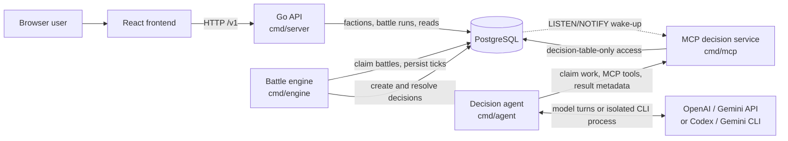
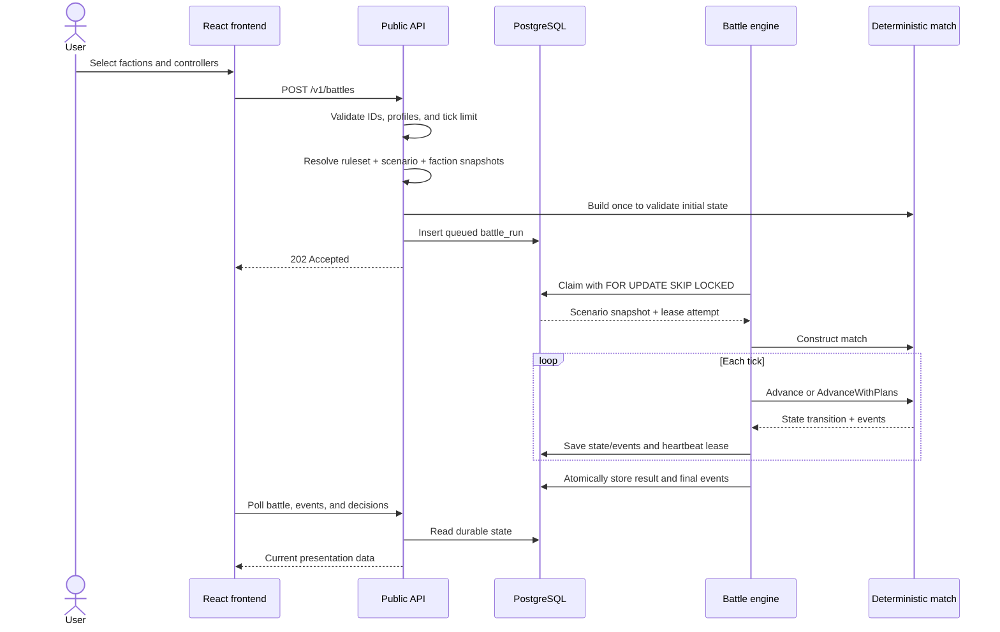
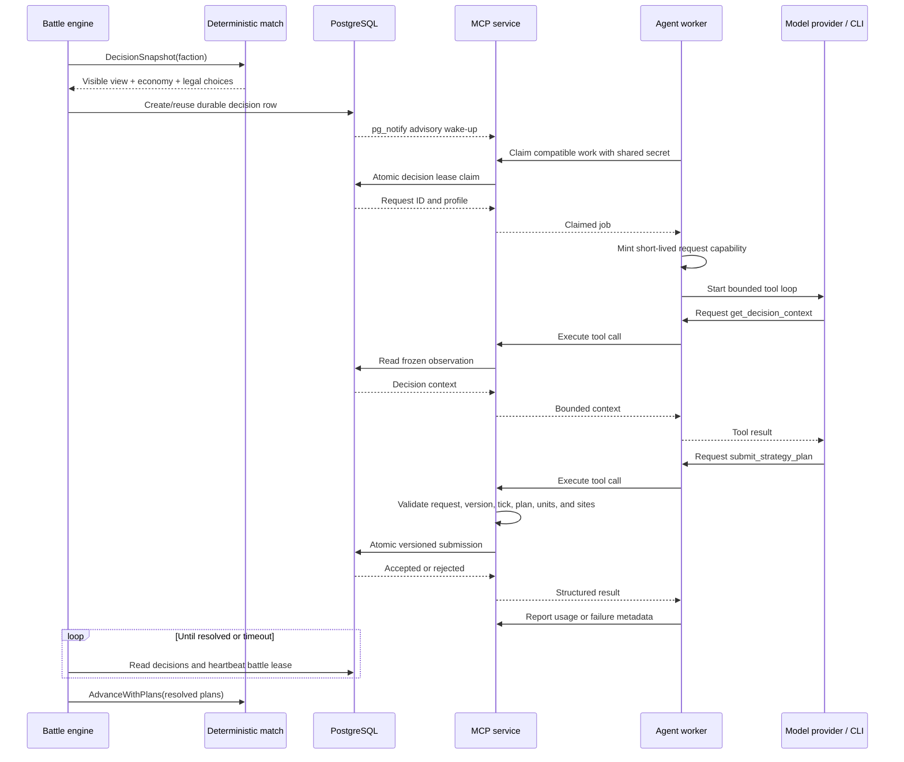
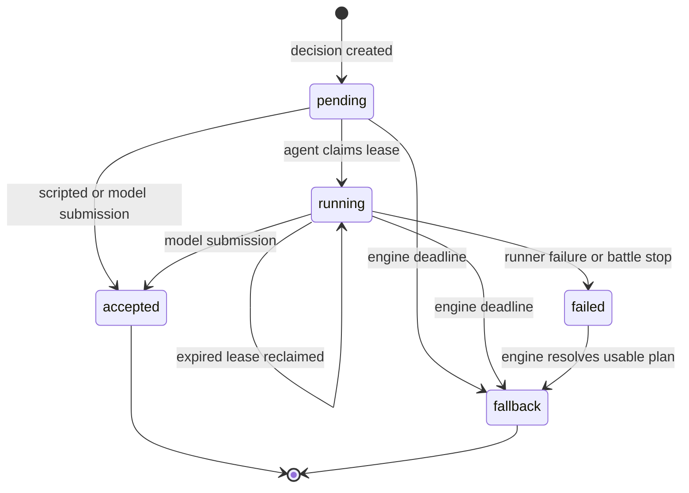
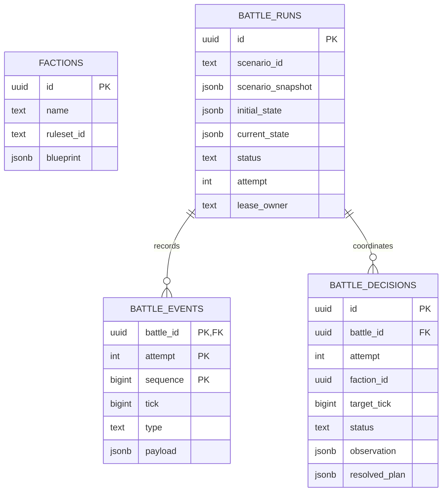

# Autonomous Battlefield System Architecture

| Field | Value |
| --- | --- |
| Status | Draft — describes the current working tree, including uncommitted changes |
| Last reviewed | 2026-09-02 |
| Audience | Contributors reviewing or extending system behavior |
| Scope | Runtime components, data flows, durability, security, and deployment |

For a package-by-package explanation of the implementation, see the [codebase guide](codebase-guide.md).

## 1. Purpose

Autonomous Battlefield is a deterministic castle-siege auto-battler. Users create reusable faction blueprints, stage a finite battle between two factions, and watch a separate engine execute it. Each faction can use either deterministic scripted plans or a model-backed strategic controller.

The central architectural rule is:

> Models propose bounded strategy plans. The deterministic engine validates and applies those plans and remains the only component that controls battlefield-state mutation.

This document describes the system's runtime boundaries and interactions. Operational instructions remain in [README.md](../../README.md), [DEPLOYMENT.md](../../DEPLOYMENT.md), and [OBSERVABILITY.md](../../OBSERVABILITY.md).

## 2. System context

PostgreSQL is the durable coordination point. The API and engine do not call each other directly, and the engine and agent do not call each other directly. Each workload can fail or restart while preserving battle and decision state.

## 3. Runtime components

| Component | Responsibility | Direct dependencies |
| --- | --- | --- |
| React frontend | Administrator login, faction creation, battle staging, map display, controls, event stream, and AI decision history | Public API |
| Public API | Administrator sessions, HTTP validation, scenario resolution, faction and battle persistence, and selectable model-profile catalog | PostgreSQL, scenario/ruleset YAML |
| Battle engine | Battle queue claims, deterministic ticks, strategy windows, state/event persistence | PostgreSQL |
| MCP decision service | Two request-scoped model tools and an internal agent control plane | PostgreSQL |
| Decision agent | Model-decision claims and API or CLI model execution | MCP service, model provider |
| PostgreSQL | Factions, battle queue, event history, snapshots, leases, and model decisions | Persistent storage |
| Scenario catalog | Authored map, timing, fallback plans, unit/building rules, and combat rules | Loaded by API and frozen into battle rows |

### Why four backend processes?

- The API remains responsive while battles and model calls take time.
- The engine can restart or scale without exposing gameplay HTTP routes.
- Provider credentials and model behavior remain outside the deterministic simulation process.
- The MCP service can receive narrower database permissions than the API or engine.
- Local subscription CLIs can run on a developer host without copying login credentials into Kubernetes.

## 4. Architectural boundaries

### Deterministic simulation boundary

The simulation receives a resolved scenario and optional plans, then produces deterministic state transitions and events. It does not access PostgreSQL, HTTP, environment variables, or model providers.

The engine owns orchestration around this pure domain: leases, retries, pauses, decision deadlines, persistence, and shutdown handling.

### Public application boundary

The API optionally authenticates one configured administrator with a signed HttpOnly cookie before accepting application requests. Login and session discovery remain public; other `/v1` routes receive a trusted actor through a replaceable authenticator. The browser reads progress only through the API; it never connects to the engine or PostgreSQL.

### Model boundary

The model never receives a repository, global game state, or mutation function. It can only:

1. read one authorized faction-visible decision context;
2. submit one validated strategy plan for that decision.

### Durable coordination boundary

Battle work and model work are both durable PostgreSQL state machines. Notifications and long-polling improve latency but are not correctness dependencies.

## 5. Core runtime flows

### 5.1 Create and run a battle

Battle execution is asynchronous from the creation request. Each battle stores a complete resolved scenario and initial state, so later edits to factions or catalog YAML cannot change an existing run.

### 5.2 Strategy decision window

A decision window occurs immediately before ticks configured by `decisionIntervalTicks`. The supplied scenario currently uses ticks 10, 20, 30, and so on.

The engine creates a decision row for every faction:

- A `scripted` controller submits its deterministic baseline immediately through the same validation service.
- A `model` controller remains pending until an agent claims and resolves it.

Using the same durable record shape supports consistent history and scripted-versus-model evaluation.

### 5.3 Timeout and fallback

The battle must make progress even if a model does not answer.

At the decision deadline:

- the first production window uses the scenario's scripted fallback;
- later windows reuse the faction's previously active plan;
- the fallback is stored with status `fallback` and error category `timeout`;
- a racing model submission and fallback are resolved by version and status predicates, so only one wins;
- the stored plan is applied exactly like an accepted model plan.

### 5.4 Pause, resume, and stop

- Pausing a queued battle prevents it from being claimed.
- Pausing a running battle retains and heartbeats its lease.
- Paused time extends the current decision and tick deadlines.
- Resuming continues the same in-memory attempt.
- Stopping releases the battle lease and fails outstanding decisions with `battle_stopped`.
- A stopped or reclaimed battle prevents the previous engine owner from making further guarded writes.

## 6. Model execution

Two execution paths implement the same provider-neutral decision-runner contract.

### API runtime

The shared agent loop:

1. connects to MCP with a request-scoped capability;
2. requires discovery of exactly `get_decision_context` and `submit_strategy_plan`;
3. asks the configured provider for a tool-calling turn;
4. rejects unsupported tools or a turn with no tool call;
5. adds tool input and output to the transcript;
6. stops after an accepted submission or the configured step limit.

OpenAI Responses and Gemini GenerateContent adapters normalize provider tool calls, refusals, and usage into common types.

### CLI runtime

The CLI runner starts Codex or Gemini CLI in a new temporary directory with:

- an empty workspace;
- a request-scoped MCP bearer token;
- only the two battlefield tools enabled;
- shell, file, browser, app, image, plugin, skill, and multi-agent capabilities disabled where supported;
- no approval prompts;
- the allowlisted profile model passed explicitly with `--model`;
- a pre-validated CLI version family.

Codex uses the existing host login without copying it. Gemini copies its OAuth credential into the temporary isolated home with mode `0600`. Subscription credentials are not placed in Kubernetes.

## 7. Decision contracts and lifecycle

### Bounded context

A decision context contains:

- battle, faction, request, target-tick, and version identifiers;
- a fog-of-war faction view;
- current and projected economy values;
- legal action kinds, unit definitions, and construction sites;
- the currently active plan;
- a hash of the observation excluding request-specific fields.

### Submitted strategy

A model or scripted controller can propose:

- a short name and operator-visible rationale;
- fixed-point attack and defend weights;
- target-specific bonuses;
- reserve gold and spend ordering;
- construction-site priorities;
- recruitment priorities.

The service validates decision version, target tick, general plan bounds, and context-specific units and sites before persistence.

### State machine

An accepted submission is idempotent when it repeats the stored idempotency key. Optimistic version checks prevent late or duplicate workers from overwriting another resolution.

## 8. Persistence and durability

| Table or view | Purpose | Important behavior |
| --- | --- | --- |
| `factions` | Reusable faction identity and blueprint | Existing battle snapshots survive faction deletion |
| `battle_runs` | Queue, scenario/initial snapshot, current state, lease, status, and result | Lease owner and attempt guard writes |
| `battle_events` | Replayable per-attempt event stream | Primary key and conflict handling make insertion idempotent |
| `battle_decisions` | Observations, provenance, leases, plans, fallbacks, errors, and usage | Unique per battle/attempt/faction/tick; versioned resolution |
| `battle_controller_evaluation` | Aggregated controller comparison | Latency, fallback/invalid rates, token use, plan diversity, and win rate |

`battle_decisions.faction_id` is historical snapshot data rather than a foreign key to `factions`. PostgreSQL `NOTIFY` only reduces claim latency: it carries no authoritative work payload and is safe to miss because agents query durable state after every wake-up.

### Battle retries

Every mutating battle write includes battle ID, attempt, and lease owner. A mismatched write fails with lease loss.

A reclaimed battle starts a new deterministic attempt from `initial_state`; events from earlier attempts remain available by attempt number. When an observation hash matches a previously resolved decision for the same faction and target tick, the decision repository can reuse that plan.

## 9. Security and trust boundaries

### Administrator session

The starter application login is explicitly enabled through environment
configuration. Credentials and HMAC session-signing material never belong in
YAML, images, or Git. Password comparisons use fixed-size constant-time hashes;
successful login issues an HttpOnly, SameSite=Strict cookie with a configured
expiry. Every protected `/v1` request validates the signature and expiry before
placing the actor in request context. Logout is itself authenticated.

Authentication-disabled local development remains backward compatible. Public
HTTPS deployments must enable the Secure cookie flag and use the same signing
secret across API replicas. This single administrator is a temporary perimeter
inside the application; it does not implement player identity, ownership, or
authorization, and Cloudflare Access remains an appropriate outer control for
a developer-hosted public tunnel.

### Model-facing capability

Each model session receives an HMAC-signed token containing one request ID and expiry. MCP verifies the signature, expiry, and equality between the authorized and supplied request IDs.

Tool bodies are bounded, plan fields are validated, and model-provided state is never authoritative.

### Agent control plane

`/internal/agent/claim`, `/fail`, and `/usage` use a shared bearer secret. These routes do not expose decision context or game state. In Kubernetes, MCP is a `ClusterIP` with an ingress NetworkPolicy intended for agent access. A host CLI agent uses an explicit loopback-only port-forward bridge.

### Database privileges

Migration `00004_battle_decisions.sql` creates a `battlefield_mcp` group role with decision-table and evaluation-view access, but without battle-run, event, unit, building, or resource-state grants. A deployment must give MCP a login that inherits only that intended role.

### Deployment responsibilities

- Replace the development capability secret with high-entropy secret-manager material.
- Keep administrator credentials and session-signing material in a secret manager, enable Secure cookies for HTTPS, and rotate both independently.
- Keep provider keys only in the agent workload.
- Treat model rationale as untrusted display text even though its length is bounded.
- Keep CLI versions pinned because isolation flags and behavior are version-sensitive.

## 10. Configuration and profile availability

The common YAML configuration defines HTTP, database, API, authentication, engine, and AI settings. Each process loads only the sections it needs. Authentication names the environment variables holding its enable flag, credentials, signing secret, and Secure-cookie flag; the API fails startup when enabled secrets are missing or too short.

A model profile specifies:

- stable ID and display name;
- provider and API/CLI runtime;
- cluster or local scope;
- API credential/model environment variables or a pinned CLI model identifier;
- optional external-agent availability environment variable;
- token and step limits;
- enabled state and supported CLI version prefix.

The API catalog advertises profiles users may select. In cluster mode, an operator flag can advertise a host-connected CLI even though the API pod cannot execute it. An agent advertises only profiles it can execute; claims include those IDs so heterogeneous agents do not lease incompatible work.

## 11. Deployment topology

### Local development

`run-dev.sh` starts PostgreSQL, migrations, API, engine, and Vite. `START_AGENT=1` also starts MCP and the agent.

| Port | Process |
| --- | --- |
| `5173` | Vite frontend |
| `8080` | Public API |
| `8081` | Engine health and metrics |
| `8083` | Agent health |
| `8084` | MCP and internal agent control plane |
| `5432` | PostgreSQL |

### Kubernetes

Kustomize deploys separate API, engine, agent, MCP, frontend, and migration workloads. The API optionally imports `battlefield-auth`, the API and agent read profile availability from `battlefield-ai`, MCP receives a distinct `MCP_DATABASE_URL`, and the processes mount a common non-secret ConfigMap.

The in-cluster agent is intended for API providers. `run-k8s-cli-agent.sh` bridges host subscription CLIs by validating the local binary and login, forwarding MCP to loopback, running a local agent, advertising availability to the API, and removing that availability on exit.

## 12. Observability

- Processes emit structured logs with stable event names.
- API logs carry or generate `X-Request-ID`.
- Engine logs cover battle claims, lease loss, decision windows, fallbacks, requeues, and completion.
- Agent/MCP logs cover decision claims, tool access, validation, provider outcome, usage, and latency.
- Full combat detail lives in `battle_events` rather than normal process logs.
- API and engine expose lifecycle checks; agent and MCP expose `/healthz`.
- Prometheus, Grafana, Elasticsearch, Kibana, and Fluent Bit are provided for the local Kubernetes environment.

## 13. Decisions and trade-offs

### Determinism over direct model control

Models submit strategy and production priorities rather than state mutations. This preserves replayability, legal-action enforcement, testing, and controller comparison.

### Durable database coordination over in-memory queues

Battle and decision work survives restarts. Leases and `SKIP LOCKED` support competing workers without another queue system, at the cost of additional PostgreSQL state-machine logic.

### Frozen snapshots over live catalog references

Rules, factions, and initial state are captured per battle. Replays remain stable, at the cost of larger JSONB rows and explicit version provenance.

### MCP as a capability boundary

The same small, auditable tool surface supports API and subscription CLI models. The trade-off is another service and authentication boundary.

### Polling with advisory wake-ups

The UI polls the API, the engine polls battle rows, and agents long-poll MCP. PostgreSQL notifications reduce model-claim latency without becoming a correctness dependency. Higher scale may justify push delivery or a dedicated broker.

## 14. Current limitations and follow-up questions

- Authentication is limited to one configured administrator; player accounts, credential recovery, per-faction ownership, authorization, and shared brute-force protection remain future work.
- Public battle updates use polling rather than push delivery.
- Load and failover behavior needs testing before increasing engine, MCP, or agent replicas.
- Agent concurrency is fixed at two rather than configured in YAML.
- API adapters build text transcripts instead of preserving provider-native structured tool history.
- A successful CLI exit is treated as an accepted runner result; an explicit final decision-status assertion would strengthen this contract.
- One shared secret authorizes the agent control plane and capability minting. Separate keys or server-minted capabilities would reduce agent signing authority.
- The standalone `UtilityController` lifecycle overlaps with the durable decision-window design but is not wired into production. See the [codebase guide](codebase-guide.md#internalbattlesimulationcontroller-deterministic-policy-abstractions).
- Rigorous controller experiments may need experiment identity, model parameters, and cost normalization beyond the current evaluation view.
