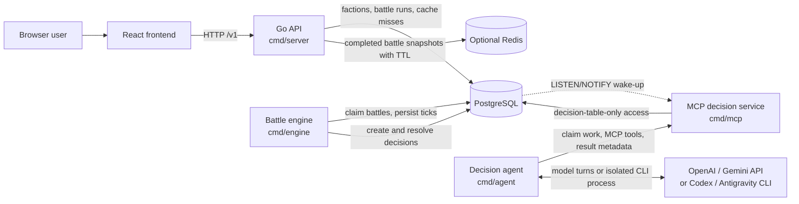
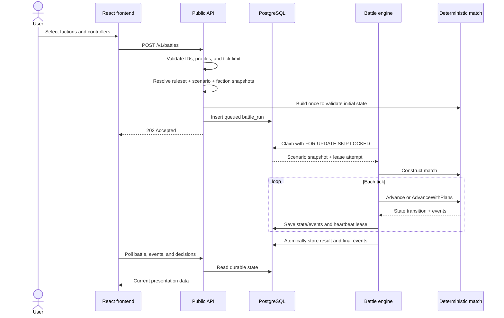
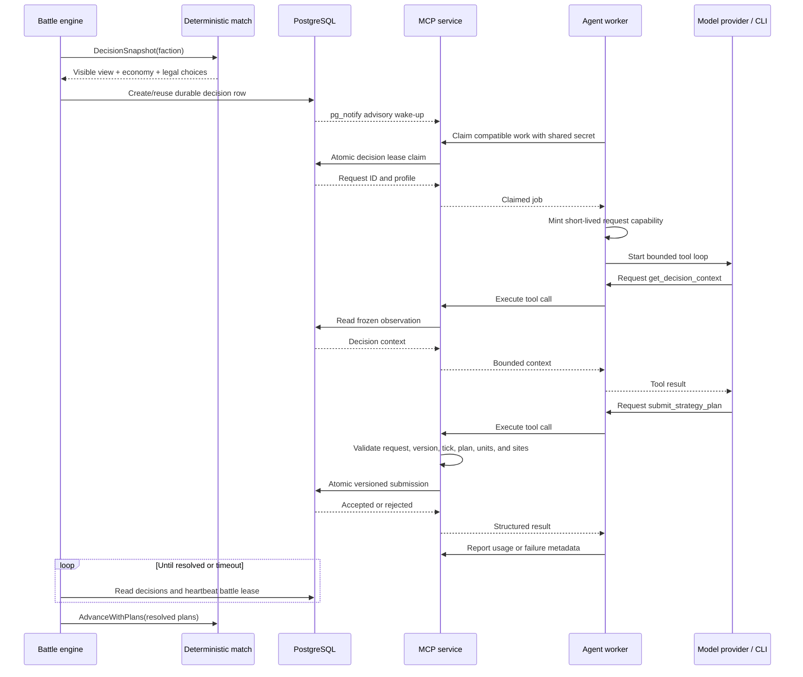
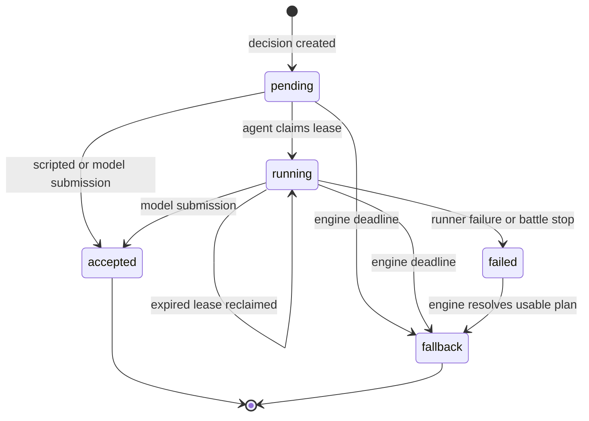
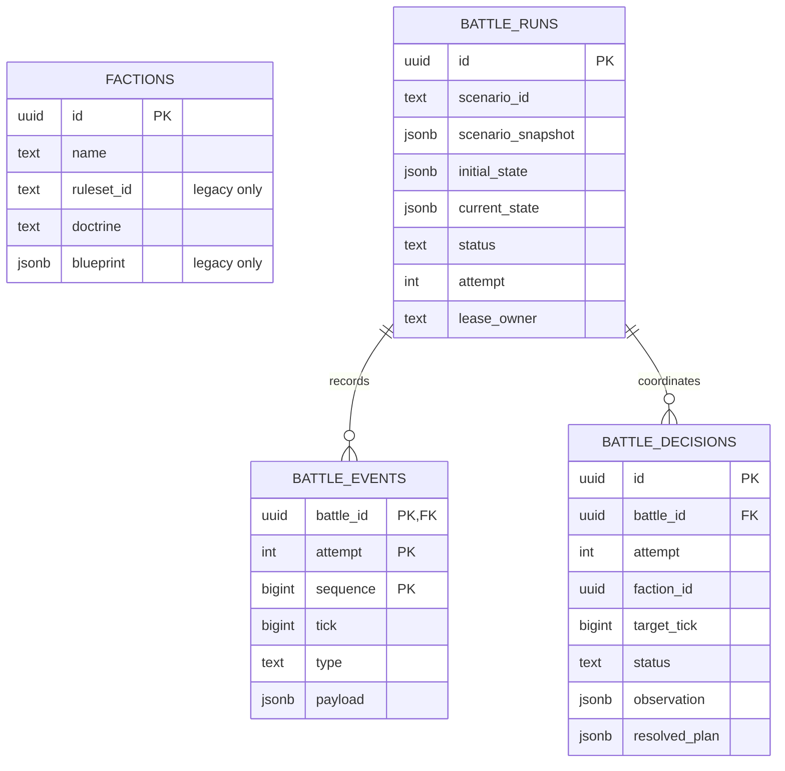

# Autonomous Battlefield System Architecture

| Field | Value |
| --- | --- |
| Status | Draft — describes the current working tree, including uncommitted changes |
| Last reviewed | 2026-09-06 |
| Audience | Contributors reviewing or extending system behavior |
| Scope | Runtime components, data flows, durability, security, and deployment |

For a package-by-package explanation of the implementation, see the [codebase guide](codebase-guide.md).

## Deployment environment boundary

WSL dev and server production use separate Kubernetes clusters, PostgreSQL
volumes, kubeconfigs, and secrets. The shared environment resolver pins the
cluster UID before operations. Dev loads working-tree images through a local
Docker socket; production accepts verified GHCR digests through Jenkins main
rollout. Context aliases distinguish environments without renaming resources.
Missing production AI/auth files preserve existing cluster Secrets. Production
rollback verifies both prior digests; local development never pulls production
deployment credentials. Observability is optional for dev. See the
[environment guide](../operations/environments.md) for registration and recovery.

## 1. Purpose

Autonomous Battlefield is a deterministic castle-siege auto-battler. Users create reusable faction doctrines, stage a finite battle between two factions, and watch a separate engine execute it. Each faction can use either deterministic scripted plans or a model-backed strategic controller.

The central architectural rule is:

> Models propose bounded strategy plans. The deterministic engine validates and applies those plans and remains the only component that controls battlefield-state mutation.

This document describes the system's runtime boundaries and interactions. Operational instructions remain in [README.md](../../README.md), [docs/operations/deployment.md](../operations/deployment.md), and [docs/operations/observability.md](../operations/observability.md).

## 2. System context

PostgreSQL is the durable coordination point. The API and engine do not call each other directly, and the engine and agent do not call each other directly. Each workload can fail or restart while preserving battle and decision state.

## 3. Runtime components

| Component | Responsibility | Direct dependencies |
| --- | --- | --- |
| React frontend | Administrator login, faction creation, battle staging and history, map display, controls, event stream, and AI decision history | Public API |
| Public API | Administrator sessions, HTTP validation, scenario resolution, faction and battle persistence, and selectable model-profile catalog | PostgreSQL, scenario/ruleset YAML, optional Redis |
| Battle engine | Battle queue claims, deterministic ticks, strategy windows, state/event persistence | PostgreSQL |
| MCP decision service | Two request-scoped model tools and an internal agent control plane | PostgreSQL |
| Decision agent | Model-decision claims and API or CLI model execution | MCP service, model provider |
| Redis (optional) | Disposable completed battle read cache; no engine or readiness dependency | Memory, API-only connection |
| PostgreSQL | Factions, battle queue, event history, snapshots, leases, and model decisions | Persistent storage |
| Scenario catalog | Authored map, timing, fallback plans, unit/building rules, and combat rules | Loaded by API and frozen into battle rows |

The backend commands are `cmd/server`, `cmd/engine`, `cmd/mcp`, `cmd/agent`, and `cmd/aieval`. The first four are runtime processes; `aieval` runs deterministic offline cases or explicitly enabled live comparisons and produces reports.

### Why four backend processes?

- The API remains responsive while battles and model calls take time.
- The engine can restart or scale without exposing gameplay HTTP routes.
- Provider credentials and model behavior remain outside the deterministic simulation process.
- The MCP service can receive narrower database permissions than the API or engine.
- Local subscription CLIs can run on a developer host without copying login credentials into Kubernetes.

## 4. Architectural boundaries

### Process health ownership

The API and engine entry points compose `httpapi.LifecycleHandler` around application traffic. That handler alone serves `/startupz`, `/livez`, `/healthz`, `/readyz`, and `/metrics`; the inner application router does not register duplicate probes. Engine readiness combines `Worker.Ready()` with a database ping. Database failure affects readiness while liveness remains available.

### Source ownership

See the [codebase guide](codebase-guide.md#3-backend-organization) for package
boundaries, frontend ownership, and launcher locations.

Frontend feature clients, including faction ruleset discovery, use the shared
HTTP transport to report network failures consistently while preserving request
cancellation. Feature clients own HTTP status messages; protected requests also
notify the application when authentication is required.

### Deterministic simulation boundary

The simulation receives a resolved scenario and optional plans, then produces deterministic state transitions and events. It does not access PostgreSQL, HTTP, environment variables, or model providers.

The engine owns orchestration around this pure domain: leases, retries, pauses, decision deadlines, persistence, and shutdown handling.

### Blocked castle approaches

Unit movement prefers a complete path to a position within attack range of the
opposing castle. If occupied approach tiles prevent that route, the engine searches
for reachable attack positions around living enemy units and buildings. This
prevents occupied castle perimeters from freezing both armies. Paths still exclude
occupied and impassable tiles, and execution remains bounded by unit movement.
Movement and attack targeting use authoritative engine state; faction sight filters
AI observations rather than controlling these engine paths.

### Public application boundary

The API optionally authenticates one configured administrator with a signed HttpOnly cookie before accepting application requests. Login and session discovery remain public; other `/v1` routes receive a trusted actor through a replaceable authenticator. The browser reads progress only through the API; it never connects to the engine or PostgreSQL.

### Model boundary

The model never receives a repository, global game state, or mutation function. It can only:

1. read one authorized faction-visible decision context;
2. submit one validated strategy plan for that decision.

### Durable coordination boundary

Battle work and model work are both durable PostgreSQL state machines. Notifications and long-polling improve latency but are not correctness dependencies.

## 5. Core runtime flows

### 5.1 Create and run a battle

Battle execution is asynchronous from the creation request. Each battle stores a complete resolved scenario and initial state, so later edits to factions or catalog YAML cannot change an existing run.

### 5.2 Strategy decision window

A decision window occurs immediately before ticks configured by `decisionIntervalTicks`. The supplied scenario currently uses ticks 10, 20, 30, and so on.

The engine creates a decision row for every faction:

- A `scripted` controller submits its deterministic baseline immediately through the same validation service.
- A `model` controller remains pending until an agent claims and resolves it.

Using the same durable record shape supports consistent history and scripted-versus-model evaluation.

### 5.3 Timeout and fallback

The battle must make progress even if a model does not answer.

At the decision deadline:

- the tick-zero opening uses a deterministic sorted-roster purchase fallback;
- the first in-battle production window uses the scenario's scripted baseline;
- later windows reuse the faction's previously active plan;
- the fallback is stored with status `fallback` and error category `timeout`;
- a racing model submission and fallback are resolved by version and status predicates, so only one wins;
- the stored plan is applied exactly like an accepted model plan.

### 5.4 Pause, resume, and stop

- Pausing a queued battle prevents it from being claimed.
- Pausing a running battle retains and heartbeats its lease.
- Paused time extends the current decision and tick deadlines.
- Resuming continues the same in-memory attempt.
- Stopping releases the battle lease and fails outstanding decisions with `battle_stopped`.
- A stopped or reclaimed battle prevents the previous engine owner from making further guarded writes.

## 6. Model execution

`internal/ai/worker` owns decision claims, concurrency, timeouts, and outcome reporting. It selects an `APIRunner` or `CLIRunner` from `internal/ai/runner`; both implement the same provider-neutral decision-runner contract.

### API runtime

`APIRunner` in `internal/ai/runner/api.go` runs the shared API tool loop:

1. connects to MCP with a request-scoped capability;
2. requires discovery of exactly `get_decision_context` and `submit_strategy_plan`;
3. asks the configured provider for a tool-calling turn;
4. rejects unsupported tools or a turn with no tool call;
5. adds tool input and output to the transcript;
6. stops after an accepted submission or the configured step limit.

OpenAI Responses and Gemini GenerateContent adapters normalize provider tool calls, refusals, and usage into common types.

### CLI runtime

The CLI runner starts Codex or Antigravity CLI in a new temporary directory with:

- an empty workspace;
- a request-scoped MCP bearer token;
- only the two battlefield tools enabled;
- shell, file, browser, app, image, plugin, skill, and multi-agent capabilities disabled where supported;
- no approval prompts;
- the allowlisted profile model passed explicitly with `--model`;
- a pre-validated CLI version family.

Codex uses the existing host login without copying it. Antigravity uses the host OS keyring or a private temporary copy of its native `antigravity-oauth-token` login file, with a temporary HOME and XDG directories. Its environment excludes provider keys and personal CLI overrides. Generated permissions allow the two battlefield MCP tools and deny file, command, and URL operations; slash-command expansion is disabled. A headless account-usage probe must succeed before advertising the profile. JSON result envelopes must report SUCCESS with no denied actions. Explicit permission rules are used without strict mode, which overrides MCP allows in CLI 1.1.27. The MCP usage endpoint verifies that a plan is accepted before acknowledging completion; missing submissions trigger a worker failure and fallback. Usage counters are recorded for accepted plans. Subscription credentials are not placed in Kubernetes.

CLI context responses include explicit target-tick and version metadata alongside the full structured context. CLI prompts require copying those values and making a substantive tactical or production decision. Name-only CLI plans are rejected; after three invalid submissions the decision is failed so the battle can fall back. MCP logs record context byte counts and validation field/code pairs without dumping observations or credentials. Usage reporting retries transient failures up to three times.

Antigravity CLI offloads larger MCP tool responses to local files. Because battlefield CLI sessions deny file reads, the host now fetches the request-scoped context through the MCP SDK and embeds the validated JSON directly in the Antigravity prompt (maximum 64 KiB). The model submits through MCP without fetching the large response again. This keeps existing file restrictions and avoids blind tick guessing when the CLI hides an offloaded response.

## 7. Decision contracts and lifecycle

### Shared prompt provenance and faction memory

API, Codex, and Antigravity use one embedded decision policy assembled by
`internal/ai/prompts.go`. Only context delivery differs: tool fetch versus
Antigravity host-prefetched JSON. The persisted `PromptVersion` includes a SHA-256
digest covering the base, identity, doctrine, policy, and both delivery templates.
Each prompt purpose has one current `.txt` file; Git preserves previous revisions.
The build manifest reads the runtime prompt version, bundle digest, and tool schema
through `go run ./cmd/aieval -mode metadata`, requiring Go during manifest generation. Both API and CLI
model submissions require a substantive plan and stop after three validation
rejections.

Before hashing a decision observation, the engine reads at most three earlier
resolved records scoped in SQL to the same battle, attempt, and faction.
`BuildFactionMemory` produces historical economy/unit counts and resolved plans,
with observation ticks and accepted/fallback status, bounded to 8 KiB. These
snapshots describe state before the historical decisions, not attributed effects.
Memory is embedded in the frozen observation JSON and included in its hash;
no separate mutable scratchpad or database migration is required. Read failures
are logged and the engine proceeds without optional history. Reuse requires
matching prompt/tool versions and profile/provider/runtime/model identifiers as
well as observation hashes. Attempts never read memory from previous attempts.

`aieval -mode compare` runs matched, repeated synthetic decisions through the
production MCP validator with isolated loopback repositories and API/CLI runners.
It verifies persisted acceptance rather than trusting CLI success, and records
context hashes, prompt provenance, validation failures, latency, usage and
canonical plan diversity. This measures individual decisions; win rate remains
null. CLI internal token/turn budgets differ from API enforcement and are labeled
in reports. See [AI comparisons](../operations/ai-comparisons.md).

### Bounded context

A decision context contains:

- battle, faction, request, target-tick, and version identifiers;
- a fog-of-war faction view;
- current and projected economy values;
- legal action kinds, unit definitions, and construction sites;
- the currently active plan;
- optional bounded faction memory and retrieved unit knowledge;
- a hash of the observation excluding request-specific fields.

### Submitted strategy

A model or scripted controller can propose:

- a short name and operator-visible rationale;
- fixed-point attack and defend weights;
- target-specific bonuses;
- reserve gold and spend ordering;
- construction-site priorities;
- explicit ordered unit purchases with quantities (legacy plans may use recruitment priorities).

The service validates decision version, target tick, general plan bounds, and context-specific units and sites before persistence.

### Explicit recruitment orders

The shared model prompt requests ordered `{unitType, count}` purchases through
`recruitmentOrders`. MCP and engine validation enforce legal unit IDs, positive
counts, and a six-unit per-window maximum. The engine executes only the requested
sequence, preserving reserve gold and spawn occupancy; it stops on the first
blocked purchase. Empty orders mean no buying; missing orders retain legacy
priority behavior. Orders are deep-copied and persisted with plans, faction memory,
and decision hashes. The UI shows requested quantities; recruitment events report
actual spending. See [explicit unit purchases](../operations/ai-comparisons.md#explicit-unit-purchases)
for partial-order and reuse semantics.

### Versioned unit knowledge

Optional ruleset knowledge is frozen in the resolved scenario JSON alongside unit
statistics, and participates in the scenario content hash. At each decision
window the engine retrieves unit cards using only the faction-visible context.
Selection runs before observation hashing and persistence. API MCP reads and host
CLI inline delivery consume that identical persisted knowledge. Retrieval has no
external service dependency and does not change engine combat or plan validation.

`engine.knowledgeRetrieval` controls positive card and byte limits (defaults 16
and 16384). Effective limits, selected source IDs, content digest, byte size, and
truncation accompany decision knowledge. Old scenarios without knowledge remain
valid. See [AI comparisons](../operations/ai-comparisons.md#unit-knowledge-retrieval)
for authoring, configuration, and evaluation details.

### Submission-shape failures and fallback attribution

The shared decision instructions require a flat MCP argument object with all
required fields, including empty objects/arrays where appropriate. Antigravity
can otherwise stop after SDK schema errors without reaching the typed plan
handler. MCP receiving middleware records `decision_tool_input_rejected` with
only the authenticated request ID, allowlisted missing field names, and a
nested-plan flag; argument values and raw SDK errors are excluded.

When a runner fails before the deadline, the engine carries its error category
into the fallback record instead of replacing it with `timeout`. Unresolved
requests that reach the deadline retain the timeout category. CLI terminal
success remains subject to the worker's accepted-plan check.

### State machine

An accepted submission is idempotent when it repeats the stored idempotency key. Optimistic version checks prevent late or duplicate workers from overwriting another resolution.

## 8. Persistence and durability

| Table or view | Purpose | Important behavior |
| --- | --- | --- |
| `factions` | Reusable faction identity and doctrine; archived legacy blueprint | Existing battle snapshots survive faction deletion |
| `battle_runs` | Queue, scenario/initial snapshot, current state, lease, status, and result | Lease owner and attempt guard writes |
| `battle_events` | Replayable per-attempt event stream | Primary key and conflict handling make insertion idempotent |
| `battle_decisions` | Observations, provenance, leases, plans, fallbacks, errors, and usage | Unique per battle/attempt/faction/tick; versioned resolution |
| `battle_controller_evaluation` | Aggregated controller comparison | Latency, fallback/invalid rates, token use, plan diversity, and win rate |

`battle_decisions.faction_id` is historical snapshot data rather than a foreign key to `factions`. PostgreSQL `NOTIFY` only reduces claim latency: it carries no authoritative work payload and is safe to miss because agents query durable state after every wake-up.

### Completed battle result caching

The API service optionally checks Redis before `GetBattle` reads PostgreSQL. A miss,
invalid entry, or Redis error falls back to PostgreSQL. Only a `completed` run with
non-null result is stored, as a JSON snapshot containing its final state and scenario.
Existing battle responses retain their schema. Faction views are projected from the
snapshot after retrieval; event payloads and decision history remain PostgreSQL reads.
Authentication runs before cache access. Engine and MCP persistence never use Redis.

Keys are `battlefield:completed-battle:v1:<lowercase-battle-uuid>`, with a default
one-hour TTL and 100 ms deadline per cache operation, with command retries disabled.
Completed runs cannot currently be restarted or modified by application commands, so
no writer invalidation is required. Any future result edit, battle deletion/reuse, or
restart of a completed battle must add invalidation/versioning before release. After
restoring PostgreSQL, clear the dedicated cache database or use a fresh Redis database.
The `v1` namespace must change for incompatible cached schema changes.

Redis is lazy-connected, optional, and excluded from readiness. An empty
`BATTLEFIELD_REDIS_URL` disables it. Malformed URLs fail API initialization without
logging their credentials; outages and cache write failures do not fail battle reads.
Concurrent misses may issue duplicate database reads; this first implementation does
not coalesce requests. Redis expiry and eviction bound the cached working set. Use a
separate Redis database or instance per deployment environment.

See [Redis operations](../operations/redis.md) for setup and verification.

### Battle retries

Every mutating battle write includes battle ID, attempt, and lease owner. A mismatched write fails with lease loss.

A reclaimed battle starts a new deterministic attempt from `initial_state`; events from earlier attempts remain available by attempt number. When an observation hash matches a previously resolved decision for the same faction and target tick, the decision repository can reuse that plan.

## 9. Security and trust boundaries

### Administrator session

The starter application login is explicitly enabled through environment
configuration. Credentials and HMAC session-signing material never belong in
YAML, images, or Git. Password comparisons use fixed-size constant-time hashes;
successful login issues an HttpOnly, SameSite=Strict cookie with a configured
expiry. Every protected `/v1` request validates the signature and expiry before
placing the actor in request context. Logout is itself authenticated.

Authentication-disabled local development remains backward compatible. Public
HTTPS deployments must enable the Secure cookie flag and use the same signing
secret across API replicas. This single administrator is a temporary perimeter
inside the application; it does not implement player identity, ownership, or
authorization, and Cloudflare Access remains an appropriate outer control for
a developer-hosted public tunnel.

### Model-facing capability

Each model session receives an HMAC-signed token containing one request ID and expiry. MCP verifies the signature, expiry, and equality between the authorized and supplied request IDs.

Tool bodies are bounded, plan fields are validated, and model-provided state is never authoritative.

### Agent control plane

`/internal/agent/claim`, `/fail`, and `/usage` use a shared bearer secret. These routes do not expose decision context or game state. In Kubernetes, MCP is a `ClusterIP` with an ingress NetworkPolicy intended for agent access. A host CLI agent uses an explicit loopback-only port-forward bridge.

### Database privileges

Migration `00004_battle_decisions.sql` creates a `battlefield_mcp` group role with decision-table and evaluation-view access, but without battle-run, event, unit, building, or resource-state grants. A deployment must give MCP a login that inherits only that intended role.

### Deployment responsibilities

- Replace the development capability secret with high-entropy secret-manager material.
- Keep administrator credentials and session-signing material in a secret manager, enable Secure cookies for HTTPS, and rotate both independently.
- Keep provider keys only in the agent workload.
- Treat model rationale as untrusted display text even though its length is bounded.
- Keep CLI versions pinned because isolation flags and behavior are version-sensitive.

## 10. Configuration and profile availability

The common YAML configuration defines HTTP, database, API, authentication, engine, and AI settings. Each process loads only the sections it needs. Authentication names the environment variables holding its enable flag, credentials, signing secret, and Secure-cookie flag; the API fails startup when enabled secrets are missing or too short. The development Compose database also requires `BATTLEFIELD_POSTGRES_PASSWORD`; its value belongs in the Git-ignored `backend/.env` or the launching shell and is shared with the local DBHub connection without being committed.

A model profile specifies:

- stable ID and display name;
- provider and API/CLI runtime;
- cluster or local scope;
- API credential/model environment variables or a pinned CLI model identifier;
- optional external-agent availability environment variable;
- token and step limits;
- enabled state and supported CLI version prefix.

The API catalog advertises profiles users may select. In cluster mode, an operator flag can advertise a host-connected CLI even though the API pod cannot execute it. An agent advertises only profiles it can execute; claims include those IDs so heterogeneous agents do not lease incompatible work.

## 11. Deployment topology

### Local development

`run-dev.sh` starts PostgreSQL, migrations, API, engine, and Vite. It reads only `BATTLEFIELD_POSTGRES_PASSWORD` from the Git-ignored `backend/.env` when the variable is absent from the shell, then constructs the local database URL. `START_AGENT=1` also starts MCP and the agent.

| Port | Process |
| --- | --- |
| `5173` | Vite frontend |
| `8080` | Public API |
| `8081` | Engine health and metrics |
| `8083` | Agent health |
| `8084` | MCP and internal agent control plane |
| `5432` | PostgreSQL |

### Kubernetes

Kustomize deploys separate API, engine, agent, MCP, frontend, and migration workloads. The API optionally imports `battlefield-auth`, the API and agent read profile availability from `battlefield-ai`, MCP receives a distinct `MCP_DATABASE_URL`, and the processes mount a common non-secret ConfigMap. Post-deployment verification uses the optional administrator Secret to establish a temporary authenticated session before probing protected application routes; neither credentials nor the session cookie are retained after the smoke test.

Registry-backed Jenkins deployments use immutable GHCR digest references. Before
admission, Kyverno validates a Cosign signature plus CycloneDX, SLSA v0.2, and
AI-manifest attestations with the reviewed public key. Cosign v3 OCI 1.1
referrers remain the portable evidence copied during registry promotion. The
CI publisher also writes legacy digest-tag mirrors of the same signed evidence
because the pinned Kyverno 1.15 verifier discovers that layout. Registry access
uses short-lived Docker configuration in Jenkins and a namespace-local pull
Secret for the admission controller; neither changes the cryptographic trust
root.

Main delivery classifies changes after the CI quality gates. Application-test-only
changes and known CI test wrappers skip image publication and rollout; production
file removals and unknown paths still select deployment. The shared
`scripts/ci/with-ghcr-auth.sh` wrapper isolates registry credentials for each
authenticated command, including rollback, and cleans up on cancellation.

Deployment staging copies only selected overlays and their base dependencies.
Infrastructure secret inputs are staged explicitly; unrelated local credentials
are not copied. Observability verification waits for completion of each new
Deployment rollout concurrently and reports failures before setup verification.
The source-security stage owns CI manifest rendering and policy validation;
scanner versions are centralized in `scripts/ci/tool-versions.env`.

W3C trace context is persisted on `battle_runs` and `battle_decisions`. API inbound spans flow through PostgreSQL; engine and agent workers extract that durable context and create consumer spans before simulation, MCP, and provider work. Outbound HTTP clients and selected database operations are instrumented. The local OpenTelemetry Collector exports to Tempo, which Grafana provisions as a data source. Span attributes deliberately exclude prompts, credentials, capabilities, full observations, and raw provider responses.

The observability overlay includes metrics, tracing, and disposable log storage.
See [observability operations](../operations/observability.md) for storage,
security, and access details, and [Jenkins](../operations/jenkins.md) for runtime
assurance launchers.

The in-cluster agent is intended for API providers. `run-k8s-cli-agent.sh` bridges host subscription CLIs by validating the local binary and login, forwarding MCP to loopback, running a local agent, advertising availability to the API, and removing that availability on exit.

## 12. Observability

- Processes emit structured JSON logs with stable `event` identifiers and readable
  `msg` summaries containing selected operational fields. The shared logging
  handler attaches `trace_id` and `span_id` from active contexts without moving
  those fields into user attribute groups. `LOG_LEVEL` defaults to INFO.
- API logs carry or generate `X-Request-ID`. Tracing wraps access logging so
  completion logs, including authentication rejections, share the request span.
- Engine logs cover battle claims, lease loss, decision windows, fallbacks, requeues,
  and completion. Running battles and pending decision windows report progress
  immediately at their first reporting point and at most every 15 seconds
  thereafter. Waiting updates include pending faction counts; completion includes
  elapsed wall time. Per-tick persistence events require DEBUG logging.
- Agent/MCP logs cover decision claims, tool access, validation, provider outcome, usage, and latency.
- Full combat detail lives in `battle_events` rather than normal process logs.
- API and engine expose lifecycle checks; agent and MCP expose `/healthz`.
- Prometheus, Grafana, Elasticsearch, Kibana, and Fluent Bit are provided for the local Kubernetes environment.
- Local Prometheus discovers nodes and scrapes each kubelet's cAdvisor endpoint
  using service-account authentication and the narrow `nodes/metrics`
  permission; it does not receive general kubelet proxy access.

## 13. Decisions and trade-offs

### Determinism over direct model control

Models submit strategy and production priorities rather than state mutations. This preserves replayability, legal-action enforcement, testing, and controller comparison.

### Durable database coordination over in-memory queues

Battle and decision work survives restarts. Leases and `SKIP LOCKED` support competing workers without another queue system, at the cost of additional PostgreSQL state-machine logic.

### Frozen snapshots over live catalog references

Rules, factions, and initial state are captured per battle. Replays remain stable, at the cost of larger JSONB rows and explicit version provenance.

### MCP as a capability boundary

The same small, auditable tool surface supports API and subscription CLI models. The trade-off is another service and authentication boundary.

### Polling with advisory wake-ups

The UI polls the API, the engine polls battle rows, and agents long-poll MCP. PostgreSQL notifications reduce model-claim latency without becoming a correctness dependency. Higher scale may justify push delivery or a dedicated broker.

## 14. Current limitations and follow-up questions

- Authentication is limited to one configured administrator; player accounts, credential recovery, per-faction ownership, authorization, and shared brute-force protection remain future work.
- Public battle updates use polling rather than push delivery.
- Load and failover behavior needs testing before increasing engine, MCP, or agent replicas.
- Agent concurrency is fixed at two rather than configured in YAML.
- API adapters build text transcripts instead of preserving provider-native structured tool history.
- One shared secret authorizes the agent control plane and capability minting. Separate keys or server-minted capabilities would reduce agent signing authority.
- The standalone `UtilityController` lifecycle overlaps with the durable decision-window design but is not wired into production. See the [codebase guide](codebase-guide.md#internalgamecontroller-deterministic-policy-abstractions).
- Rigorous controller experiments may need experiment identity, model parameters, and cost normalization beyond the current evaluation view.

### Shared content library and scenario restrictions

Catalog startup resolves ruleset library references from the sibling `content`
directory. Libraries version unit definitions, upgrades, existing castle/economy
building roles, and unit cards together. Rulesets select content and own global
balance rules; scenarios can narrow units, upgrades, and buildings. Invalid
references, incompatible authored plans, and invalid definitions fail startup.

Scenario summaries expose effective allowed IDs. Faction profiles are independent
of rulesets and scenarios. The backend validates purchases against the selected scenario. The resolved scenario contains
full definitions, filtered cards, and library provenance; its hash and persisted
JSON freeze these across later catalog edits. AI legal choices, retrieval, and
purchase validation consume the same resolved roster. Excluding economy buildings
removes legal construction sites and disables their production. No schema migration
or runtime content service is required. See the
[content authoring guide](../operations/content-library.md).

## Faction doctrine and opening purchases

New battle snapshots use version 2. Factions contain identity and doctrine, independent
of model profiles and scenario catalogs. The owning doctrine is frozen in each
decision context, included in observation hashes, and delivered to API and CLI
runners beneath core rules using the versioned doctrine prompt template. Opponent
doctrines are absent from agent observations.

The first worker transition is an opening decision at tick zero. Both contexts
are prepared from castles and starting gold before either plan is applied. Opening
permits zero to six recruited units and one-time upgrades, with no construction,
income, or combat. The worker persists opening state and events through `SaveTick`
before tick one. Opening units become ready at tick one. Accepted decisions and
fallbacks use the existing durable records, deadlines, and attempt/requeue semantics.
The persisted `openingComplete` state and engine phase prevent repeated spending.

Gold is the only resource: Castle Siege starts with 180; unspent gold carries forward.
`upgradeOrders` is an ordered array of legal IDs executed at the `upgrades` position
in `spendOrder`. Already-owned IDs are skipped free; the first unaffordable upgrade
stops that category, respecting reserves. Attack/defense bonuses update living units
and future recruits. Economy bonuses update existing and future economy buildings;
new bonuses affect the next income collection. In-battle income still precedes spending.

Scripted controllers and opening fallback ignore doctrine. They buy legal units
round-robin in sorted ID order, skipping unaffordable types, until six purchases or
no affordable type remains. Legacy snapshots without version 2 retain their starting
blueprints, initial upgrade bonuses, and original decision schedule.

### Faction identity and background drafts

Faction identity now consists of name, explicit strategic doctrine, and an
optional background (trimmed, at most 1,000 Unicode characters). Battle creation
copies all three into its immutable scenario snapshot. Missing background in old
snapshots decodes as empty. Only the owning profile enters each decision context,
observation hash, durable decision provenance, and API/CLI system prompt.
The shared `battlefield-agent-v5` identity template JSON-escapes profile fields and
asks the agent to act as the faction's commanding voice. Core rules take
precedence over doctrine; background supplies perspective beneath doctrine.
Scripted controllers do not interpret history or map keywords to tactical weights.

The API's `internal/generation` package owns durable background draft admission.
PostgreSQL serializes each actor's admissions by locking
`faction_generation_accounts`; a partial unique index also prevents multiple
active jobs. `faction_background_generations` stores input, idempotency hash,
profile, quota admission day via `created_at`, expiry, result, prompt version,
usage, timing, and model metadata. Reads/admissions/claims expire stale rows.
Queued expiry refunds the original day; running expiry records a counted failure.
No in-memory counter or browser state is authoritative for allowance.

Generation workers reuse the agent execution infrastructure with an advertised
`faction_background` job type and executable profile IDs. Legacy claims without
job types remain battle-only. Battle claims take priority; generation starts only
when a worker owns a free execution slot. Workers check ready background jobs
before entering an empty battle long poll; jobs admitted during that poll are
checked on the next claim. The MCP write timeout leaves room beyond the maximum
20-second poll so a durable claim can be delivered. Claims use `FOR UPDATE SKIP LOCKED` and
never reclaim running generation jobs. Generation capabilities are namespaced
separately and authorize only the draft's two tools on `/generation-mcp`.
The restricted MCP database role receives SELECT/UPDATE on generation jobs,
without faction-table or battle-state access.

One operator-configured profile selects the writer independently of battle
models. API execution has at most three provider turns. Native CLI execution uses
the generation-only prompt/tool surface, a three-turn instruction and three
invalid-submission cap, and the same execution deadline; native CLI internal
provider calls are not exposed as individually enforceable turns by the runner.
There is no automatic model fallback. Model-returned prose alone is insufficient:
a valid server-accepted tool submission is required for success.

The frontend keeps generated text in an editable preview until Use background;
Discard and errors leave current profile fields intact. Saving is a separate
explicit action. Manual background editing works while generation is disabled.

## Battle history reads

The authenticated `GET /v1/battles` route passes through the battle API,
service, and PostgreSQL repository. A single query projects participant
identities/controllers from the immutable scenario snapshot and reads lifecycle
timestamps, progress, status, and a compact outcome. It does not load simulation
states or use the terminal-result cache. History is service-wide under the
existing administrator authentication model.

The `battle_runs_history_idx` index orders `created_at DESC, id DESC`.
Migration `00010_battle_history.sql` adds it without rewriting existing data;
rollback drops only the index. Keyset pagination uses the last displayed
creation time and UUID, with one extra fetched row to detect the next page.
Status filtering reads current values, so membership may change between requests.

The React `/battles` page fetches on entry, filter/page navigation, retry, and
manual refresh. It does not poll. URL parameters preserve the status, current
cursor, and prior cursors for Previous/browser navigation; refresh returns to
the newest page with the same filter. Detail links carry the originating URL
in router state, and direct detail visits link back to the unfiltered archive.
Obsolete requests are aborted and their results ignored.
