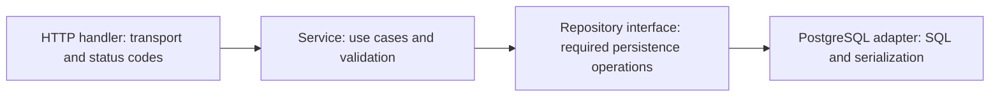

# OrdinalFrontier Backend Guide

[Codebase index](codebase-guide.md) · [System architecture](../architecture/system-architecture.md)

Read by task: [packages](#package-guide) · [shared types](#important-shared-data-types) ·
[persistence](#database-migrations-and-adapters) · [configuration](#configuration-and-authored-content) ·
[feature map](#feature-map) · [history query plans](#battle-history-query-plans) ·
[integration tests](#end-to-end-api-integration-test)

## Backend organization

### Request-oriented features

Faction and battle HTTP features follow a handler → service → repository dependency direction:



- `api` packages translate HTTP requests, responses, and error categories.
- `service` packages enforce use-case rules and depend on narrow interfaces.
- `repo` packages implement those interfaces using PostgreSQL.
- [`backend/internal/app/app.go`](../../backend/internal/app/app.go) wires the API's concrete repositories, services, and handlers through one constructor, `app.New(db, catalog, maxTicks, app.Options{…})`; zero-valued options select defaults.

Repository interfaces live close to the service or worker that consumes them. This keeps the use case independent from a particular database implementation.

### Simulation-oriented code

[`backend/internal/game`](../../backend/internal/game) does not use the HTTP feature layering. It is an infrastructure-free domain package that takes resolved input and returns deterministic state transitions.

[`backend/internal/battle/worker`](../../backend/internal/battle/worker) is an application worker around that domain. It owns persistence orchestration but delegates game rules and state mutation to `game.Match`.

### Process health ownership

`httpapi.LifecycleHandler` is the sole owner of startup, liveness, readiness, and metrics endpoints. The API and engine entry points wire its dependencies and readiness callback into that handler. The application router owns business routes only, and the application database contract requires SQL operations without a health-ping dependency. `Worker.Ready()` exposes execution state; the worker package contains no HTTP health wrapper. Engine lifecycle integration tests cover worker startup/shutdown and database failure through the shared handler.

Agent and AI gateway commands expose a separate `/healthz` endpoint; they do not use
`LifecycleHandler`. The AI gateway also serves `/readyz`, which pings PostgreSQL with a
2-second timeout and backs its Kubernetes readiness probe.

### AI-oriented code

[`backend/internal/ai`](../../backend/internal/ai) defines neutral contracts first, then separates execution into:

- an agent worker that leases jobs;
- a shared API-provider tool loop;
- isolated CLI runners;
- provider HTTP adapters;
- an MCP server and client.

The package root contains types and interfaces shared across these subpackages, avoiding provider-specific types in the engine or battle service.

## Package guide

### `internal/game`: authoritative simulation domain

| File | Responsibility |
| --- | --- |
| [`types.go`](../../backend/internal/game/types.go) | Maps, rulesets, factions, units, buildings, state, events, results, controller config, and faction views |
| [`match.go`](../../backend/internal/game/match.go) | Runtime state, tick orchestration, events, and results |
| [`initialization.go`](../../backend/internal/game/initialization.go) | Scenario validation and initial factions, castles, and units |
| [`opening.go`](../../backend/internal/game/opening.go) | Tick-zero opening phase and deterministic fallback |
| [`upgrades.go`](../../backend/internal/game/upgrades.go) | One-time gold purchases and bonus propagation |
| [`decisions.go`](../../backend/internal/game/decisions.go) | Decision snapshots, plan validation, scripted plans, and tactics |
| [`economy.go`](../../backend/internal/game/economy.go) | Income, spending in plan order (shared by regular windows and the opening), construction payment, and recruitment |
| [`structures.go`](../../backend/internal/game/structures.go) | Typed construction, building caps, tower turns, and forward recruitment |
| [`siege.go`](../../backend/internal/game/siege.go) | Structure approach priorities and minimum-range retreat |
| [`support.go`](../../backend/internal/game/support.go) | Herbalist treatment and healer escort routes |
| [`combat.go`](../../backend/internal/game/combat.go) | Unit turns, targeting, damage, position attacks, and loot |
| [`movement.go`](../../backend/internal/game/movement.go) | All unit movement helpers: castle approach, goal sets, routing around occupied hexes, stepping, and reachable enemy alternatives |
| [`knowledge.go`](../../backend/internal/game/knowledge.go) | Ruleset knowledge validation and defensive copying |
| [`visibility.go`](../../backend/internal/game/visibility.go) | Faction perspectives and fog of war; a faction view carries only its own `FactionState` (gold, upgrades, production totals) |
| [`clone.go`](../../backend/internal/game/clone.go) | Defensive copying of state, scenarios, results, and plans |
| [`map.go`](../../backend/internal/game/map.go) | Hex-map validation, coordinates, traversal, and visibility helpers |
| [`rules.go`](../../backend/internal/game/rules.go) | Ruleset and legacy blueprint validation |

`game.Match` is the in-memory authority for one battle attempt. Important methods include:

- `DecisionWindowDue` and `DecisionTargetTick` for production boundaries;
- `DecisionSnapshot` for a bounded faction-visible model input;
- `ScriptedPlans` for deterministic baselines;
- `AdvanceWithPlans` for plan application followed by a tick;
- `State` for a defensive copy of current state.

`Match` contains no database, HTTP, or model-provider dependency. Preserve this property when adding game behavior.

### `internal/battle/catalog`: authored inputs

[`catalog.go`](../../backend/internal/battle/catalog/catalog.go) strictly decodes scenario and ruleset YAML with unknown-field rejection. It validates templates, combines a scenario with two stored faction identities, and returns a complete resolved `game.Scenario`. The battle service attaches controllers and computes the battle's digest with `battleservice.ScenarioDigest`, the only digest function, which the catalog tests also use.

The API stores this resolved value in `battle_runs.scenario_snapshot`. The engine therefore does not reload live YAML when it claims a battle.

### `internal/battle/service`: battle use cases

[`service.go`](../../backend/internal/battle/service/service.go) contains public battle rules:

- validate battle IDs, participants, controller selections, and tick counts;
- ensure requested model profiles are available;
- load faction identities;
- resolve and hash the scenario snapshot;
- create an initial `game.Match` to validate the battle;
- enqueue, list history, read, pause, resume, and stop battles;
- read events, decision history, and faction perspectives.

[`repository.go`](../../backend/internal/battle/service/repository.go) defines the persistence operations required by these use cases. [`catalog.go`](../../backend/internal/battle/service/catalog.go) defines catalog-facing types and interfaces.

### `internal/battle/resultcache`: optional read cache

[`redis.go`](../../backend/internal/battle/resultcache/redis.go) implements the
service's `ResultCache` port. `cmd/server` constructs and closes it;
`app.New` wires it (`app.Options.Cache`) beneath authentication. Service/config tests
and `resultcache/redis_test.go` cover caching, failure behavior and the
`battlefield_result_cache_operations_total` counter with an
in-process Redis protocol server; no external Redis process is required.
See [cache behavior](../architecture/system-architecture.md#completed-battle-result-caching) and
[Redis operations](../operations/redis.md).

### `internal/battle/api`: battle HTTP delivery

[`handler.go`](../../backend/internal/battle/api/handler.go) registers the battle,
scenario, and profile routes documented in the
[HTTP API reference](../architecture/api.md). It owns JSON decoding,
cursor/attempt parsing, HTTP status mapping, and response encoding for those routes.
[`errors.go`](../../backend/internal/battle/api/errors.go) holds the shared service-error
mapping (`writeError`): forbidden is 403, allowance 429, invalid 400, not found 404, and not
active 409, with route-specific messages. Any other error is logged and becomes a generic 500.
Handlers depend on the full `battleservice.Service` interface, so a missing capability is a
compile error rather than an empty response.

Keep domain validation in the service. The handler should concentrate on transport validation and stable HTTP status mapping.

### `internal/battle/worker`: durable execution

| File | Responsibility |
| --- | --- |
| [`repository.go`](../../backend/internal/battle/worker/repository.go) | The worker's repository contract, including `BattlePaused`, and the engine's `DecisionRepository` (the shared decision contract plus the pending count). `worker.New(repository, decisions, config)` takes decisions explicitly; nil means scripted plans only. The job and lease types it uses (`queue.Job`, `queue.Lease`, `queue.ErrLeaseLost`) live in [`battle/queue`](../../backend/internal/battle/queue/queue.go), which `battle/repo` also imports, so the persistence adapter doesn't depend on the engine package |
| [`worker.go`](../../backend/internal/battle/worker/worker.go) | Construction, claims, battle/tick execution, persistence, and completion |
| [`decisions.go`](../../backend/internal/battle/worker/decisions.go) | Decision-window preparation, waiting, validation, fallback, and logging. While models work, it polls `CountPendingWindowDecisions` (a `count(*)` that never reads frozen observations) and reads the full window once when it closes |
| [`lifecycle.go`](../../backend/internal/battle/worker/lifecycle.go) | Worker readiness, pause/heartbeat waits, cancellation, and requeue |

The worker's main call path is:

```text
Run
└── ClaimBattle
    └── process
        └── game.NewMatch
            └── runBattle
                └── runTick
                    ├── waitWhilePaused
                    ├── resolveDecisionWindow (when due)
                    ├── Match.Advance / AdvanceWithPlans
                    ├── SaveTick
                    └── CompleteBattle
```

`resolveDecisionWindow` freezes contexts for both factions, persists durable decision rows, immediately resolves scripted controllers, waits for model controllers, applies timeout fallbacks, and returns one plan per faction.

All persistence calls carry the current battle lease. Do not add an unguarded write path that allows a stale attempt to update the battle.

### `internal/battle/repo`: PostgreSQL battle adapter

The adapter stays in one package: [`postgres.go`](../../backend/internal/battle/repo/postgres.go) constructs it, [`battles.go`](../../backend/internal/battle/repo/battles.go) owns public battle operations, [`queue.go`](../../backend/internal/battle/repo/queue.go) owns queue leases and `FailExhaustedBattles` (the engine runs it before each claim), [`expiry.go`](../../backend/internal/battle/repo/expiry.go) owns the `battleTimeout` (one hour) sweep, and [`ticks.go`](../../backend/internal/battle/repo/ticks.go) owns atomic tick and completion writes. Splitting files does not change transaction boundaries.

[`decisions.go`](../../backend/internal/battle/repo/decisions.go) implements the AI decision repository:

- create or reuse decisions;
- notify waiting agents;
- atomically claim compatible model work;
- accept a versioned/idempotent plan;
- resolve fallbacks;
- record provider failures, validation failures, usage, and metadata;
- list per-window and per-battle decision history.

SQL concurrency behavior is part of the application's correctness. Changes to status predicates, `FOR UPDATE SKIP LOCKED`, versions, owners, attempts, or leases require focused concurrency and race tests.

### `internal/ai`: shared contracts and focused subpackages

The root package holds only the contracts every AI component shares. Behaviour lives
in subpackages that import those contracts; the root imports none of them, which
`test/boundaries` enforces.

| Package | Responsibility |
| --- | --- |
| [`ai`](../../backend/internal/ai/types.go) | `types.go`: decision sessions, frozen contexts (including their knowledge, memory and unit-reference types), submissions, records, model turns, tools, usage and profiles. `repository.go`: the durable decision repository contract and errors |
| [`ai/capability`](../../backend/internal/ai/capability/capability.go) | `Mint` and `Verify` for request-scoped HMAC capability tokens |
| [`ai/cliisolation`](../../backend/internal/ai/cliisolation/) | Subscription CLI provider identifiers and binaries, environment allowlists, Antigravity's private home, and saved-login checks (`CheckAuth`) for the Codex, Claude and Antigravity CLIs |
| [`ai/decision`](../../backend/internal/ai/decision/service.go) | Context reads, the three-strike validation limit, observation hashes; `validate.go` holds every plan rule checked against the frozen observation |
| [`ai/profile`](../../backend/internal/ai/profile/profiles.go) | API/CLI profile validation and availability (`Registry`, `NewCatalog`, `NewRegistry`) and the administrator access policy |
| [`ai/prompts`](../../backend/internal/ai/prompts/prompts.go) | Embedded instruction templates, context delivery, and the battle and background-generation prompt digests |
| [`ai/agentview`](../../backend/internal/ai/agentview/agent_context.go) | The bounded projection models see (`Compact`, `Observation`), compaction, frozen unit references and paged unit details |
| [`ai/briefing`](../../backend/internal/ai/briefing/knowledge.go) | What a model receives alongside the battlefield view: bounded rules knowledge and scoped faction memory, built when the engine freezes a decision context |

The templates sit beside [`prompts.go`](../../backend/internal/ai/prompts/prompts.go)
in `internal/ai/prompts/`. `prompts.Version` hashes the battle prompts as assembled
for a fixed sample session, so changes to wording, order or wiring all produce a new
version; background writer prompts have a separate `prompts.GenerationVersion`.

| File | Role |
| --- | --- |
| `battlefield-agent.txt` | Battle session system prompt establishing tool-only authority and untrusted observations |
| `decision.txt` | Main decision instructions: session rules, the submission contract, engine purchase semantics and how to read compacted context. Unit and building behaviour comes from the ruleset's `knowledge.mechanics`, not this file; a test rejects ruleset terms here |
| `tool-context.txt` | Short per-decision prompt when context is fetched through MCP |
| `inline-context.txt` | Variant used when the host has already supplied the full context JSON |
| `identity.txt` | Faction identity block: how to use doctrine and background, their precedence below core rules, and the untrusted-data delimiters |
| `background-generation.txt` | Background writer system instructions |
| `background-decision.txt` | Background writer per-job instructions |

For battle sessions, `prompts.SessionSystem` returns the battlefield system prompt.
`prompts.SessionDecision` renders the shared decision instructions, then the faction
name, background, and doctrine as JSON inside the untrusted-data delimiters defined
by `identity.txt`, then the request-specific delivery (request ID, and
inline context when prefetched). Keep request-specific text last: content ahead of
it is the prefix providers can cache across a faction's decisions.

`prompts.GenerationVersion` covers both background writer instruction
components and the rendered character limit. Faction limits are declared in
`internal/faction/faction.go` and mirrored in frontend `features/factions/limits.ts`;
update both when changing this API contract. Existing Unicode boundary tests cover
editor, service, and generation validation.

`DecisionRunner` is the execution boundary used by the agent. `TurnProvider` is the narrower boundary implemented by model APIs that participate in the shared tool loop.

`decision.Service` deliberately receives only a `decision.SubmissionRepository`, which cannot modify battles or simulation state.

### `internal/ai/agent`: the agent's job executor

`cmd/agent` runs one `agent.Executor`, in the cluster for API profiles and on the CLI host
for subscription CLI profiles. The AI gateway's dispatch API hands out jobs; the executor
pulls the ones its available profiles can run and hands each to the matching runner.
[`executor.go`](../../backend/internal/ai/agent/executor.go) starts one claim loop per concurrency slot. Each loop:

1. long-polls the AI gateway's agent dispatch endpoint with executable profile IDs;
2. immediately runs the claimed job in its owned slot;
3. requires the claimed profile from the local registry;
4. requires the server-minted request-scoped capability;
5. creates an API or CLI runner;
6. applies a decision timeout;
7. reports usage or failure metadata to the AI gateway.

The default runner factory is the only place that chooses concrete provider implementations from a model profile.

### `internal/ai/runner`: model execution mechanisms

| File | Responsibility |
| --- | --- |
| [`api.go`](../../backend/internal/ai/runner/api.go) | Shared bounded tool loop for API providers |
| [`mcp.go`](../../backend/internal/ai/runner/mcp.go) | Authenticated streamable HTTP MCP client and normalized tool calls |
| [`cli.go`](../../backend/internal/ai/runner/cli.go) | Isolated Codex/Antigravity/Claude CLI execution, Antigravity context prefetch, and result parsing |
| [`claude.go`](../../backend/internal/ai/runner/claude.go) | Restricted Claude Code arguments, MCP configuration, and terminal-result parsing |
| [`codex_usage.go`](../../backend/internal/ai/runner/codex_usage.go) | Codex JSONL usage parsing |
| [`observability.go`](../../backend/internal/ai/runner/observability.go) | Langfuse generation observations for API and CLI runs |
| [`process_linux.go`](../../backend/internal/ai/runner/process_linux.go) | CLI process-group isolation and cancellation (no-op fallback in `process_other.go`) |

The API loop accepts only a known MCP tool set: the three battle tools or the two
background-generation tools. It
rejects any other tool name a provider requests. Each turn becomes one assistant message holding its text and tool calls (missing call IDs are assigned per turn), followed by one tool message per result; usage accumulates over turns.

The CLI runner creates a temporary directory, passes the profile's allowlisted model explicitly with `--model`, and constructs provider-specific command-line restrictions. Tests use the `CommandExecutor` interface to inspect the selected model and execution restrictions without starting a real CLI.

[`cliisolation`](../../backend/internal/ai/cliisolation/) shares environment
isolation and saved-login probing for the Codex, Claude, and Antigravity CLIs between
profile discovery and execution. All three inherit only login and transport
variables; Antigravity additionally gets a private home holding only its permission
configuration, MCP server, and copied login token. `cmd/agent -check-antigravity-auth` supports the
host launcher's preflight. See [CLI runtime](../architecture/ai-decisions.md#cli-runtime)
for context delivery and accepted-plan enforcement.

### `internal/ai/providers`: external API adapters

[`openai.go`](../../backend/internal/ai/providers/openai.go) translates neutral tools into OpenAI Responses function tools. [`gemini.go`](../../backend/internal/ai/providers/gemini.go) translates them into Gemini function declarations.

Each adapter converts the neutral history to its API's native roles and tool-call
items (`openAIInput`, `geminiContents`). [`http.go`](../../backend/internal/ai/providers/http.go) owns
the shared HTTP response lifecycle, status errors, and JSON decoding. Responses are
capped at 4 MiB. Error statuses report only the provider's machine-readable error
class (for example `invalid_request_error` or `INVALID_ARGUMENT`), never its free-text
message, which can echo request content. Provider adapters retain their
authentication, request schemas, and named response types.

Both adapters:

- accept a configurable HTTP client and endpoint for tests;
- normalize token usage and tool calls;
- map safety/refusal results to a common error;
- contain no battle or database logic.

### `internal/ai/mcpserver`: model and agent boundary

The package exposes separate HTTP surfaces:

- `/mcp` ([`server.go`](../../backend/internal/ai/mcpserver/server.go)) is the
  request-capability-protected battle model tool surface;
- `/generation-mcp` ([`generation.go`](../../backend/internal/ai/mcpserver/generation.go))
  exposes only background context and submission tools;
- `/internal/agent/*` ([`dispatch.go`](../../backend/internal/ai/mcpserver/dispatch.go))
  is the shared-secret agent dispatch API for claims, capability minting and result
  metadata. It is plain JSON over HTTP, not MCP.

Both MCP surfaces authenticate through one `capabilityHandler` in `server.go`: origin
allowlist, `Bearer` capability verification, and a check that the token's kind
(battle or `generation:`-prefixed) matches the endpoint.

The MCP tools are:

- `get_decision_context`;
- `get_unit_details` (1–4 exact unit IDs);
- `submit_strategy_plan`.

[`agentview/agent_context.go`](../../backend/internal/ai/agentview/agent_context.go) owns the explicit
agent projection, frozen unit reference snapshot, and exact lookup. The full
`DecisionContext` remains persisted for validation. New snapshots are captured by
the battle worker before hashing for every decision.
[`unit_details.go`](../../backend/internal/ai/mcpserver/unit_details.go) serves the
capability-scoped lookup. The saved-context service and frontend inspector show
reconstructed context separately from optional reference details. All evaluation
variants use the current projection, with lookup and total input-token metrics.

The tool server validates request scope before calling `decision.Service`. In the dispatch API, PostgreSQL notifications close an in-memory wake-up channel so long-polling claim requests promptly query durable state.

### `internal/game/controller`: strategy-plan contract

[`types.go`](../../backend/internal/game/controller/types.go) defines `PlanProposal`, its typed construction and recruitment orders, `Coordinate` and `Tick`. `PlanProposal` is actively used by the game, AI subsystem, scenarios, repository, API, and frontend; the match consumes it directly and performs deterministic action scoring internally.

Shared production plan validation lives in [`validation.go`](../../backend/internal/game/controller/validation.go); [`clone.go`](../../backend/internal/game/controller/clone.go) owns `ClonePlanProposal` and `ClonePlanProposals`, used by the match and catalog. Add new mutable proposal fields to that copy implementation and its isolation test.

### `internal/faction`: reusable doctrines

| Area | Responsibility |
| --- | --- |
| [`faction.go`](../../backend/internal/faction/faction.go) | Stored and decorated faction model |
| [`service`](../../backend/internal/faction/service) | UUID/name/doctrine/background validation, profile creation/update with owner-or-Admin edits, idempotent create retries, and the ruleset catalog. `Service` and `Repository` list every operation; nothing is discovered by type assertion. The service records the caller as owner |
| [`api`](../../backend/internal/faction/api) | Faction list/create/update/delete and faction-ruleset HTTP routes |
| [`repo`](../../backend/internal/faction/repo) | PostgreSQL serialization and errors; persists the owner the service supplies |

Faction creation and editing share `normalizeFaction` in `service/service.go`,
so whitespace normalization and Unicode length limits stay consistent. The
`RulesetCatalog` port requires only the ruleset listing operation it consumes.

Deleting a faction removes it from the active registry but does not affect the copied participant data inside existing battle snapshots.

### `internal/generation`: faction background generation

| File | Responsibility |
| --- | --- |
| [`types.go`](../../backend/internal/generation/types.go) | Configuration, normalized draft input, job state, quota options, the `Admission` (profile, label and runtime a job runs with), and the repository contracts. The root package links no HTTP or database code, which `test/boundaries` enforces, so the AI gateway and AI eval can import it |
| [`api/handler.go`](../../backend/internal/generation/api/handler.go) | Authenticated options, admission, and status routes under `/v1/faction-background-generations`; server failures are logged |
| [`repo/postgres.go`](../../backend/internal/generation/repo/postgres.go) | PostgreSQL adapter built by `NewPostgres(postgres.Pool)`, since admission needs transactions: account quotas, idempotency, durable claims, expiry, and result recording. Job lookups validate the UUID and compare the primary key directly |

This package runs background writing as durable asynchronous jobs rather than
inline requests. `Admit` opens a transaction per actor, expires stale jobs,
evaluates the account quota, and reuses an existing job when the idempotency key
and input hash match. `Claim` hands a job to an agent worker by executable
profile. `Submit` and `Finish` record the draft, category, usage, and metadata.

The generation path never touches battle or simulation state. Its worker side
lives in [`ai/agent/generation.go`](../../backend/internal/ai/agent/generation.go)
and its tool surface in [`ai/mcpserver/generation.go`](../../backend/internal/ai/mcpserver/generation.go),
which exposes draft-only tools and namespaced capabilities. Migration
`00009_faction_background.sql` owns the jobs, account locks, and quota indexes.

### `internal/admin`: model-access policy

`handler.go` translates HTTP requests and errors. `service.go` owns defaults,
validation, and the bounded `ReadPolicy` callback consumed by the AI profile
registry. Its repository contract is implemented by `postgres.go`, which owns
SQL, JSON persistence, and optimistic version conflicts. `internal/app` wires
both the handler and registry to the service; policy reads do not depend on HTTP.

### Shared infrastructure packages

- [`internal/authn`](../../backend/internal/authn) provides Cloudflare JWT verification, explicit development login modes, role/ownership helpers, exact-origin mutations, a deny-by-default route access table, and mode-aware session/logout routes. `routeRules` in `authorization.go` is the one table of every public route: its `authn.Permission` (`play`, `inspect`, `admin`), whether it is `public` (no authentication; login and session), and whether the `ci` identity may call it. Identity routes under `/v1/auth/` carry no permission and skip `RoutePolicy`. `TestRouteRulesStayConsistent` rejects malformed, duplicate or over-broad rules. `authn.PublicAPIRoutes()` exposes the table; [`test/apicontract`](../../backend/test/apicontract) fails the build if [`docs/architecture/openapi.yaml`](../architecture/openapi.yaml) lists a different set. When adding a `/v1` route, add its rule to `routeRules` **and** document the operation in the OpenAPI contract in the same change. `cloudflare_test.go` exercises signatures, key rotation, forged headers, legacy cookies and role removal. `service_test.go` covers enrolled CI service JWTs, invalid claims, disabled enrollment and the read-only route boundary. CI uses a separate `ci` actor, never a human role.
- [`internal/config/config.go`](../../backend/internal/config/config.go) strictly decodes one YAML document, rejects unknown fields, and provides one loader and one result type per binary: `LoadAPI` → `APIConfig`, `LoadEngine` → `EngineConfig`, `LoadAgent` → `AgentConfig`, `LoadAIGateway` → `AIGatewayConfig`. [`environment.go`](../../backend/internal/config/environment.go) names every fixed environment variable and validates `BATTLEFIELD_ENV` for all four.
- [`internal/postgres`](../../backend/internal/postgres) manages the `pgx` pool, embedded Goose migrations, startup retries (`ConnectWithRetry`, which logs each failed attempt as `database_connect_retry`), and `LISTEN/NOTIFY`. `DBTX` covers pools and transactions; `Pool` adds `Begin` for code that opens its own transactions, such as `app.New` and the generation repository.
- [`internal/httpapi`](../../backend/internal/httpapi) provides bounded strict JSON, lifecycle/readiness routes, request IDs, routing, and access logging. The API uses all of it; the engine uses only `LifecycleHandler` for its probe and metrics port. A caller's `X-Request-ID` is kept only if it matches `[A-Za-z0-9._:-]{1,128}`; otherwise the server generates a 32-hex ID.
- [`internal/observability`](../../backend/internal/observability) groups the leaf
  packages every binary uses to observe itself. `test/boundaries` lets them import only
  each other, so any package can use them without an import cycle:
  - [`logging`](../../backend/internal/observability/logging) configures `LOG_LEVEL`
    (an unrecognised value falls back to INFO and logs `log_level_invalid`), redacts
    error attributes, formats
    readable operational messages while retaining stable event names, and enriches
    logs with active trace/span IDs. `handler.go` preserves slog attribute grouping;
    `messages.go` selects the operational fields shown in compact messages.
  - [`metrics`](../../backend/internal/observability/metrics) defines the API and
    engine Prometheus metrics with bounded labels; `metrics.Handler` serves them.
  - [`tracing`](../../backend/internal/observability/tracing) configures OpenTelemetry
    export (`tracing.Configure`), HTTP and database spans, durable trace-context
    propagation through queued jobs, and AI decision tracing. Spans carry
    `deployment.environment` from `BATTLEFIELD_ENVIRONMENT`.
  - [`requestid`](../../backend/internal/observability/requestid) carries the HTTP
    correlation ID in the request context for `httpapi` and `apierror`.
  - [`redact`](../../backend/internal/observability/redact) strips database
    connection identities from error text. The logging handler applies it to every
    error-valued attribute; spans use `tracing.RecordError`, which
    [`test/conventions`](../../backend/test/conventions) enforces.
- [`worker/progress.go`](../../backend/internal/battle/worker/progress.go) bounds
  battle and decision-wait updates to one per 15 seconds and supplies elapsed time.

## Important shared data types

| Type | Defined in | Used for |
| --- | --- | --- |
| `game.Scenario` | `internal/game/types.go` | Complete immutable input to a battle attempt |
| `game.State` | `internal/game/types.go` | Current authoritative simulation snapshot |
| `game.Transition` | `internal/game/types.go` | One tick's state, events, and optional result |
| `game.View` | `internal/game/types.go` | Faction-projected fog-of-war state |
| `controller.PlanProposal` | `game/controller/types.go` | Scripted/model strategy and production input |
| `ai.DecisionContext` | `internal/ai/types.go` | Frozen bounded model observation |
| `ai.DecisionRecord` | `internal/ai/types.go` | Durable decision state and provenance |
| `service.BattleRun` | `battle/service/service.go` | Public/use-case representation of a stored run |
| `queue.Lease` | `battle/queue/queue.go` | Attempt and ownership guard for engine writes |

When introducing a new field, identify its authority:

- simulation truth belongs in `game` types;
- public use-case state belongs in the relevant service;
- model-only context belongs in `ai` types;
- transport-specific request/response shapes should stay inside handlers or frontend clients.

Administrator model access is implemented in [`internal/admin`](../../backend/internal/admin):
its handler validates settings and stores a versioned policy in PostgreSQL.
[`internal/ai/profile/access.go`](../../backend/internal/ai/profile/access.go) overlays that policy
on the API profile registry for catalog reads and new selections. The API composition
root wires the same effective registry into battle and background-generation handlers.
[`internal/authn/preview.go`](../../backend/internal/authn/preview.go) enforces
administrator-only, read-only role preview before route permission checks.
Frontend [`admin/api/settings.ts`](../../frontend/src/features/admin/api/settings.ts)
handles settings reads/saves; [`RolePreviewContext.ts`](../../frontend/src/features/auth/RolePreviewContext.ts)
and the shared request transport coordinate effective roles and mutation blocking.
Tests cover durable cross-instance saves, conflicts, selection restrictions, preview
permissions, frontend save/reload, and preview navigation.

## Database migrations and adapters

Migrations under [`backend/migrations`](../../backend/migrations) are embedded into the
server binary. The [database guide](../architecture/database.md) owns the schema,
migration history, roles, triggers and migration conventions.

Schema changes should be made with a new migration, then reflected in repository scan/serialization logic and tests. Do not edit an already-applied migration to evolve a shared database.

Tests for an individual migration's upgrade, downgrade or backfill live beside the SQL in
`backend/migrations` (`*_integration_test.go`, package `migrations_test`). Each migrates a
private schema to the version before the change and checks the data it leaves behind.

`internal/postgres.NewMigrationProvider` configures embedded Goose migrations with
the same database-wide advisory session lock for application startup and tests
that run `Up`, `UpTo`, or `Down`. Separate test schemas still share the cluster-wide AI gateway role
and public-schema permissions; constructing an unlocked provider can cause
`tuple concurrently updated` failures across parallel packages. The PostgreSQL
integration regression holds the lock from another schema, verifies migration
cancellation without application DDL, then verifies successful migration after release.

## Configuration and authored content

| Path | Purpose |
| --- | --- |
| [`backend/config.yaml`](../../backend/config.yaml) | Local process configuration and model-profile definitions |
| [`.env.example`](../../.env.example) | Shared dev/production application settings schema |
| [`backend/gamedata/content`](../../backend/gamedata/content) | Versioned unit, upgrade, building and knowledge-card libraries |
| [`backend/gamedata/rulesets`](../../backend/gamedata/rulesets) | Library selections, starting gold, building limits and combat values |
| [`backend/gamedata/scenarios`](../../backend/gamedata/scenarios) | Map identity and geometry; shared timing/plans live in `backend/gamedata/battlefield.yaml` |
| [`infra/deploy/base/infrastructure/configmap.yaml`](../../infra/deploy/base/infrastructure/configmap.yaml) | Cluster configuration equivalent |
| [`infra/deploy/environments/deployment.env.example`](../../infra/deploy/environments/deployment.env.example) | Deployment environment profile template consumed by the shared resolver |

`internal/config/config.go` owns the per-binary result types, strict decoding,
common parsing helpers, and the loaders. Each loader parses only the sections its
binary uses, so a binary can neither read a section it never parsed nor fail on
another binary's settings: an invalid `ai.agentConcurrency` stops only the agent.
Parsers and their concern-specific types live in `auth.go`, `ai.go` (`Models`,
`Agent`, `Gateway`), `database.go`, `http.go`, `engine.go`, `result_cache.go`, and
`generation.go` in the same package. `environment.go` holds the fixed environment
variable names, `BATTLEFIELD_ENV` validation, and the shared secret check.

Configuration is decoded with `yaml.KnownFields(true)`. Update the file-facing struct, parsed runtime struct, validation, examples, deployment ConfigMap, and tests together.

Environment variable names are fixed in code. Model profiles are the exception: each
one names its own credential, model and availability variables. The retired
`*EnvironmentVariable` keys (`database.urlEnvironmentVariable`,
`auth.sessionSecretEnvironmentVariable` and so on) are still accepted, but only when
they repeat the fixed name. The deployed ConfigMap keeps them because older rollback
targets require them. Remove them from the ConfigMap, then from `fileConfig`, once no
rollback target predates the change.

## Feature map

Where to start for each cross-cutting feature. The linked page owns its behavior.

| Feature | Backend | Frontend | Key tests | Behavior owner |
| --- | --- | --- | --- | --- |
| Agent context projection | `ai/agentview`: `agent_context.go`, `battlefield_context.go` (v4 view), `faction_groups.go`, `context_duplicates.go`, `session_context.go` | `features/battles/components/DecisionContextPanel.tsx` | `agentview` tests, including `TestBattlefieldContextExternalFixture` (below) | [Compact battlefield view](../architecture/ai-decisions.md#compact-battlefield-view) |
| AI observability | `observability/tracing/ai.go`, `ai/runner/observability.go`, `ai/runner/codex_usage.go`, `ai/mcpserver/tool_logging.go`, `context_telemetry.go` | `AIDecisionPanel` trace links and usage | `context_transport_test.go`; `scripts/test/test-cli-agent.py` | [Langfuse operations](../operations/langfuse.md) |
| Access and roles | `authn/cloudflare.go`, `audience.go`, `diagnostics.go`, `authorization.go`, `preview.go` | `features/auth/SessionContext.tsx`, `RolePreviewContext.ts` | `config/access_test.go`, `battle/api/player_test.go`, [`test/integration`](#end-to-end-api-integration-test) | [Security boundaries](../architecture/system-architecture.md#8-security-and-trust-boundaries) |
| Admission and AI limits | Triggers in migrations `00011`, `00014`, `00016`; `ai/agent/policy.go`, `credentials_linux.go`; `ai/runner/process_linux.go` | — | `migrations/battle_admission_integration_test.go`, `generation/repo/cli_capacity_integration_test.go` | [Database](../architecture/database.md#admission-triggers) |
| Managed Players | `internal/members`, `config/members.go` | `features/admin/pages/MembersPage.tsx` | `internal/members` integration tests | [Player invitations](../operations/player-invitations.md) |
| Content catalog | `battle/catalog/library.go`, `shared_content.go`; `ai/decision/validate.go` | `ExpansionMap.test.tsx` | `game/expansion_test.go`; catalog `expansion_test.go`, `balance_test.go` | [Content libraries](content-library.md), [Frontier Siege](../game/frontier-siege.md) |
| Doctrine and opening purchases | `faction/service/update.go`; `game/opening.go`, `upgrades.go` | `/factions/new`, `/factions/:id/edit` editor | `game` opening and upgrade tests | [Game rules](../game/game-rules.md) |
| Background generation | [`internal/generation`](#internalgeneration-faction-background-generation); `ai/agent/generation.go`; `ai/mcpserver/generation.go` | `features/factions/components/BackgroundGenerator.tsx`, `api/backgrounds.ts` | generation repository and MCP transport tests | [HTTP API](../architecture/api.md#faction-background-generation) |
| Battle history | `history.go` in `battle/api`, `battle/service`, `battle/repo` | `features/battles/pages/BattleHistoryPage.tsx` | `battle/repo/history_integration_test.go` | [HTTP API](../architecture/api.md#browse-battle-history) |

`members` logs unexpected failures as `player_members_request_failed` with a fixed
`reason` and any SQLSTATE, never the raw error (which can name database hosts and
users), and answers 503. Faction limits are declared in `internal/faction/faction.go`
and mirrored in frontend `features/factions/limits.ts`; change both together.

To measure a private JSON context without adding it to fixtures, run from `backend`:
`BATTLEFIELD_CONTEXT_FIXTURE=/path/to/context.json go test ./internal/ai/agentview -run TestBattlefieldContextExternalFixture -v`.

## Battle history query plans


pgx caches prepared statements, and after five executions PostgreSQL may reuse a
**generic plan** that cannot see parameter values. The history cursor is therefore
one row comparison with first-page sentinels,
`(created_at, id) < (COALESCE($2, 'infinity'), COALESCE($3, max-uuid))`, which
stays an index condition in both plan types. The earlier
`$2 IS NULL OR (created_at, id) < ($2, $3)` form became a filter in generic plans,
so a deep page walked every newer row. `TestBattleHistoryCursorStaysIndexConditionInGenericPlans`
guards this. Keep `listBattlesSQL` and the copy in
`backend/test/performance/query-plans/explain.sql` in sync.

Re-measure with the disposable database (10k battles over ~90 days, 120k events):

```bash
./scripts/test/with-test-postgres.sh ./scripts/perf/run-query-plans.sh
```

The runner verifies the harness container ID, test-container name, exact loopback
URL shape, and published port before applying migrations or loading fixtures. It
rejects standalone URLs and does not select another concurrent harness's database.

Results on PostgreSQL 17.6, 2026-09-29, limit 26 (page size 25 plus one):

| Query | Plan | Shared buffers | Time |
| --- | --- | --- | --- |
| History, all statuses, first page | `battle_runs_history_idx` scan | 5 | 0.27 ms |
| History, all statuses, cursor at offset 5,000 (generic plan) | index cond on cursor | 5 (was 470, 5,001 rows filtered) | 0.23 ms (was 0.82 ms) |
| History, `queued` (5% of rows), first page | index scan, status filter | 67 (669 rows filtered) | 0.50 ms |
| History, `paused` (1.4%), first page | bitmap scan on `battle_runs_claim_idx` | — | 0.81 ms |
| History, `paused`, cursor at offset 5,000 (generic plan) | index cond on cursor | 170 (was 635) | 0.61 ms (was 1.29 ms) |
| Events after sequence 10,000 (20k-event battle) | events index range scan | 8 | 0.05 ms |
| Latest 200 events (20k-event battle) | backward events index scan, then sort of 200 rows | 11 | 0.08 ms |

Rare status filters still scan the history index and discard non-matching rows,
which grows with how far the matching rows are spread. At this scale it stays
under 1 ms; add a `(status, created_at DESC, id DESC)` index only if measurements
at a larger history show it matters. `battle_events_cursor_idx` duplicated the
`battle_events` primary key `(battle_id, attempt, sequence)` (9.8 MB each at 120k
events); migration `00015_drop_duplicate_event_index.sql` removes it, and the event
queries use `battle_events_pkey` with the same buffers and timings.

## End-to-end API integration test

`backend/test/integration/api_test.go` runs the assembled API, including
the lifecycle handler, behind a real HTTP server. It uses a PostgreSQL schema of
its own through `TEST_DATABASE_URL`, and skips when that variable is unset. It
uses the production Cloudflare Access verifier. A local test issuer publishes a
signing key at `/cdn-cgi/access/certs`, and the test sends signed tokens for
Player, Developer, Admin and CI identities. An in-process engine worker processes
queued battles, so a scripted `castle-siege` battle actually runs to
completion.

The test covers:

- **Authentication:** missing, expired, wrong-audience, wrong-issuer and
  role-less tokens; the session body; the 404 legacy login; and CI-only routes.
- **Factions:** faction creation and its retry and conflict responses.
- **Malformed input:** Origin and media-type checks, invalid or duplicate JSON,
  unknown fields, oversized bodies, invalid IDs and tick counts, and missing
  scenarios or factions.
- **Battle retries:** the 202 retry and both 409 cases.
- **A full run:** polling until complete, events, the faction view and history.
- **Authorization:** owner and role checks on inspect, admin and control routes,
  and control retries.

The private schema keeps the worker from claiming battles that other packages'
tests create in the shared database at the same time.

Startup and migration tests use the same PostgreSQL advisory-lock configuration
in `internal/postgres.NewMigrationProvider`. The lock spans schemas within the
database because role and public-schema permission changes are shared across
test fixtures.
