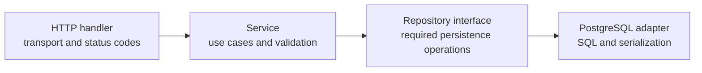

# OrdinalFrontier Backend Guide

[Codebase index](codebase-guide.md) · [System architecture](../architecture/system-architecture.md)

## Backend organization

### Request-oriented features

Faction and battle HTTP features follow a handler → service → repository dependency direction:



- `api` packages translate HTTP requests, responses, and error categories.
- `service` packages enforce use-case rules and depend on narrow interfaces.
- `repo` packages implement those interfaces using PostgreSQL.
- [`backend/internal/app/app.go`](../../backend/internal/app/app.go) wires the API's concrete repositories, services, and handlers.

Repository interfaces live close to the service or worker that consumes them. This keeps the use case independent from a particular database implementation.

### Simulation-oriented code

[`backend/internal/game`](../../backend/internal/game) does not use the HTTP feature layering. It is an infrastructure-free domain package that takes resolved input and returns deterministic state transitions.

[`backend/internal/battle/worker`](../../backend/internal/battle/worker) is an application worker around that domain. It owns persistence orchestration but delegates game rules and state mutation to `game.Match`.

### Process health ownership

`httpapi.LifecycleHandler` is the sole owner of startup, liveness, readiness, and metrics endpoints. The API and engine entry points wire its dependencies and readiness callback into that handler. The application router owns business routes only, and the application database contract requires SQL operations without a health-ping dependency. `Worker.Ready()` exposes execution state; the worker package contains no HTTP health wrapper. Engine lifecycle integration tests cover worker startup/shutdown and database failure through the shared handler.

Agent and MCP commands expose a separate `/healthz` endpoint; they do not use
`LifecycleHandler`.

### AI-oriented code

[`backend/internal/ai`](../../backend/internal/ai) defines neutral contracts first, then separates execution into:

- an agent worker that leases jobs;
- a shared API-provider tool loop;
- isolated CLI runners;
- provider HTTP adapters;
- an MCP server and client.

The package root contains types and interfaces shared across these subpackages, avoiding provider-specific types in the engine or battle service.

## Package guide

### `internal/game`: authoritative simulation domain

| File | Responsibility |
| --- | --- |
| [`types.go`](../../backend/internal/game/types.go) | Maps, rulesets, factions, units, buildings, state, events, results, controller config, and faction views |
| [`match.go`](../../backend/internal/game/match.go) | Runtime state, tick orchestration, events, and results |
| [`initialization.go`](../../backend/internal/game/initialization.go) | Scenario validation and initial factions, castles, and units |
| [`opening.go`](../../backend/internal/game/opening.go) | Tick-zero opening phase and deterministic fallback |
| [`upgrades.go`](../../backend/internal/game/upgrades.go) | One-time gold purchases and bonus propagation |
| [`decisions.go`](../../backend/internal/game/decisions.go) | Decision snapshots, plan validation, scripted plans, and tactics |
| [`economy.go`](../../backend/internal/game/economy.go) | Income, construction, and recruitment |
| [`structures.go`](../../backend/internal/game/structures.go) | Typed construction, building caps, tower turns, and forward recruitment |
| [`siege.go`](../../backend/internal/game/siege.go) | Structure approach priorities and minimum-range retreat |
| [`support.go`](../../backend/internal/game/support.go) | Herbalist treatment and allied movement |
| [`combat.go`](../../backend/internal/game/combat.go) | Unit turns, targeting, damage, and loot |
| [`movement.go`](../../backend/internal/game/movement.go) | Castle approach paths and reachable enemy alternatives |
| [`knowledge.go`](../../backend/internal/game/knowledge.go) | Ruleset knowledge validation and defensive copying |
| [`visibility.go`](../../backend/internal/game/visibility.go) | Faction perspectives and fog of war |
| [`clone.go`](../../backend/internal/game/clone.go) | Defensive copying of state, scenarios, results, and plans |
| [`map.go`](../../backend/internal/game/map.go) | Hex-map validation, coordinates, traversal, and visibility helpers |
| [`rules.go`](../../backend/internal/game/rules.go) | Ruleset and legacy blueprint validation |

`game.Match` is the in-memory authority for one battle attempt. Important methods include:

- `DecisionWindowDue` and `DecisionTargetTick` for production boundaries;
- `DecisionSnapshot` for a bounded faction-visible model input;
- `ScriptedPlans` for deterministic baselines;
- `AdvanceWithPlans` for plan application followed by a tick;
- `State` for a defensive copy of current state.

`Match` contains no database, HTTP, or model-provider dependency. Preserve this property when adding game behavior.

### `internal/battle/catalog`: authored inputs

[`catalog.go`](../../backend/internal/battle/catalog/catalog.go) strictly decodes scenario and ruleset YAML with unknown-field rejection. It validates templates, combines a scenario with two stored faction identities, and returns a complete resolved `game.Scenario` plus digest.

The API stores this resolved value in `battle_runs.scenario_snapshot`. The engine therefore does not reload live YAML when it claims a battle.

### `internal/battle/service`: battle use cases

[`service.go`](../../backend/internal/battle/service/service.go) contains public battle rules:

- validate battle IDs, participants, controller selections, and tick counts;
- ensure requested model profiles are available;
- load faction identities;
- resolve and hash the scenario snapshot;
- create an initial `game.Match` to validate the battle;
- enqueue, list history, read, pause, resume, and stop battles;
- read events, decision history, and faction perspectives.

[`repository.go`](../../backend/internal/battle/service/repository.go) defines the persistence operations required by these use cases. [`catalog.go`](../../backend/internal/battle/service/catalog.go) defines catalog-facing types and interfaces.

### `internal/battle/resultcache`: optional read cache

[`redis.go`](../../backend/internal/battle/resultcache/redis.go) implements the
service's `ResultCache` port. `cmd/server` constructs and closes it;
`app.NewAPIWithResultCache` wires it beneath authentication. Service/config tests
and `resultcache/redis_test.go` cover caching and failure behavior with an
in-process Redis protocol server; no external Redis process is required.
See [cache behavior](../architecture/system-architecture.md#completed-battle-result-caching) and
[Redis operations](../operations/redis.md).

### `internal/battle/api`: battle HTTP delivery

[`handler.go`](../../backend/internal/battle/api/handler.go) registers and implements:

Battle, scenario, and profile routes are documented in the
[HTTP API reference](../architecture/api.md). This handler owns JSON decoding,
cursor/attempt parsing, HTTP status mapping, and response encoding for those routes.

Keep domain validation in the service. The handler should concentrate on transport validation and stable HTTP status mapping.

### `internal/battle/worker`: durable execution

| File | Responsibility |
| --- | --- |
| [`repository.go`](../../backend/internal/battle/worker/repository.go) | Battle-job, lease, and worker repository contracts |
| [`worker.go`](../../backend/internal/battle/worker/worker.go) | Construction, claims, battle/tick execution, persistence, and completion |
| [`decisions.go`](../../backend/internal/battle/worker/decisions.go) | Decision-window preparation, waiting, validation, fallback, and logging |
| [`lifecycle.go`](../../backend/internal/battle/worker/lifecycle.go) | Worker readiness, pause/heartbeat waits, cancellation, and requeue |

The worker's main call path is:

```text
Run
└── ClaimBattle
    └── process
        └── game.NewMatch
            └── runBattle
                └── runTick
                    ├── waitWhilePaused
                    ├── resolveDecisionWindow (when due)
                    ├── Match.Advance / AdvanceWithPlans
                    ├── SaveTick
                    └── CompleteBattle
```

`resolveDecisionWindow` freezes contexts for both factions, persists durable decision rows, immediately resolves scripted controllers, waits for model controllers, applies timeout fallbacks, and returns one plan per faction.

All persistence calls carry the current battle lease. Do not add an unguarded write path that allows a stale attempt to update the battle.

### `internal/battle/repo`: PostgreSQL battle adapter

The adapter stays in one package: [`postgres.go`](../../backend/internal/battle/repo/postgres.go) constructs it, [`battles.go`](../../backend/internal/battle/repo/battles.go) owns public battle operations, [`queue.go`](../../backend/internal/battle/repo/queue.go) owns queue leases, and [`ticks.go`](../../backend/internal/battle/repo/ticks.go) owns atomic tick and completion writes. Splitting files does not change transaction boundaries.

[`decisions.go`](../../backend/internal/battle/repo/decisions.go) implements the AI decision repository:

- create or reuse decisions;
- notify waiting agents;
- atomically claim compatible model work;
- accept a versioned/idempotent plan;
- resolve fallbacks;
- record provider failures, validation failures, usage, and metadata;
- list per-window and per-battle decision history.

SQL concurrency behavior is part of the application's correctness. Changes to status predicates, `FOR UPDATE SKIP LOCKED`, versions, owners, attempts, or leases require focused concurrency and race tests.

### `internal/ai`: shared contracts

| File | Responsibility |
| --- | --- |
| [`types.go`](../../backend/internal/ai/types.go) | Decision sessions, contexts, submissions, records, model turns, tools, usage, and profiles |
| [`repository.go`](../../backend/internal/ai/repository.go) | Durable decision repository contract and errors |
| [`service.go`](../../backend/internal/ai/service.go) | Context reads, plan validation, observation hashes, and HMAC capabilities |
| [`prompts.go`](../../backend/internal/ai/prompts.go) | Embedded shared instructions, context delivery, and separate battle and background-generation prompt digests |
| [`knowledge.go`](../../backend/internal/ai/knowledge.go) | Bounded knowledge selection from frozen rules and faction-visible context |
| [`memory.go`](../../backend/internal/ai/memory.go) | Scoped, chronological historical decision summaries with count/byte bounds |
| [`profiles.go`](../../backend/internal/ai/profiles.go) | API/CLI profile validation and availability evaluation |

Prompt files are embedded through [`prompts.go`](../../backend/internal/ai/prompts.go).
`PromptVersion` hashes the six battle prompt templates below and the inline
`identityContextTemplate`; background writer prompts have a separate
`GenerationPromptVersion`.

| File | Role |
| --- | --- |
| `prompts/battlefield-agent.txt` | Battle session system prompt establishing tool-only authority and untrusted observations |
| `prompts/decision.txt` | Main tactical and production decision instructions |
| `prompts/tool-context.txt` | Short per-decision prompt when context is fetched through MCP |
| `prompts/inline-context.txt` | Variant used when the host has already supplied the full context JSON |
| `prompts/doctrine.txt` | Doctrine template embedded and included in `PromptVersion`, but currently not rendered |
| `prompts/identity.txt` | Identity template embedded and included in `PromptVersion`, but currently not rendered |
| `prompts/background-generation.txt` | Background writer system instructions |
| `prompts/background-decision.txt` | Background writer per-job instructions |

For battle sessions, `SessionSystemPrompt` returns the battlefield system prompt.
`SessionDecisionPrompt` renders the shared decision instructions, then the faction
name, background, and doctrine as JSON inside the untrusted-data delimiters defined
by `identityContextTemplate`, then the request-specific delivery (request ID, and
inline context when prefetched). Keep request-specific text last: content ahead of
it is the prefix providers can cache across a faction's decisions.

`GenerationPromptVersion` covers both background writer instruction
components and the rendered character limit. Faction limits are declared in
`internal/faction/faction.go` and mirrored in frontend `features/factions/limits.ts`;
update both when changing this API contract. Existing Unicode boundary tests cover
editor, service, and generation validation.

`DecisionRunner` is the execution boundary used by the agent. `TurnProvider` is the narrower boundary implemented by model APIs that participate in the shared tool loop.

`DecisionService` deliberately receives only a `DecisionSubmissionRepository`, which cannot modify battles or simulation state.

### `internal/ai/worker`: provider-neutral worker

[`worker.go`](../../backend/internal/ai/worker/worker.go) starts one claim loop per concurrency slot. Each loop:

1. long-polls the MCP agent-control endpoint with executable profile IDs;
2. immediately runs the claimed job in its owned slot;
3. requires the claimed profile from the local registry;
4. requires the server-minted request-scoped capability;
5. creates an API or CLI runner;
6. applies a decision timeout;
7. reports usage or failure metadata through MCP.

The default runner factory is the only place that chooses concrete provider implementations from a model profile.

### `internal/ai/runner`: model execution mechanisms

| File | Responsibility |
| --- | --- |
| [`api.go`](../../backend/internal/ai/runner/api.go) | Shared bounded tool loop for API providers |
| [`mcp.go`](../../backend/internal/ai/runner/mcp.go) | Authenticated streamable HTTP MCP client and normalized tool calls |
| [`cli.go`](../../backend/internal/ai/runner/cli.go) | Isolated Codex/Antigravity/Claude CLI execution, Antigravity context prefetch, and result parsing |
| [`claude.go`](../../backend/internal/ai/runner/claude.go) | Restricted Claude Code arguments, MCP configuration, and terminal-result parsing |
| [`codex_usage.go`](../../backend/internal/ai/runner/codex_usage.go) | Codex JSONL usage parsing |
| [`observability.go`](../../backend/internal/ai/runner/observability.go) | Langfuse generation observations for API and CLI runs |
| [`process_linux.go`](../../backend/internal/ai/runner/process_linux.go) | CLI process-group isolation and cancellation (no-op fallback in `process_other.go`) |

The API loop accepts only a known MCP tool set: the three battle tools (or the
legacy two-tool pair during rollout) or the two background-generation tools. It
rejects any other tool name a provider requests. It appends tool calls and results to the neutral message transcript and accumulates usage over turns.

The CLI runner creates a temporary directory, passes the profile's allowlisted model explicitly with `--model`, and constructs provider-specific command-line restrictions. Tests use the `CommandExecutor` interface to inspect the selected model and execution restrictions without starting a real CLI.

[`clienv/antigravity.go`](../../backend/internal/ai/clienv/antigravity.go) shares
permission configuration, environment isolation, and saved-login probing between
profile discovery and execution. `cmd/agent -check-antigravity-auth` supports the
host launcher's preflight. See [CLI runtime](../architecture/system-architecture.md#cli-runtime)
for context delivery and accepted-plan enforcement.

### `internal/ai/providers`: external API adapters

[`openai.go`](../../backend/internal/ai/providers/openai.go) translates neutral tools into OpenAI Responses function tools. [`gemini.go`](../../backend/internal/ai/providers/gemini.go) translates them into Gemini function declarations.

[`http.go`](../../backend/internal/ai/providers/http.go) owns transcript formatting,
the shared HTTP response lifecycle, status errors, and JSON decoding. Provider
adapters retain their authentication, request schemas, and named response types.

Both adapters:

- accept a configurable HTTP client and endpoint for tests;
- normalize token usage and tool calls;
- map safety/refusal results to a common error;
- contain no battle or database logic.

### `internal/ai/mcpserver`: model and agent boundary

[`server.go`](../../backend/internal/ai/mcpserver/server.go) exposes separate HTTP surfaces:

- `/mcp` is the request-capability-protected battle model tool surface;
- `/generation-mcp` exposes only background context and submission tools;
- `/internal/agent/*` is the shared-secret agent control plane for claims and result metadata.

The MCP tools are:

- `get_decision_context`;
- `get_unit_details` (1–4 exact unit IDs);
- `submit_strategy_plan`.

[`agent_context.go`](../../backend/internal/ai/agent_context.go) owns the explicit
agent projection, frozen unit reference snapshot, and exact lookup. The full
`DecisionContext` remains persisted for validation. New snapshots are captured by
the battle worker before hashing for every decision.
[`unit_details.go`](../../backend/internal/ai/mcpserver/unit_details.go) serves the
capability-scoped lookup. The saved-context service and frontend inspector show
reconstructed context separately from optional reference details. All evaluation
variants use the current projection, with lookup and total input-token metrics.

The server validates request scope before calling `DecisionService`. PostgreSQL notifications close an in-memory wake-up channel so long-polling claim requests promptly query durable state.

### `internal/game/controller`: deterministic policy abstractions

[`types.go`](../../backend/internal/game/controller/types.go) defines `PlanProposal`, action candidates, strategy plans, and a controller interface. `PlanProposal` is actively used by the game, AI subsystem, scenarios, repository, API, and frontend.

[`utility_controller.go`](../../backend/internal/game/controller/utility_controller.go) is an independently tested in-memory utility controller with its own decision scheduling and pending-plan lifecycle. It is not constructed by the API, engine, or `game.Match` production path. The current match consumes `PlanProposal` directly and performs deterministic action scoring internally.

The standalone controller is retained as an intentional, independently tested capability. Shared production plan validation lives in [`validation.go`](../../backend/internal/game/controller/validation.go); [`clone.go`](../../backend/internal/game/controller/clone.go) owns `ClonePlanProposal` and `ClonePlanProposals`, used by the match, catalog, and utility controller. Add new mutable proposal fields to that copy implementation and its isolation test.

### `internal/faction`: reusable doctrines

| Area | Responsibility |
| --- | --- |
| [`faction.go`](../../backend/internal/faction/faction.go) | Stored and decorated faction model |
| [`service`](../../backend/internal/faction/service) | UUID/name/doctrine/background validation and profile creation/update |
| [`api`](../../backend/internal/faction/api) | Faction and faction-ruleset HTTP routes |
| [`repo`](../../backend/internal/faction/repo) | PostgreSQL serialization and errors |

Faction creation and editing share `normalizeFaction` in `service/service.go`,
so whitespace normalization and Unicode length limits stay consistent. The
`RulesetCatalog` port requires only the ruleset listing operation it consumes.

Deleting a faction removes it from the active registry but does not affect the copied participant data inside existing battle snapshots.

### `internal/generation`: faction background generation

| File | Responsibility |
| --- | --- |
| [`types.go`](../../backend/internal/generation/types.go) | Configuration, normalized draft input, job state, quota options, and the repository contracts |
| [`handler.go`](../../backend/internal/generation/handler.go) | Authenticated options, admission, and status routes under `/v1/faction-background-generations` |
| [`postgres.go`](../../backend/internal/generation/postgres.go) | Transactional admission, account quotas, idempotency, durable claims, expiry, and result recording |

This package runs background writing as durable asynchronous jobs rather than
inline requests. `Admit` opens a transaction per actor, expires stale jobs,
evaluates the account quota, and reuses an existing job when the idempotency key
and input hash match. `Claim` hands a job to an agent worker by executable
profile. `Submit` and `Finish` record the draft, category, usage, and metadata.

The generation path never touches battle or simulation state. Its worker side
lives in [`ai/worker/generation.go`](../../backend/internal/ai/worker/generation.go)
and its tool surface in [`ai/mcpserver/generation.go`](../../backend/internal/ai/mcpserver/generation.go),
which exposes draft-only tools and namespaced capabilities. Migration
`00009_faction_background.sql` owns the jobs, account locks, and quota indexes.

### `internal/admin`: model-access policy

`handler.go` translates HTTP requests and errors. `service.go` owns defaults,
validation, and the bounded `ReadPolicy` callback consumed by the AI profile
registry. Its repository contract is implemented by `postgres.go`, which owns
SQL, JSON persistence, and optimistic version conflicts. `internal/app` wires
both the handler and registry to the service; policy reads do not depend on HTTP.

### Shared infrastructure packages

- [`internal/authn`](../../backend/internal/authn) provides Cloudflare JWT verification, explicit development login modes, role/ownership helpers, exact-origin mutations, a deny-by-default route permission registry, and mode-aware session/logout routes. `authn.PublicAPIRoutes()` exposes that registry plus the three auth routes; [`internal/apicontract`](../../backend/internal/apicontract) fails the build if [`docs/architecture/openapi.yaml`](../architecture/openapi.yaml) lists a different set. When adding a `/v1` route, register its permission **and** document the operation in the OpenAPI contract in the same change. `cloudflare_test.go` exercises signatures, key rotation, forged headers, legacy cookies and role removal. `service_test.go` covers enrolled CI service JWTs, invalid claims, disabled enrollment and the read-only route boundary. CI uses a separate `ci` actor, never a human role.
- [`internal/config/config.go`](../../backend/internal/config/config.go) strictly decodes one YAML document, rejects unknown fields, resolves environment variables, and provides process-specific loaders.
- [`internal/postgres`](../../backend/internal/postgres) manages the `pgx` pool, embedded Goose migrations, startup retries, and `LISTEN/NOTIFY`.
- [`internal/httpapi`](../../backend/internal/httpapi) provides bounded strict JSON, lifecycle/readiness routes, request IDs, routing, and access logging.
- [`internal/logging`](../../backend/internal/logging) configures `LOG_LEVEL`,
  formats readable operational messages while retaining stable event names, and
  enriches logs with active trace/span IDs. `handler.go` preserves slog attribute
  grouping; `messages.go` selects the operational fields shown in compact messages.
- [`worker/progress.go`](../../backend/internal/battle/worker/progress.go) bounds
  battle and decision-wait updates to one per 15 seconds and supplies elapsed time.
- [`internal/telemetry`](../../backend/internal/telemetry) defines API/engine Prometheus metrics and shared OpenTelemetry tracing, HTTP
  instrumentation, and durable trace-context propagation.

## Important shared data types

| Type | Defined in | Used for |
| --- | --- | --- |
| `game.Scenario` | `internal/game/types.go` | Complete immutable input to a battle attempt |
| `game.State` | `internal/game/types.go` | Current authoritative simulation snapshot |
| `game.Transition` | `internal/game/types.go` | One tick's state, events, and optional result |
| `game.View` | `internal/game/types.go` | Faction-projected fog-of-war state |
| `controller.PlanProposal` | `game/controller/types.go` | Scripted/model strategy and production input |
| `ai.DecisionContext` | `internal/ai/types.go` | Frozen bounded model observation |
| `ai.DecisionRecord` | `internal/ai/types.go` | Durable decision state and provenance |
| `service.BattleRun` | `battle/service/service.go` | Public/use-case representation of a stored run |
| `worker.BattleLease` | `battle/worker/repository.go` | Attempt and ownership guard for engine writes |

When introducing a new field, identify its authority:

- simulation truth belongs in `game` types;
- public use-case state belongs in the relevant service;
- model-only context belongs in `ai` types;
- transport-specific request/response shapes should stay inside handlers or frontend clients.

Administrator model access is implemented in [`internal/admin`](../../backend/internal/admin):
its handler validates settings and stores a versioned policy in PostgreSQL.
[`internal/ai/access.go`](../../backend/internal/ai/access.go) overlays that policy
on the API profile registry for catalog reads and new selections. The API composition
root wires the same effective registry into battle and background-generation handlers.
[`internal/authn/preview.go`](../../backend/internal/authn/preview.go) enforces
administrator-only, read-only role preview before route permission checks.
Frontend [`admin/api/settings.ts`](../../frontend/src/features/admin/api/settings.ts)
handles settings reads/saves; [`RolePreviewContext.ts`](../../frontend/src/features/auth/RolePreviewContext.ts)
and the shared request transport coordinate effective roles and mutation blocking.
Tests cover durable cross-instance saves, conflicts, selection restrictions, preview
permissions, frontend save/reload, and preview navigation.

## Database migrations and adapters

Migrations under [`backend/migrations`](../../backend/migrations) are embedded into the server binary.

| Migration | Main change |
| --- | --- |
| `00001_create_factions.sql` | Initial faction table |
| `00002_create_battle_queue.sql` | Battle runs and per-attempt event stream |
| `00003_castle_siege_state.sql` | Ruleset/blueprint and battle state snapshots |
| `00004_battle_decisions.sql` | Model decisions, indexes, evaluation view, restricted MCP role |
| `00005_stop_battles.sql` | `stopped` battle status |
| `00006_pause_battles.sql` | Pause flag and unpaused claim index |
| `00007_trace_context.sql` | Persisted trace propagation context |
| `00008_faction_doctrine.sql` | Faction doctrine and versioned battle snapshots |
| `00009_faction_background.sql` | Faction background and asynchronous generation jobs |
| `00010_battle_history.sql` | Descending creation-time/ID index for battle history |
| `00011_friends_access.sql` | Row ownership, atomic admission triggers, AI execution counts, single CLI lease, runtime stop policy, and private usage view |
| `00012_model_access.sql` | Versioned administrator model access policy and last editor metadata |
| `00013_player_members.sql` | Durable player membership and access synchronization |
| `00014_cli_concurrency.sql` | Four shared CLI lease slots with serialized admission |
| `00015_drop_duplicate_event_index.sql` | Drops `battle_events_cursor_idx`, which duplicated the `battle_events` primary key; event pages use `battle_events_pkey` |
| `00016_admin_battle_admission.sql` | Exempts authenticated Admin battle creation from admission limits; exempt battles still occupy active capacity |

Schema changes should be made with a new migration, then reflected in repository scan/serialization logic and tests. Do not edit an already-applied migration to evolve a shared database.

`internal/postgres.NewMigrationProvider` configures embedded Goose migrations with
the same database-wide advisory session lock for application startup and tests
that run `Up`, `UpTo`, or `Down`. Separate test schemas still share the MCP role
and public-schema permissions; constructing an unlocked provider can cause
`tuple concurrently updated` failures across parallel packages. The PostgreSQL
integration regression holds the lock from another schema, verifies migration
cancellation without application DDL, then verifies successful migration after release.

## Configuration and authored content

| Path | Purpose |
| --- | --- |
| [`backend/config.yaml`](../../backend/config.yaml) | Local process configuration and model-profile definitions |
| [`.env.example`](../../.env.example) | Shared dev/production application settings schema |
| [`backend/rulesets`](../../backend/rulesets) | Versioned unit, building, economy, and combat values |
| [`backend/scenarios`](../../backend/scenarios) | Map layout, timing, scripted plans, and fallbacks |
| [`infra/deploy/base/infrastructure/configmap.yaml`](../../infra/deploy/base/infrastructure/configmap.yaml) | Cluster configuration equivalent |
| [`infra/deploy/environments/deployment.env.example`](../../infra/deploy/environments/deployment.env.example) | Deployment environment profile template consumed by the shared resolver |

`internal/config/config.go` owns shared types, strict decoding, common parsing
helpers, and process loaders. Parsers and their concern-specific types live in
`auth.go`, `ai.go`, `database.go`, `http.go`, `engine.go`, `result_cache.go`, and
`generation.go` in the same package. There are no new package dependencies.

Configuration is decoded with `yaml.KnownFields(true)`. Update the file-facing struct, parsed runtime struct, validation, examples, deployment ConfigMap, and tests together.

## Agent context compaction

`ai/faction_groups.go` groups observed units/buildings with faction statistics
after metadata deduplication, and conditionally shares effective building stats.
Its reconstruction tests verify ownership, missing faction statistics, distinct
effective profiles, stable full IDs and individual observations. The inspector
renders grouped JSON through its existing reconstructed-context section.

`ai/context_duplicates.go` removes equal plan/metadata copies from the current
projection. `ai/session_context.go` removes identity text only when the exact
value is supplied in the system prompt. API tool delivery and Gemini prefetch
apply this helper; MCP's canonical response stays self-contained. Tests cover
historical differences, faction scope, source immutability and both runner paths.

`backend/internal/ai/battlefield_context.go` implements the v4 agent view:
effective-stat profiles and inclusive visibility row ranges, with independent
size checks to retain inline fields when smaller. Its tests reconstruct observed
units and visibility, check version compatibility and measure opening/small/large
views. To measure a local JSON context without adding private data to fixtures,
run `BATTLEFIELD_CONTEXT_FIXTURE=/path/to/context.json go test ./internal/ai -run TestBattlefieldContextExternalFixture -v`
from `backend`.

## Langfuse integration

- `backend/internal/telemetry/ai.go` provides decision correlation, explicit AI
  sampling and safe trace URLs alongside the existing infrastructure tracing.
- `backend/internal/ai/runner/observability.go` emits generation observations;
  `codex_usage.go` parses terminal JSONL usage without retaining model reasoning.
  `runner/claude.go` constructs the restricted Claude invocation and parses its
  terminal result and cache-aware usage. `clienv/claude.go` filters environment
  variables and checks the native subscription login without model inference.
  Their tests cover tool restrictions, credential handling, cleanup, multiline JSON
  with separated stderr diagnostics, and failures;
  `mcpserver/claude_live_test.go` is an opt-in synthetic MCP submission test.
  `scripts/test/test-cli-agent.py` checks launcher profile selection, generated
  configuration, availability flags, forwarding diagnostics and health-probe
  failure handling as part of the deployment regression gate.
  Provider adapters preserve cache/reasoning subsets and usage on refusals.
- `backend/internal/ai/mcpserver/tool_logging.go` records server tool spans;
  `context_telemetry.go` measures serialized initial-context sections in bytes.
  Tool metrics distinguish serialized transport, text, and structured-content
  bytes. `context_transport_test.go` checks single-copy JSON delivery, legacy
  context fields, repeat-read compatibility, and reduced transport size.
- Decision history exposes optional trace links and additive usage metadata;
  `AIDecisionPanel` distinguishes API totals, CLI aggregates and legacy counters.
- `infra/deploy/langfuse/values.yaml` pins the self-hosted Helm configuration;
  `collector-config.yaml` adds the filtered export pipeline. Run
  `scripts/cd/deploy-langfuse.sh` using the registered environment and follow
  [Langfuse operations](../operations/langfuse.md) to enable future deploys.

`scripts/lib/ensure-helm.py` supplies the Langfuse installer with an existing
Helm binary or a temporary checksum-pinned Linux amd64 download.

`infra/deploy/langfuse/values.yaml` also supplies explicit pod/container security contexts
for Langfuse, SeaweedFS and PostgreSQL, preserving the namespace security policy.

`infra/deploy/overlays/local/gateway/langfuse-route.yaml` exposes the UI through the
shared gateway. `battlefield_env_langfuse_enabled` in the environment helper detects
the installed project for collector configuration and host CLI forwarding.

## Limited-access deployment and agent containment

`internal/authn/cloudflare.go` owns Access verification/key refresh;
`internal/authn/audience.go` decodes string and string-array JWT audiences, with
signed human/service session regression tests in `audience_test.go`;
`internal/authn/diagnostics.go` classifies failures and exposes a context observer
consumed by `internal/httpapi/request_logging.go` for safe request-correlated diagnostics;
`authorization.go` owns role capabilities, ownership checks, mutation origin checks
and explicit route assignments. Add new public routes to that registry deliberately.
`config/access_test.go` covers production misconfiguration and the CLI verification
gate. `battle/api/player_test.go` checks projections after shared cache reads.
Faction/battle service tests cover every role for own, other and legacy content.

Migration `00011_friends_access.sql` owns row ownership, atomic admission triggers,
AI execution counts, the original CLI lease, runtime stop policy and private usage view.
Migration `00014_cli_concurrency.sql` expands that lease admission to four shared slots.
`generation/friends_integration_test.go` tests cross-connection admission, paused
limits, UTC reset, shared CLI slots and execution budgets against PostgreSQL.
Workers receive capabilities from MCP instead of signing them. `worker/policy.go`
cancels execution on the private stop switch; `credentials_linux.go` blocks procfs/
ptrace reads of the worker's credentials; `runner/process_linux.go` kills CLI process
groups. Local credentials remain available only to the appropriate CLI login.

`features/auth/SessionContext.tsx` exposes UI permissions from the session. The App
handles Access reauthentication/logout; Player battle pages do not mount inspection
panels or request decision history. Faction editing and battle controls reflect
ownership, with backend enforcement independent of the UI.

`scripts/ops/render-limited-launch.py` produces private auth configuration and a
Tunnel deployment with origin-side Access validation and application ingress policies.
`infra/deploy/agent-vm/` contains the libvirt network/filter, proxy and worker configuration;
its `host/` templates include the dedicated firewall, Caddy proxy, loopback MCP
forward and Squid service override. `scripts/ops/render-agent-vm-host.py` renders
a credential-free bundle into a new directory without changing live services.
`scripts/test/test-agent-vm-host.py` checks rendering, input rejection and private
listener/Host-rewrite invariants through the deployment gate.
[VM setup and recovery](../operations/agent-vm.md) explains host/guest commands,
Codex helper installation and end-to-end verification;
`create-agent-vm.sh` provisions a fresh VM after capacity/image checks;
`verify-agent-isolation.py` tests its guest boundary. `ai-policy.sh` is the private
operator stop/status/usage interface. `verify-access-service.py` checks the restricted CI service identity during production smoke;
the former human-JWT helper has been retired. `scripts/test/test-limited-launch.py` verifies
rendered routing and isolation artifacts without modifying infrastructure.
See [limited-access launch](../operations/limited-launch.md) for setup and live verification.

Authentication configuration parsing separates mode selection, Cloudflare identity
assignments and local session settings. Signing-key decoding is separate from
JWKS fetching and refresh caching. Regression tests cover malformed signing keys,
profile eligibility and the default-deny browser/route boundaries.

`scripts/ops/prepare-limited-production.sh` checks production cluster identity before invoking its Python helper to validate and prepare private launch files. Offline regression checks live in `scripts/test/test-production-preparation.py`.

Production k6 smoke-load credential binding is described in the
[launch runbook](../operations/limited-launch.md).

### Shared content catalog

- `backend/content/core-v1.yaml` preserves the starter roster. `core-v2.yaml`
  adds siege/support units and defensive/production structures; rulesets reference
  a versioned library instead of duplicating stats.
- `backend/scenarios/frontier-siege-v2.yaml` supplies the expanded 25×17 authored
  map and mixed scripted plans, selected through `castle-siege-v2`.
- `backend/internal/ai/expansion.go` validates typed construction and recruitment
  sources against frozen legal choices. The worker exposes structure definitions
  and source IDs through the MCP context.
- `backend/internal/game/expansion_test.go` covers expansion mechanics;
  catalog `expansion_test.go` and `balance_test.go` cover actual content, replay,
  and mirrored equal-budget probes. Frontend `ExpansionMap.test.tsx` covers the
  larger map, new structures, treatment indicators, and decision history.
- `backend/internal/battle/catalog/library.go` resolves and validates library
  references; `restrictions.go` narrows scenario choices and validates authored plans.
- Faction creation/editing uses name, doctrine and optional background, with editable strategy templates.
  Scenario summaries carry allowed IDs for purchase validation; profiles are generic.

Library-backed and inline rulesets both resolve to the existing immutable game
snapshot. See [content libraries](../operations/content-library.md) for authoring.

The faction API exchanges `{ id, name, doctrine, background? }`; edit requests use PUT.
Battle setup selects generic profiles without blueprint compatibility filtering.

### Doctrine profile implementation

- `backend/internal/faction/service/update.go` and the faction handler/repository
  implement validated name/doctrine/background updates. Creation and listing expose only profile fields.
- `backend/internal/game/opening.go` handles the tick-zero phase and deterministic
  fallback; `upgrades.go` executes one-time gold purchases and propagates bonuses.
- `backend/internal/ai/prompts/*.txt` and doctrine-aware API/CLI runners define
  the new context/tool contract. Decision records retain doctrine in observation provenance.
- `backend/migrations/00008_faction_doctrine.sql` backfills balanced doctrine,
  preserves legacy columns, and permits decision records at tick zero.
- Faction routes `/factions/new` and `/factions/:id/edit` share the doctrine editor.
  The decision panel displays opening plans and requested upgrades.

### Faction backgrounds and generation

- `backend/internal/generation/{types,handler,postgres}.go` defines normalized
  draft input, configuration, authenticated endpoints, PostgreSQL admission,
  account quotas, idempotency, durable claims, expiry and result validation.
- `backend/migrations/00009_faction_background.sql` adds an empty-default
  background, generation jobs/account locks, active/queue/quota indexes, and
  narrowly scoped MCP grants. Existing profiles, blueprints and battle snapshots
  are preserved. `internal/postgres/migrations.go` serializes migration runners
  with a PostgreSQL advisory session lock, including concurrent fresh schemas.
- Faction API/service/repository and battle catalog/worker copy background with
  name/doctrine; `ai.SessionDecisionPrompt` embeds that identity through
  `identityContextTemplate` (`identity.txt` is hashed but not rendered). Observation
  hashing includes owning identity. Prompt history lives in Git; filenames identify purpose without version suffixes.
- `backend/internal/ai/mcpserver/generation.go` provides draft-only tools and
  namespaced capabilities; `internal/ai/worker/generation.go` executes and reports
  background jobs without battle data, using the configured writer profile.
- `frontend/src/features/factions/components/BackgroundGenerator.tsx` handles
  allowance discovery, admission, polling, editable preview and use/discard.
  `api/backgrounds.ts` defines its HTTP contracts. Creation and editing share
  the background textarea, Unicode counter and generator; the directory shows
  saved backgrounds.
- Generation PostgreSQL tests exercise concurrent admission, quota days,
  cooldown, expiry accounting, account isolation and migration preservation. MCP
  tests run both API and CLI stubs through the real generation tool transport;
  frontend tests cover preview state and unsaved text. Identity tests cover prompt
  escaping, delivery, hashing and opposing-profile isolation. Deterministic battle
  evaluations carry profile identity in their context and session.

### Battle history implementation and verification

The battle API, service, and repository each contain a `history.go` adapter:
HTTP query parsing and error mapping; summary types and cursor validation;
and a compact PostgreSQL projection. `Service.ListBattles` accepts
`BattleHistoryInput`, while `Repository.ListBattles` accepts a validated
`BattleHistoryQuery`. `BattleSummary` and `BattleHistoryPage` have matching
frontend types in the battle API client.

The history page owns abortable list requests and URL-based navigation. Its
tests cover outcomes, loading/errors, refresh, filter changes, stale requests,
and returns from detail pages. App tests cover exact navigation matching and
expired sessions. Repository integration tests cover paused semantics, tied
timestamps, new insertions between pages, snapshot identities, and migration
upgrade/rollback using isolated fixtures.

Run the Go coverage gate with disposable PostgreSQL integration coverage:

```bash
./scripts/test/with-test-postgres.sh ./scripts/test/test-go-coverage.sh
(cd frontend && npm test -- --coverage)
(cd frontend && npm run build)
```

#### Pagination query plans

pgx caches prepared statements, and after five executions PostgreSQL may reuse a
**generic plan** that cannot see parameter values. The history cursor is therefore
one row comparison with first-page sentinels,
`(created_at, id) < (COALESCE($2, 'infinity'), COALESCE($3, max-uuid))`, which
stays an index condition in both plan types. The earlier
`$2 IS NULL OR (created_at, id) < ($2, $3)` form became a filter in generic plans,
so a deep page walked every newer row. `TestBattleHistoryCursorStaysIndexConditionInGenericPlans`
guards this. Keep `listBattlesSQL` and the copy in
`scripts/perf/query-plans/explain.sql` in sync.

Re-measure with the disposable database (10k battles over ~90 days, 120k events):

```bash
./scripts/test/with-test-postgres.sh ./scripts/perf/query-plans/run-query-plans.sh
```

Results on PostgreSQL 17.6, 2026-09-29, limit 26 (page size 25 plus one):

| Query | Plan | Shared buffers | Time |
| --- | --- | --- | --- |
| History, all statuses, first page | `battle_runs_history_idx` scan | 5 | 0.27 ms |
| History, all statuses, cursor at offset 5,000 (generic plan) | index cond on cursor | 5 (was 470, 5,001 rows filtered) | 0.23 ms (was 0.82 ms) |
| History, `queued` (5% of rows), first page | index scan, status filter | 67 (669 rows filtered) | 0.50 ms |
| History, `paused` (1.4%), first page | bitmap scan on `battle_runs_claim_idx` | — | 0.81 ms |
| History, `paused`, cursor at offset 5,000 (generic plan) | index cond on cursor | 170 (was 635) | 0.61 ms (was 1.29 ms) |
| Events after sequence 10,000 (20k-event battle) | events index range scan | 8 | 0.05 ms |
| Latest 200 events (20k-event battle) | backward events index scan, then sort of 200 rows | 11 | 0.08 ms |

Rare status filters still scan the history index and discard non-matching rows,
which grows with how far the matching rows are spread. At this scale it stays
under 1 ms; add a `(status, created_at DESC, id DESC)` index only if measurements
at a larger history show it matters. `battle_events_cursor_idx` duplicated the
`battle_events` primary key `(battle_id, attempt, sequence)` (9.8 MB each at 120k
events); migration `00015_drop_duplicate_event_index.sql` removes it, and the event
queries use `battle_events_pkey` with the same buffers and timings.

Battle creation maps HTTP 429 to an allowance explanation: queued, running, and
paused battles count toward active limits. The message directs players to battle
history or to retry later for daily limits; the API does not distinguish the
exhausted limit in its response.

`internal/battle/repo/expiry.go` owns the atomic expiry update; the battle worker
schedules the sweep. See [battle expiry](../architecture/system-architecture.md#battle-expiry)
for the runtime contract.

## End-to-end API integration test

`backend/internal/app/api_integration_test.go` runs the assembled API, including
the lifecycle handler, behind a real HTTP server. It uses a PostgreSQL schema of
its own through `TEST_DATABASE_URL`, and skips when that variable is unset. It
uses the production Cloudflare Access verifier. A local test issuer publishes a
signing key at `/cdn-cgi/access/certs`, and the test sends signed tokens for
Player, Developer, Admin and CI identities. An in-process engine worker processes
queued battles, so a scripted `ranged-skirmish-v1` battle actually runs to
completion.

The test covers:

- **Authentication:** missing, expired, wrong-audience, wrong-issuer and
  role-less tokens; the session body; the 404 legacy login; and CI-only routes.
- **Factions:** faction creation and its retry and conflict responses.
- **Malformed input:** Origin and media-type checks, invalid or duplicate JSON,
  unknown fields, oversized bodies, invalid IDs and tick counts, and missing
  scenarios or factions.
- **Battle retries:** the 202 retry and both 409 cases.
- **A full run:** polling until complete, events, the faction view and history.
- **Authorization:** owner and role checks on inspect, admin and control routes,
  and control retries.

The private schema keeps the worker from claiming battles that other packages'
tests create in the shared database at the same time.

Startup and migration tests use the same PostgreSQL advisory-lock configuration
in `internal/postgres.NewMigrationProvider`. The lock spans schemas within the
database because role and public-schema permission changes are shared across
test fixtures.

## Managed Player membership

`backend/internal/members` contains the PostgreSQL membership/audit store, bounded
Cloudflare group client, background reconciler and Admin-only HTTP routes. Its
integration tests use isolated schemas through `TEST_DATABASE_URL` and exercise
replica contention, concurrent removal/reinvitation, one-time import, promotion/
offboarding and recovery.
Migration 00013 persists membership versions, removed records and synchronization
backoff. API startup initializes the store before readiness and cancels its worker
before closing the pool. The authentication package accepts a Player resolver only
after verifying the Access JWT; privileged and CI identities keep their existing path.

`frontend/src/features/admin/pages/MembersPage.tsx` provides email invitations,
removal, retry and a copyable game link with five-second status polling. App routing
exposes it only to Admins with the session members capability, outside preview; the backend permission registry independently
enforces every endpoint. Feature API and component tests cover the full flow.
The shared application environment parser extracts a separate members Secret consumed
only by API pods. See [Player invitations](../operations/player-invitations.md).

Worker capacity is configured by `ai.agentConcurrency` in
`backend/internal/config/ai.go` and passed by `backend/cmd/agent/main.go`.
Migration `backend/migrations/00014_cli_concurrency.sql` sets the shared CLI lease
capacity; `backend/internal/generation/friends_integration_test.go` verifies
concurrent admission across battle and generation jobs.
